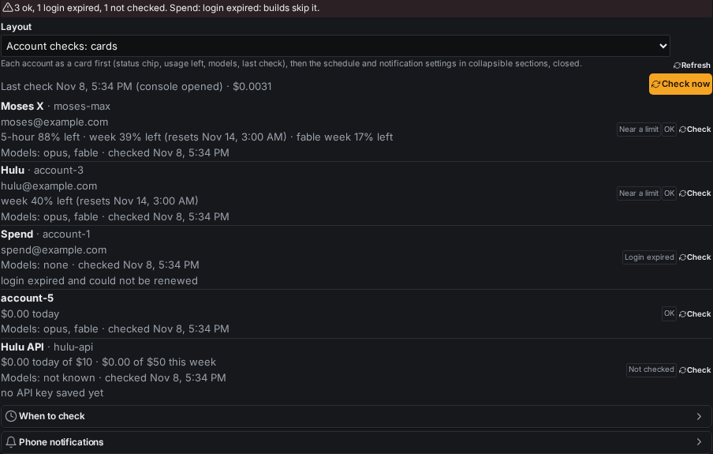

# Account health check + one shared status store (account-health-failover)

Build `account-health-failover` (Opus, Nov 8 2026), branch `claude/account-health-failover`, stacked on
`claude/account-failover-notify` (PR #392), which is stacked on #389. Land #389, then #392, then this one.

Brett asked for five parts (A-E). B (failover), C (phone alert on every account problem) and D (one home per login, why
account-1's refresh failed) were already built by the parallel build `account-failover-notify` (#392) when this one
started, so they were not built twice. This build adds **A** (the health check and its shared store) and **E** (the
before/after phone notifications), and wires both into B and C. account-1's story (part D) is in
`_claude/builds/reports/account-failover-notify.md` → "What happened to account-1".

## A. Health check

`deploy/claude-account-probe.mjs` checks every saved account:

- **Subscription:** a tiny headless session on a private copy of the login with every shared link removed: no
  CLAUDE.md, no settings or hooks, no MCP servers, no tools, a one-line system prompt, an empty cwd, nothing saved
  (`claude -p "Reply…" --model opus --tools "" --strict-mcp-config --setting-sources "" --system-prompt …`). `--bare`
  can't be used: it never reads OAuth. About 360 input tokens (≈ $0.0015 list price, nothing extra on a subscription).
  It proves the login works and renews the token if due (the renewal goes to the login's one home through
  `claude-login.mjs release`). Then two free reads with the token: `/api/oauth/usage` (5-hour and weekly use, resets,
  per-model weekly caps such as Fable, extra-usage credits) and `/v1/models`. A setup-token login can't read usage: its
  numbers come from the session's rate-limit event.
- **API key:** the free `/v1/models` (proves the key, lists models) and a 1-token Opus message (≈ $0.0001), the only way
  to see "credit balance is too low". Anthropic has no balance API, so "credits left" for a key is the last-known spend
  against its daily and weekly caps.
- **When:** every 60 min (the host's minute sweep runs `probe due`), when a console opens (skipped within 15 min of the
  last check), on Check now / voice / MCP. The console never runs anything on the host. It writes
  `account-probe-request.json` in the shared data folder and the sweep starts the check within a minute. That keeps
  host writes off the console's read channel and out of the veto queue.
- **Cost, measured live (Nov 8 17:33 UTC, 6 accounts):** $0.0031 in total, 2-6 s per account, in parallel.

That live run found: account-1 expired ("OAuth session expired and could not be refreshed"), Hulu ok (weekly 40 %
left; the "out until 21:58" limit from earlier was stale), Moses X ok (Fable weekly cap 83 % used), account-5 (API) ok,
the two API slots without a key "not checked".

## The one shared store: account-status@1

`deploy/account-status.mjs` defines `account-status.json` in the claude-accounts data folder (shared by host and console):
per account `status` (ok / limited / no-credits / expired / unknown), `why`, `warn` (80 %+), `checkedAt`, `source`
(probe / failover / clear), `until`, login validity and a 16-character login hash, usage windows, per-model caps, extra
credits, API spend vs caps, `models` (opus / fable it can use now), probe time and cost; plus the last `run`. No credential.

Writers: the probe, failover (`claude-workers.mjs markLimit` writes it at once), a by-hand clear. Readers:

| Reader | How |
| --- | --- |
| Routing (launcher) | `claude-workers.mjs status` adds the store's limit and models to each row; `worker-routing.mjs decide` only runs or queues a job on an account whose models hold the job's model. An expired / limited / no-credits account takes nothing until `until`, a new sign-in (login hash changes) or a newer ok check. Never checked or older than 6 h = not blocked (a fresh install never stops every build). |
| Claude accounts screen | new panel **Account checks** (status per account, Check now, settings); the accounts view carries `health` on each row |
| Usage badge | capability `axf.account-status@1`: every usage row gets the check's status, models and time; a row the host read missed takes the check's newer numbers; API keys show spend vs cap |
| Systems check | *Claude account checks*: red when a check finds a login expired or no credits |

## E. Phone notifications (type `account-status`)

Through the console alert hub and axf.notify@1 (`notify.json` type `account-status`, AmberX on, keys
`claude-accounts:status:<run>:start|result`, so each check pushes and a repeat never buzzes twice):

1. start: "Checking 6 Claude accounts" (names; "the result follows in a minute")
2. result: "Claude accounts: 3 ok, 1 login expired, 2 not checked", one line per account
   (`Moses X: ok · week 39% left · opus+fable`), then what to do ("Sign account-1 in again."). The start alert closes.

Sent for console openings and by-hand checks by default (*notifyRuns* load | all | off). A check that finds a new
problem also raises the #392 problem alert (`claude-accounts.problem`, one per account and problem); an account that
comes back ok leaves the limits and its alert closes. The AmberX notification panel build (`amberx-notify-panel`) had
nothing committed yet: it picks the type up from `notify.json` like every other notify-types@1 entry.

## Control (API, voice, MCP, CLI)

- REST: `GET/POST /api/plugins/claude-accounts/checks`, `POST …/checks/settings`
- Commands (MCP, voice, CLI through plugin-commands): `checks`, `check`, `checks-set`
- CLI on the host: `node deploy/claude-account-probe.mjs run [--trigger …] [--account a,b] [--background]`, `due`,
  `show`; `node deploy/account-status.mjs show|able <name> --model fable`
- Settings (`workers.json` → `probe`, Settings → Plugins → Claude accounts → Account checks, collapsible sections):
  *When to check* (enabled, intervalMin 10-1440, onLoad, loadGapMin 0-240, session, apiMessage) and
  *Phone notifications* (notifyRuns, alertProblems); timeoutSec via API.

## UI Review

`r-20261108-1492a8a6`, three layouts as settings assets (`claude-accounts-checks-cards` default, `-sections`,
`-compact`), desktop + phone shots in `account-health-failover/shots/`.

## Tests

| Suite | Before | After |
| --- | --- | --- |
| `deploy/account-health.test.mjs` (new) | — | 67 (store, ableFor, routing reads the store, model filter, failover writes, parsers, classify, API probe with a fake network, a whole run with notifications, load gap, no double run, console requests, due, settings) |
| `deploy/claude-workers.test.mjs` | 65 | 65 (resets the store between cases) |
| `deploy/account-failover.test.mjs` | 50 | 50 (same) |
| `deploy/worker-routing.test.mjs`, `claude-login.test.mjs` | 44, 57 | 44, 57 |
| claude-accounts `test.py` | 105 | 120 |
| claude-badge `test.py` / `test.mts` | 73 / 49 | 77 / 49 |
| notify-control `test.py` | 132 | 132 |

Also clean: tsc, check-theme, check-controls, check-toolbars, check-chrome-assets, help coverage, glossary catalog,
plugin lifecycle (claude-accounts, claude-badge), plugin-commands.

## Overlaps

- `account-failover-notify` (#392): B, C, D; this build stacks on it.
- Pending `running-builds-follow-the-active-claude-account-fail-over-when-it-dies` and
  `auto-switch-claude-account-when-the-active-one-r` are about the console's own account; the store answers their
  "which account can work" question (`axf.account-status@1` → `able`). A note is left on each.

## Known gaps

- A setup-token login (account-3 Hulu) shows only the window its session reported (weekly here), not the 5-hour one.
- The scheduled check needs the minute sweep cron (`axf-claude-token-save`), which exists on the VPS since Nov 7.
- No Kotlin twin: Android is on hold, and this is a console plugin plus host scripts, not a framework engine.
