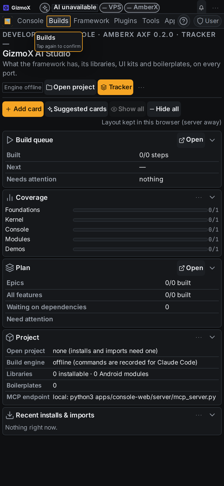
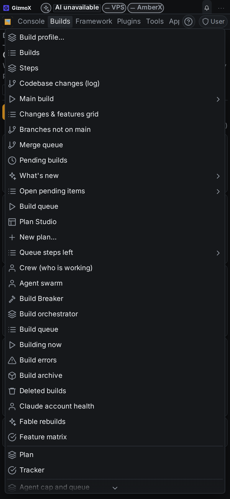
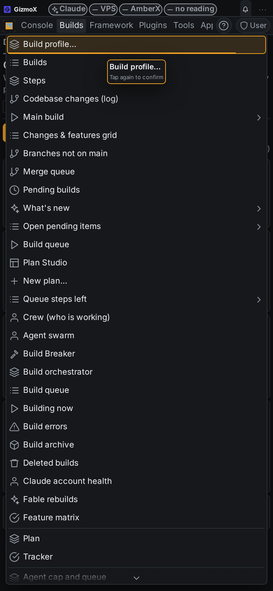
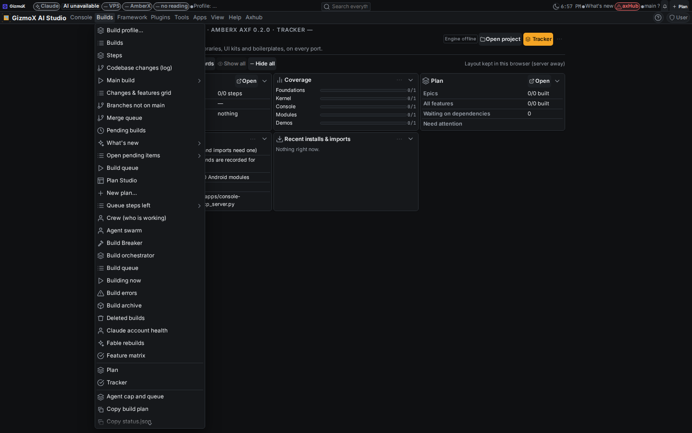
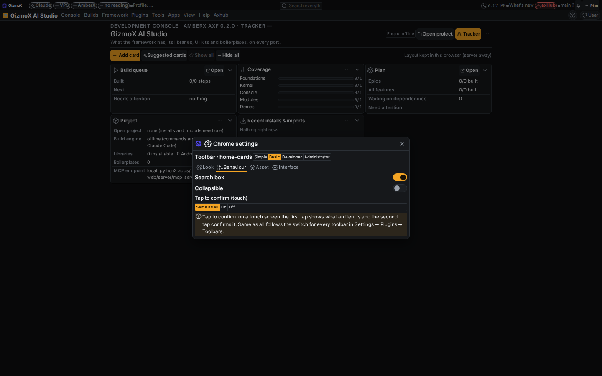

# add-a-tap-to-confirm-option-to-every-settings-in — Tap to confirm in every settings interface

Build `add-a-tap-to-confirm-option-to-every-settings-in` (Phase 1, Opus). Brett, Nov 12 2026 (voice) + Addenda 1 and 2.
Branch `claude/add-a-tap-to-confirm-option-to-every-settings-in`. Status: **s1–s3 done**.

> "You'll put the tap to confirm option in all tab um, tab group settings, navigation menus, application menus,
> toolbars, put tap to confirm option in all of them. In all their settings interfaces."
> Addendum 1: "And any any plugin or UI that has a custom settings interface, it uses that by default. And new and existing."
> Addendum 2: "…the first tap, instead of saying tap to confirm, they show what it is and tap to confirm."

## Summary

- **One behaviour, every kind.** Before this build, tap to confirm worked only on toolbars (build `toolbar-tap-confirm`).
  It now also works on:
  - tabs and tab groups (including a row's More / dropdown list)
  - navigation menus
  - application menus (the menu bar and its menus)
  - context menus
  - banners

  The same framework listener (installed by `<AxfProvider>`) handles all of them, so new ones get it with no code.
- **In every settings interface.** chrome-settings@1 gives each chrome kind a **Tap to confirm (touch)** field on its
  Behaviour tab: *Same as all / On / Off*.
  - Every right-click / long-press **Settings…** dialog shows it. That covers each tab group, toolbar, navigation
    menu, application menu, context menu and banner.
  - Every custom settings interface shows it by default (Addendum 1). The field comes from the shared registry, so it
    appears in the shared default `settings/chrome-<type>`, in each app's custom copy `chrome-<type>-<app>`, and in
    any copy made later. No asset edit was needed.
  - Plugin settings pages can show it too, with the new framework control `<TapConfirmChoice kind instance>`. The nav
    settings page (Molly's Navigation plugin, Behaviour) now uses it.
- **Switches for each kind.** Settings → Plugins → Toolbars → Tap to confirm has one switch per kind (toolbars, tabs
  and tab groups, navigation menus, application menus, context menus, banners), all on by default, plus the arm window
  (3 s by default). An item's own choice beats its kind's switch.
- **First tap = what it is + "Tap again to confirm" (Addendum 2).** The tip shows the item's name or description,
  then *Tap again to confirm* (it used to say *Tap again to run*).
- **Touch only.** Mouse, trackpad, pen and keyboard still act on one click, as before.

## How it is reached (API)

| What | Console API / MCP (`console_action`) | CLI / voice |
|---|---|---|
| Open an item's settings (deep link) | `chrome.settings:<type>:<instance>`, e.g. `chrome.settings:tab-group:ui-review.sections` | same action through `axf.mjs` / AmberX ("open tab group settings") |
| One item's choice | `tapconfirm.item:<type>:<instance>:<inherit\|on\|off>` (or `chrome.set:<type>:<instance>:tapConfirm:<value>`) | same |
| A whole kind | `tapconfirm.kind:<toolbar\|tab-group\|nav-menu\|app-menu\|context-menu\|banner>:<on\|off>` | same |
| Arm window | `tapconfirm.window:<ms>` (clamped to 1000–10000) | same |
| Read state | settings `axf.chrome.<type>.<instance>` → `tapConfirm`, `axf.tapConfirm.<kind>` (toolbars: `axf.toolbars.tapConfirm`), `axf.toolbars.armMs` (`console_list settings`) | same |

## What changed

- `framework/core/engines/chrome-settings-rules.mjs`:
  - adds the `tapConfirm` field to every chrome type (`CHROME_TAP_FIELD`, `CHROME_TAP_OPTIONS`);
  - marks it `instanceOnly: true`: it is a choice of the item, not a field of the asset type, so `asset-types.json` is
    unchanged and no schema change was needed.
- `framework/core/engines/tapconfirm.ts`:
  - `TAP_KINDS` and `tapKindKey`;
  - `tapConfigFor(get, kind, instance)`: the item's choice, else the toolbar's older `axf.toolbar.<id>.tapConfirm`,
    else the kind's switch;
  - `TAP_HINT`.
- `framework/react/tapConfirm.ts`:
  - `tapSurfaceOf(el)` maps any element to its kind and its chrome settings instance. That is the same id its context
    menu opens, so the dialog's choice is the one the tap reads.
  - The listener now covers every kind.
- `framework/react/components/ChromeContext.tsx`:
  - adds the `tapconfirm.item | kind | window` actions;
  - `setChromeField` drops a value that equals the field default;
  - the Behaviour note in the dialog explains the option.
- `framework/react/components/TapConfirmChoice.tsx` (new), used in `NavStyleSettings.tsx` (Behaviour).
- `framework/libs/toolbars`: the per-kind switches.
- Baked into console-web, axhub-web, amberx-droid and molly (`src/axf`). The lock hashes are updated, so these files
  aren't flagged as edited.
- Not baked into walkthrough-studio and demo. Their framework copies are already stale (they predate
  chrome-settings@1). They get this on their next `rebake.mjs apply`; until then walkthrough-studio keeps
  toolbar-only tap to confirm.
- Android twin deferred: recorded in `framework/spec/PORTING.md`.

## Screenshots

From the console's Vite build, with the hub off (local look).

| | |
|---|---|
| Phone, first tap on the Builds menu: lit, tip "Builds · Tap again to confirm" |  |
| Phone, second tap opened the menu |  |
| Phone, first tap on a menu item: "Build profile… · Tap again to confirm" |  |
| Desktop, one mouse click opens the menu (no arm, no tip) |  |
| Desktop, Toolbar settings → Behaviour → Tap to confirm (touch) |  |

The Playwright run logged:

- phone, first tap: `armed 1, tip "Builds / Tap again to confirm"`;
- phone, second tap: `armed 0, menu open`;
- desktop, one click: `armed 0, tip none, menu open`.

## Tests and checks

| Check | Result |
|---|---|
| `npx -y tsx framework/spec/check-tapconfirm.mts` | 80/80. It was 40; the new checks cover every kind, item vs kind switches, the older toolbar key, surface detection for tabs / More list / nav / previews / menu bar / context menu / banner, and the tip text. |
| `npx -y tsx framework/spec/check-chrome-settings.mts` (fixture regenerated) | 282 ✓ |
| `check-chrome.mts` | ✓ |
| `check-theme` | ✓ |
| `check-controls` | ✓ |
| `check-toolbars` | ✓ |
| `check-chrome-assets` | ✓ |
| `chrome-settings.mjs check` | ✓ |
| `tsc --noEmit`: console-web, axhub-web, amberx-droid, molly | clean |
| `help-coverage --check` | ✗, but not from this build. It fails on `apps/console-web/plugins/agent-slots/help.json` entries[2].kind, a file this build doesn't touch. |

## Known gaps

- **The console's top menu bar sits outside `.fx-shell`.** Right-clicking it doesn't open the shared context menu
  (the context host ignores anything outside the shell). Its Application menu settings are still reachable through
  `chrome.settings:app-menu:app` and the Settings dialog of any other chrome. Tap to confirm itself works on it (see
  the shots).
- **Other toolbar editors don't show the choice yet.** lib-workspace `ToolbarCustomizer` and Molly's
  `toolbar-designer` don't have the control. Those toolbars get it through their right-click Settings dialog and the
  Toolbars → All toolbars list.
- **Molly was type-checked with axhub-web's node_modules** (Molly has none installed in this worktree).
