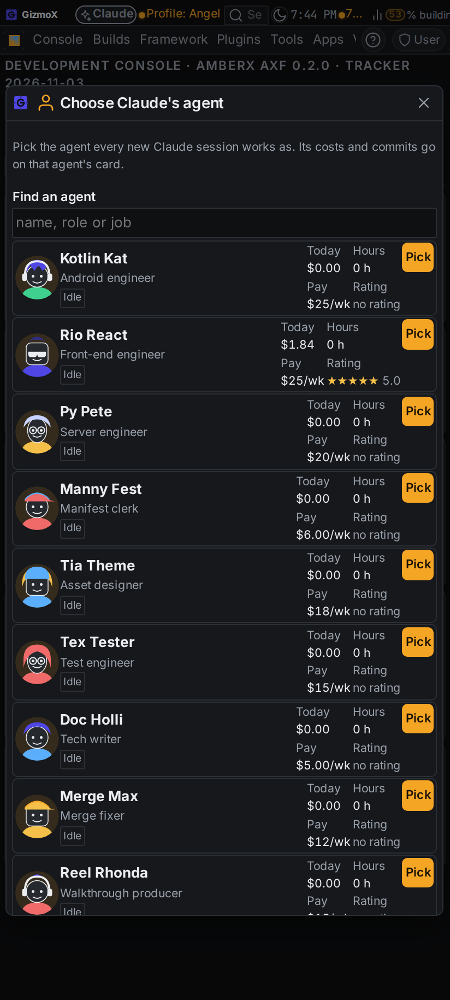
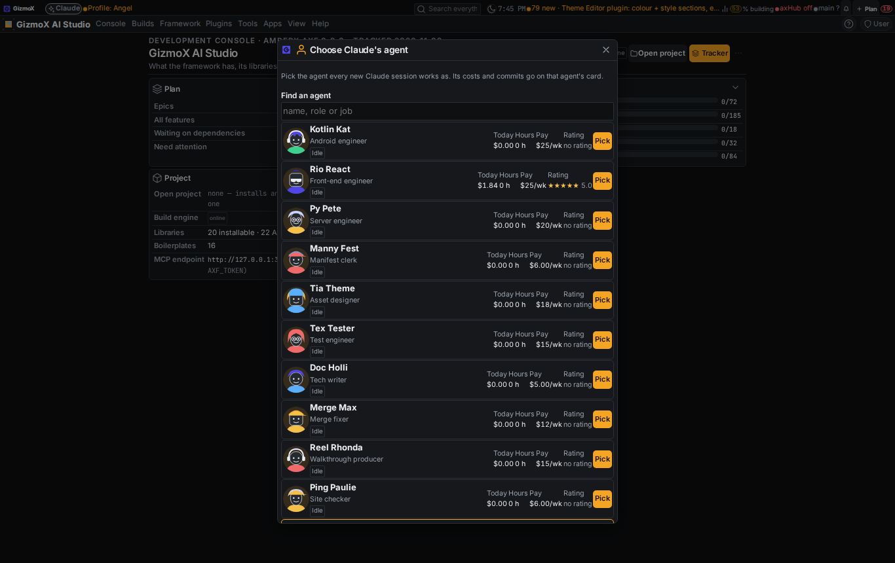
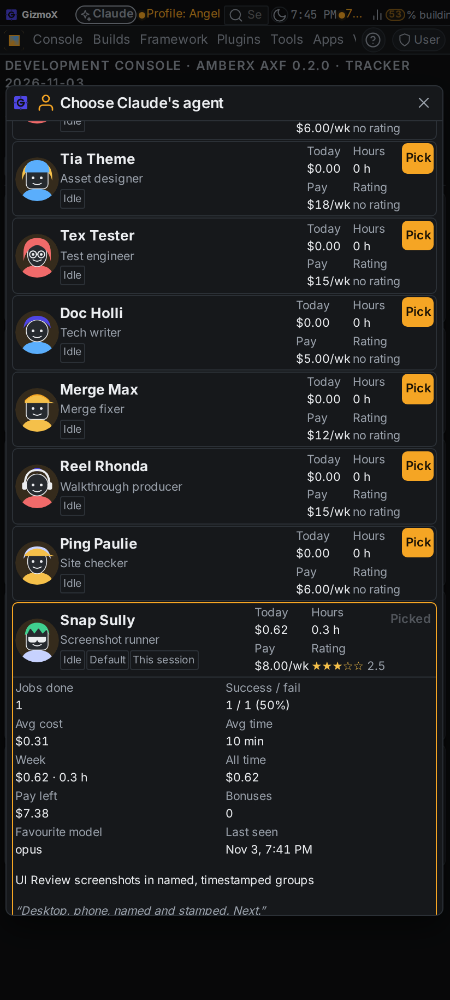
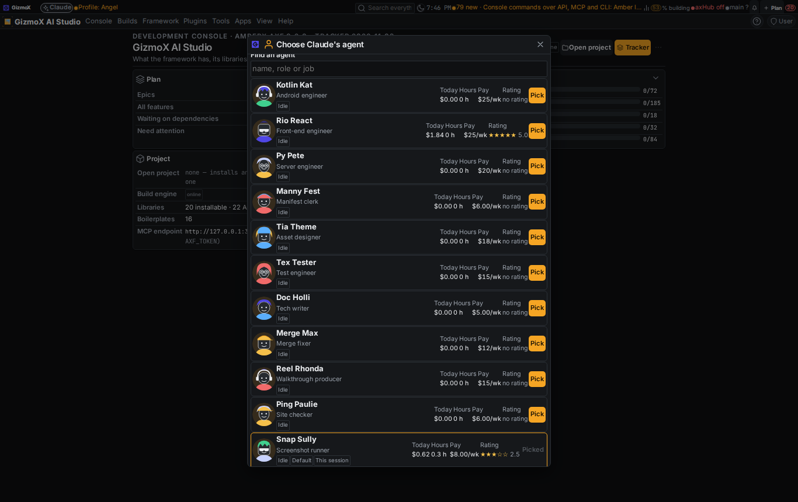
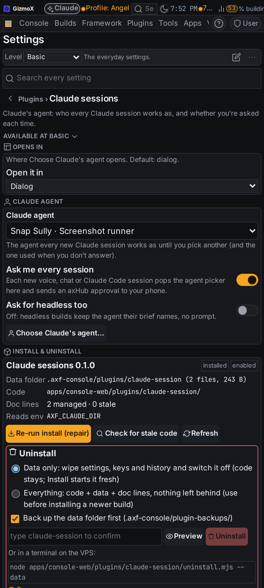
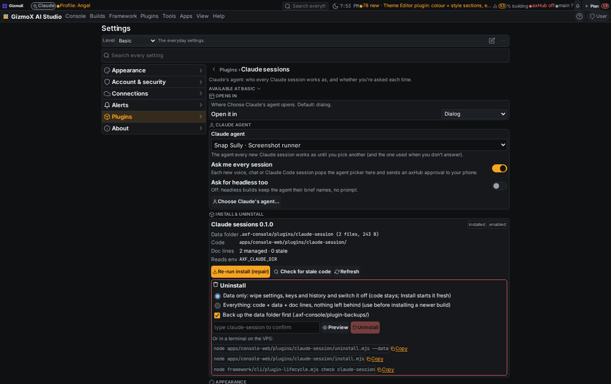
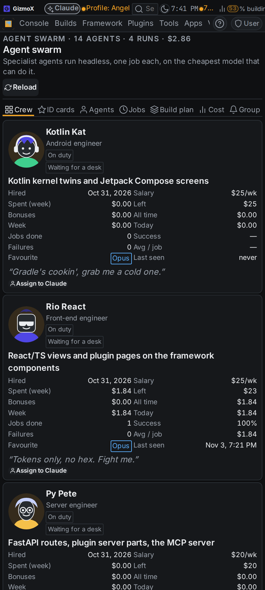
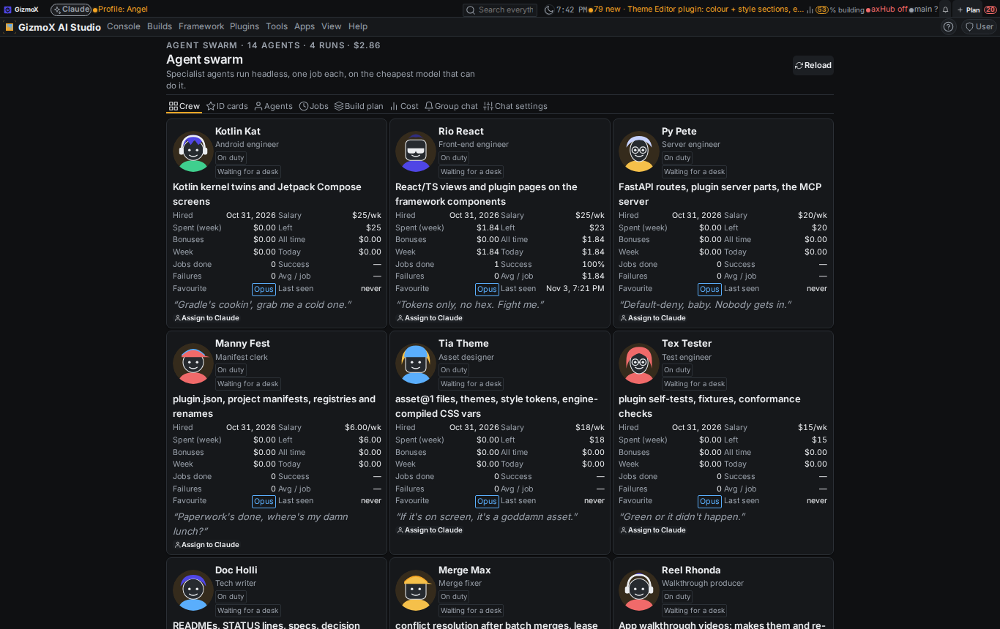

# agent-pick: every Claude session works as the agent Brett assigns

Build `agent-pick` (Urgent profile), Brett, Nov 3 2026 (voice). Model: Opus (every step pinned Opus; no upgrade).
Branch `claude/agent-pick`. Booked on **Snap Sully** (assigned agent; the all-rounder router from crew-retrain #265
is not on main yet, so no reassignment happened).

## What landed

**New console plugin `claude-session` (agent-pick@1)**, `apps/console-web/plugins/claude-session/`:

- `claude_session_start {client: voice|chat|code|headless, summary, agent?, session?}` — every session calls it
  first. Answers the agent to work as now (id, name, avatar, persona / voice notes, `intro`, `env.AXF_AGENT`).
- **Ask me every session** (default ON): the session gets `asking: true` and works as the **default agent**; Brett
  gets (1) the picker as a console pop-up (ask watcher, his signed-in browser only), (2) a bell item, (3) one held
  axHub approval `axf.claude_session_answer` with a plain reason ("Claude session: work as Snap Sully?"), which is
  what reaches his phone through the AmberX app. An unanswered ask lapses to the default after 30 min.
- Headless builds keep their brief's named agent (no prompt) unless **Ask for headless too** is on.
- `claude_session_agent {session}` (read, fit for axHub `allow`) tells a session who it is and whether the pick is
  pending; it switches when Brett picks.
- `claude_session_answer` only counts from Brett: his own signed-in console click, or the axHub approval carrying the
  ask's one-time ticket. Tickets are never shown to a session; a session answering itself gets 403.
- `claude_session_book {session, usd, usage?, model?, summary?, commits?, branch?, build?, final?}` books cost, time
  and commits on the agent's card; `final: true` closes the run and posts it in the group chat.
- `claude_session_assign`, `claude_session_persona` (persona / voice notes per agent), settings get/set, picker, asks.
- Commands are declared once (server routes + plugin.json `commands.items`) and project to REST, MCP
  (`claude_session_*`) and CLI (`axf claude-session …`) through plugin-commands@1.

**UI** (screenshots below):

- Picker dialog `claude.picker`: every crew agent with avatar, Working / Idle, current job, today's cost, hours, pay,
  rating, chips for Default / This session; tap a row for jobs done, success / fail, average cost and time, week and
  all-time spend, pay left, bonuses, favourite model, last seen, recent runs, write-ups, raises, persona / voice
  editor, and links to Card, History, Session browser, Terminal, Group chat. One tap on **Pick** picks.
- **Choose Claude's agent…** in the right-click menu everywhere and in Plugins; **Assign to Claude** under every crew
  card and on the profile (new slot `swarm.agent.actions`) and in the agent context menu (`agent` target).
- Settings → Plugins → **Claude sessions**: Claude agent, Ask me every session, Ask for headless too, recent sessions.

**Agent swarm:** capability `axf.crew@1` (`crew()` compact crew read with status, pay, spend, minutes, stats, feed,
raises, write-ups; `book(entry)`), `swarm.mjs crew` / `swarm.mjs book`. A session is a `job` run of type
`agent-session` (no agent@1 / swarm-run@1 contract change). Open session runs don't count as failures.

**Rule:** shared `RULES.md` → Sessions ("Every Claude session works as the agent Brett assigns") and `CLAUDE.md`
conventions; the console MCP instructions say it too.

## Tests

| Check | Before | After |
|---|---|---|
| `python3 apps/console-web/plugins/claude-session/test.py` (zero tokens, assign, settings, ask on / off, default fallback, lapse, headless, only-Brett answers, fake-axHub approval round trip, booking on the right card, MCP tool names) | — | 57/57 |
| `node apps/console-web/plugins/agent-swarm/test.mjs` (+ booking, crew, open run ≠ failure) | 93 | 94 |
| `python3 apps/console-web/server/test_mcp_tools.py` | pass | pass (139) |
| `plugin-lifecycle.mjs check claude-session` / `agent-swarm` | — / clean | clean / clean |
| `check-theme.mjs`, `check-controls.mjs` (new files) | — | 0 findings |
| `help-coverage.mjs --check` | ok | ok (19 entries for the plugin) |
| console `tsc --noEmit` | ok | ok |
| real console app: `GET /api/plugins/claude-session/picker` | — | 200, live crew numbers |

## Screenshots

`_claude/builds/reports/agent-pick/shots/after/` (offline console, `AXF_APPEARANCE_HUB=off`, scratch crew runs):

| | Phone | Desktop |
|---|---|---|
| Picker |  |  |
| Row expanded |  |  |
| Settings |  |  |
| Breakroom: Assign to Claude |  |  |

## Decisions and deviations

- **Tool names:** the plugin folder can't be `claude` (the lifecycle check flags every `"claude"` string in other
  plugins), so it is `claude-session`: `claude_session_start` is exact; *claude_agent_get* became
  **`claude_session_agent`**. The settings route is `agent-settings` so it never collides with claude-settings'
  planned `claude_settings_get` / `_set`.
- **Persona / voice** live in this plugin's store keyed by agent id, not on agent@1 (a contract change = Fable work).
- **Picker crew** = the Breakroom crew (swarm roster + hires). The Agent manager's LLM agents (Vinny, Molly…) are a
  different kind of agent and are not offered.

## Built against contracts (not on main yet)

- **claude-settings** (pending): its registry should list the three settings here; note left on that build.
- **follow-amber** (pending): the pop-up goes through this plugin's own ask watcher until follow-amber's stream lands;
  note left on that build.
- **crew-live** (#273, conflicting): `agent` context target, `agent-swarm.profile:` and `crew.*` actions are used when
  present, with Breakroom fallbacks; faces drawn with the framework card rules instead of `AgentAvatar`.
- **crew-retrain** (#265): hourly pay / rating show when the crew data carries them; until then pay = weekly salary,
  rating = success rate on five stars.

## Known gaps

- Sessions call `claude_session_start` / `claude_session_book` because the rule says so; no hook does it for them
  yet (the codebase-changes Stop hook could book the final cost automatically; worth a small build).
- `deploy/claude-headless.sh` already passes `AXF_AGENT`; it doesn't call `session-start` itself.
- No Android twin (Android on hold); nothing in the kernel changed.
- `_claude/shared/rules/RULES.md` was held by claude-sync at session start (changed on both sides); the rule line is
  committed here, and the hold still needs Brett's keep-local/keep-hub call.
