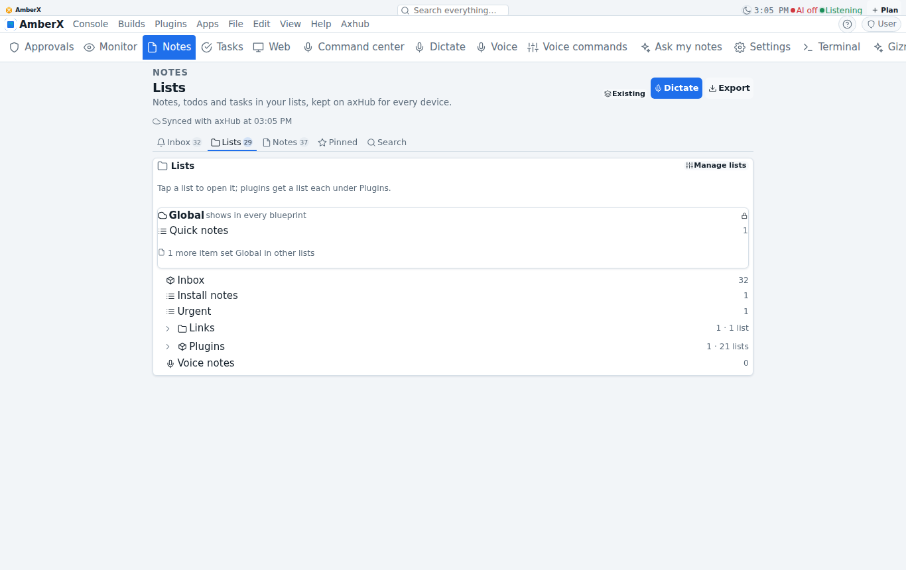
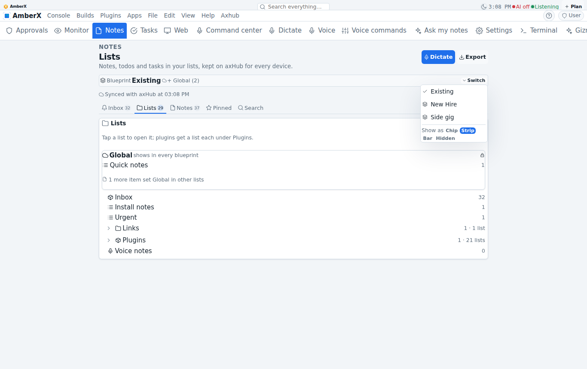
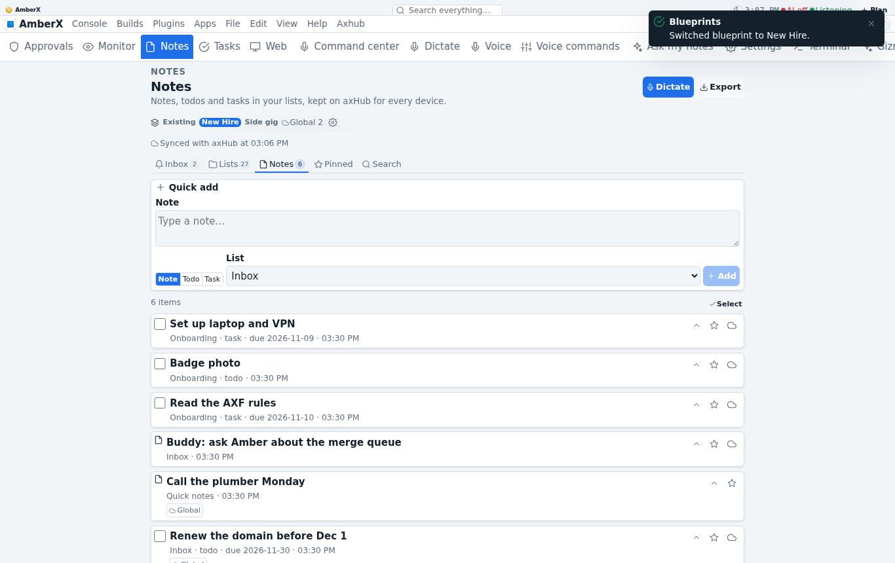
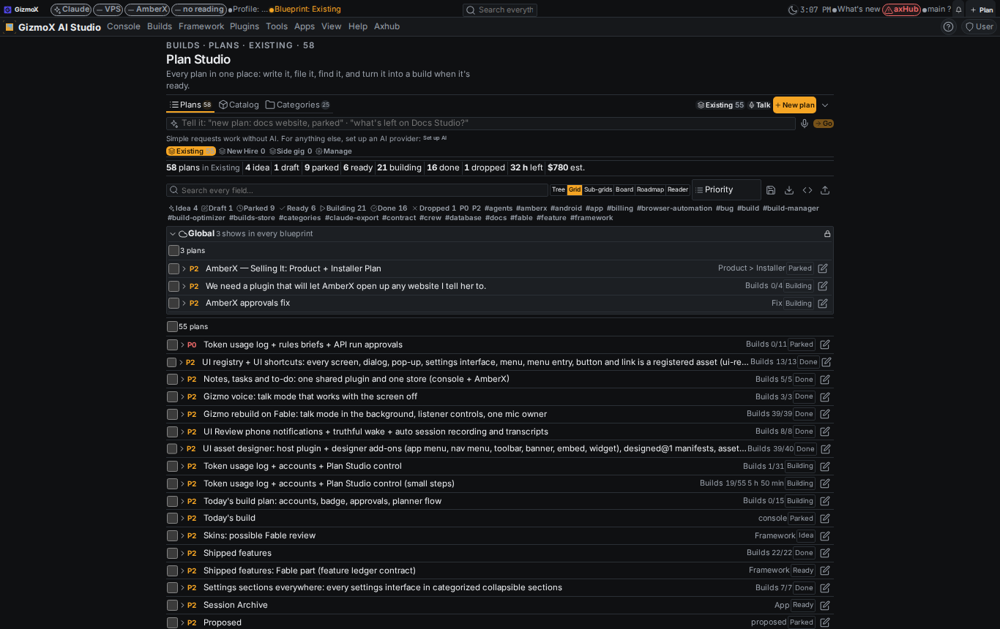

# Blueprints switch notes, tasks and to-dos too + permanent Global group (blueprint-notes-tasks)

## Brett said (verbatim)

> Source: headless brief · At: 2026-11-07
>
> Blueprints switch notes, tasks and to-dos too (Brett, Nov 7)
>
> 1. Switching the active blueprint switches EVERYTHING scoped to it: Plan Studio plans, AND AmberX/console notes, tasks, to-do items and lists (notes-tasks plugin, amberx.items, amberx.lists).
> 2. Items/lists get an optional `blueprint` field (backward compatible). Existing notes/tasks/to-dos go to the same blueprint the existing plans went to.
> 3. Global lists: some lists are shared across all blueprints. "Quick notes" is global by default. A per-list switch "show in every blueprint".
> 4. Voice: "add X to quick notes" always works; "switch blueprint to X" switches all of it. control@1, MCP, CLI.
> 5. Active blueprint visible in AmberX and the console (chip), settings in place, assets only, no hard-coded styling. UI Review three options (--choices).
> 6. Tests: switch filters plans + notes + tasks + to-dos; global lists stay; nothing lost. Add to Shipped features.

## Addendum 1 (Brett, Nov 7 2026 (brief))

> Notes/tasks/to-do manager AND Plan Studio each get a permanent group called **Global** (can't be deleted or moved).
> Global holds repo-wide items: they show no matter which blueprint is open.
> Any plan, note, task, to-do or list can be set to Global (toggle + drag in), and back.
> Quick notes lives in Global by default. Replaces the per-list "show in every blueprint" switch: Global is that switch.

**Model:** Opus, every step. **Branch:** `claude/blueprint-notes-tasks` (on top of `claude/plan-blueprints`, merged in as the
base because that build is built but not pushed or merged yet). Committed, not pushed (as the brief asked).

## What changed

- **One switch for everything.** Plan Studio's `plan-studio/blueprints.json` (plan-blueprints@1) stays the only record of the
  active blueprint. The AmberX notes core now reads it too, so switching anywhere (Plan Studio, AmberX, voice, MCP, CLI,
  control@1) switches plans, notes, tasks, to-dos and lists together, on every device.
- **Optional `blueprint` field on items and lists** (amberx-notes@1, backward compatible: missing = the default blueprint).
  New rows are filed in the active blueprint, centrally (AmberX `mutate`, the control@1 runner, voice intents).
- **Permanent Global group** (reserved id `global`, never a blueprint): shows in every blueprint; can't be switched to,
  renamed, described, duplicated, made the default, moved or deleted, and no blueprint can take its name or id. Plans,
  notes, tasks, to-dos and lists go in and out with a Global toggle, drag and drop (desktop), `move {blueprint: "global"}` or
  act `global {on}`. A list in Global brings everything in it (sub-lists too). Quick notes lives in Global and is made when
  missing. This replaces the per-list "show in every blueprint" switch, as the addendum says.
- **System lists** (Inbox, Plugins, Voice notes, plugin lists) are containers shown in every blueprint; the items in them
  are scoped one by one. A list that holds a shown item always shows, so nothing hides behind its list.
- **Voice** (AmberX notes parser + Plan Studio's plain-English rules): "switch blueprint to X" / "open the X blueprint"
  (switches all of it), "make the X list global", "make X global", "take X out of global", "add X to quick notes" (always
  works). Global is refused as a switch target with a plain answer.
- **control@1 / MCP / CLI:** `amberx.items` and `amberx.lists` gain field + `select.blueprint` (id, name, `global`, `all`)
  and act `global {on}`; `planner.plans` gains act `global {on}` and `move {blueprint: "global"}`; snapshot, fixtures,
  CONTROL.md, MCP docstrings, CLI docs (`axf note global <id>`, `axf list global <id>`, `axf plan global <id>`),
  `plans.mjs blueprint global <plan id>… [--off]`. Baked control registry refreshed in console-web and AmberX.
- **UI:**
  - Plan Studio: the Global group is drawn first in the plans view (a lock, its count, "shows in every blueprint"), drop
    target; the plans below are a drop target to take a plan back; each plan row has *Set Global* / *Global*; the Blueprint
    picker offers *Global (every blueprint)*.
  - Console: *Blueprint: <name>* on the main banner (framework status widget, tap = manage blueprints; setting *Active
    blueprint chip on the main banner* in Settings → Plugins → Plan Studio).
  - AmberX Notes and Tasks: the active blueprint as a **chip** (default), a **strip** or a **bar** (setting
    `amberx.blueprints.show`, changeable in place from its own menu, also *Hidden*); the Lists tab starts with the Global
    group; every note card and list has the Global toggle (cloud); drag in / out on desktop. Tokens and framework controls
    only.
- **Migration (live hub, 15:09 UTC):** `node apps/console-web/plugins/token-control/amberx-blueprints.mjs migrate` filed 35
  items and 5 lists in **Existing** (where the 58 plans went) and Quick notes in **Global**. Checked before writing: no field
  beyond `blueprint` / `updatedAt` changed on any row. Backup:
  `~/hub/data/amberx-axf/backups/amberx-notes-before-blueprints-20261107`. File owner/mode restored to deploy 664.

## UI Review

Item `r-20261107-b05bba4e`, group "blueprint-notes-tasks - Nov 7 3:10 PM", 33 shots. Three options as `toolbar` assets in
`apps/console-web/plugins/plan-studio/assets/toolbar/blueprints-switch-notes-mw6jh0wp-{chip,strip,bar}.json` (how AmberX shows
the active blueprint; the toolbar type holds several views, so he can pick more than one in order). Shared shots: Plan
Studio's Global group and the console banner chip.

| Chip (default) | Strip | Bar |
| --- | --- | --- |
|  |  |  |

Console: 

## Tests

| suite | before | after |
| --- | --- | --- |
| AmberX `npx -y tsx apps/amberx-droid/test.mjs` | 2316 | 2372 (blueprint scope, migration nothing-lost, switch filters notes/tasks/to-dos, Global stays, voice) |
| Plan Studio `test.mjs` | 30 | 32 (Global permanence, delete/duplicate leave it alone, store + CLI) |
| token-control `test.mjs` | 21 | 22 (one switch moves plans + AmberX notes, tasks, to-dos, lists; Quick notes; Global list; nothing lost) |
| plan-studio server `test.py` | 19 | 19 |
| check-control | 376 | 376 |

Also green: console and AmberX `tsc` + `vite build`, check-theme, check-controls, check-toolbars, check-chrome-assets,
help coverage 100 % (2 new entries written), plugin-lifecycle (plan-studio, token-control), plugin commands, plugins
`--check`, plugin pages.

## Shipped features

The Shipped features plugin isn't on main (same as for plan-blueprints); What's new reads this report's *What changed*
once the branch merges.

## Known gaps / for Brett

- **Not pushed, no PR**, as the brief said. It sits on top of `claude/plan-blueprints` (also local only): they land
  together, plan-blueprints first or as one stack.
- **The console's Todo manager plugin** (the xGallery port, its own SQLite store) is not scoped by blueprint: the brief
  named the notes-tasks plugin and `amberx.items` / `amberx.lists`, which is the AmberX notes store. Say if the Todo
  manager should follow too.
- **The installed AmberX app is the old one** until the next AmberX build ships: it shows every row, and when it edits a
  row it drops the `blueprint` field, which then reads as the default (Existing). Nothing is lost.
- The console's banner chip follows a switch made on another device when Plan Studio's state is read again (page load or
  Plan Studio open), not instantly.
- Writes from the host shell (control@1 CLI, this migration) leave root-owned files on /projects; the migration's were put
  back to deploy 664. Same as before this build for any host-side control write.
- **Model:** the `blueprint` field and Global id extend Fable-built contracts (plan@1 / blueprint@1, amberx-notes@1,
  control@1) additively; done on Opus. Per the rule, a Fable review of the contract part is worth adding to
  `fable-review-nov3`-style review before merge.
- Kotlin twin: none needed (the notes core and plan@1 have no Kotlin reader; control@1's Kotlin twin stays deferred in
  PORTING.md).
