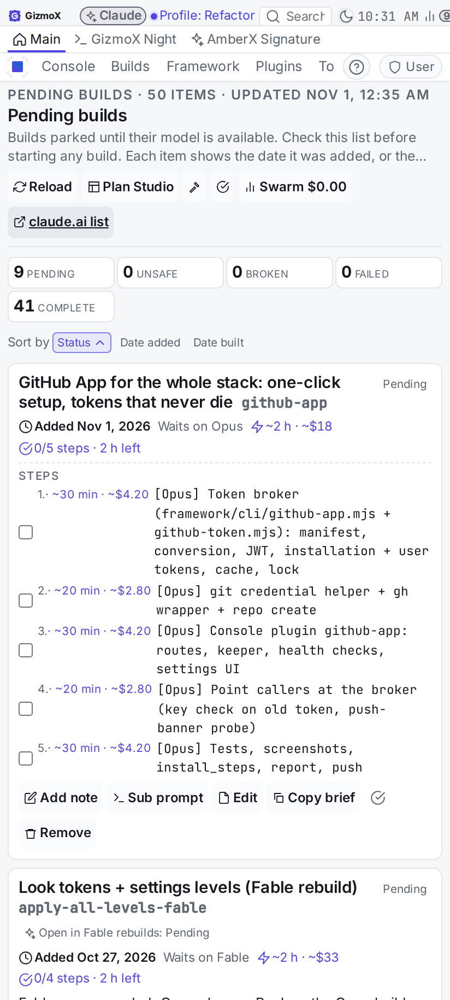
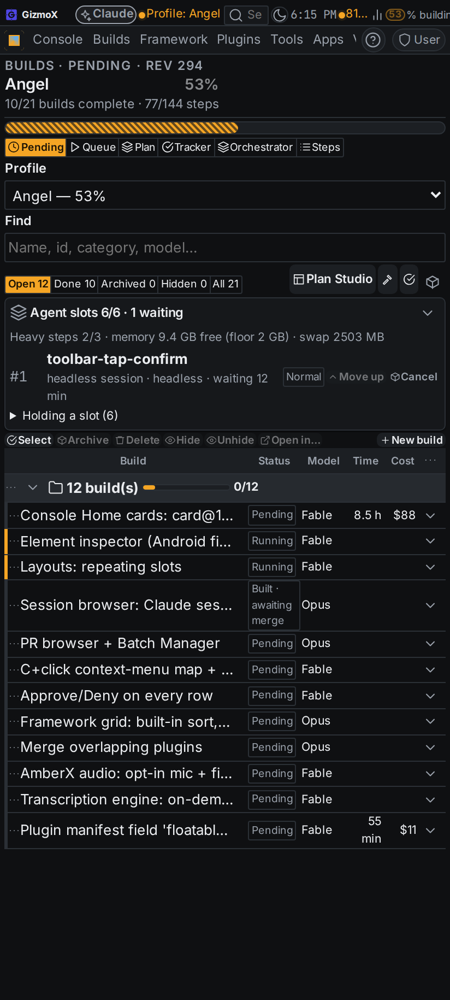
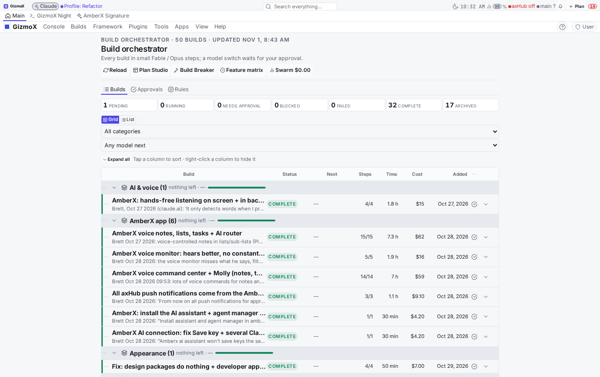
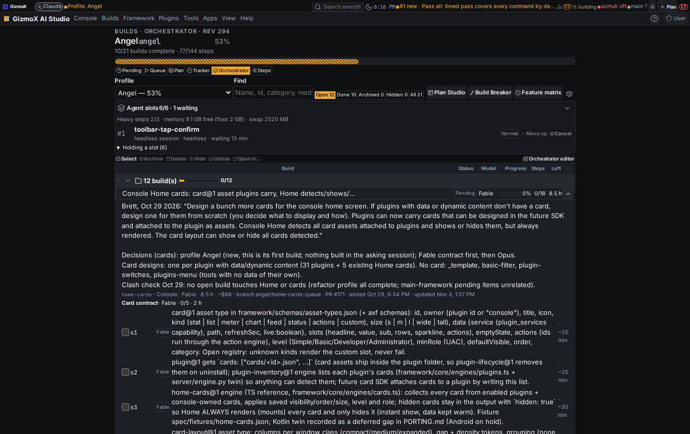
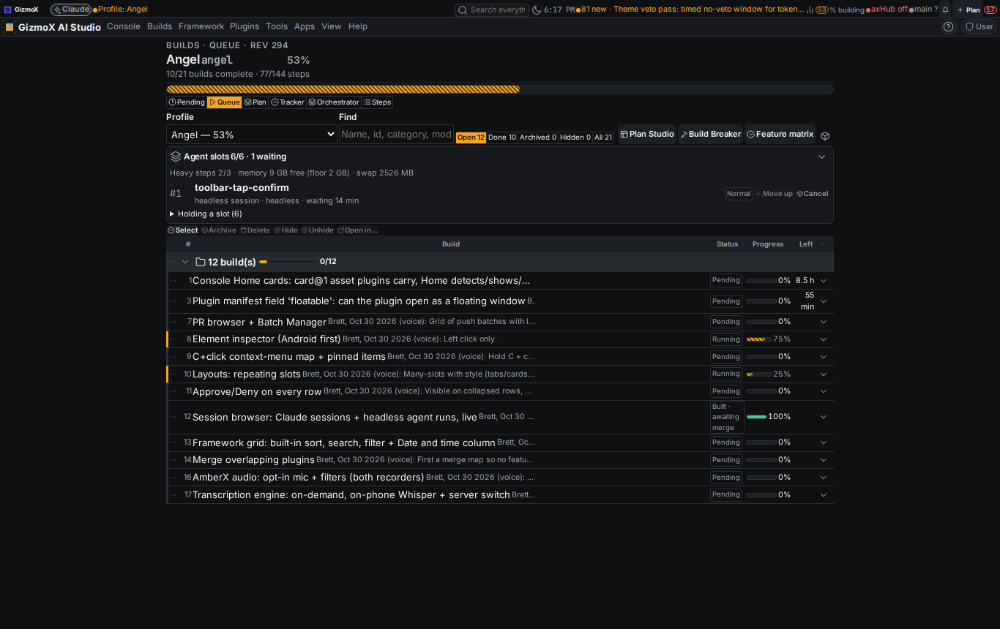
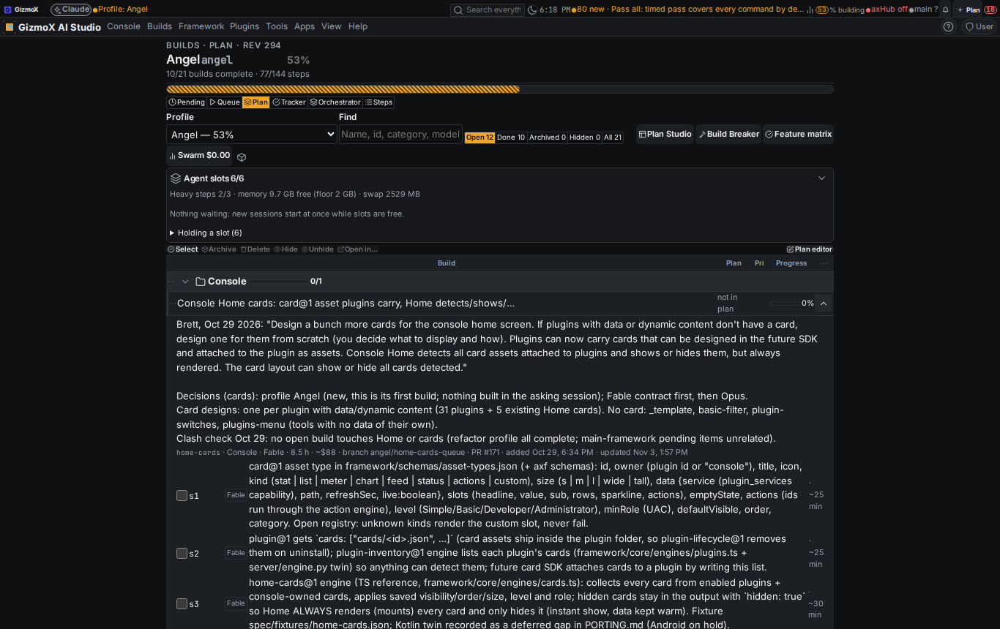
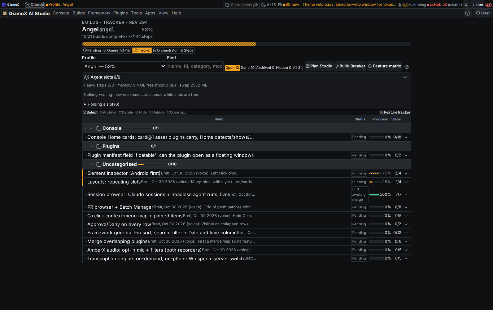
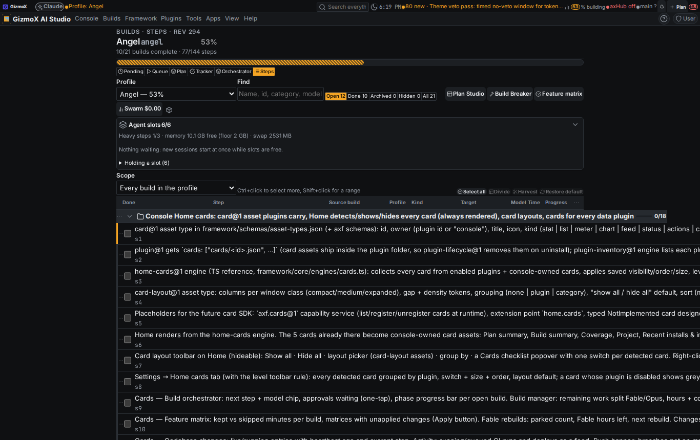

# builds-one-page-done: the one Builds page, finished on current main

- **Build:** `builds-one-page-done` (Urgent), finishing `builds-one-page` (Refactor, was archived at 4/15)
- **Asked by:** Brett, Nov 3 2026 (voice): "finish the Builds one-page build"
- **Agent:** Snap Sully (headless session; no booking command exists for a session that is already running, so it is recorded here and in the store note)
- **Model:** Opus (every remaining step was pinned to Opus; no model switch)
- **Branch:** `claude/builds-one-page-done` · PR: see THREADS.md

## 1. What was really done (verified before building)

| Step | State before | Evidence | Now |
|---|---|---|---|
| s1–s4 (Fable, one dataset design) | done | superseded by the one builds store (builds@1) | done |
| s5 run the migration, old files read-only | open | builds@1 store landed with `urgent-builds` (merged `2a057cc4`); old orchestrator/pending/queue files are read-only exports | **done** (verified) |
| s6 `/api/builds`, engine-rpc, MCP; old routes via shims | open | builds-page server routes + pending/queue/orchestrator CLIs all read/write the store (urgent-builds, orch-pending-sync #143) | **done** (verified) |
| s12 claude.ai Pending page + Build manager merge | open | covered by orch-pending-sync (#143) + the store projections | **done** (verified) |
| s14 hidden createdAt/updatedAt on builds, steps, notes | open | builds@1 records carry them; migration backfilled | **done** (verified) |
| s7–s11, s15, s16 (the page itself) | open | built only on `claude/builds-one-page-finish` (`c4b77a6e`), never pushed, 321 commits behind main | ported here, **done** |
| s13 tests, shots, report | open | this report | **done** |

## 2. What changed

**Ported from the stale finish branch** (code only; its stale store/journal/orchestrator data was left behind):
- Builds page: six views over the one store — **Pending · Queue · Plan · Tracker · Orchestrator · Steps** — with the same table (framework DataGrid), rows that expand into per-view nested info, shared Profile / Find / Show filters, selection toolbar (Archive, Delete, Hide, Unhide, Open in…), double-click multi-select, New build, newest-first default sort, hidden created/updated columns, keys 1–6.
- View switching everywhere: app menu Builds ▸ View, context menu *Open in view…*, `builds.open:<view>[:<query>]` actions, `axf://builds?view=…` links, search provider, the banner number opens a filtered view.
- Old screens (pending, build, plan, tracker, build-orchestrator) redirect to their view; the Plan editor, Feature tracker and Orchestrator editor stay reachable as full editors.

**Reconciled with what landed on main since:**
- `builds-store-core` immediate ops: main's `step-done` kept (the branch's `tick-step` is the same op); `set-status` keeps `builtAt` for `built` and `complete`.
- **Dropped the branch's `approve` op.** It let the Builds page approve any model switch, which breaks Brett's Nov 3 rule (upgrades need Brett). Model switches now go only through the orchestrator's gate. The Orchestrator view shows a downgrade as passing on its own; an upgrade shows *needs Brett* (plus *asked* when a request is open) and links to the Orchestrator editor, where only his signed-in click counts.
- Main's `built · awaiting merge` status, step tick checkboxes and the Steps view's Done column kept.
- Nothing for Patches or Build Pilot was brought back.

**New in this build:**
- **Every view and command through control@1.** `builds.mjs view <name>` + named commands `tick`, `status`, `hide`, `unhide`, `archive`, `delete`, `note`; server routes `GET /view/{name}`, `POST /tick|status|hide|unhide|archive|note`, `DELETE /build/{id}` (soft, destructive + confirm); plugin.json `commands` gives each a title, description and input schema. The plugins domain exposes them as REST `/api/control/builds-page/<command>`, MCP `builds-page_<command>` and `axf builds-page <command>` (17 commands, 5 reads).
- Long build names ellipsize: grid rows are max-content wide, so a long name pushed Status/Model off the row on the phone and scrolled the whole page sideways on desktop. The title cell is now bounded (tokens only).
- Help for the 17 new controls (written text, not drafts).

## 3. Tests

| Check | Before | After |
|---|---|---|
| `python3 apps/console-web/plugins/builds-page/test.py` | 19 | **38** (every view, every named command, approve refused, soft delete) |
| `node framework/spec/check-builds-store.mjs` | 38 | 38 (approve test now asserts it is refused) |
| `python3 apps/console-web/plugins/build-orchestrator/server/test_upgrade.py` | 12 | 12 |
| `node framework/spec/check-plugin-commands.mjs` | ok | ok (57 checks, 788 commands) |
| `npx tsx apps/console-web/scripts/menu-reach.mts` | ok | ok (350 checks) |
| `node framework/cli/help-coverage.mjs --check` | — | ok |
| check-theme / check-controls / plugin-lifecycle builds-page | ok | ok |
| `tsc --noEmit` + `npm run build` (console-web) | — | ok |

## 4. Screenshots

Taken with `framework/cli/rebuild-shots.mjs --env AXF_APPEARANCE_HUB=off` (the sandbox can't reach axHub's look). "Before" = the Builds / Pending / Orchestrator screens on main as captured on the finish branch (Nov 1); "after" = this branch, all six views.

| | Before | After |
|---|---|---|
| Pending, phone |  |  |
| Orchestrator, desktop |  |  |
| Queue · Plan · Tracker · Steps (desktop) | — |     |

## 5. Stale branches closed out

- `claude/builds-one-page-finish` (local only, `c4b77a6e`): fully ported here; superseded. Its worktree can be removed.
- `claude/builds-one-page` (PR #134, 897 behind): the plan.json dataset design it built was replaced by builds@1; superseded, close.
- `claude/queue-builds-one-page-trim` (PR #130, 945 behind): queued this build in the old orchestrator file; superseded, close.

## 6. Known gaps and notes

- **Store merge duplicated an added step.** One `add-step` on `builds-one-page` (s16) came back three times after the live sync with main (`s16`, `s16-15`, `s17-16`, different uids). The two extras were removed by hand and `builds-store.mjs verify` passes. Worth a look in `builds-live.mjs`'s per-step merge (an added step without a stable uid on both sides).
- On the phone the *Built · awaiting merge* chip wraps onto three lines in the Status column. It's readable but tall.
- The "before" shots are two days old (main's Builds page barely changed in that time).
