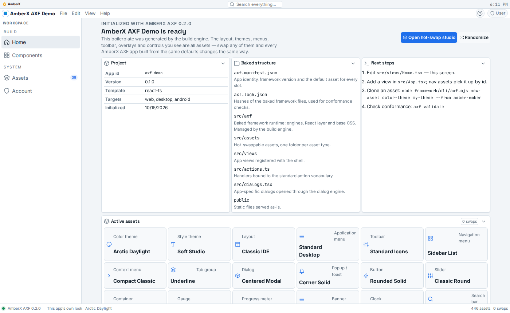
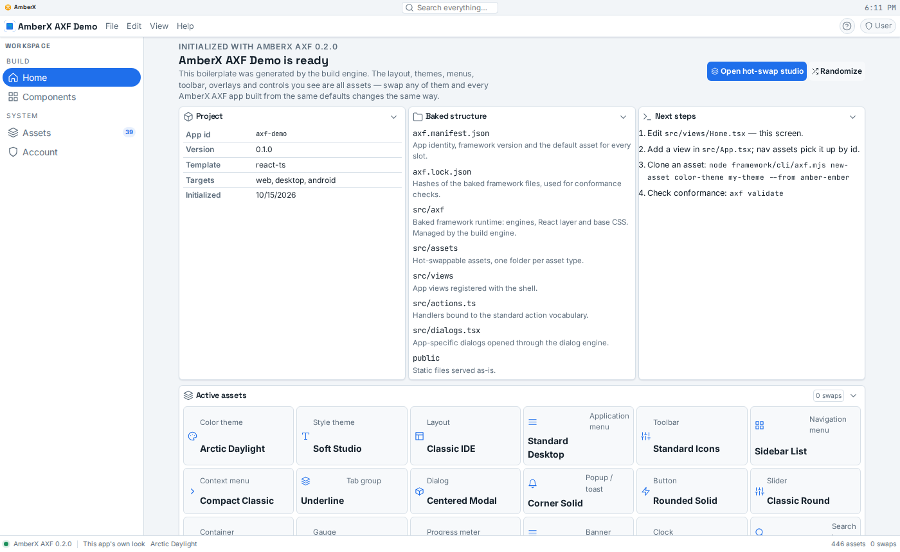
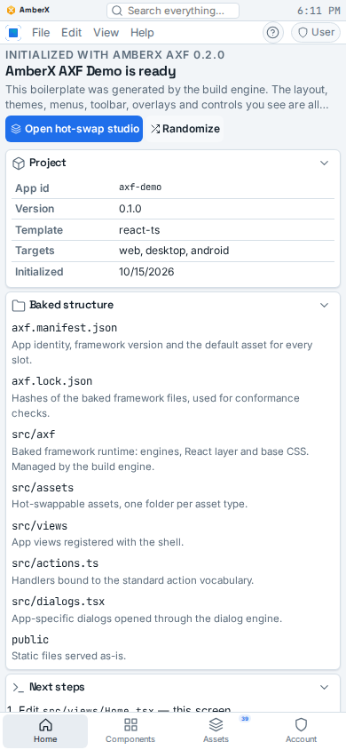
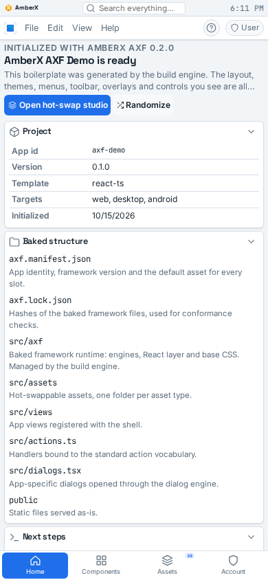

# Chrome settings actually apply on toolbars, nav and menu bar

Build `chrome-settings-actually-apply-toolbars` (Phase 1, Opus). Brett, Nov 13 2026 17:44:

> do all tab groups have their own settings interface ... the toolbar and nav ignore it, why

## The answer

**Yes, every tab group has its own settings.** Every tab row is the framework `TabGroup`, keyed by its id
(`axf.chrome.tab-group.<id>`, plus its own asset pick `…<id>.asset`). There is one exception: the Terminal tab strip.
It is hand-drawn on purpose, has its own Terminal settings, and is the only `tab-row` finding left in
`check-chrome-assets.mjs`.

**Why the toolbar, nav and menu bar ignored it:** the dialog saved their settings
(`axf.chrome.toolbar.app`, `axf.chrome.nav-menu.app`, `axf.chrome.app-menu.app`, `axf.chrome.banner.app`,
`axf.chrome.context-menu.app`), but nothing read them back. Only `TabGroup.tsx` merged the overrides. For the other
kinds, the runtime built the root style (`compileStyles`: size, surface, divider, active mark, icons, menu bar
height) from the raw asset. The toolbar, nav, banner and context-menu components also drew from the raw asset.
Only Tap to confirm worked, because its engine reads the key directly.

## What changed

- `framework/core/runtime.ts`: new `rt.chromeData(type, instance = 'app')`. It returns the active asset's data with
  that instance's overrides written over it. It is used by:
  - `compileStyles` (toolbar, nav, menu bar, context menu);
  - the banner height var and `rt.banner()`;
  - `toolbarCollapsed()` and `navStyleData()`.

  The override keys also join `styleSettingsKey()`, so a change re-applies the root style live.
- `framework/react/components/Chrome.tsx`:
  - `Toolbar` and `NavMenu` draw from `rt.chromeData`.
  - `AssetToolbar` (page toolbars) is now its own instance (its asset id). It has its own right-click target and a
    layout-free style scope (`.fx-toolbar-scope`, `display: contents`), so its settings apply to it alone.
- `NavTree.tsx` and `Overlays.tsx` (context menu) read the merged data too.
- `framework/spec/check-chrome-apply.mts` (new, in CI next to `check-chrome-settings`), 130 checks:
  - it sets every value of every dialog field on the toolbar, nav, menu bar, banner and context menu;
  - it fails when two values give the same render input (compiled root style plus the fields the component reads);
  - it checks Tap to confirm on every kind, that page-toolbar overrides stay on that toolbar, and that settings
    survive a reload (a fresh runtime on the same storage).

  Run against the old runtime, it reports 24 ignored settings.

## How it is reached (API)

Nothing new was needed: the existing chrome actions now take effect.

| What | Console API / MCP (`console_action`) | CLI / voice |
|---|---|---|
| Open a kind's settings (deep link) | `chrome.settings:<toolbar\|nav-menu\|app-menu\|banner\|context-menu>:app`, a page toolbar `chrome.settings:toolbar:<asset id>` | same action via `axf.mjs console do` / AmberX ("open toolbar settings") |
| Set one field | `chrome.set:<type>:<instance>:<field>:<value>`, e.g. `chrome.set:nav-menu:app:indicator:fill` | same |
| Reset one field / everything | `chrome.unset:<type>:<instance>:<field>`, `chrome.reset:<type>:<instance>` | same |
| Read state | setting `axf.chrome.<type>.<instance>` (`console_list settings`); root attributes `data-fx-toolbar*`, `data-fx-nav*`, `data-fx-menubar` | `axf.mjs console state` |

## Checks

| Check | Result |
|---|---|
| `npx tsx framework/spec/check-chrome-apply.mts` | 130 passed (24 failures on the old runtime) |
| `npx tsx framework/spec/check-chrome-settings.mts` | 282 passed |
| `npx tsx framework/spec/check-tapconfirm.mts` | 80/80 |
| `npx tsx framework/spec/check-toolbars.mts` | 608 passed |
| `node framework/spec/check-asset-overrides.mjs` | ok |
| `check-theme`, `check-controls`, `check-toolbars`, `check-chrome-assets` | pass |
| `tsc --noEmit` console-web (framework baked in) | clean |

## Shots

The demo app was built from this branch with the settings saved, then reloaded (the console itself needs axHub,
which the build box can't reach).

- Nav: list → filled pills, compact.
- Menu bar: raised and roomy.
- Toolbar: root `data-fx-toolbar=icons-labels`, surface raised, padding 0.6 → 0.9. The demo hides its toolbar slot.

| Before | After (after reload) |
|---|---|
|  |  |
|  |  |

## Known gaps

- **A page toolbar under a non-flat app toolbar.** If the app toolbar's surface is raised or glass and a page
  toolbar's own surface is `flat`, the page toolbar still shows the app's surface. The stylesheet has no `flat` rule
  to undo it. Raised and glass on a page toolbar do apply.
- **Baked app copies.** `apps/*/src/axf` pick this up on their next rebake (CI copies the framework); they weren't
  re-baked here.
- **Kotlin twin.** Deferred, as for the rest of chrome-settings@1 (spec/PORTING.md).
