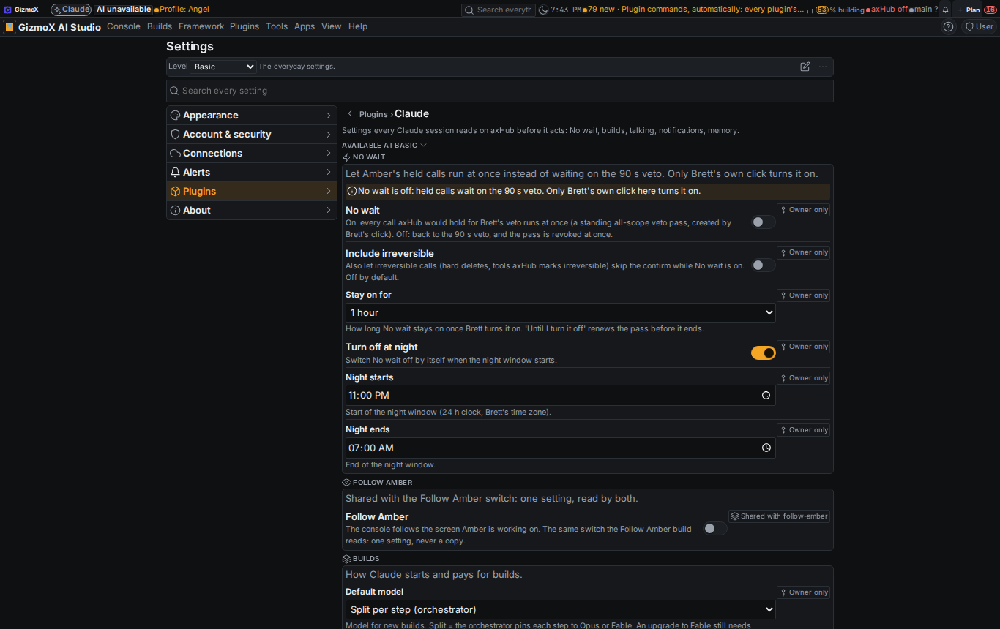
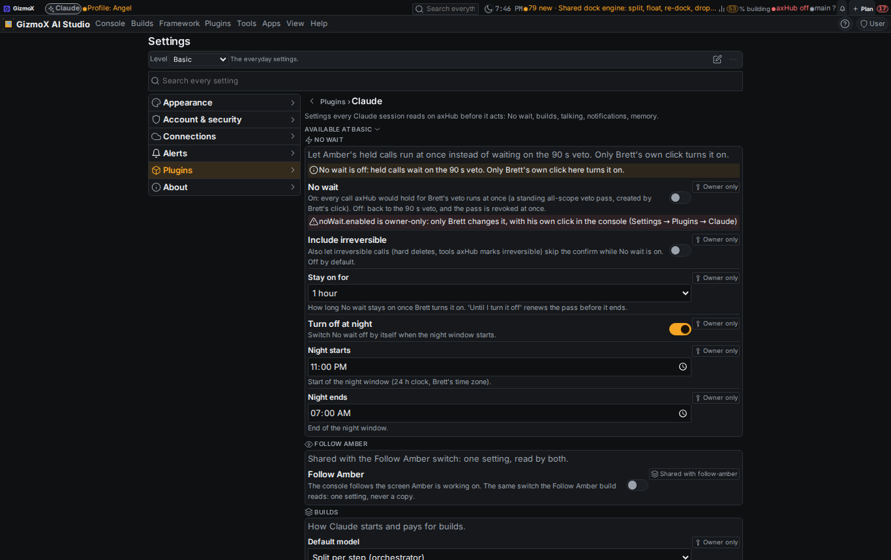
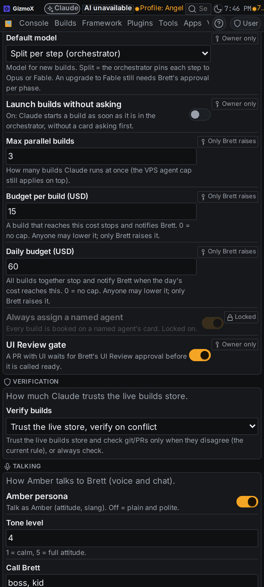

# Claude plugin: Claude settings (build `claude-settings`, Urgent, Opus)

Brett, Nov 3 2026 (voice): "I need a plugin called Claude. Claude settings. A setting to enable your no-wait in that. A
whole bunch of settings that are for Claude, that you check on axHub and then act accordingly." Agent: Janitor Joey
(headless). Branch `claude/claude-settings`.

## What was built

- **Console plugin "Claude"** (`apps/console-web/plugins/claude-settings`, plugin@1, claude-settings@1): page (Plugins →
  Claude), Settings → Plugins → Claude (one panel per group, so the level toolbar and settings search see them),
  "Claude settings" in every context menu (target `*`) and in Builds menu, No wait banner chip, lifecycle
  install/uninstall, help entries.
- **One store on axHub:** `/projects/_shared/_data/claude/settings.json` (the hub's shared data, every project).
  claude.ai reads it with `axhub.memory_read` project `shared`, area `data`, path `claude/settings.json`; keys missing
  there are their defaults. Without `/projects` the plugin says `live: false` and uses its data folder.
- **Open registry, data only:** `registry.json`, plus `registry.d/*.json`, plus the hub's `claude/registry.json`. Each
  entry: key, group, label, kind (toggle, choice, number, text, time), default, level, description, and who may change
  it (`owner: true`, `owner: "raise"`, `locked`). 30 settings in 7 groups today.
- **Commands declared once:** REST `GET/PUT /api/plugins/claude-settings/settings`, `GET settings/{key}`,
  `GET registry`; plugin commands (auto) project them to MCP + `axf claude-settings …`; CLI
  `node apps/console-web/plugins/claude-settings/claude-settings.mjs get|set|registry`; and the two named MCP tools
  `claude_settings_get` (read-only annotation, so the axHub default policy runs it without a veto) and
  `claude_settings_set` (write: veto).
- **Rule:** shared `RULES.md` (first item under "Before building anything") and `CLAUDE.md` (top) say: at session start
  and before acting, read Claude settings and follow them. The console MCP server's instructions say the same.

## Settings

| Group | Settings | Who changes them |
| --- | --- | --- |
| No wait | No wait, Include irreversible, Stay on for (1 h / 4 h / until off), Turn off at night, night start/end | Owner only |
| Follow Amber | Follow Amber (`followAmber.enabled`, shared key) | Any session |
| Builds | Default model (split/Opus/Fable), Launch without asking, UI Review gate | Owner only |
| | Max parallel builds, Budget per build, Daily budget | Anyone lowers, only Brett raises |
| | Always assign a named agent | Locked on |
| Verification | Verify builds: trust live store, verify on conflict / always | Any session |
| Talking | Persona, tone level, address terms, swearing, response length, say costs, reports aloud vs summary | Any session |
| Notifications | Build done, blocked, approval waiting, quiet hours (+ from/until) | Any session |
| Memory and notes | Session notes to Notes Vault, handoff note at end of session | Any session |

## How owner-only is enforced

- The owner approval comes **only from the request**: the console server asks control@1 (`owner(request)`, the same
  test veto passes use: Brett's signed-in axHub session in the console, never a bearer token) and hands it to the core.
  Nothing in a body, an MCP call, a CLI flag or the environment can claim it.
- The core also ignores an owner approval whenever the process runs inside a Claude session, headless build or agent
  (`nonHumanSource`: CLAUDECODE, AI_AGENT, AXF_SURFACE, AXF_SESSION…), the same guard model upgrades use.
- Owner-only means both directions: a session can't switch No wait off either (the server's own clock can, see below).
- A patch with one refused key changes nothing.

## No wait = a standing veto pass

- Brett's click (No wait on) → the server asks control@1 `owner_pass(request, 'grant', 'all', …)`: an all-scope veto
  pass (control-pass@1, token-control) approved by **that same request**, minutes from Stay on for (60 / 240 / 240),
  `include_irreversible` only when Include irreversible is on. Changing duration or Include irreversible while on
  re-grants it. Off → `revoke` at once.
- If the grant fails, the switch goes back off (never "on" without a pass behind it).
- A clock (60 s) in the server: until-off passes are renewed with less than 30 min left (`renew_pass`: only while a
  pass Brett approved himself is active, recorded as "brett (standing)"); at night (default 23:00–07:00, Brett's time
  zone) No wait switches off and the pass is revoked; a pass revoked from the banner or expired switches No wait off.
  Every clock change is recorded as `via: system` with the reason.
- axHub already honours the pass (it reads the console's signed pass publication), so nothing changed on axHub's side.

## Changes outside the plugin

- `token-control/server/__init__.py`: control@1 capability gained `owner(request)`, `owner_pass(request, …)` and
  `renew_pass(…)`. The plain `run()` still never carries an approval.
- `server/mcp_server.py`: `claude_settings_get` / `claude_settings_set` + instructions line; `test_mcp_tools.py` +6 checks.
- `claude-handoff`: its internal role id for `.claude/settings.json` renamed `'claude-settings'` → `'claude-code-settings'`
  (computed per run, nothing stored) so the plugin lifecycle check doesn't read it as a reference to this plugin.
- CI (`android.yml`): runs `claude-settings/test.mjs`; `test.py` is picked up by the existing glob.

## Tests

| Test | Before | After |
| --- | --- | --- |
| `node apps/console-web/plugins/claude-settings/test.mjs` (registry, owner-only rules, pass decisions, night window) | — | 46 ✓ |
| `python3 apps/console-web/plugins/claude-settings/test.py` (real token-control pass store: created by Brett's session, re-granted, revoked; refused for a token; clock switches off a revoked pass; renewal only of Brett's pass) | — | 21 ✓ |
| `python3 apps/console-web/server/test_mcp_tools.py` | 144 ✓ | 150 ✓ |
| `node apps/console-web/plugins/claude-handoff/test.mjs` | 95 ✓ | 95 ✓ |
| check-theme, check-controls, check-plugin-pages, check-plugin-commands, help-coverage --check, tsc | ✓ | ✓ |
| `plugin-lifecycle check claude-settings` | — | ✓ in CI (locally only the ignored `.axf-focus.json` Watch-live file is flagged) |

## Screenshots (phone + desktop)

Taken with `framework/cli/rebuild-shots.mjs` (hub look off, scratch settings file, console token = not Brett).
`shots/after/`: the Settings → Plugins → Claude tab; the No wait switch clicked from a token session, refused with the
owner-only message; the Builds and Talking groups.

The ON state (banner chip, "No wait is ON" note) needs Brett's signed-in session, which the harness doesn't have; it
is covered by `test.py` instead.

## Known gaps

- **Follow Amber:** the follow-amber build (running in another session, Urgent) has no switch on main yet. This plugin
  owns the shared key `followAmber.enabled`; follow-amber should read it (`claude_settings_get` /
  `axf.claude-settings@1`) instead of adding its own.
- **Acting on the settings** is up to each session (the rule says read and follow). Nothing yet enforces the budget caps
  or max parallel automatically in the launcher/orchestrator; that would be a follow-up build wiring
  `deploy/claude-headless.sh` and agent-slots to these values.
- **axHub policy:** `claude_settings_get` is annotated read-only (axHub's default runs reads without a veto) and
  `claude_settings_set` is a write (veto). No axHub-side change was made.
- Direct file writes to the hub document (a shell on the VPS) bypass the transports; the No wait power itself still
  needs a pass, which only Brett's session or his signed axHub approval creates.
- Shared `RULES.md` is held by claude-sync (changed on both sides); the repo copy has the new rule. Brett picks which
  copy to keep (`claude-sync resolve shared:rules/RULES.md --keep local|hub`).
