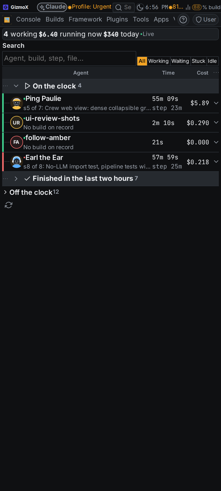
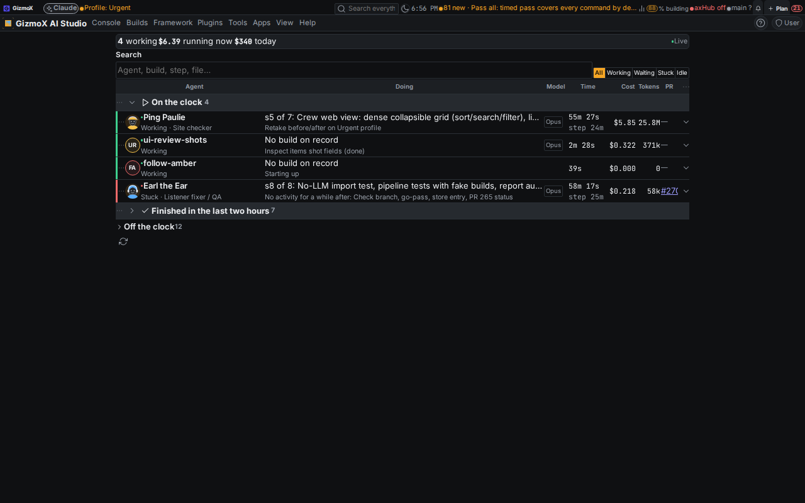
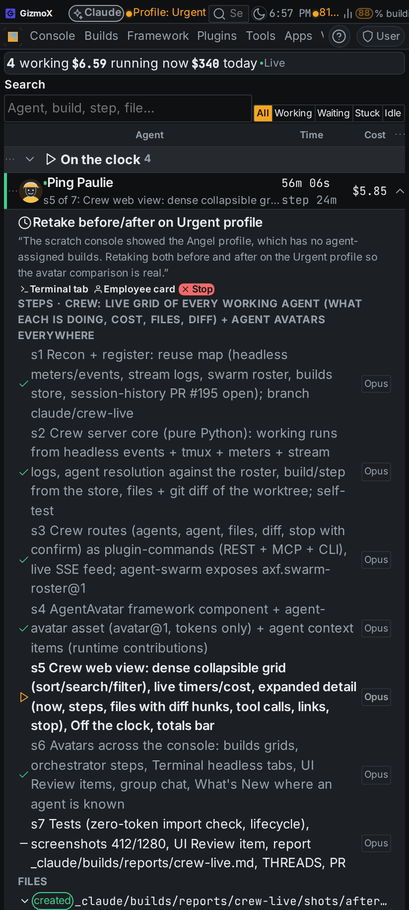
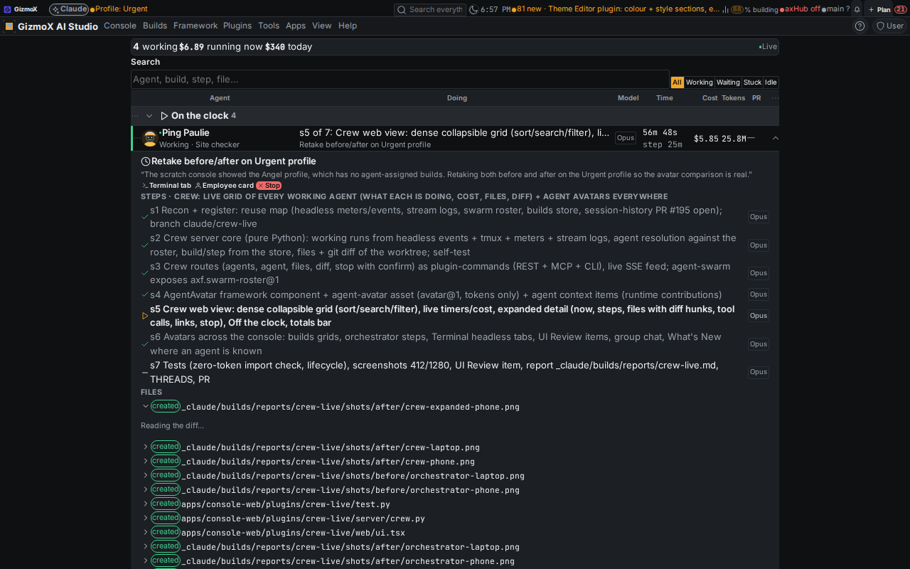
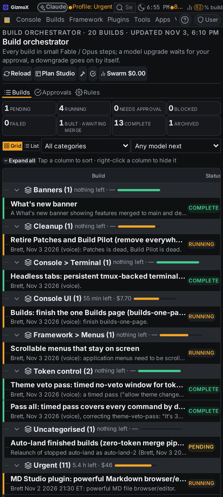
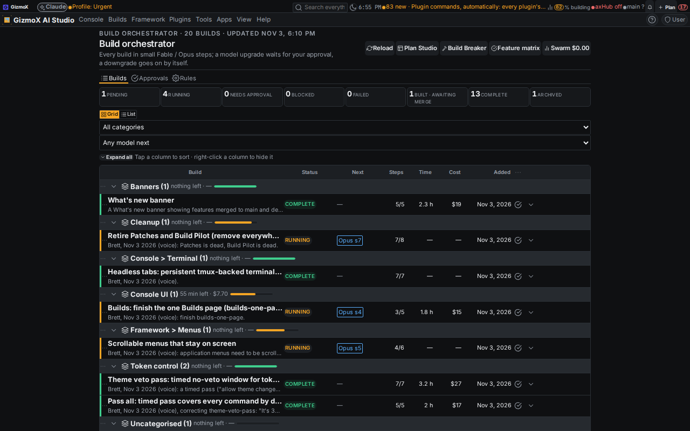
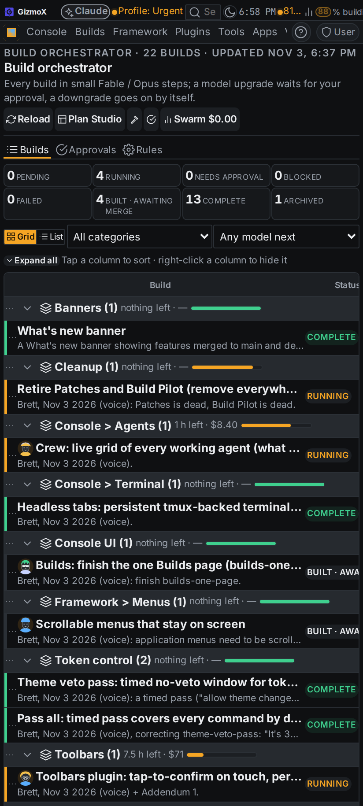
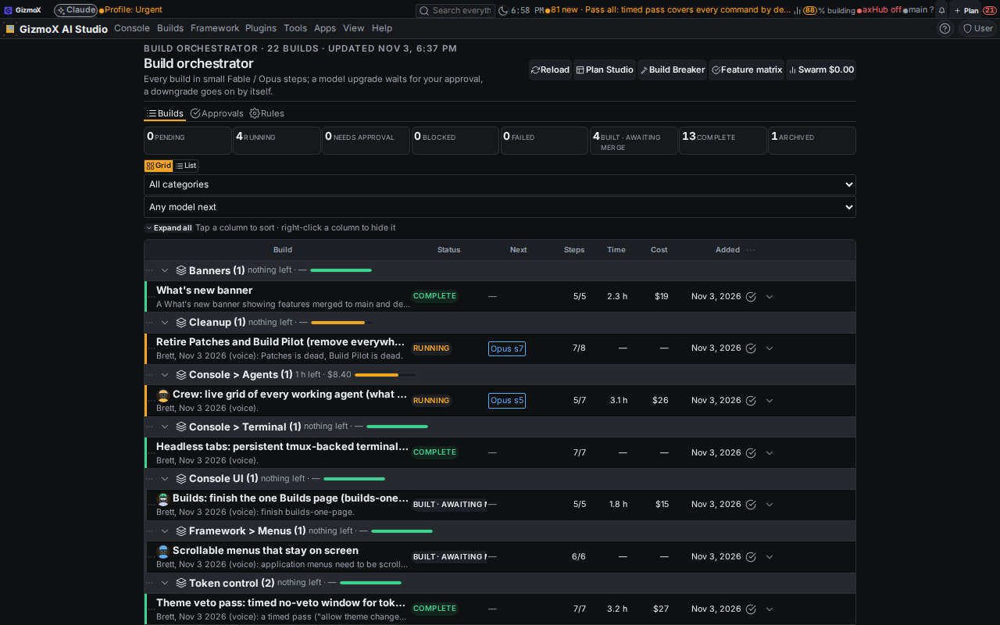

# crew-live — Crew: who is working, live (Urgent profile)

Brett, Nov 3 2026 (voice). Agent: **Ping Paulie**. Model: Opus (all 7 steps). Branch `claude/crew-live`.

## What was built

**Crew plugin** (`apps/console-web/plugins/crew-live`, Builds → **Crew**): every agent working right now, one dense
row each, on the framework DataGrid (sort, search, status filter, collapsible rows and groups, phone first).

- Row: avatar + name, status dot (working / waiting on approval / stuck / idle), `sN of M: <step>` in plain English,
  model, a timer since the job started plus time on the current step (ticks every second), live cost, tokens, PR link.
- Expanded: what the agent is doing this second (newest tool call, worded from the tool and its input, no model),
  the last thing it said, steps done / now / next with their models, files created / modified / deleted vs the build's
  base (merge-base with `origin/main`) each opening its diff (hunks fold, old/new line numbers, light highlighting,
  binary files flagged), recent tool calls with each one's share of its turn's cost, Terminal tab / Session browser /
  Employee card links, **Stop** (confirm through the framework Button's behaviour-theme confirm).
- "Finished in the last two hours" group, **Off the clock** (crew with nothing running), totals bar (working, cost
  running now, cost today), live indicator.
- Phone (layout asset's `data-fx-narrow` cut-off): agent (with the step line under the name) · time · cost.

**Live, without polling storms:** one server snapshot every 2 s at most, shared by every caller; `GET live` is a
server-sent-events feed that only sends when the snapshot changed; one feed per browser however many views listen.
Avatars elsewhere fill the agent directory with one read at start and every 5 minutes.

**Zero tokens:** the plugin reads files, the builds store and git only. `test.py` fails if any server or web file
imports or calls an LLM client, model API or LLM capability, or launches `claude`.

**Commands declared once** (plugin-commands@1, auto): `agents`, `agent`, `files`, `diff` (reads) and `stop`
(destructive, confirm) → REST `/api/control/crew-live/<cmd>`, MCP `crew-live_<cmd>`, CLI `axf crew-live <cmd>`, so Amber
can read the crew by voice.

## Reuse (what it builds on)

| Need | Reused | How |
|---|---|---|
| live runs, exact live cost, kill | Terminal / headless-tabs (PR #259): tmux list + headless-meter@1 + kill_tmux | new capability **`axf.headless@1`** on the Terminal plugin (sessions, meters, kill) |
| agent names, avatars, pay | agent swarm roster + state | new capability **`axf.swarm-roster@1`** (30 s cache over `swarm.mjs state`) |
| employee card | swarm Crew tab profile | new action **`agent-swarm.profile:<id>`** (navigates + opens the profile) |
| Terminal tab of a run | headless tab opener | new action **`terminal.attach:<session>`** |
| avatar drawing | `agent-card-rules.mjs` `avatarModel` | framework `AgentAvatar` draws it |
| tool calls / usage / result | stream-json logs from `deploy/claude-headless.sh` | read directly (same per-message-id rule as `deploy/claude-meter.mjs`) |
| steps, PR, approvals | builds store (builds@1) | read directly |
| Session browser | PR #195 is **still open** (not on main) | Crew links to it through the action `session-history.open` when it exists; otherwise the item says it isn't installed |

## Avatars everywhere

- Framework **`AgentAvatar`** (`framework/react/components/AgentAvatar.tsx`) + **agent directory**
  (`framework/core/agent-directory.ts`: id, name, aliases = the runs and builds an agent is on, `agentInText` for
  "Agent: <name>" lines) + **`agent-avatar` asset** (`framework/assets/avatar/agent-avatar.json`, avatar@1: size and
  shape) + `.fx-agent-avatar` styles in `axf.css` (theme tokens only; translucent tints through `--fx-opacity-tint`).
  Baked into console-web, axHub web, AmberX and Molly (`shared-assets.mjs bake`).
- Shown on: Crew rows and Off the clock, Build orchestrator build rows, Builds page build rows, Terminal headless tab
  titles, UI Review item meta lines, What's New rows, the agent swarm group chat.
- Context target `agent` (payload = agent id) on every avatar and Crew row; the Crew contributes the menu at run time:
  Open employee card, Their current task, Their history / past runs, Open in Session browser, Open Terminal tab, Open
  group chat, Assign a job, Stop current job (confirm).

## Changed outside the plugin

- `framework/react/components/AgentAvatar.tsx`, `framework/core/agent-directory.ts` (new), `framework/react/index.ts`
  (exports), `framework/ui/axf.css` (avatar styles), `framework/assets/avatar/agent-avatar.json` (new asset).
- `console-terminal`: `axf.headless@1` capability, `terminal.attach` action, avatar on headless tab titles.
- `agent-swarm`: `axf.swarm-roster@1` capability, `agent-swarm.profile` action, chat uses `AgentAvatar`; manifest test
  updated for the new `provides` entry.
- `build-orchestrator`, `builds-page`, `ui-review`, `whats-shipped`: one `AgentAvatar` each.
- `framework/cli/rebuild-shots.mjs`: a `laptop` viewport (1280 × 800) next to phone (412) and desktop (1366).

## Tests

| Check | Before | After |
|---|---|---|
| `crew-live/test.py` (core, routes vs fake capabilities, git diff, zero tokens, web core) | — | 57 pass (incl. 20 web core) |
| `agent-swarm/test.mjs` | 93 | 93 pass |
| `console-terminal/test.py` | 97 | 97 pass |
| console `tsc --noEmit` | pass | pass |
| `check-theme.mjs`, `check-controls.mjs` | pass | pass |
| `plugin-lifecycle.mjs check crew-live` | — | clean |
| `plugin-commands check` | — | crew-live 6 reads · 9 commands |
| `help-coverage --check` | pass | pass |
| `axf validate --framework` | pass | pass (493 assets, + agent-avatar) |

## Screenshots

Before (main) / after, phone 412 px and laptop 1280 px, real VPS data. Folder `crew-live/shots/`.

| | Phone | Laptop |
|---|---|---|
| Crew (after) |  |  |
| Crew, row open (after) |  |  |
| Orchestrator before |  |  |
| Orchestrator after (avatars) |  |  |

## Known gaps

- **Session browser rows** don't show avatars: that plugin (PR #195) isn't on main yet; once it lands, one
  `<AgentAvatar agent={run.agent} />` in its row does it.
- **PR rows** (push banner) and **orchestrator step rows** show no avatar of their own (the build row above them does).
- Agent identity for a plain build launch comes from the build's `Agent: <name>` line: the launcher tags runs with the
  build name, not the agent id (`AXF_AGENT`), so a build whose detail names nobody shows initials.
- The `avatar@1` asset type has no `source: "agent"` yet (the `agent-avatar` asset uses `text`); adding it is an
  asset-type contract change (Fable), not done here.
- Cost between meter updates is the last streamed figure (no interpolation); exact once the run's result arrives.
- Kotlin twin of the agent directory / AgentAvatar deferred (Android on hold).
