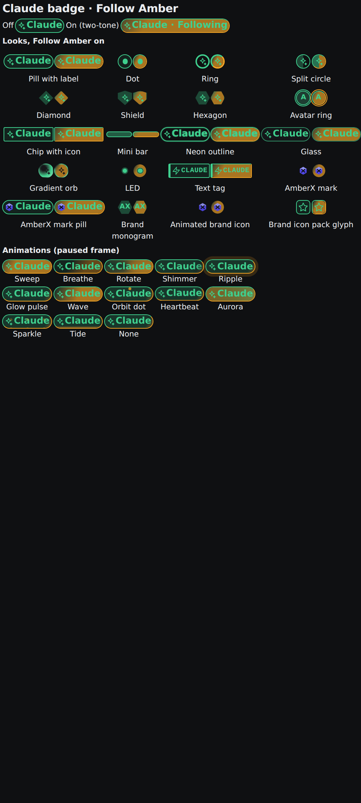

# follow-amber-switch — Follow Amber in the Claude badge

Build `follow-amber-switch` (Current profile), Opus, branch `claude/follow-amber-switch`. Booked on Snap Sully.

## What Brett said (verbatim, Nov 4 2026, voice)
> Make a widget that can go in the banner that is a switch which makes it automatically go to you when you mention something. You don't have to be asked to go to it. If you just mention something casually, it will go to that screen.

Addenda (voice): no new widget, put it in the Claude badge, two-tone when on; animate the colours; a bunch of animation options and ~15 badge looks; add icons from the branding packages.

## What changed
- **Claude badge = the Follow Amber switch.** Tap toggles Follow Amber (`followAmber.toggle`). The old tap (open settings) and Test again moved to the badge's right-click / long-press menu, along with *Open again: <last thing Amber opened>*, *What Amber opened…*, *Change badge…* and *Pick a brand icon…*. Without Follow Amber installed, a tap still opens settings.
- **Two-tone + animated while on.** The badge keeps its connection colour and adds a faded second tone (theme tone, or a custom #hex). 12 animations + none (sweep, breathe, rotate, shimmer, ripple, glow, wave, orbit, heartbeat, aurora, sparkle, tide), each with speed, intensity and loop/once, set per state: Follow on / Amber just opened something (one bright pulse) / connecting / error. CSS only, no timers; reduce motion = static two-tone.
- **20 badge looks** (`claude-badge/looks.json`, badge assets): pill, dot, ring, split circle, diamond, shield, hexagon, avatar ring, chip, mini bar, neon, glass, orb, LED, text tag, plus brand looks: AmberX mark, AmberX mark pill, monogram, animated brand icon, icon-pack glyph. Pickers with live previews in Settings → Plugins → Claude badge.
- **Brand icon picker**: every logo mark, animated logo and icon-pack glyph in the registry (whatever the Brand library has installed) plus the built-in icons, drawn with the two tones and animations.
- **REST / MCP / CLI**: `GET styles-list`, `POST style-set`, `POST animation-set` (MCP `claude_badge_styles_list`, `claude_badge_style_set`, `claude_badge_animation_set`; CLI `axf claude-badge styles-list|style-set|animation-set`). Kept in the plugin's `style.json`.
- **One switch**: Follow Amber's switch and Claude settings' `followAmber.enabled` now stay equal both ways (capabilities `axf.claude-settings@1.set` and `follow-amber@1.set_state`); the web setting key is `followAmber.enabled`. Follow Amber's separate banner chip now defaults off (the badge shows it).
- **Casual mentions**: `console_show` / `console_follow` / the MCP instructions say to open anything mentioned in passing; new Claude setting `followAmber.casual` (default on), returned as `casual` by `console_follow`.
- **Framework**: badge asset type gains optional `look`, `tone2`, `color2`, `motion`, `speed`, `intensity`, `once`, `pulse`, `pulseMotion`, `mark`, `text` (`badgeLook()` in `core/engines/banner.ts`, drawn by `BannerBadge`, CSS in `ui/axf.css`); banner badges are context-menu targets (`banner`, payload `badge:<id>`). Re-baked into console-web, axhub-web, amberx-droid, molly. Android twin deferred (PORTING.md).

## Checks
- `claude-badge/test.mts` 29 ✓ (model + framework badgeLook), `claude-badge/test.py` 39 ✓ (+14 new), `follow-amber/test.py` 35 ✓ (+2 switch sync), claude-settings 21 + 46 ✓, follow-amber web 11 ✓.
- console `tsc --noEmit` clean; check-theme, check-controls, check-toolbars, shared-assets, `validate --framework`, plugin-lifecycle (claude-badge, follow-amber, claude-settings) all ✓.

## Screenshot
Phone (412 px), filed to UI Review → Screenshots, group "follow-amber-switch - Nov 4 1:55 PM": `follow-amber-switch/shots/phone-badge-looks.png`.

## Known gaps
- The "opened" state uses its animation choice only (the pulse length is fixed at ~0.9 s).
- Another console picks up a look change when it comes back into view (no push stream for the style).
- The shot is a harness render of the framework badge (the full console sits on "Waiting for axHub" under Playwright).
