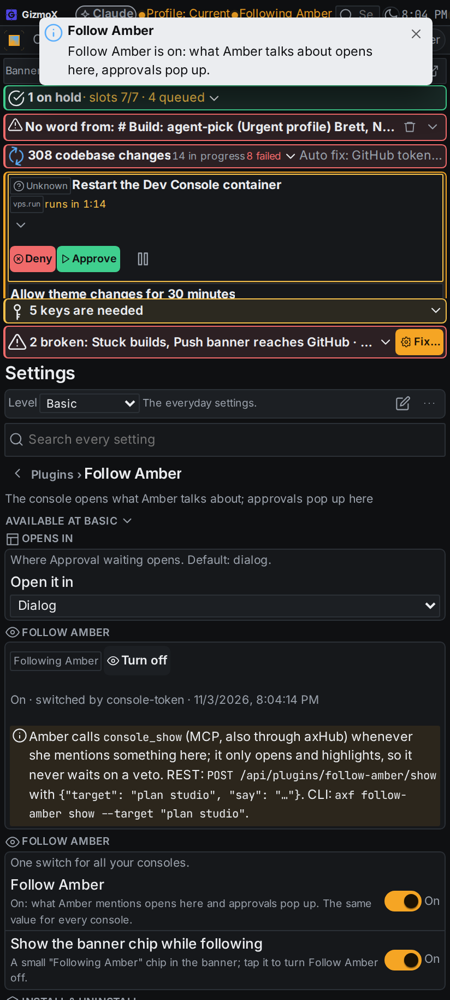
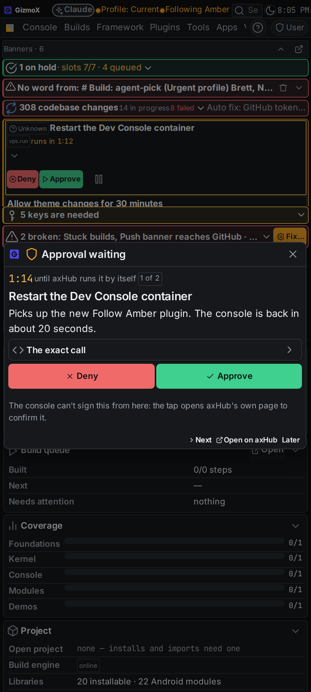
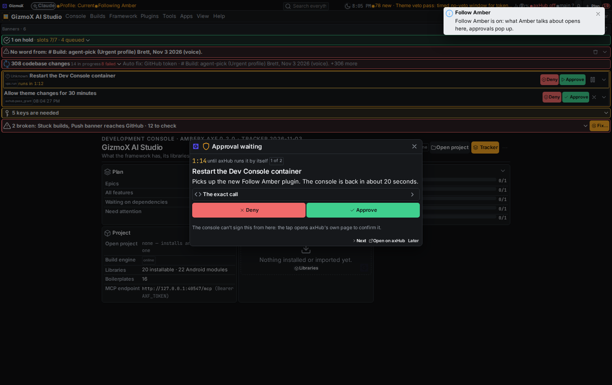
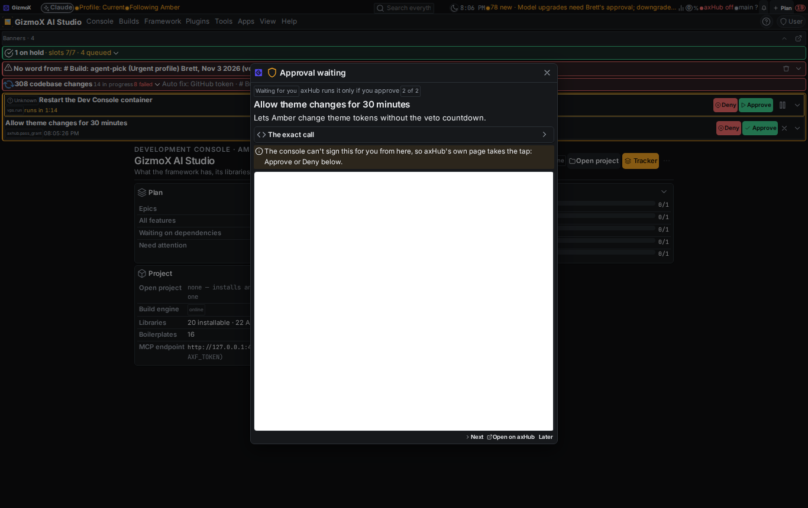
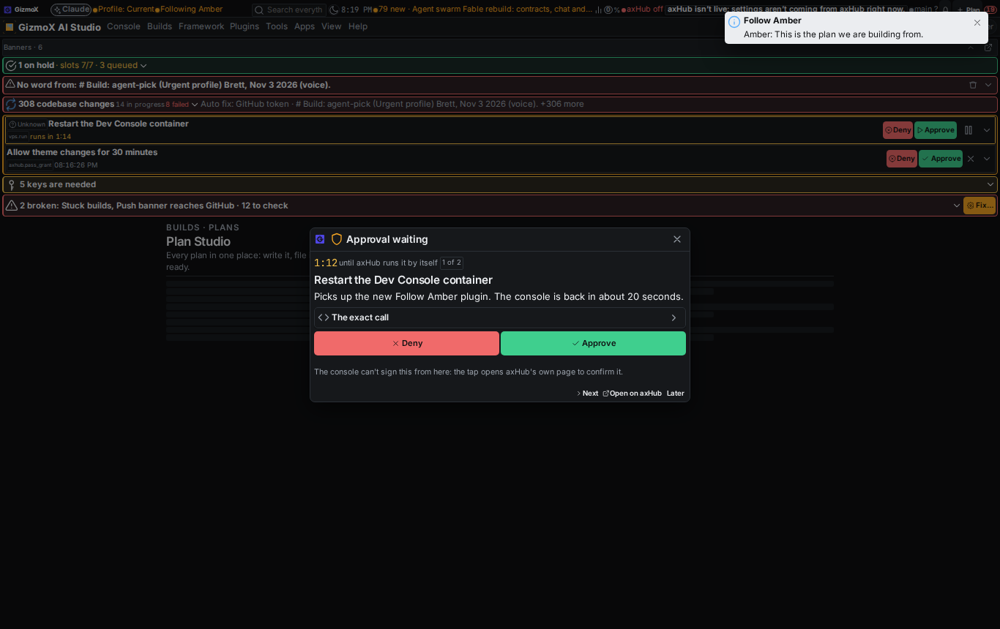

# Follow Amber (`follow-amber`, Urgent, Opus)

Brett, Nov 3 2026 (voice). Agent: Reel Rhonda (headless, Opus 5.5). Branch `claude/follow-amber`.

## What was asked

One switch in the Dev Console, **Follow Amber**. On: whenever Amber mentions a console screen, dialog, build, setting,
plugin or anything that needs Brett, the console opens it right away (focused, highlighted); every axHub held / confirm
call for Brett pops up in the console as an approval dialog (title, plain description, the exact call folded, countdown
on veto calls, big green Approve / red Deny on one tap, a queue). Off: nothing opens by itself. Navigation tools never
wait on a veto; `console_show` + `console.follow` for Amber; rule in RULES.md + CLAUDE.md.

## What was built

| Piece | Where |
|---|---|
| Plugin `follow-amber` (plugin@1, lifecycle, help, hooks) | `apps/console-web/plugins/follow-amber/` |
| Server: switch (owner-wide, kept in `.axf-console/plugins/follow-amber/state.json`), follow stream (SSE, follow-amber@1 frames), `show`, `approval`, `recent`; capability `follow-amber@1` | `server/__init__.py` |
| Show = Console commands (`console-commands@1`) with the single grant `control.console.navigate`: screens, settings tabs, dialogs and navigation-only actions open; anything that writes is refused by the runner | `server/__init__.py` `_open` |
| Web: settings sub-tab (Settings → Plugins → Follow Amber: the switch, banner-chip switch, status), right-click item on every target (`*:follow-amber`), app menu (Plugins), banner chip "Following Amber" (status widget, tap = off), the follow client (highlight with the search flash: CSS selector or exact text; Amber's words as a toast) | `web/index.tsx`, `web/menu.ts`, `web/follow-amber.css` |
| Approval pop-up `follow-amber.approval`: queue (held calls first, soonest first; then approvals oldest first; shelved wait quietly), countdown, title + description, exact call in a folded container, big Deny / Approve, Next / Open on axHub / Later; takes over the approvals banner's own review / veto dialog while following | `web/index.tsx`, `web/core.ts` |
| MCP: `console_show {target, highlight?, say?, to?}` and `console_follow`; `console_open`, `console_dialog`, `console_settings`, `console_back` now read-only (axHub's `recommended` preset runs read-only tools at once, decision #112); `console_action` stays a write | `apps/console-web/server/mcp_server.py` |
| Commands declared once: plugin.json `commands.items` → REST `/api/control/follow-amber/<cmd>`, MCP `follow_amber_state / _switch / _show / _approval / _recent`, CLI `axf follow-amber <cmd>` (plugin-commands@1) | `plugin.json` |
| Rules + docs | `_claude/shared/rules/RULES.md`, `CLAUDE.md`, `framework/spec/CONTROL.md` (Console → Follow Amber; recommended policy row for navigation) |

## How a decision reaches axHub (and why it isn't always one tap here)

axHub takes Approve / Deny only from **its own origin** with the session's CSRF value, or from AmberX's native shell with
its own hub session (veto@1 host). It never takes a token, by design: that is what stops an agent from approving its
own call. The pop-up therefore decides, best first:

1. **App host** (AmberX phone shell, `vetoHost().act` / `approvalsHost().decide`): one tap, signed with his hub session.
2. **Hub origin** (a page on axhub.amberxai.com): one tap, `decideOnHub` / `vetoAction` with CSRF.
3. **Otherwise** (the console on console.amberxai.com in a desktop browser): the tap opens axHub's own page in the
   pop-up (framed) for the confirm; if the hub refuses to be framed, after 8 s an **Open on axHub** button.

The console server holds no hub session and never decides anything. Tests prove both routes and that the
no-signed-path case sends nothing.

**Found while testing (needs a change on axHub, not here):** the live hub's `frame-ancestors` lists
`https://patches.amberxai.com https://amberx.amberxai.com` only, so the console origin can't frame hub pages, and the
retired Patches origin is still allowed. Fix on the hub: `AXHUB_APPROVALS_FRAME_ANCESTORS` (and
`AXHUB_EMBED_FRAME_ANCESTORS`) = `https://console.amberxai.com`, drop Patches. For true one-tap from the desktop console,
axHub would need a decide route that accepts the console's origin (CORS + CSRF from the owner's cookie-domain apps), an
axHub decision for Brett; until then desktop is tap → confirm on the hub page, the phone (AmberX) is one tap.

## No server-side axHub subscription

The spec asked the server to subscribe to axHub's approval event stream. axHub has none (lib-approvals says so: "The hub
has no approvals event stream today, so polling is the live path"), and its feed answers only an admin's browser
cookie, never a token. So each following console reads the feed with Brett's own session (every 5 s, on focus, and at
once when anything calls `approval` / `console_show approval:<id>`). When no console is open, AmberX already raises
the veto notices with Deny / Approve on the phone. Console wake (PR #266, open) applies to shows automatically once it
merges, since shows go through Console commands' delivery.

## Tests

| Check | Before | After |
|---|---|---|
| `python3 apps/console-web/plugins/follow-amber/test.py` (switch, off = nothing opens, navigate grant only, kind fallback, no console open, approval frames, owner only, capability, no Console commands) | — | 33 checks |
| `npx -y tsx --tsconfig apps/console-web/tsconfig.json apps/console-web/plugins/follow-amber/web/check.mts` (frames, queue order, routes, approve / deny round trips against a fake axHub with CSRF, AmberX host path, refused decision); `test.mts` runs it for the CI glob | — | 11 checks |
| `python3 apps/console-web/server/test_mcp_tools.py` (nav tools read-only, console_action a write, console_show / console_follow wiring, instructions) | 139 | 163 |
| `console-commands` server test, `plugin-commands` server test | 35 / 53 | 35 / 53 |
| `check-theme.mjs`, `check-controls.mjs`, console `tsc --noEmit` | pass | pass |
| Real stack (uvicorn + Vite + Chromium): off = `shown: false`; on = through Console commands; auto MCP tools `follow_amber_*` listed; pop-up opens on a new held call; `console_show` opens Plan Studio with Amber's note | — | seen |

## Screenshots (`follow-amber/shots/after/`)

The hub was stubbed in the browser for the shots (the headless browser can't reach axHub), so the frame is blank there.

## Known gaps

- Desktop one-tap needs the axHub change above; frame-ancestors on the hub also needs the console origin.
- The right-click item sits at the end of the console's long default menu (it is on every target).
- Approve / Deny are dialog buttons, not toolbar buttons, so the toolbars build's tap-to-confirm doesn't touch them;
  they carry `data-axf-one-tap` in case that build wants an explicit opt-out marker.
- Shared `RULES.md` is held in a claude-sync conflict from before this build (new on both sides); the repo copy has the
  rule, the hub copy takes it once Brett picks which copy to keep.
- Android twin: not built (Android on hold); the console is web only.
