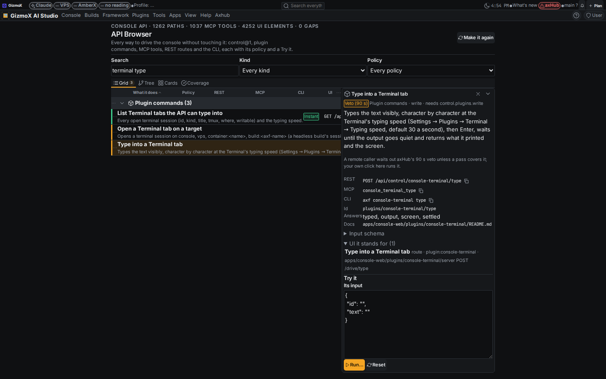
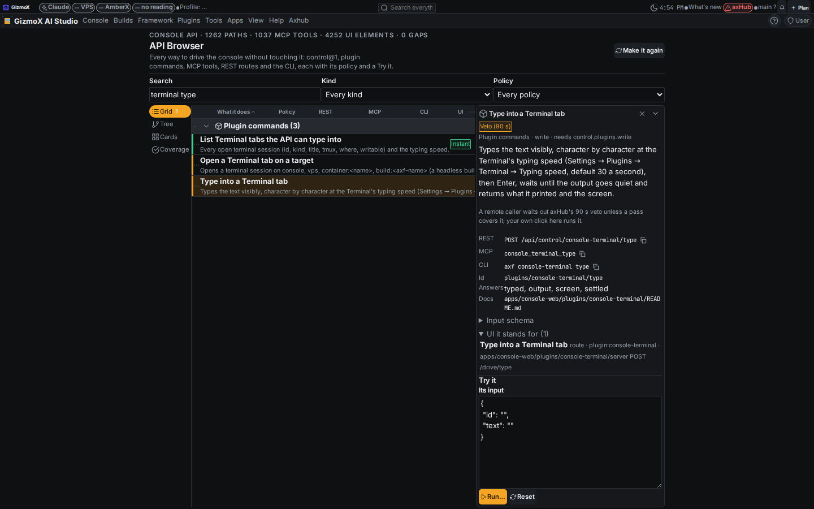
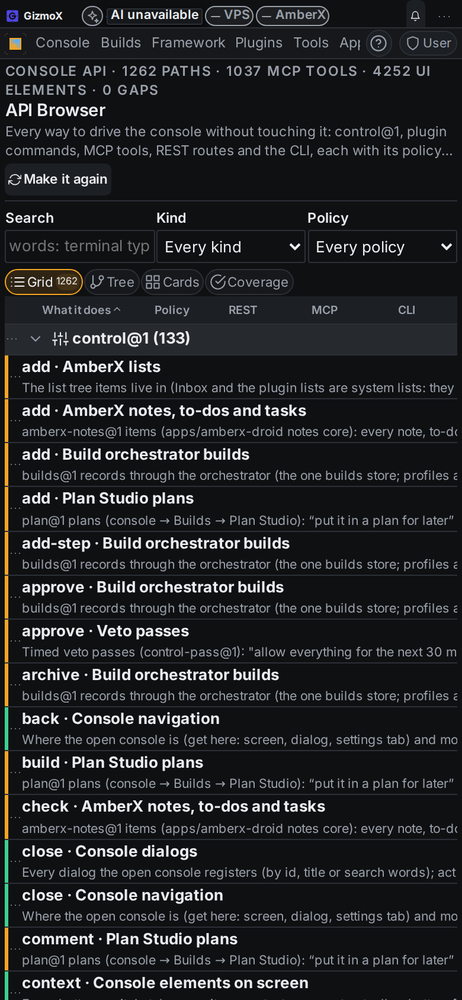
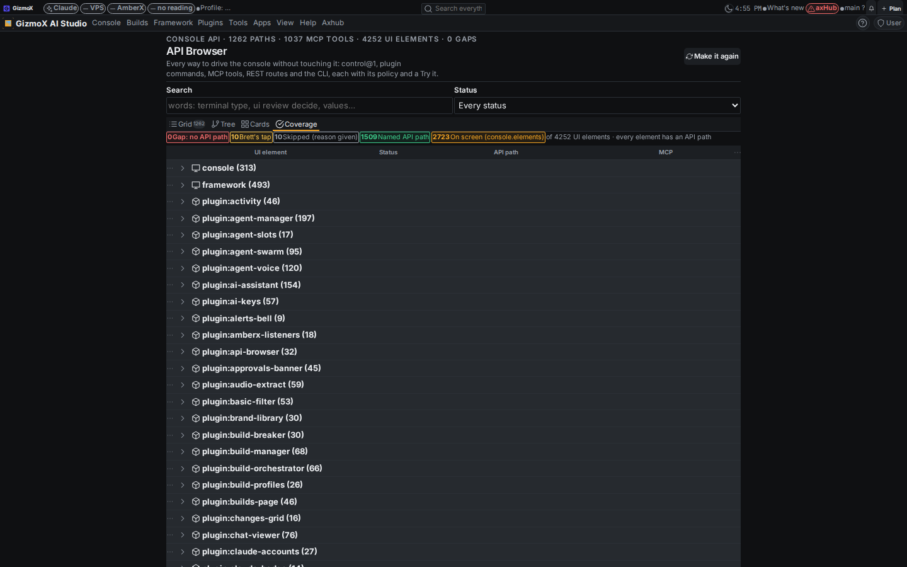

# The API controls everything in the console (Nov 7 2026)

Build `full-api-control` (All builds, Opus), branch `claude/full-api-control`, commits only (not pushed, no PR yet).

> The API controls EVERYTHING in the console. Rule: the API (control@1 / MCP / CLI / voice) must be able to do anything
> Brett can do by hand in the console and every plugin. Today it can't (e.g. it can open a terminal tab but can't type in it).

Addendum 1: a real, polished API Browser plugin listing every API path, with Grid / Tree / Cards / Coverage views, a
Try it panel, and three looks to UI Review.

## What was built

- The API types into the Terminal: open a tab on console / vps / container / a build, type visibly at the Typing speed setting (30 a second), send keys, read the screen, close it; Brett watches it live in his console
- `console open terminal` works: an action can name the window screen it opens (`ActionMeta.screen`)
- control@1 `console.values`: read, change or reset any setting of the open console, checked against its kind, choices and range
- control@1 `console.elements`: list and press, toggle, fill, focus or right-click anything on screen; deletes need a confirm token; Brett's own taps stay his
- Every UI element of the console has an API path (4252 elements, 0 gaps); CI fails on a new one without
- API Browser plugin: 1262 API paths (control@1, plugin commands, MCP tools, REST, CLI) with policy, schema, names, the UI they stand for, and Try it

## Step 1 — Terminal typing

- `console-terminal` plugin commands (REST `/api/control/console-terminal/<cmd>`, MCP `console-terminal_<cmd>`, CLI
  `axf console-terminal <cmd>`): `open-tab {target: console | vps | container:<name> | build:<axf-name> | attach:<tmux>}`,
  `type {id, text, enter?, cps?, wait?, timeoutS?, quietMs?}` → typed, output (the lines after the command), screen,
  settled; `keys {id, keys}` (enter, tab, shift-tab, esc, arrows, home/end, page up/down, f1–f12, ctrl-<letter>, alt-<key>);
  `screen {id, lines?}` (tmux `capture-pane`, else the stripped stream); `close-tab {id, kill?}`; `tabs`.
- The server owns the session; the open console gets `terminal.show` (navigation only, through console-commands@1) and
  opens a tab attached to that same session, so every character shows as it is typed. `close-tab` sends `terminal.drop`.
- Setting *Typing speed* (`typeCps`, 1–400, default 30) in Settings → Plugins → Terminal → Tabs & behaviour.
- Writes go through the existing policy (plugin commands: POST = write = axHub veto for a remote caller; the
  orchestrator VPS gate takes over when `orchestrator-vps-gate` lands). Reads (`screen`, `tabs`) are instant.
- `terminal` is a screen: `terminal.toolbar` carries `screen: 'terminal'`, the console catalog lists it as a screen and
  the console client opens it through that action (survives the lazy loader's stand-in, which keeps action metadata).

## Step 2 — Audit

`node framework/cli/api-coverage.mjs` walks the console's own source, every plugin's web part and server routes, and
the framework's React layer and libraries, and lists every screen, dialog, settings tab and panel, setting, action,
app-menu and context-menu entry, toolbar, control (button, switch, field, select, slider, tab row …) and route with the
API path that reaches it. Registry: `apps/console-web/api-coverage.json` (api-coverage@1). Full table:
[`full-api-control/coverage.md`](full-api-control/coverage.md) (`api-coverage.mjs table [words]`).

What the audit found missing before the fixes:

- **Setting values**: control@1 could open a settings tab but not read or change a setting → `console.values`.
- **Buttons, switches, fields, tabs, menu items that aren't actions** (2600+ of them) → `console.elements`.
- **Typing into the Terminal** → step 1.
- **Dialogs marked `searchable: false`** were left out of the console catalog, so `console.dialogs` couldn't open them →
  `SearchEntry.searchable` (listed for the API, kept out of results, the app menu and ref links).
- **41 controls with no accessible name** (icon-only buttons, unlabeled inputs, `label=""` fields) → named
  (`aria-label`, and an `ariaLabel` prop on `TextField`, `SelectField`, `Slider`).
- **UI Review decide** had no schema → declared (`ui-review/decide`: approve | changes | reject | reopen).

### Coverage by kind

| Kind | Named API path | On screen (console.elements) | Brett's tap | Skipped (reason) | Gaps |
|---|---|---|---|---|---|
| action | 185 | 0 | 0 | 0 | 0 |
| control | 0 | 2652 | 9 | 0 | 0 |
| menu | 280 | 10 | 0 | 0 | 0 |
| settings-panel | 197 | 0 | 0 | 0 | 0 |
| toolbar | 0 | 61 | 0 | 0 | 0 |
| dialog | 18 | 0 | 0 | 0 | 0 |
| screen | 31 | 0 | 0 | 0 | 0 |
| setting | 120 | 0 | 0 | 0 | 0 |
| settings-tab | 47 | 0 | 0 | 0 | 0 |
| route | 631 | 0 | 1 | 10 | 0 |

### Coverage by area

| Area | Elements | Named | On screen | Brett's tap | Skipped | Gaps |
|---|---|---|---|---|---|---|
| console | 313 | 35 | 278 | 0 | 0 | 0 |
| framework | 493 | 106 | 387 | 0 | 0 | 0 |
| plugin:activity | 46 | 17 | 29 | 0 | 0 | 0 |
| plugin:agent-manager | 197 | 66 | 131 | 0 | 0 | 0 |
| plugin:agent-slots | 17 | 9 | 8 | 0 | 0 | 0 |
| plugin:agent-swarm | 95 | 33 | 62 | 0 | 0 | 0 |
| plugin:agent-voice | 120 | 31 | 89 | 0 | 0 | 0 |
| plugin:ai-assistant | 154 | 57 | 96 | 0 | 1 | 0 |
| plugin:ai-keys | 57 | 18 | 39 | 0 | 0 | 0 |
| plugin:alerts-bell | 9 | 7 | 2 | 0 | 0 | 0 |
| plugin:amberx-listeners | 18 | 11 | 7 | 0 | 0 | 0 |
| plugin:api-browser | 32 | 10 | 22 | 0 | 0 | 0 |
| plugin:approvals-banner | 45 | 28 | 12 | 4 | 1 | 0 |
| plugin:audio-extract | 59 | 30 | 29 | 0 | 0 | 0 |
| plugin:basic-filter | 53 | 8 | 45 | 0 | 0 | 0 |
| plugin:brand-library | 30 | 10 | 20 | 0 | 0 | 0 |
| plugin:build-breaker | 30 | 15 | 15 | 0 | 0 | 0 |
| plugin:build-manager | 68 | 25 | 41 | 0 | 2 | 0 |
| plugin:build-orchestrator | 66 | 27 | 37 | 2 | 0 | 0 |
| plugin:build-profiles | 26 | 9 | 17 | 0 | 0 | 0 |
| plugin:builds-page | 46 | 17 | 29 | 0 | 0 | 0 |
| plugin:changes-grid | 16 | 8 | 8 | 0 | 0 | 0 |
| plugin:chat-viewer | 76 | 28 | 48 | 0 | 0 | 0 |
| plugin:claude-accounts | 27 | 17 | 10 | 0 | 0 | 0 |
| plugin:claude-badge | 14 | 12 | 2 | 0 | 0 | 0 |
| plugin:claude-handoff | 110 | 42 | 68 | 0 | 0 | 0 |
| plugin:claude-session | 33 | 17 | 16 | 0 | 0 | 0 |
| plugin:claude-settings | 15 | 9 | 6 | 0 | 0 | 0 |
| plugin:codebase-changes | 40 | 17 | 23 | 0 | 0 | 0 |
| plugin:console-commands | 31 | 26 | 4 | 0 | 1 | 0 |
| plugin:console-terminal | 181 | 59 | 120 | 0 | 2 | 0 |
| plugin:container-access | 36 | 21 | 15 | 0 | 0 | 0 |
| plugin:context-menu-designer | 75 | 16 | 59 | 0 | 0 | 0 |
| plugin:crew-live | 36 | 25 | 10 | 0 | 1 | 0 |
| plugin:fable-rebuilds | 27 | 16 | 11 | 0 | 0 | 0 |
| plugin:feature-assist | 40 | 15 | 25 | 0 | 0 | 0 |
| plugin:feature-matrix | 46 | 22 | 24 | 0 | 0 | 0 |
| plugin:follow-amber | 28 | 15 | 8 | 4 | 1 | 0 |
| plugin:github-app | 19 | 11 | 8 | 0 | 0 | 0 |
| plugin:hub-sync | 2 | 2 | 0 | 0 | 0 | 0 |
| plugin:main-build-status | 27 | 16 | 11 | 0 | 0 | 0 |
| plugin:maintenance | 36 | 25 | 11 | 0 | 0 | 0 |
| plugin:mcp-client | 11 | 11 | 0 | 0 | 0 | 0 |
| plugin:md-studio | 81 | 31 | 50 | 0 | 0 | 0 |
| plugin:molly-guide | 28 | 18 | 10 | 0 | 0 | 0 |
| plugin:notes-browser | 31 | 13 | 18 | 0 | 0 | 0 |
| plugin:notify-control | 68 | 21 | 47 | 0 | 0 | 0 |
| plugin:output-recorder | 31 | 21 | 10 | 0 | 0 | 0 |
| plugin:plan-studio | 148 | 21 | 127 | 0 | 0 | 0 |
| plugin:plugin-commands | 21 | 11 | 10 | 0 | 0 | 0 |
| plugin:plugin-manager | 79 | 31 | 47 | 0 | 1 | 0 |
| plugin:plugin-switches | 9 | 5 | 4 | 0 | 0 | 0 |
| plugin:plugin-update | 16 | 7 | 9 | 0 | 0 | 0 |
| plugin:plugins-menu | 69 | 26 | 43 | 0 | 0 | 0 |
| plugin:project-wizard | 40 | 12 | 28 | 0 | 0 | 0 |
| plugin:push-banner | 86 | 36 | 50 | 0 | 0 | 0 |
| plugin:ref-links | 9 | 8 | 1 | 0 | 0 | 0 |
| plugin:session-checkin | 33 | 15 | 18 | 0 | 0 | 0 |
| plugin:snapshot-manager | 36 | 20 | 16 | 0 | 0 | 0 |
| plugin:systems-check | 94 | 46 | 48 | 0 | 0 | 0 |
| plugin:theme-editor | 36 | 10 | 26 | 0 | 0 | 0 |
| plugin:theme-manager | 47 | 12 | 35 | 0 | 0 | 0 |
| plugin:todo-manager | 101 | 35 | 66 | 0 | 0 | 0 |
| plugin:token-control | 63 | 27 | 36 | 0 | 0 | 0 |
| plugin:ui-review | 138 | 57 | 81 | 0 | 0 | 0 |
| plugin:voice-notes | 58 | 11 | 47 | 0 | 0 | 0 |
| plugin:whats-shipped | 30 | 16 | 14 | 0 | 0 | 0 |

## Step 3 — Filling the gaps

- **control@1 `console.values`** (append-only, after `tokens.nav`): `list` (`select.q`, `select.tab`), `get`, `set`,
  `reset`. The console catalog now carries every setting a settings group declares (key, label, kind, tab, options,
  range, secret); a set is checked before it is sent (`consoleValueErrors`), then written by the console through its
  settings registry exactly as its control would (the setting's `requires` checked there). Keys no group declares
  (toolbar, chrome) take any plain value. Secrets can be set, never read.
- **control@1 `console.elements`**: `list` / `get` / `act press | toggle (input.on) | set (input.value) | focus | context`.
  The console scans what it shows (dialogs, menus and pop-ups included), names each element `<where>/<role>:<label>`
  (`data-axf-id` wins), and acts on it. A press whose label or style says delete / reset answers
  `confirmation_required` with a token and needs `control.console.delete` on the second try.
- **Brett's own taps stay his.** Elements inside `[data-axf-person-only]` are listed (`personOnly: true`) and refused:
  approval Approve / Deny / Shelve (approvals banner, veto notice, Follow Amber pop-up), Approve upgrade (orchestrator),
  owner-only Claude settings rows, guarded notification rows. Every remote press runs inside `rt.actions.asRemote`, where
  a `personOnly` action refuses, so a click can't stand in for his tap either. Approvals in place: the API lists and
  brings them up (`approvals.view`, `approvals.veto`, Follow Amber `approval`), he decides.
- **UI Review**: approve / reject / ask for changes (`ui-review/decide`), pick options (`ui-review/choices-choose`),
  read the pick (`choices-decision`) — all plugin commands.
- **Names everywhere**: MCP `console_value`, `console_elements`, `console_press` (plus `control_*`); CLI
  `axf console value <key> [v] [--reset]`, `axf console list values|elements [words]`, `axf console press|toggle|fill|focus|menu <element>`.
- The console's ack carries `data` (the value, the elements); the console-commands server turns it into the answer.

## Step 4 — Locked

- CI (`.github/workflows/android.yml`): `node framework/cli/api-coverage.mjs check && node framework/spec/check-api-coverage.mjs`
  — fails on any UI element without an API path, with file:line and what to add. `--strict` also fails a stale registry.
- Rule *The API controls everything* in `_claude/rules/RULES.md`, CLAUDE.md conventions, `_claude/builds/BRIEF-TEMPLATE.md`
  and `_claude/memory/decisions.md`; spec in `framework/spec/CONTROL.md` → *Everything by hand, by API*; Kotlin twins
  deferred in `framework/spec/PORTING.md`.

## Addendum — API Browser

Plugin `api-browser` (Console › API Browser; Settings → Plugins → API Browser). One generated registry,
`framework/cli/api-registry.mjs` (api-registry@1): 1262 paths — control@1 133 (every target × op / act verb), plugin
commands and reads 976, MCP tools 53 (the rest of the console MCP), REST routes 73 (main.py), CLI 27 — 1037 MCP tool
names in all. Each: what it does, input schema, policy (instant 700, veto 500, confirm 61, Brett's tap 1), REST + MCP +
CLI names, the UI elements it stands for, docs.

- Views on a TabGroup: **Grid** (DataGrid by kind, sort, hide columns), **Tree** (Dev Console › plugin / control domain /
  MCP area › kind › path), **Cards**, **Coverage** (every UI element and its path, red = gap). Search + Kind / Policy /
  Status filters on every view.
- Detail pane: copy REST / MCP / CLI, schema, UI it stands for, **Try it** (control@1 and plugin commands through
  `POST /api/control`, REST directly, with the browser's own session; reads run, a change asks once, a delete takes the
  confirm token on a second button; MCP-only, CLI and Brett-only paths say why they don't run here; setting *Try it may
  run changes*).
- **Three looks** (tab-group assets `api-browser-tabs`, `api-browser-rail`, `api-browser-chips`, choice set
  `api-browser`), submitted to UI Review as item `r-20261107-e7b50396` (group "full-api-control - Nov 7 11:56 AM"),
  desktop + phone each, plus Tree / Cards / Coverage shots. Shots: `full-api-control/shots/`.

## Tests

| Check | Result |
|---|---|
| `python3 apps/console-web/plugins/console-terminal/test.py` | 161 (was 140): key names, targets, typing speed, typed output, keys + screen, close drops the tab and its tmux |
| `npx tsx framework/spec/check-console-commands.mts` | 102 (window screens, values, elements) |
| `npx tsx framework/spec/check-control.mts` | 390, 25 targets |
| `python3 apps/console-web/plugins/console-commands/server/test_console_commands.py` | 87 |
| `node framework/spec/check-api-coverage.mjs` | 21 |
| `node framework/cli/api-coverage.mjs check --strict` | 4252 elements, 0 gaps |
| `python3 apps/console-web/plugins/api-browser/test.py` / `test.mts` | 21 / 7 |
| `python3 apps/console-web/server/test_mcp_tools.py` | 206 |
| ui-review, follow-amber, notify-control, build-orchestrator, console-commands tests | green (ui-review's choices test scoped to its own asset type) |
| check-theme, check-controls, check-toolbars, check-plugin-pages, check-chrome-assets, help-coverage --check, plugin-lifecycle (every touched plugin), plugin-commands, tsc | green |

## Known gaps and clashes

- **Clash with #329 (settings-placement-everywhere):** both append a control@1 target after `tokens.nav` and edit
  `check-control.mts`. Whichever lands second puts its targets after the other's (count 26) and lets both
  `console.placement` and `console.values` take `set`; regenerate fixtures. Noted on both builds.
- `console.elements` reaches what is **on screen**: a control inside a closed panel needs its screen / dialog / settings
  tab opened first (the API can do that too). Its ids are made from accessible names, so a renamed button gets a new id.
- `console.values` covers settings declared in settings groups; plugins that keep settings on their own server are
  reached through their `settings-set` plugin commands (listed in the API Browser).
- The static audit names controls by their source text; a few runtime-named ones show as `{expr}` in the table.
- Push banner *Auto-merge* / *Auto-land* switches are already API-reachable through `push-banner` commands (`PUT config`);
  "switching them back on is Brett's call" is a rule, not a guard. Fencing them is a separate decision.
- Writes from the Terminal commands use today's plugin-command policy; the orchestrator VPS gate will take over when
  `orchestrator-vps-gate` lands.
- `claude-sync` holds `_claude/rules/RULES.md`, `BRIEF-TEMPLATE.md` and `decisions.md` (and ~100 other files) in this
  worktree: the hub copies need Brett's pick (`claude-sync resolve … --keep local|hub`).
- Kotlin twins deferred (Android on hold), PORTING.md.
