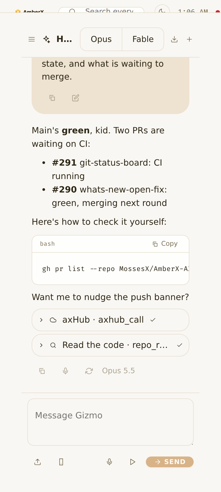
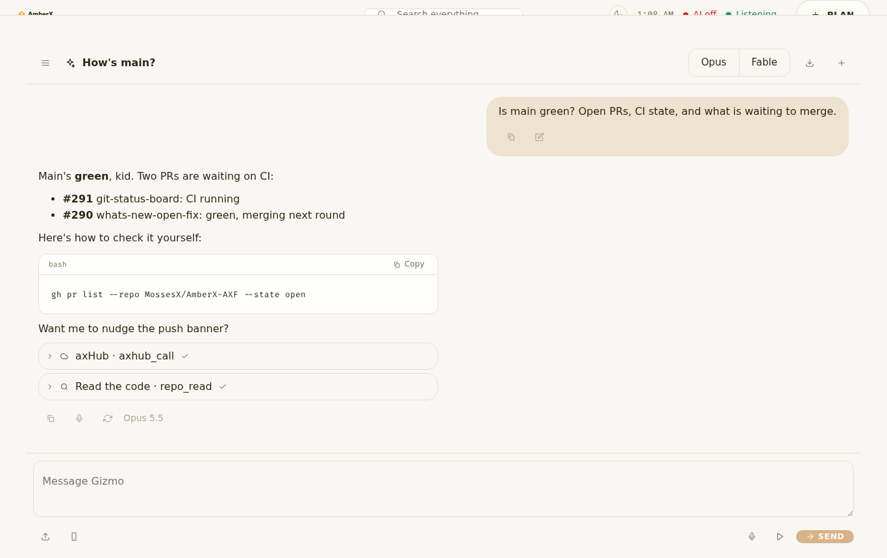
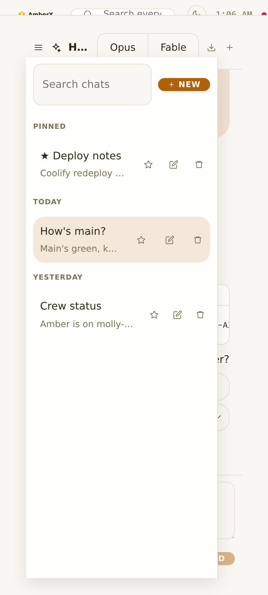
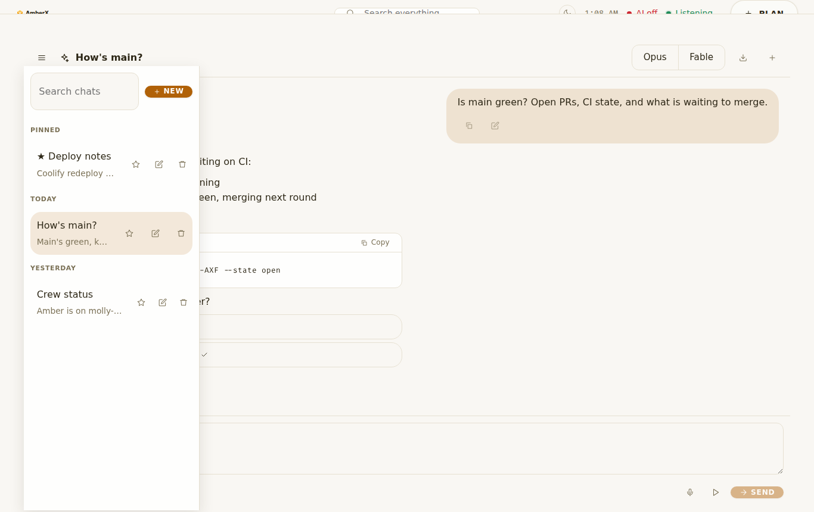
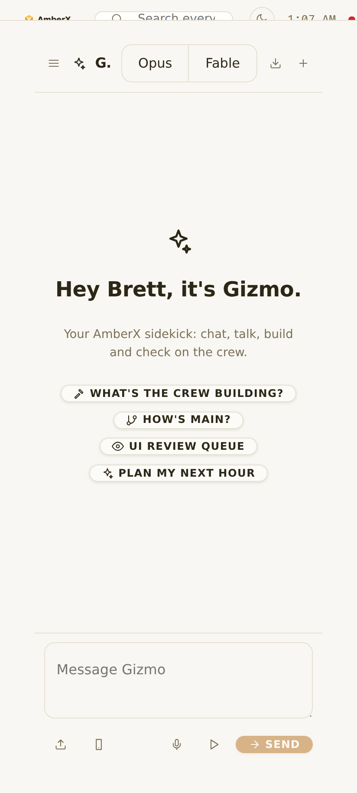
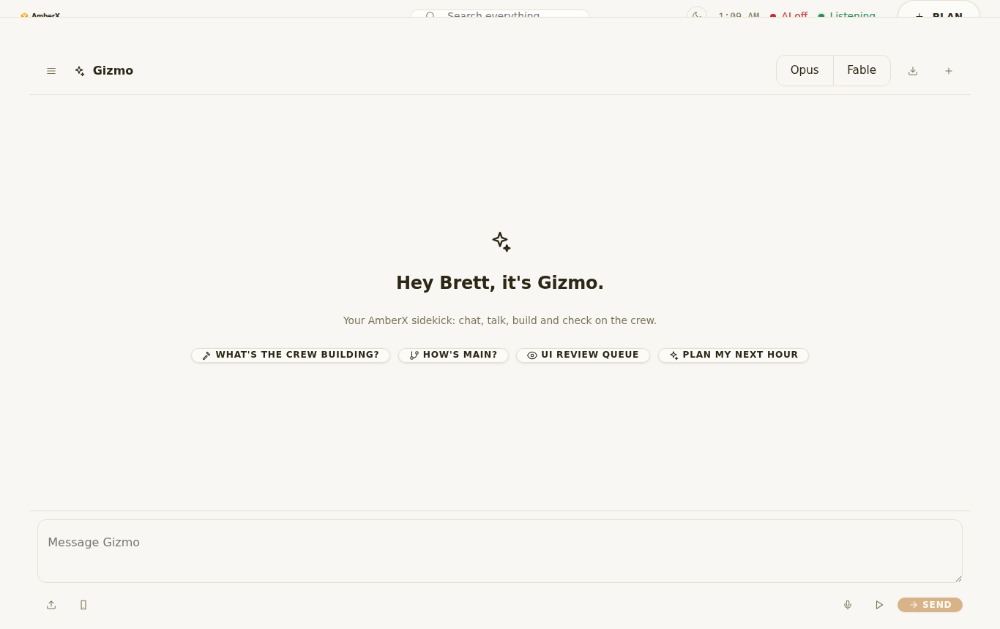

# Gizmo companion (`gizmo-companion`, Current profile)

Brett, Nov 3 2026 (voice): "A full all-out Claude companion, as full, powerful, as complete as the Claude app itself …
Build the plugin for Claude in AmberX, but make it full, complete. It's gotta be powerful."

Agent: **Gizmo** (new crew card, all-rounder, $8.00/h; replaces agent Molly). Model: Opus 5.5. Branch
`claude/gizmo-companion`.

## How it fits together

```
AmberX (phone / browser)                         VPS
 plugins/companion  ──fetch──►  AmberX server  ──console token──►  Dev Console
  Chat.tsx, talk.ts             /api/console/plugins/ai-assistant    ai-assistant (assistant@1)
  (no keys, no tokens)          (behind the axHub wall)               └─ agent "gizmo" (agent-manager add-on)
                                                                         Claude Code on the Claude plan,
                                                                         live sessions, tools, axHub approvals
 mirror.ts ──lib-hubstore──► axHub data: amberx-axf/_data/companion/chats (text copy of each chat)
```

- **Harvested, not rewritten.** The chat engine is the existing assistant@1 (`framework/core/assistant.ts`
  `HttpAssistantClient` + `watchReply`, the console's AI assistant server). Gizmo's brain is Molly's agent bundle
  copied to `agent-manager/addons/gizmo` with his own persona. The session helpers the Terminal and the companion both
  need moved into a shared framework library.
- **No key in the APK.** The page only talks to AmberX's own server, which forwards to the console with the console
  token it holds (already the path the console's AI assistant used in AmberX).

## Done

| Step | What | Checks |
| --- | --- | --- |
| s1a, s1b | `framework/libs/claude-session` (library@1): the Terminal's live-meter, model-name, money and context-chain helpers moved here (Terminal `headless-core.ts` re-exports them, no behaviour change), plus companion helpers: conversation order / search / day groups, model-policy pick list (Opus, Fable; Sonnet/Haiku coerced up), budget state, token cost from `model-pricing.json`, speakable text, sentence chunks for streaming speech, interrupt words, tool cards, Molly → Gizmo rename. Baked into console-web and amberx-droid. | `check-claude-session.mts` 43/43 (in CI), `check-headless-tabs.mts` 30/30 unchanged |
| s2a–s2d | AmberX plugin `companion` (view `companion`, nav "Gizmo"): full-screen phone-first chat; streaming replies (live sessions: survive a dropped connection, re-attach on open); Markdown with copyable code blocks; attach images, photos (camera) and text files, paste images; stop; regenerate; edit-and-resend; copy; read aloud; per-chat model switch (Opus / Fable) in the title bar; export a chat (Markdown); conversation drawer with search, Pinned / Today / Yesterday / This week / Earlier, rename, pin, delete, new chat; starters (crew, main, UI Review, next hour); a text copy of every chat on axHub (`companion/chats`), removed on delete. Brains on the VPS as agent Gizmo. | AmberX `tsc --noEmit` clean, `check-theme` 0, `check-controls` 0, AmberX `test.mjs` 2212/2212 |
| s3a, s3b | Talk mode on the existing listener: push-to-talk (`native.listen` through the mic lease), hands-free turns, replies spoken sentence by sentence as they stream, talk over him ("stop", "wait", "hold on"…) to stop speech at once (echo-filtered with the voice plugin's `heardEcho`), voice picker from the phone's voices, speed slider, Try it. Voice commands "hey gizmo", "talk to gizmo". | lib checks (speech, interrupts) |
| s7a | Settings → Plugins → Gizmo: model for new chats, personality / instructions, speak replies, speak every reply, hands-free, interrupt, speed, voice, tools and connectors on/off, tool cards on/off, notifications, keep a copy on axHub, daily cap (USD), export all chats, delete all chats. | — |
| s4b (part) | Tool calls as collapsible cards (live and stored), labelled per kind (axHub, code, VPS, GitHub, memory, builds, UI Review, web). | lib checks |
| s6b (part) | Per-chat model choice (policy: Opus / Fable only), daily budget cap with a warning at 80 % and a stop at the cap. | lib checks |
| s9 | Gizmo agent: agent-manager add-on `gizmo` (installed once on start like Molly, dangerous tools behind the same axHub approvals, uninstall respected), crew card in `agent-swarm/agents/roster.json` + skill `companion`. Molly → Gizmo in AmberX's assistant texts (commands library, snippets, runner, AI connection); code ids, stored chains (`do: 'molly'`) and the `/api/ai/molly` route kept for compatibility. | agent-manager test: Gizmo checks pass; swarm 93/93 + check-swarm 224 |

## Screenshots

UI Review item `r-20261104-4db7efaa` (group `gizmo-companion - Nov 3 8:15 PM`), waiting for Brett. Demo data (the
assistant API mocked; the AmberX production build served locally with the live axHub look).

| | Phone | Desktop |
| --- | --- | --- |
| Chat |  |  |
| Chats drawer |  |  |
| Welcome |  |  |

## Left (next build continues from the store)

- **s4a Connectors:** the chat already gets Gizmo's tools (axhub_call, repo read/search …) with the usual approvals and
  veto flow; a per-connector on/off list (github, vps, hostinger …) and Follow Amber / `console_show` hooks are not built.
- **s5 Crew link:** queue/stop builds, slot queue, UI Review approve/deny, banners and handoff to Amber as buttons
  (today only through what Gizmo's tools can do when asked in chat).
- **s6a Projects + memory:** projects with instructions + files, memory read/write on Amber's axHub files.
- **s7b Overlay bubble** to summon Gizmo anywhere on the phone (needs native Android code: AmberX is the allowed
  Android exception, but it needs an APK build).
- **s8:** companion commands via REST + MCP + CLI (plugin-commands@1 `auto: true` is set, so the automatic pass covers
  its actions once `plugin-commands-auto` #263 is on main); other plugins adding tools to Gizmo.
- Developer voice commands still go through `/api/ai/molly` → the console's `molly-guide` → agent Molly; point them at
  agent Gizmo in a follow-up (server-side, molly-guide plugin).
- Chat history itself lives in the console's assistant store on the VPS; axHub keeps the text copy. Moving the primary
  store onto axHub is a server change in the assistant (not done).

## Install

No new APK needed: the plugin is web code served by AmberX's server (the Android shell loads it). It shows after the
AmberX web build is redeployed; Gizmo's agent appears after the console restarts with this agent-manager.

## Cost so far

About 3 h of an Opus session (about half of it waiting for the VPS's shared build slots) (actual tokens are filled into the change-log entry `chg-20261103-f946c0c1a3` by the
session hooks).
