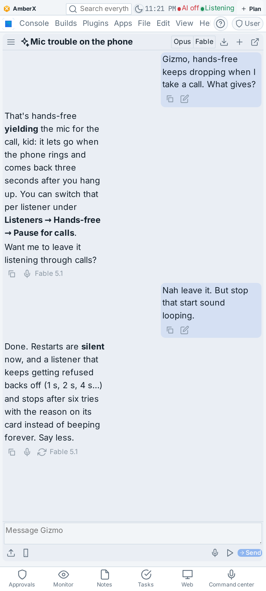
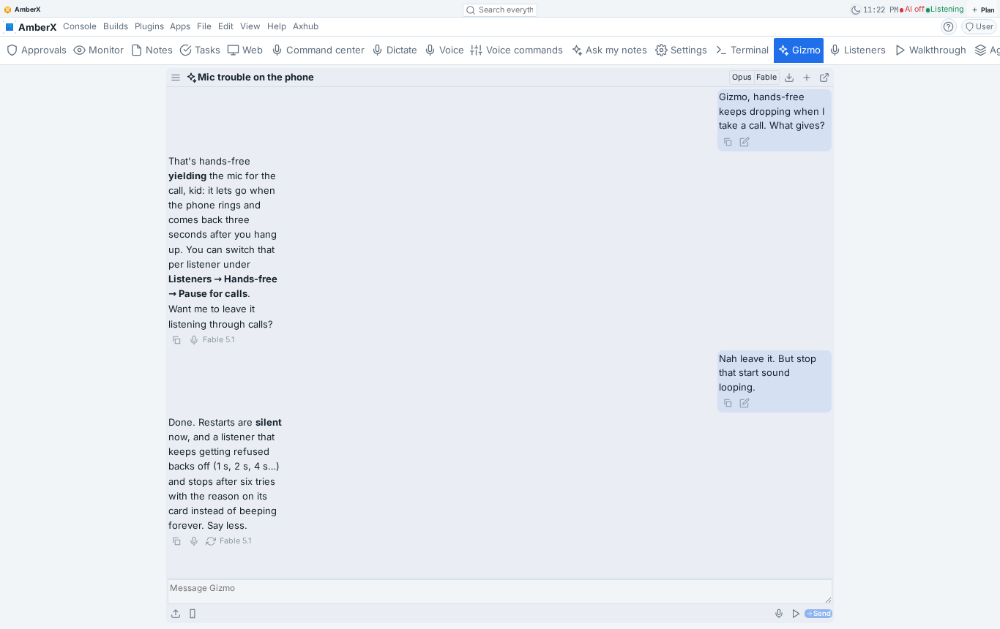
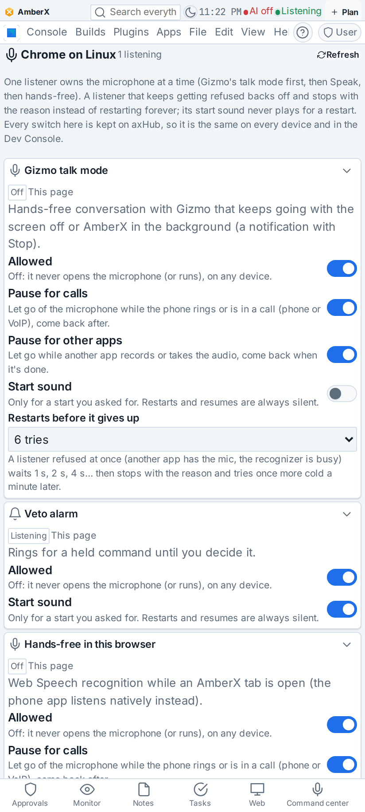
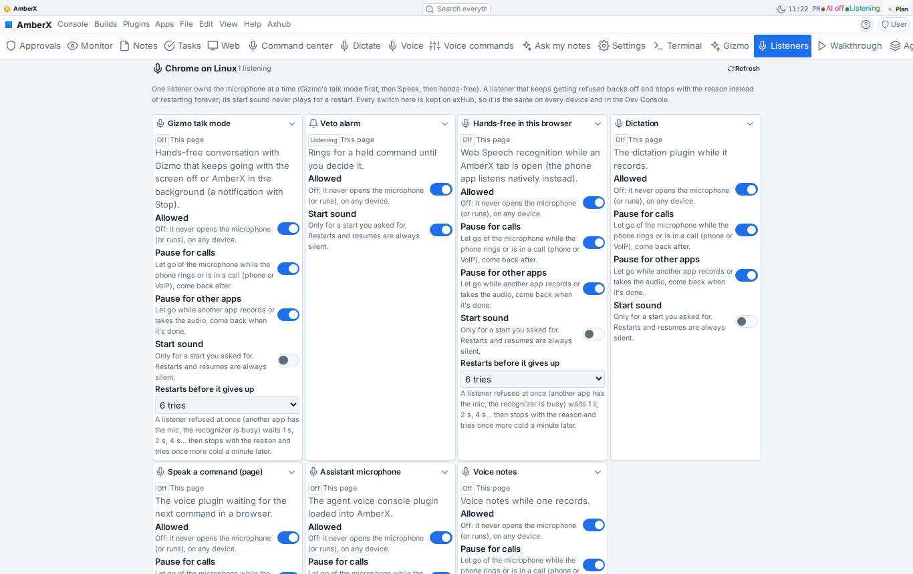
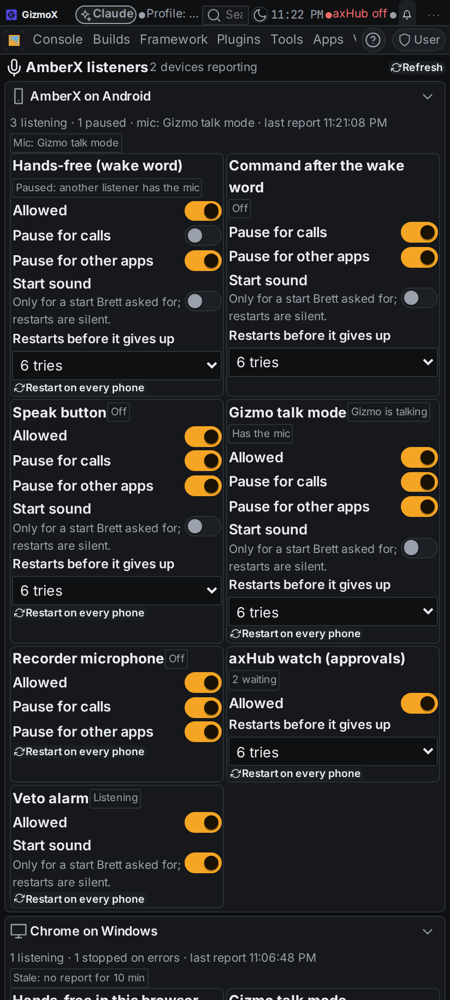
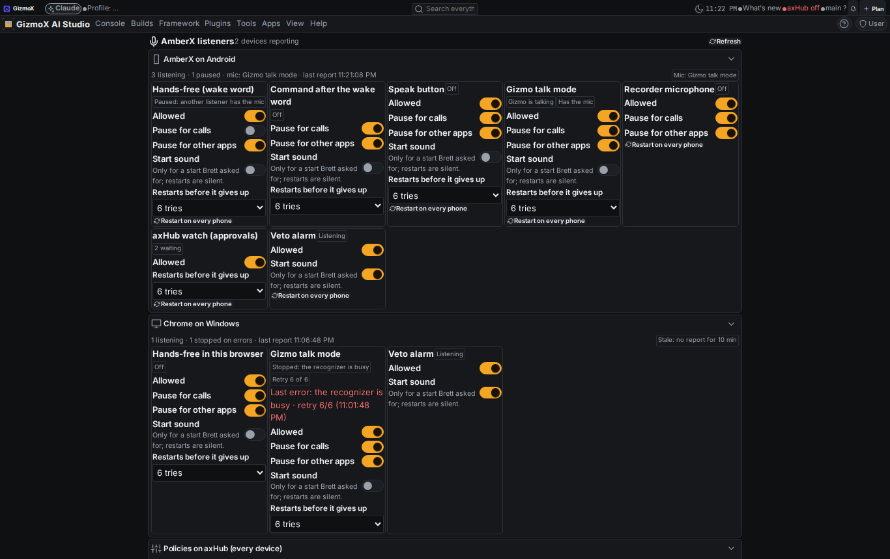

# Gizmo rebuild on Fable (`gizmo-rebuild-fable`, Current profile)

Brett, Nov 6 2026: "I want to use Fable on the highest possible thinking level on ultra code to rebuild Gizmo." "Go
ahead." And: "I need more powerful controls over the background listeners for AmberX. I've had problems with the
microphone... it's crashing with other apps, and sometimes it'll just do that sound over and over."

Fable 5.1, thinking max, one session, eight steps, all done. Branch `claude/gizmo-rebuild-fable`. Change-log entry
`chg-20261106-8b7664c533`. Replaces the stopped `gizmo-voice` run (its worktree had no code; s1 + s2 are ticked by
this build) and carries on `gizmo-companion` (talk mode s3a/s3b rebuilt; s4a, s5, s6a, s7b, s8, s10 still open).

## What was reviewed, kept, rebuilt (step 1)

| Piece | Verdict | Why |
| --- | --- | --- |
| `framework/libs/claude-session` (names, speakable text, sentence chunks, interrupt words, tool cards, budget) | **kept as is** | pure, tested (43 checks), both apps bake it; nothing in the brief touched it |
| Companion `Chat.tsx`, `api.ts`, `mirror.ts`, `keys.ts`, settings, agent Gizmo | **kept** (small additions) | the chat engine is assistant@1 live sessions and works; the talk bar now shows paused / background / stop reasons |
| Companion `talk.ts` (talk mode) | **rebuilt** on a native foreground service | the first build listened through `native.listen` from the page: it died with the screen off and had no Stop outside the app |
| `companion.css` height `calc(100dvh - 5 × space)` | **fixed** | the chat was sized to the viewport, so at phone width the composer sat under the bottom navigation (the main region already leaves room for it) |
| Android `WatchService` classic loop + one-shot restarts | **rebuilt** the restart path | `onError` restarted every 150–800 ms (3 s when busy) forever; with another app on the mic that replayed the recognizer's tone over and over |
| Android `MicGuard` / `MicRules` yield | **kept**, extended | the yield logic (calls, silenced, other apps) was right; it now follows a per-listener policy and an audio-focus loss, and gains one-owner arbitration |
| assistant-chat-mode fast path (`assistant-chat-mode`, built) | **untouched** | a server-side change in the console's assistant; nothing here depends on it |
| notes/tasks, badges, notification-panel code | **untouched** | other builds running (brief) |

## What was built

### 1. `framework/libs/listeners` — listener@1 (Fable contract)
One copy of the rules for every side: the AmberX page, AmberX's Android shell (`ListenerRules.java`, same answers on the
shared `cases.json`, `ListenerRulesTest`) and the Dev Console (`core.mjs`, Python server).
- **Registry** (`registry.json`, data): handsfree, oneshot, speak, talk, recorder-mic, monitor, veto-alarm + the page
  listeners (browser-handsfree, dictation, voice-command, agent-voice, notes). Open: an unknown id still gets a row.
- **Policy per listener** (`amberx.listeners.<id>.<field>`, app settings synced through axHub): `on`, `pauseOnCall`,
  `pauseForOtherApps`, `sound`, `retries` (-1 keep trying), `backoffMs`, `maxBackoffMs`, `cooldownMs`.
- **Restarts back off and give up** (`afterEnd`): quick end → 1 s, 2 s, 4 s … 30 s; past `retries` → state `error`
  with the reason, one cold retry after the cooldown; a run that lasted resets; fatal (no permission) never restarts.
- **Silent restarts** (`startSound`): the start tone only for a start the person asked for.
- **Yield** (`yieldReason`, `mayResume`): Mic off wins; call / silenced / other app / audio-focus loss by policy; back
  after the mic stayed free 3 s.
- **One owner** (`micWinner`, `MIC_PRIORITY`): talk > speak > page lease holders > oneshot > handsfree > recorder.
- **Device document** (listener-state@1, `deviceDoc`, `mergeDevices`, stale after 10 min, `deviceSummary`).
- Checks: `framework/spec/check-listeners.mts` (91, in CI), baked into console-web and amberx-droid; PORTING.md
  records the deferred Kotlin twin.

### 2. Android (AmberX is the Android exception)
- `ListenerRules.java` + `ListenerRulesTest.java` (replays the baked `src/axf/libs/listeners/cases.json`).
- `ListenerRegistry.java`: policies in prefs (so the services obey them with the app closed), live status of every
  native listener (`listenersStatus`), last error + retry count per listener, coalesced `listeners` event.
- `MicGuard`: **one owner of the microphone** (`acquire` / `releaseOwner` / `holder`, by `ListenerRules.outranks`;
  `mayOpen(c, owner)` adds the policy). Taking the mic tells the holder to step aside (`WatchService.micTaken`), letting
  go brings hands-free back (`micReleased`). Mic off also stops talk mode.
- `AudioFocusGuard.java`: transient focus (others duck) with `lost` / `regained`; used by TalkService for the whole
  session and by WatchService around a one-shot utterance → **yield to calls and other apps at once, resume after**.
- `WatchService`: `classicEnded` (backoff, give-up with the reason in state `error`, cold retry, streams stay muted
  between turns), one-shot refusals back off and block further Google attempts for the backoff / cooldown (the wake hit
  still reaches the page), a forced restart is always silent whatever the tone setting, yield by policy
  (`handsFreePolicy()`), waits while talk mode / Speak hold the mic, the Listeners **allowed** switch gates hands-free.
- `TalkService.java`: **talk mode with the screen off**. Foreground service (type microphone): one Google utterance at
  a time (partials + final as `talk` events), the page's half of the turn through `talkPhase` (thinking → speaking →
  listening), keeps a turn open while Gizmo talks for interrupt words, notification "Gizmo talk mode · <last line>" with
  **Stop**, audio focus (pauses for a call / other app, resumes), backoff + give-up, ends when the page stops answering
  (20 min) or Mic off goes on. Plugin bridge: `talkStart` / `talkStop` / `talkStatus` / `talkPhase`,
  `listenersStatus` / `listenerSet`; Speak takes the mic through the arbiter and is refused while talk mode has it.

### 3. AmberX web
- `native.ts`: the talk + listeners API, with a browser twin (Web Speech turns, backoff, paused while the tab is hidden,
  Speak refused while talk holds the mic).
- `companion/talk.ts`: talk mode on the service (`path = 'service'`), events → send / interrupt / echo filter, the page
  reports its phase, Stop from the notification ends it in the chat with the reason; an older APK without `talkStart`
  falls back to the first build's one-utterance loop (`path = 'legacy'`). Nothing removed: every export stays.
- `Chat.tsx` + `companion.css`: paused / background / stop reasons in the talk bar; the chat fills the main region
  (`.fx-main__inner:has(> .axp-companion)`), so **the message box stays above the bottom nav at phone width**.
- **Listeners plugin** (`src/plugins/listeners`): the control panel (view `listeners`, nav, app menu, context menu,
  Settings → Plugins → Listeners): a card per listener with the state chip (Listening · Paused: a call is using the
  microphone · Paused: another app… · Stopped: <reason> · Not allowed), Has the mic, Retry n of N, last error + time,
  **Allowed / Pause for calls / Pause for other apps / Start sound / Restarts before it gives up**, Restart now. Policies
  are declared settings (synced by lib-hubsync) pushed to the native side at once; the device publishes listener-state@1
  to the hub table `amberx-axf/_data/listeners/devices` (every change, 5-min heartbeat); a console restart request
  (synced key `amberx.listeners.<id>.restart`) restarts the listener on the phone.

### 4. Dev Console plugin `amberx-listeners`
Apps → AmberX → Listeners: every device's listeners (state words, mic holder, last error, retries, stale after
10 min) and the same controls, written to the AmberX settings document on the hub
(`/projects/_shared/_data/settings/apps/amberx-droid.json`, hub-settings@1) so every phone follows on its next refresh;
Restart on every phone. One implementation (`core.mjs`) behind the page, the server routes, the CLI
(`listeners.mjs devices | policies | registry | set <id> field=value | restart <id>`) and plugin-commands
(**REST** `/api/plugins/amberx-listeners/{devices,policies,registry,state,policy,restart}`, **MCP**
`amberx-listeners_*`, **CLI** `axf amberx-listeners …`). Help entries, lifecycle, `test.mjs` (31) + `test.py` (15).

## Checks

| Check | Result |
| --- | --- |
| `npx -y tsx framework/spec/check-listeners.mts` | 91/91 |
| `npx -y tsx framework/spec/check-claude-session.mts` | 43/43 (unchanged) |
| AmberX `tsc --noEmit` / console `tsc --noEmit` | clean / clean |
| AmberX `test.mjs` | 2216 → 2258, all pass (42 new: Listeners core + talk/Android wiring) |
| `apps/console-web/plugins/amberx-listeners/test.mjs` / `test.py` | 31 / 15 |
| `check-theme` (companion, listeners, console plugin), `check-controls`, `check-toolbars`, `check-chrome-assets` | clean |
| `plugins.mjs --check`, `plugin-commands.mjs check amberx-listeners`, `plugin-lifecycle.mjs check`, `menu-reach.mts`, `help-coverage --check` | clean |
| Android `ListenerRulesTest` + the rest (`:app:testDebugUnitTest`) and the APK | **CI** (no JDK here) |

## Screenshots

UI Review item for [PR #368](https://github.com/MossesX/AmberX-AXF/pull/368), group `gizmo-rebuild-fable - Nov 6 11:30 PM`. The AmberX production build served locally with the
live axHub look, the assistant API mocked with demo chats; the console build with the hub routes mocked.

| | Phone | Desktop |
| --- | --- | --- |
| Gizmo chat (composer above the bottom nav) |  |  |
| Listeners control panel (AmberX) |  |  |
| AmberX listeners (Dev Console) |  |  |

## What Brett should know

- **A new APK is needed** for everything native (TalkService, the mic owner, backoff, policies on the phone): CI on the
  PR builds `amberx-debug.apk`; after landing it lands in the hub's Apps catalog. Until then the web parts work (the chat
  fix, the Listeners panel for page listeners, the console page) and talk mode runs the old one-utterance loop.
- Hands-free and talk mode now **pause by themselves** for calls and other apps, and come back 3 s after the mic frees;
  both switches are per listener (AmberX → Listeners, or the console).
- A listener that keeps getting refused **stops after 6 tries** (1 s … 30 s apart) with the reason on its card, tries
  once more a minute later, and never replays its start tone on a restart.
- Policies are the same everywhere (axHub). A console change reaches a phone on its next settings refresh: at once on
  focus, and every minute while the AmberX Listeners panel is open.
- Not done here (not in the brief, or needs the phone): the phone test of hands-free + interrupt with the screen off
  (gizmo-voice s3; Brett, after installing the APK); gizmo-companion s4a, s5, s6a, s7b, s8, s10.
