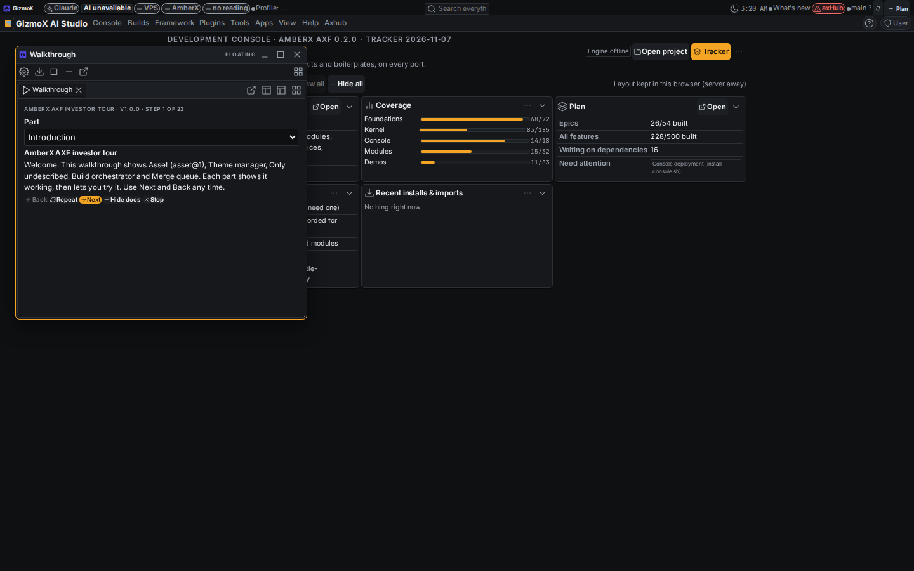
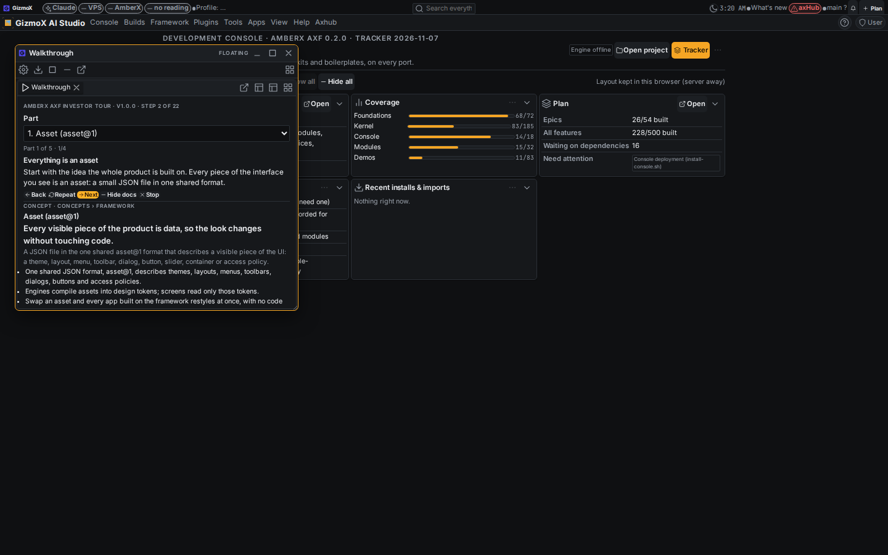
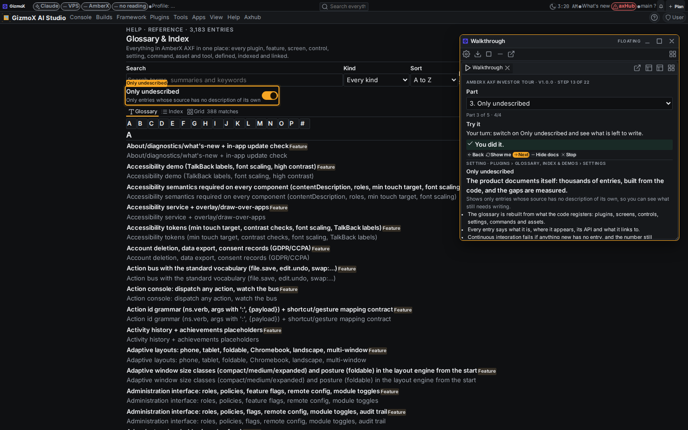
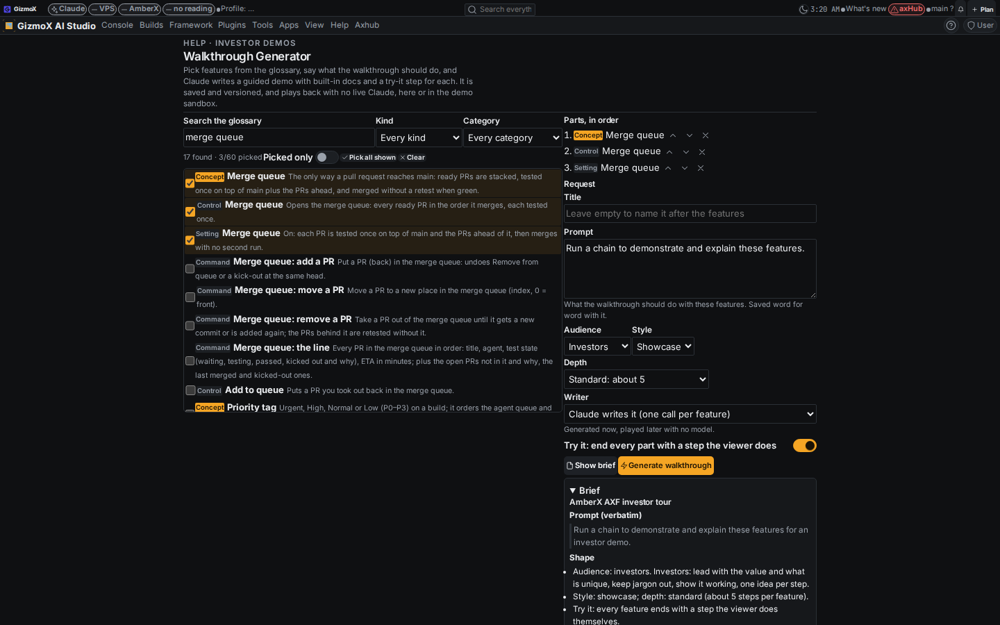
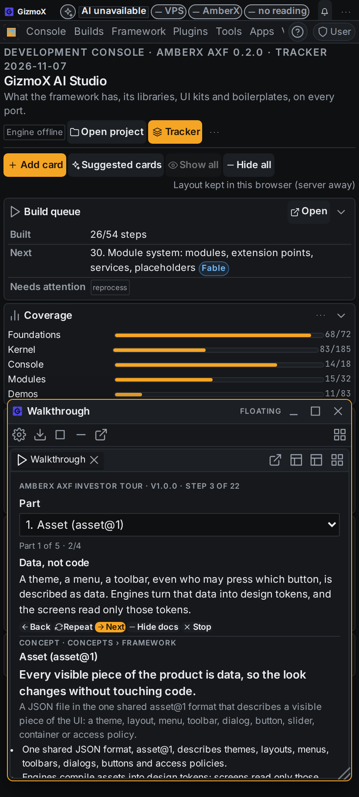
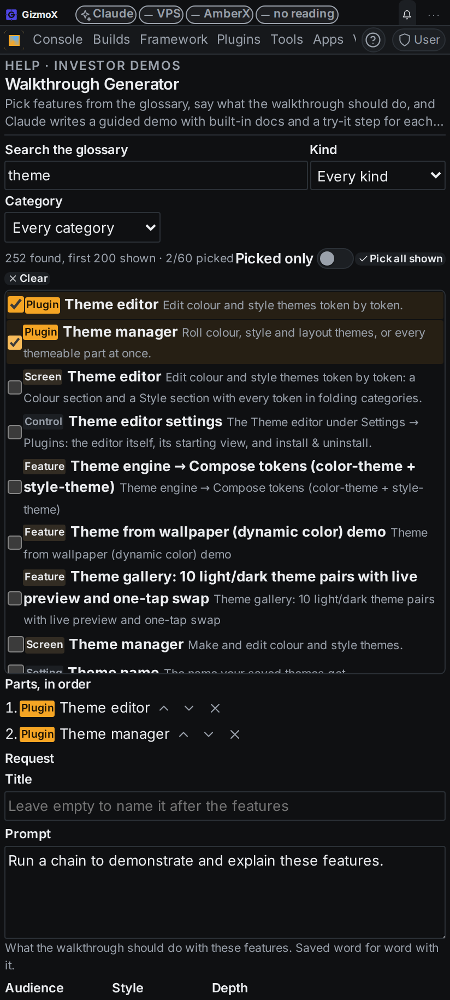

# Glossary walkthrough generator (investor demos)

Build `glossary-walkthrough-generator-investor-demos` · branch `claude/glossary-walkthrough-generator` · Opus 5.5 · Nov 8 2026.

## Brett said (verbatim)

> Pick any number of terms from the existing glossary (thousands of entries), write a prompt (e.g. 'run a chain to demonstrate and explain these features'), and generate an interactive walkthrough: a guided demo that shows each feature in action, with built-in interactive documentation. Walkthroughs are pre-generated by Claude and saved; they play back in the demo sandbox with no live Claude. The 'Demo sandbox system + sandbox settings panel' build depends on this one. Purpose: investor demos.

## Depends on

The glossary itself (`glossary-index-demos`, branch `claude/glossary-index-demos-r3`) was marked complete but was never
opened as a PR, so it is not on main. This branch merges r3 in and builds on it (no duplicate of the glossary,
demonstration@1, book@1 or the player). Landing this branch lands both.

## What was built (all in the Glossary & Index plugin)

| Step | What |
| --- | --- |
| s1 picker | Walkthrough Generator page: search, kind and category filters, Picked only, Pick all shown (cap 60), parts in order with move up / down / remove. `web/walkthrough-pick.ts` (pure). |
| s2 request + brief | `glossary-walkthrough-request@1` (terms, prompt verbatim, title, audience, style, depth, writer, try-it) → brief (markdown) shown by **Show brief** and saved with the walkthrough. `walkthrough-rules.mjs`. |
| s3 chain runner | One prompt per part with only the actions / targets that exist; replies parsed as JSON, invented screens dropped, template stands in per part. Server: background job through `axf.llm@1` (`POST walkthrough/generate`, `GET walkthrough/job`, cancel). CLI: `walkthroughs.mjs generate --llm claude` (Opus) or `plan` → answer → `assemble --replies`. |
| s4 format + storage + versions | `glossary-walkthrough@1` in `<dataDir>/walkthrough/<id>/current.json` + `v<version>.json` (50 kept); regenerate bumps the minor version; versions with diff (added / removed / rewritten); restore saves as a new version. Also writes a `demonstration@1` per part and a `book@1` (tour). Export / import file `glossary-walkthrough-export@1`. |
| s5 player | Floating walkthrough player: parts as chapters, Back / Repeat / Next / Docs / Stop, keys, actions `walkthrough.*`, docs card per part, try-it steps that wait for the viewer's own tap on the highlighted control, a clear message when the control is not on screen, and the window moves off the control it highlights. Phone-sized window on phones. |
| s6 sandbox hook + e2e | `?axf-walkthrough=<id>` and `?axf-walkthrough-src=<same-origin .json>` (+ `&axf-walkthrough-step=n`) play on load with no API; sample `samples/investor-tour.walkthrough.json` written by Claude ahead of time (5 parts, all Claude). Browser e2e on the built console (below). |

No new framework asset type: the walkthrough format is the plugin's own data contract, and everything visible is
already an asset (demonstration@1 + book@1 per walkthrough; the UI is framework controls on theme tokens).

## Fixed on the way

- **Theme manager crashed the whole console** once the r3 asset types (demonstration, book, clip, docs) exist: it read
  the active asset of every type and those have none. It now themes only types with an active asset.
  (`plugins/theme-manager/web/ThemeManager.tsx`; theme-manager test 34/34.)
- Demonstration player highlight: help ids (label slugs such as `only-undescribed`) now resolve the way Help mode does
  (`describeHelpElement` + `helpTarget`), so generated targets land on real controls in both players.
- r3 leftovers that would have failed CI on landing: plugin nav on one line (menu-reach), lifecycle mentions for
  THREADS.md / RULES.md.

## Tests

- `npx -y tsx apps/console-web/plugins/glossary-index/test.mts`: 29 checks (8 new walkthrough checks + the sample), also
  under Node 22 `--experimental-strip-types` (CI's runner).
- `python3 apps/console-web/plugins/glossary-index/test.py` (new): 20 checks, routes + background chain with no provider
  and with a fake `axf.llm@1` (one call per part, a failing call falls back to the template).
- Browser e2e (`e2e-run.mjs` in this folder; vite preview of the built console, API mocked, the sample served as a
  static file the way a sandbox would): player opens from the file, Next, docs card, Part picker navigates (Theme
  manager), try-it waits, highlight lands on the real switch, tapping it completes the step, generator search / pick /
  order / brief. 9/9 pass.
- CI checks run locally: tsc, check-theme, check-controls, check-toolbars, check-chrome-assets, help-coverage (100%),
  plugin-commands (3 suites), catalog `--check`, plugin-lifecycle, MCP tools 203, theme-manager 34.
- Known unrelated failure: `menu-reach.mts` reports `shipped-features` (another plugin, not touched here).

## Screenshots

| | |
| --- | --- |
|  |  |
|  |  |
|  |  |

## Gaps / next

- Concept entries have no on-screen action, so their parts are narrated only; a later pass could map concepts to the
  screens that show them (e.g. asset → Theme manager).
- Try-it can't switch a view mode by itself (only `nav:` and actions the entry exposes).
- The demo sandbox build (`demo-sandbox-system-sandbox-settings-panel`) consumes this: serve the exported file beside
  the console and open `?axf-walkthrough-src=…`, or import it and open `?axf-walkthrough=<id>`.
- UI Review submission with options is listed in THREADS (to carry on) if it did not go through from this session.
