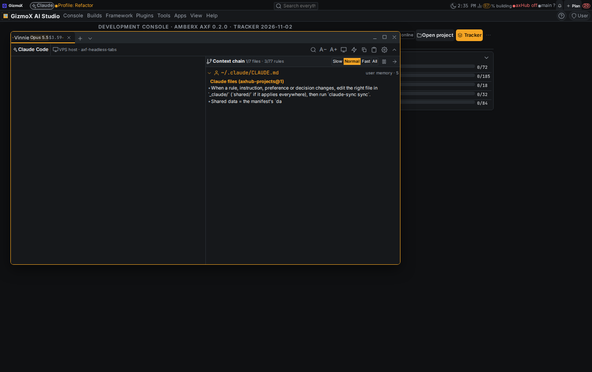
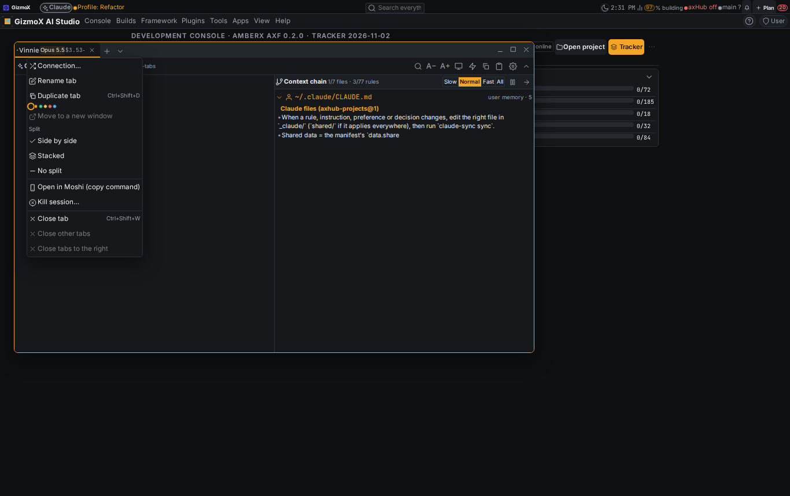
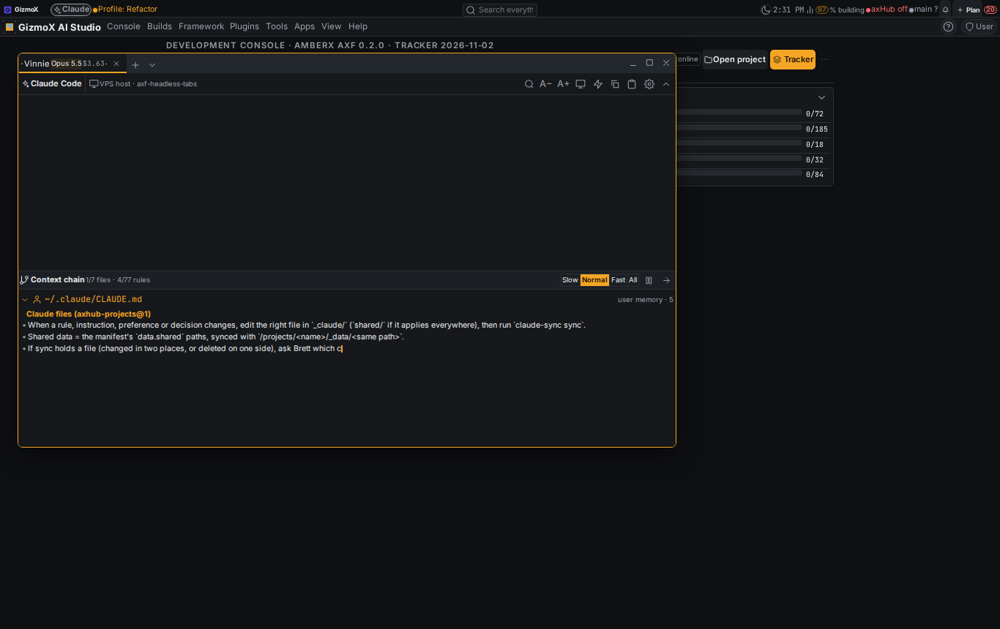
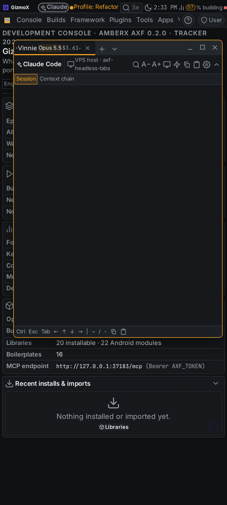
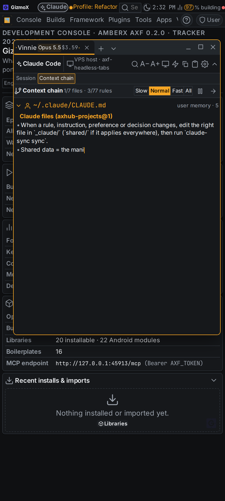

# headless-tabs — report

Urgent profile · Opus 5.5 · branch `claude/headless-tabs` · Nov 3 2026 · requested by Brett (voice), GO given.

## What it does

1. **Persistent tabs (s1).** Every VPS and console tab (shell or Claude Code) runs inside a tmux session named `axt-…`.
   The browser picks the name once and keeps it with the tab (localStorage). The ssh / pty link on the console server is
   only an attachment: after a reload, phone sleep, a reaped link, or a console restart the tab opens a new link on the
   same name, which replays the pane's last 3000 lines with colours (`tmux capture-pane -e -J`) and re-attaches.
   Closing a tab **detaches** (the session lives on; ∨ → *Running sessions* re-opens it). Tab menu → **Kill session…**
   (confirm) ends it. Tab menu → **Open in Moshi** copies `mosh root@<vps> -- tmux attach -t <name>` (console tabs:
   `… -- docker exec -it <container> tmux attach -t <name>`). Container tabs keep the old server-side ring buffer.
   Setting `persistTabs` (on). The console image now installs tmux.
2. **Headless sessions open their own tab (s2).** `deploy/claude-headless.sh` tags each run's tmux session
   (`@axf_kind headless`, `@axf_agent`, `@axf_model`, `@axf_cwd`, `@axf_meter`, `@axf_chain`) and appends
   `session-start` / `session-end` lines to `$AXF_HEADLESS_DIR/events.jsonl` (default `/var/tmp/axf-headless`). Agent =
   `--agent`, else `AXF_AGENT` (the swarm router now passes the agent's name), else the build name; model = `AXF_MODEL`,
   else the `--model` in the claude args. One `tmux ls -F` reads every session with its tags. The console opens a tab for
   every running `axf-…` session that no live terminal window shows, on every load too (so builds started while the
   console was closed appear), unless that tab was closed by hand. Covers `vps.build_start`, console launches, swarm jobs
   and orchestrator launches, since they all go through the launcher.
3. **Live cost (s3).** The stream printer (`deploy/claude-stream.mjs --meter … --chain …`) feeds `deploy/claude-meter.mjs`,
   which writes `<session>.meter.json` (headless-meter@1) at most once a second: each assistant message counted once
   (last usage per message id) × the model's price from `framework/schemas/model-pricing.json` (config, nothing in the
   UI); a `result` event's `total_cost_usd` replaces the estimate for that run; account-switch re-runs add up. Routes:
   `GET headless/meters?names=…` (one ssh call for all tabs, cached 2 s; ssh connection multiplexed),
   `GET headless/<name>/chain`, `GET tmux`, `POST tmux/kill`, `POST sessions/<id>/kill`.
4. **Tab title (s4).** Agent · model (`Opus 5.5`) · cost (grey while it is an estimate) + status dot: working (pulsing
   accent), waiting (quiet for a minute, no tool running), done, failed. Renaming the tab keeps your name.
5. **Split pane (s5).** Session + context chain side by side or stacked; tab menu → Split (remembered per tab), default in
   Settings → Terminal → Headless tabs. Narrower than about 40 characters of text per pane, it becomes one swipeable row
   with *Session* / *Context chain* chips (phone).
6. **Context chain (s6).** The files the session takes in, in order: Claude Code's CLAUDE.md load order (user memory,
   project memory from the outermost folder in, `@imports` depth-first up to 5 levels, `.claude/rules`), then each file
   it `Read`s (a read inside a folder with its own CLAUDE.md brings that in first). Imports nest under the importing file.
   Each Markdown file's rules (headings + list items, code blocks skipped) type out one at a time: Slow 18 chars/s,
   Normal 45, Fast 140, All; pause between rules; Pause / Play; Skip to the end. Finished files fold to one line.

## Screenshots

Taken with `framework/cli/rebuild-shots.mjs` (`AXF_APPEARANCE_HUB=off`, the sandbox can't reach axHub's look), with a
fetch stub standing in for one running headless session (agent Vinnie, Opus 5.5, cost climbing; the chain is this repo's
real one). Pane A is empty in every shot: under the harness's Vite dev server the vendored xterm script never loads; the
same happens on `main` (checked on a base worktree), so it is the harness, not this build.

| | |
|---|---|
| Desktop, side by side |  |
| Tab menu: Split, Open in Moshi, Kill session |  |
| Stacked |  |
| Phone: session pane, swipe chips |  |
| Phone: swiped to the chain |  |

## Tests

- `python3 apps/console-web/plugins/console-terminal/test.py`: 75 → **97** checks. New: a real tmux console tab
  survives its link closing, is tagged / quiet / 50000 lines, re-opening replays scrollback that had scrolled off the
  screen, Kill session ends it; tmux name guards; the token reaches a Claude tab's tmux session from the environment
  only (never the command line or tmux's global environment); `tmux ls` parsing; meters (one ssh call, bad names dropped,
  cached); chain; Moshi / ssh attach commands.
- `npx -y tsx framework/spec/check-headless-tabs.mts` (new, in CI): **30** checks: rules and imports, the memory chain
  order with an import cycle, cost per message once, reconciliation to `total_cost_usd`, re-runs adding up, no-result =
  failed, unpriced models flagged, the stream printer writing both files, persistable tabs, auto-open selection, status
  dot, labels, reveal pacing.
- End to end on this VPS: `claude-headless.sh` with real tmux tagged the session, wrote `session-start`, and the meter
  tracked a real Claude Code stream live ($0.07 at kill time).
- `apps/console-web/plugins/agent-swarm/test.mjs` 87/87, `framework/spec/check-agent-slots.mjs` 56/56, `tsc --noEmit`
  clean, `check-theme` and `check-controls` clean, help coverage back at 100% (19 new entries), plugin lifecycle clean.

## Found and fixed along the way

- `tmux … -t =name` works for `has-session` / `attach` / `kill-session` but not for pane or option targets
  (`capture-pane`, `show-options`, `set-option`): those need `=name:`. Fixed; the self-test now proves it.
- The narrow (swipe) breakpoint first used `--fx-space`, which is 3.4px on the phone density; it now uses the body text
  size token, measured by a hidden probe so it resolves through `calc()`.

## Known gaps

- Interactive (non-headless) Claude Code tabs have no cost meter or context chain: they don't speak stream-json. Their
  transcript could feed the same meter later.
- The `events.jsonl` log is written but the console reads the live list from `tmux ls` (tags included), which already
  covers sessions started while the console was closed; the log is there for other readers (Build manager, axHub).
- The console's local tmux tabs end when the console container is rebuilt (VPS tabs do not).
- Android: deferred gap recorded in `framework/spec/PORTING.md` (Android on hold).
