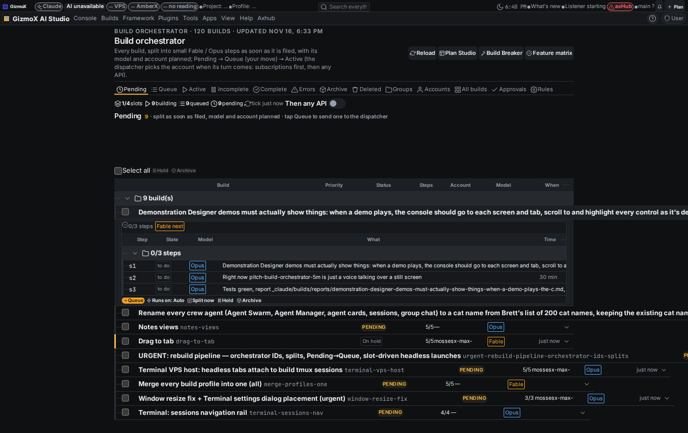
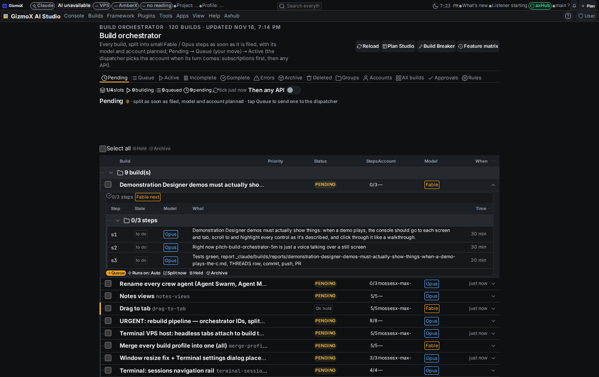
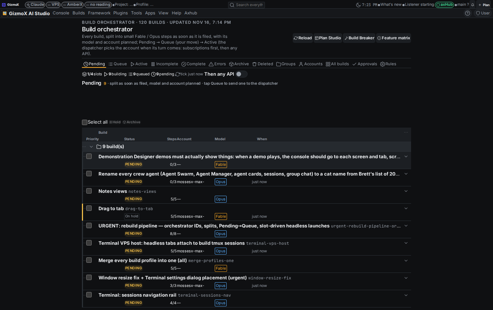

# Hotfix: orchestrator grid columns don't line up

Build `hotfix-orchestrator-grid-columns-don-t` · branch `claude/hotfix-orchestrator-grid-columns-don-t` · Phase 1 (Opus)

Brett said (2026-11-16 18:28):
> Line up the grid in the orchestrator, the pending builds grid, none of the columns are lined up, it looks like trash. I built a skin on Fable and it did that.

## Root cause (s2)

`lib-datagrid` (`framework/libs/datagrid`) drew the header and **every row as its own CSS grid**:

```css
.axf-grid-head, .axf-grid-row { display: grid; grid-template-columns: var(--axf-grid-cols); min-width: max-content; … }
```

They shared the same *track list* (`--axf-grid-cols`), but each one resolved it alone. That is only safe when every
track is a fixed length. The build grids use flexible and intrinsic tracks:

- Pending / Queue / Active / Incomplete / Complete / Errors / Archive / Deleted (`plugins/build-orchestrator/web/pipeline.tsx`):
  the Build column is `minmax(14em, 4fr)`;
- the steps sub-grid: the What column is `minmax(14em, 1fr)`;
- every grid with row hooks: the tail track is `minmax(4sp, max-content)`.

Each row is `min-width: max-content` and its cells are `white-space: nowrap` (`orchestrator.css`). A row whose title is
longer than the screen is wider than the header, so its `fr` track takes the extra width, and every column after it
moves right by that much. A short row and the header stay put. Measured before the fix: the Build cell runs up to
2,275px past its header on a phone, and 35–72 of every 72 header/cell pairs are off per tab. The All builds grid
(`ui.tsx`, every track bounded, no `fr`) lines up, which confirms the cause.

**Why it looked like the skin did it.** It doesn't depend on the skin: the default look fails the same way (see the
before set). A skin with a wider font or more cell padding makes more titles overflow, so more rows break and it gets
far more visible. Brett's Fable-made skin lives on the hub (not in `framework/assets/skin`); the framework skins
(`windows` measured) fail identically.

**What the two named builds changed.**

- `console-look-becomes-default-axhub-skin` (#717): no change to the grid CSS, the DataGrid component or grid tokens.
  It moves the console's look into a skin, so the console now draws under a skin by default; that is when the bug
  became visible on the live console.
- `every-grid-1-2-rows-per-item-set-skin` (#707, draft, **not on main**): adds the `grid.rowLines` token
  (`--fx-grid-row-lines`, `data-axf-row-lines`) and the `grid-rows@1` contract (primary cells on line 1, secondary on
  line 2) plus a separate `fx-rows` renderer. None of its CSS reaches DataGrid yet, so there is no 2-row mode on
  main. This hotfix gives DataGrid a 2-row layout on the same shared columns with the same names (`data-axf-row-lines`,
  primary = the grid's fixed columns), so #707's s5 can feed the skin token into it instead of drawing rows a second way.

No skin asset or `console.css` sets column widths, gaps or padding on only the header or only the rows; the gap and
padding tokens were already the same on both (`--fx-dens-gap-md`, `--axf-grid-pad`, `--fx-dens-gap-xl`). The one
one-sided rule is `orchestrator.css`'s `white-space: nowrap` on cells, which is fine once the tracks are shared.

## Fix

- **One column definition (s4).** `gridTemplate()` (`framework/libs/datagrid/index.tsx`) builds the single
  `grid-template-columns` (grip, every shown column's width, tail) from the column specs; the grid root carries it and
  the header and every row are `grid-template-columns: subgrid` spanning it. Group headers, the expanded detail and the
  empty line span every track. The row-hook tail is one shared `max-content` track (it was sized per row). The root is
  `min-width: min-content`, so a narrow screen scrolls sideways with every row on the same tracks.
- **2 lines per row (s5).** `rowLines` prop → `axf.grid.rowLines.<grid id>` → `axf.grid.rowLines` → 1; the root carries
  `data-axf-row-lines`. Line 1 is the fixed (primary) columns across the row, line 2 every other column in its own
  track of the same template; every cell has an explicit track (auto-placement put line 2 one track to the left at
  first, the header and rows together, so the edge check couldn't see it; the check now also fails on a header cell
  outside the header or overlapping another).
- **Same padding and alignment on both sides (s5–s6).** Header cells are framework buttons: the button asset's padding
  and centring applied to the header only, so a label sat right of its column's content. `.axf-grid .axf-grid-hcell`
  now has no inline padding and starts where the cell starts (`is-end` columns end where the cell ends).
- **Skin assets and `console.css` (s6).** Nothing to remove: no skin (`framework/assets/skin/*`) sets grid widths, gaps
  or padding, and `console.css` has no grid rule. The only one-sided rule left is `orchestrator.css`'s
  `white-space: nowrap` on cells, harmless on shared tracks. `check-theme`, `check-controls`, `check-chrome-assets`
  and `check-component-tokens` pass.

## Tests

| Check | Before | After |
|---|---|---|
| `apps/console-web/scripts/grid-align.mjs`: before (default + windows, desktop + phone, 9 tabs); after (default + all 6 framework skins, 1 and 2 lines, desktop + phone, 9 orchestrator tabs + 6 other grid views) | 52 failures: every `fr`-track grid misaligned; 2-row mode missing | **420 cases, 45,344 header/cell pairs, 0 failures**; every skin proven drawn by its tokens; `state grid:…` reports the row mode drawn |
| check-theme · check-controls · check-toolbars · check-chrome-assets · check-console-control · check-component-tokens · shared-assets check · chrome-settings check | pass | pass |
| `theme-swap.mjs` | (main's console job red since Nov 15) | one finding, not from this build: `fx-tabs#125` background stays transparent in every colour theme (tab-group chrome, untouched here; left for `fix-red-ci-blocked-builds-they-land`). Every grid colour, opacity, density and sizing pick follows. |

Console re-baked with `rebake.mjs apply apps/console-web --force`: the baked copy was behind the framework in 17 files (the
console-look-becomes-default-axhub-skin engine changes: hub default skin resolution, skin rules, axf.css) plus five new
framework files; none had edits that aren't in the framework (each compared). CI bakes the framework into the console the
same way, so this matches what CI builds. Fixtures and the tracker didn't move (no engine in `framework/core` changed).

## Shots

Before: `hotfix-orchestrator-grid-columns-don-t - before`; after: `hotfix-orchestrator-grid-columns-don-t - after`
(UI Review → Screenshots on the VPS console, default + windows, every orchestrator tab, desktop + phone, 1 and 2 lines).
Manifest `hotfix-orchestrator-grid-columns-don-t/shots.json` (every case of both runs); subsets in `shots/before/` and
`shots/after/`.





UI Review: `r-20261116-k7rk501` "Orchestrator grids: columns line up again (1 and 2 lines per row)", waiting for Brett,
submitted with `--single-option` (a hotfix restoring the intended look; 1 or 2 lines per row is already a setting).

## API

Everything goes through console-control@1, so REST, MCP, the CLI and voice reach the same targets with the same verbs.

| What | Address | Verbs |
|---|---|---|
| Lines per row for every grid (Settings → Plugins → Data grid) | `setting:axf.grid.rowLines` (full: `view:settings/tab:settings.tabs=plugins/subtab:settings.subtabs=datagrid/setting:axf.grid.rowLines`) | `open`, `state`, `set` (`1` / `2`) |
| Lines per row for one grid (while it is on screen) | `setting:axf.grid.rowLines.<grid id>`, e.g. `setting:axf.grid.rowLines.build-orchestrator.pending` | `state`, `set` (`1` / `2` / `null` = follow every grid) |
| A grid: row mode, resolved column template, layout | `grid:<grid id>`, e.g. `view:build-orchestrator/tab:build-orchestrator.tabs=pending/grid:build-orchestrator.pending` | `state` → `rowLines`, `rowLinesFrom`, `template`, `tracks`, `layout`; `set {"rowLines": 2}`; `set "<row id>"` selects a row (as before); `open` / `focus` |

- REST: `POST /api/console-control` `{"verb":"set","address":"setting:axf.grid.rowLines","value":2}`; `{"verb":"state","address":"grid:build-orchestrator.pending"}`.
- MCP: `console_control {verb:"set", address:"setting:axf.grid.rowLines", value:2}`; `console_open view:settings/tab:settings.tabs=plugins/subtab:settings.subtabs=datagrid`; `console_focus grid:build-orchestrator.pending`.
- CLI: `axf console set setting:axf.grid.rowLines --value 2`; `axf console state grid:build-orchestrator.pending`.
- Voice (AmberX): "set lines per row to 2", "open data grid settings" (the target's label and keywords: grid, rows, lines, row mode).
- The settings registry entry is appended to `apps/console-web/src/control/inventory.json` (control-inventory.mjs); `check-console-control` passes. `grid-align.mjs` switches row mode only through `setting:axf.grid.rowLines` and checks that `state grid:build-orchestrator.<tab>` reports the row mode and template the screen draws.

## CI

`node scripts/grid-align.mjs` runs in `.github/workflows/android.yml`, console job, right after `theme-swap.mjs` (same
Playwright install, same built `dist/`). It falls back to the synced `_claude/builds/store.json` when
`orchestrator.mjs state` isn't available. The full matrix (7 looks × 2 row modes × 2 viewports × 15 screens) took about
15 minutes on the busy VPS.

## Open items

- **Live check.** After the PR lands and the console redeploys, open the Build orchestrator → Pending on the live
  console signed in (desktop and phone) and note the result on the build. Not done in this session: the PR has to land first.
- **#707 (`every-grid-1-2-rows-per-item-set-skin`, pending).** Its s5 should feed the skin token `grid.rowLines` into
  DataGrid's `rowLines` (same `data-axf-row-lines` name) instead of drawing rows a second way. A note is on that build.
  This hotfix's default stays 1 line (today's look); #707 proposes 2 as the default, which is that build's call.
- **theme-swap `fx-tabs#125`.** A tab group background that stays transparent in every colour theme. That's tab-group
  chrome, untouched here; left for the build fixing main's red console job.
- **UI Review.** `r-20261116-k7rk501` waits for Brett.
