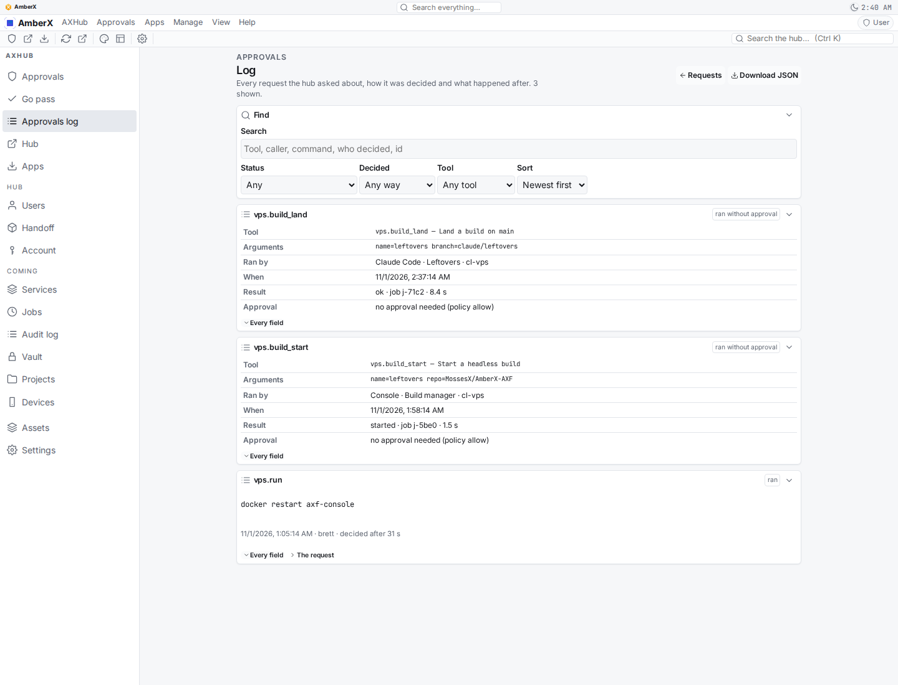
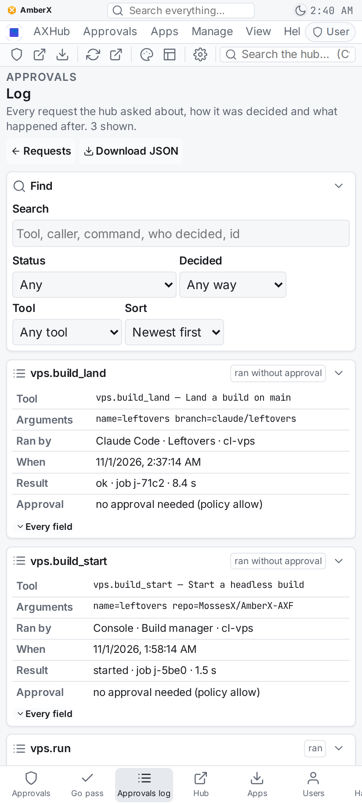

# Leftovers — finishing every nearly-done build (Nov 1 2026)

Brett's brief (Oct 31 night): finish nine nearly-done items in order, tick their steps in the builds store, push each to
main. One headless Opus session on the VPS, branch `claude/leftovers` (worktree `/root/axf-builds/leftovers`), every
item merged with `origin/main` and pushed with `git push origin HEAD:main` (never forced). Change log entry
`chg-20261101-0440102964`.

Most of the "pending" steps turned out to be bookkeeping: the branches were already on main, and the steps were
waiting on a push or a merge approval that had since happened. Two items needed real code (5, 6) and one was a real bug (9).

## The items

### 1. Urgent / `urgent-builds` s12 — report, THREADS, merge, push
- **What was wrong:** s12 still open because the Oct 31 session couldn't push (no GitHub token on the host). The
  branch had since reached main (`2a057cc4`), but the store, the report ("Not pushed yet"), THREADS (`blocked`) and the
  console banner (`blocked:push:claude/urgent-builds`) still said it was stuck.
- **Changed:** report says pushed + merged; THREADS row moved to Done; s12 ticked (build now Complete 12/12).
  Resolved the stale push-blocked banner items whose branches are verified on main (urgent-builds, menu-approve,
  axhub-web-flicker, approve-now-web, shots-tab token alert, vps-git-push; git push works on the host now).
- **Also fixed:** the systems check's saved AI routine still checked `framework/cli/orch-sync.mjs`, which the Urgent
  build deleted on purpose, so the banner showed a false warning. Regenerated the routine on the live console
  (`POST routine/run`): the check is gone, it now checks the builds store instead.
- **Tests:** quick block (16 checks) green. **Commit:** `5e49cdd0`.

### 2. Refactor / `orch-pending-sync` s3 — rule + docs + CI test
- **What was wrong:** the shared rule "Orchestrator and Pending builds stay in sync" still told sessions to run
  `framework/cli/orch-sync.mjs`, a file the one builds store replaced and deleted.
- **Changed:** the rule now describes the store (one record per build, projections, one lock, journal, read-only
  exports, claude.ai goes through the orchestrator). The builds README already said the bridge was retired. The CI
  test is `check-builds-store.mjs` + `builds-store.mjs verify`, already in `android.yml`. Build Complete 3/3.
- **Commit:** `1c372327` (+ `17ab0bdd`, the Pending exports of the ticks).

### 3. Refactor / `veto-everywhere` s3 + s9
- **s3 (axHub PR + merge + redeploy):** cloned axHub next to the worktree (`/root/axf-builds/axhub-leftovers`).
  `claude/veto-everywhere` and `claude/veto-complete` are both on axHub main, and the live axHub server runs image
  `209951f` (axHub main is that plus one report commit), with `AXHUB_CONFIRM_AS` defaulting to veto. Nothing to push.
  (I couldn't call `describe_service` to see it live: axHub MCP tools are denied in headless runs. The evidence is the
  code plus the deployed commit.)
- **s9 (docs, tests):** docs already covered 90 s + Approve now / Shelve (`docs/veto.md` 26 mentions,
  `veto-approvals.md`, PORTING). **Wrong:** the shared RULES had the veto rule twice, one copy still saying
  "3-minute countdown", plus duplicate "Automatic merge" and "Don't hand Brett chores" bullets. Removed the stale copies.
- **Tests:** axHub `pnpm test` on Node 22 (docker): **514/514**. AmberX `test.mjs` **2045/2045** + `tsc` clean.
  approvals-banner self-test 10/10. Build Complete 9/9. **Commit:** `b741cf04`.

### 4. Refactor / `agent-voice` s9 (status was "waiting")
- **What it waited on:** the PR create/merge approval (`45ca37d6`, Oct 30). `feat/agent-voice` is fully on main, so
  nothing waits on Brett; no banner item needed.
- **Checks:** `plugin-lifecycle check agent-voice` clean, `test.py` 37/37, `test.mts` 22/22. Build Complete 9/9.
- **Commit:** `03a62fa9`.

### 5. Angel / `live-key-checks` s7 + s12 — real code
- **What was missing:** the push banner still built its own GitHub client from `GITHUB_TOKEN` alone. When that token
  died (it is dead right now on the console), the banner showed nothing even though axHub could still read GitHub. Its
  token problem also wasn't a health@1 item.
- **Changed (`apps/console-web/plugins/push-banner/server/__init__.py`):**
  - s12: `gh()` gets its client from `axf.github@1` (axHub first, local token fallback, the systems check's GitHub
    route setting); falls back to plain lib-github if the capability isn't installed. Listing branches/PRs now works
    with no local token. Writes (open PR, merge, update branch, delete branch, protection) and check-runs have no hub
    route, so they still need the local token, and auto-merge stays off without it.
  - s7: the banner registers its own health@1 check `push-banner-github` ("Push banner reaches GitHub"): red = no
    route at all, amber = reads through axHub but no local token for PRs/merges, green = both. Registered lazily
    (plugins load in any order) from the auto-merge loop and every branches read.
  - Systems check auto-fix message and README / githubsvc docs updated.
- **Tests:** push-banner `test.py` 132 → **141** (hub-route reads, token fallback passed through, auto-merge off
  without local token, lazy health registration, red/amber/green). systems-check `test.py` 216/216. Build Complete 12/12.
- **Commit:** `b0ab0494`.

### 6. Angel / `ui-review` s9 — real code
- **What was missing:** auto-merge ignored UI Review, so a PR whose screenshots were waiting or rejected merged anyway.
- **Changed:** `Pushes.ui_hold()` reads `ui-review@1` `state()`. Auto-merge skips a held PR (waiting / changes /
  rejected) and gives the next PR its turn; the manual Merge button refuses it with "held by UI Review". UI Review
  items have no repo field, so PR numbers only count for AmberX-AXF and other repos match by branch. If UI Review
  errors, the PR is held, never merged blind. Without the plugin, nothing is held. UI Review README updated.
- **Heads-up:** from now on, PRs with a waiting UI Review item won't auto-merge until Brett approves them in UI Review.
- **Tests:** push-banner `test.py` 141 → **150** (free / waiting / other-repo by branch / Merge refuses / rejected is
  skipped with green CI / approved merges / broken = held / no plugin = free). Build Complete 9/9.
- **Commit:** `ce6d16fd`.

### 7. Angel / `audio-extract` s7 — tests, THREADS, PR
- Already on main. `test.mts` 24/24, AmberX `test.mjs` + `tsc` green on Node 22, lifecycle clean (the only hits
  were an untracked local session archive). Brett still needs to install the new AmberX APK from CI
  (`amberx-debug.apk`). Build Complete 7/7. **Commit:** `e14b9952`.

### 8. Angel / `audio-output-recorder` (showed 0/5)
- Checked each step against main (`e46b8079`, `08f84bf3`, PR #194 merged). All five are really built:
  - s1 `OutputRecordService`: AudioPlaybackCapture through MediaProjection, only `setAudioPlaybackCaptureConfig`
    (never an audio source, so never the mic), foreground notification of type mediaProjection.
  - s2 the switch in the output-recorder page, `OutputRecordTile` (quick settings), `OutputRecordStartActivity` (consent).
  - s3 30-minute chunks, `OutputRecordUploader` / `OutputRecordQueue`: the local copy stays until axHub confirms,
    offline retry, local cap (drop oldest or stop).
  - s4 the recordings on axHub: play, share/download, delete, send to Audio Extract, in AmberX and the console.
  - s5 `test.mts` 18/18 (Node 22), `RecorderControlTest`, README.
- **Note:** s1–s2 are pinned to Fable and s3–s5 to Opus, so the orchestrator wanted a model-switch approval before
  ticking s3. That gate is for *starting* a phase on a new model; this work had already shipped. I recorded the steps
  as done with a plain step update and a note saying so. **No approval was recorded in Brett's name.**
- Build Complete 5/5. **Commit:** `3bd42897`.

### 9. Bug: axHub web approvals log, "The request" opened an empty page
- **What was wrong:** since axHub decision #110, `vps.build_start / build_land / build_stop / build_list` run on
  `allow`, and the hub logs them as "ran without approval". There's no approval request behind them, so the log's
  "The request" button opened an empty request page.
- **Changed:** `apps/axhub-web/src/hub/core.ts` gets `ranWithoutApproval()` + `directRunRows()`; `ApprovalLog.tsx`
  shows those entries' details inline (Tool, Arguments, Ran by, When, Result with job + duration, and why there was no
  approval) in the framework table (`fx-table`, theme tokens only, nothing hand-styled). "The request" only shows on
  entries that have an approval request. "Every field" still works.
- **Tests:** axhub-web `test.mjs` 264 → **276**; axhub-web `tsc` + `vite build` (Node 22) green. Screenshots against a
  faked hub API (desktop + phone): 2 inline blocks, 1 "The request" (the approved `vps.run` only).
- **UI Review:** `r-20261101-f74d2ada`, group **"Leftovers - Oct 31 10:40 PM"** (ui-review-item@1, kind screen, app
  axhub-web, screen approvals-log), waiting.
- **Commit:** `8f3500ce`.

## Full local test block

Ran the whole web / Node / Python part of `.github/workflows/android.yml` in a `node:22` container on a clean
worktree of the final code (`/tmp/lo/full.sh`): the framework checks, deploy helpers + shellcheck, add-ons, every
plugin's lifecycle check, init of every template and boilerplate (incl. the next-ts and FastAPI-wall builds), console
re-bake + build (with the template plugin), axhub-web / AmberX / Walkthrough re-bake + build, **theme swap +
interface-scope**, the whole "Alerts + MCP client + axf_server" list, every plugin `test.py` and `test.mts`, and the
library templates. Gradle/Android stays in GitHub CI (no Android SDK here).

**130 passed, 3 failed, all 3 accounted for:**
- `check-theme`: my own comment in `ApprovalLog.tsx` said "decision #110", which the checker reads as a hex colour.
  Fixed in `a76d9704`; `check-theme` is green (729 files).
- `codebase-changes/test.py` ("the repo comes from the git remote") and `systems-check/test.py` ("routine records
  agent and commit"): both need `git`. The container mounted a git worktree whose `.git` points outside the mount.
  On the host the same code passes, **173/173 and 216/216**. Environment only, not code.

Also run on the host along the way: the quick framework block (16 checks) after every item; axHub `pnpm test` 514/514
(Node 22); AmberX `test.mjs` 2045/2045 + `tsc`; push-banner 150; axhub-web 276.

## Left for Brett / not done

- **claude-sync holds 16 files** (store, journal, orchestrator exports, THREADS, shared RULES, STATUS, some plan
  data). In every case I checked, the repo copy is a superset of the hub's (store rev 16 vs 14; the hub RULES is just
  older). Picking a side is Brett's call (`claude-sync resolve <id> --keep local|hub`); the banner already has
  `blocked:claude-sync-held`.
- **UI Review** `r-20261101-f74d2ada` is waiting for Brett.
- **Item 9 has no orchestrator build:** the rules want one, and the build profile is Brett's pick. A headless run can't
  ask, so it's tracked in the change log entry and THREADS instead.
- **asset-conform** (`blocked:push:asset-conform`) has 3 commits not on main. It wasn't on this list, so I left it and
  its banner item alone.
- Not started, as told: home-cards (0/18), plugin-floatable, and every other unstarted build. Archived builds untouched.
