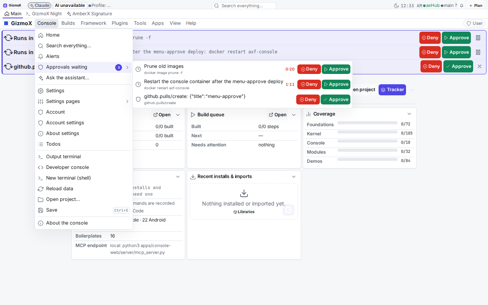
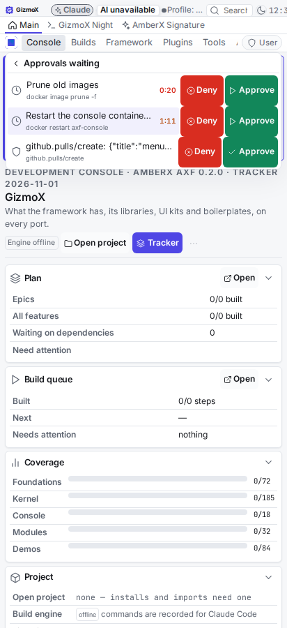

# menu-approve — Approve / Deny on every row of the app menu's "Waiting for approval"

**Date:** 2026-11-01 · **Model:** Opus (headless VPS, one session) · **Branch:** `claude/menu-approve` → `main`

## What Brett asked
Application menu → Approvals → *Waiting for approval* listed each waiting call with no buttons. Put green **Approve**
and red **Deny** on each item right there (veto countdown and confirm items), big tap targets, live countdown on veto
items, title cuts first (never the buttons). Approve = run now / the existing approve route, Deny = the existing deny
route. The item flips to Running / Denied in place, then drops off. No full re-render, no flicker. In every app with
that menu: axhub-web, AmberX, the console.

## What was built (once, in the framework)
- **App menu rows can carry buttons** (`framework/core/types.ts` `MenuItem.buttons` / `detail` / `deadline` /
  `paused`; live-list rows only, runtime fields, not asset fields). The app-menu engine passes them through and gates
  each button by UAC (hide drops, disable locks). Fixture `app-menu.json` unchanged.
- **Providers say what a tap did:** `AppMenuProvider.act(itemId, buttonId) → { ok, state, message, keep }`, run by
  `rt.runAppMenuButton` (falls back to dispatching the button's `action`; never throws).
- **Renderer** (`framework/react/components/AppMenu.tsx` `LiveRow`): label + second line + countdown on the left (cut
  first, ellipsis), framework `Button`s on the right (`tone` danger / success, never shrink, about 36 px tall and
  44 px on a phone). A tap keeps the menu open, shows busy, then the row reads **Running / Approved / Denied** in
  place (same element) and drops off after 1.6 s; a refusal toasts and puts the buttons back; an "opened on the hub"
  answer keeps the row. The countdown ticks on its own component, so nothing else re-renders, and the list is never
  reloaded while open. Last row gone → "Nothing waiting". Styles: `framework/ui/axf.css` (`.fx-menu__live*`,
  `.fx-menu__acts`, `.fx-menu__count`), theme / scale tokens only.
- **lib-approvals** `menu.ts`: `installApprovalsMenu(rt, { hub })` replaces lib-hub's read-only `hub.approvals` list
  with rows from the approvals feed (held calls first, then approvals) and decides through the same path as the title
  bar badge (`host.ts` `decideApproval`: the app's own host → a page on the hub's origin → open the call on the hub).
  The host seam moved from `react.tsx` to `host.ts` (re-exported, no API change).

## Per app
| App | Menu entry | Approve | Deny |
|---|---|---|---|
| axhub-web | Approvals → Waiting for approval (`hub.approvals`) | on the hub's origin: veto@1 approve-now / decide route `approve` | veto@1 deny / decide route `decline` |
| AmberX | Approvals → Waiting for approval (`hub.approvals`) + the approvals banner plugin's entries | the phone host (`setApprovalsHost` decide: signed-in hub view, native) | same |
| Console | Console → Approvals waiting, Apps → axHub → Waiting for approval (`approvals.list`) | held: `approvals-banner` `actResult(approve-now)`; approval: host decide, else the review dialog (row stays) | held: `actResult(deny)`; approval: host decide `decline`, else the review dialog |

## Screenshots (built console, fake hub feed: two held calls + one approval)
Desktop: `menu-approve/desktop.png` · Phone: `menu-approve/phone.png`

 

## Tests
- New `framework/spec/check-approvals-menu.mts` (in CI's web test block; jsdom added to `framework/package.json`):
  rows, both buttons, order and tones, countdown, shelved, status rows, provider `act` (approve → Running, deny →
  Denied, opened → keep, refusal, decision not offered, no double send), UAC gating, and the real `AppMenuList` in a
  DOM: tap Approve / Deny → busy → flips in place (same element, other rows byte-identical, menu open, list not
  reloaded) → drops off; refusal restores the buttons and toasts; last one gone → Nothing waiting. **53 / 53.**
- Full local block from `.github/workflows/android.yml` (engine sweep `- run:` checks, theme / controls / plugin pages /
  lifecycle, add-ons, the whole web / Python test block, every plugin `test.py` and `test.mts`) on a clean worktree of
  the merged branch, Node 22: **75 / 75 green**. `framework` libs typecheck green; console-web, axhub-web,
  amberx-droid and walkthrough-studio build green.

## Notes
- The brief said to wait (max 30 min) for the axhub-web flicker fix on main first. It hadn't landed after 30 min
  (no `flicker` commit, no `claude/axhub-web-flicker` branch), so main was merged as it stood. This change doesn't
  depend on it: the menu list loads once per open and only the tapped row changes.
- The approvals-banner plugin is 0.5.1 (menu rows); its banner rows are unchanged.
- Baked copies re-baked: console-web, axhub-web, amberx-droid, walkthrough-studio (demo stays as it was; Patches is
  paused and untouched).
