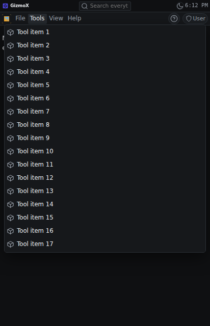
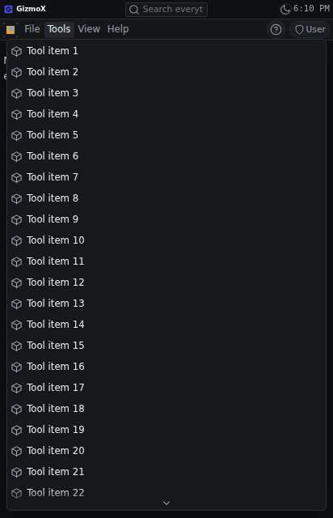
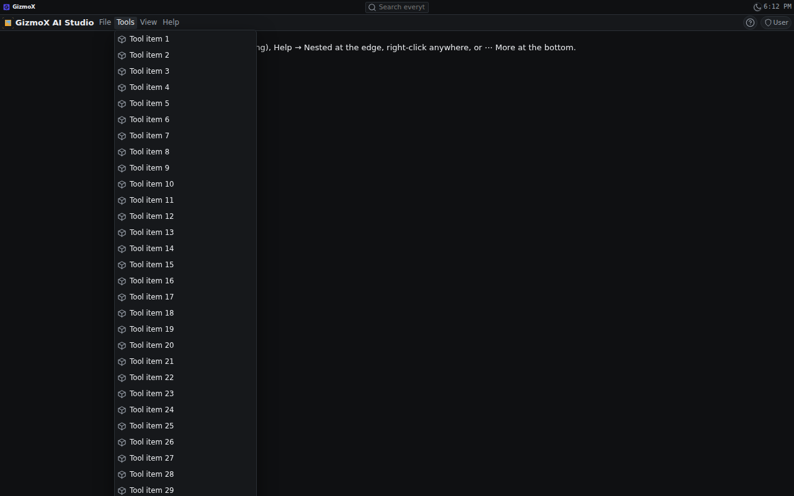
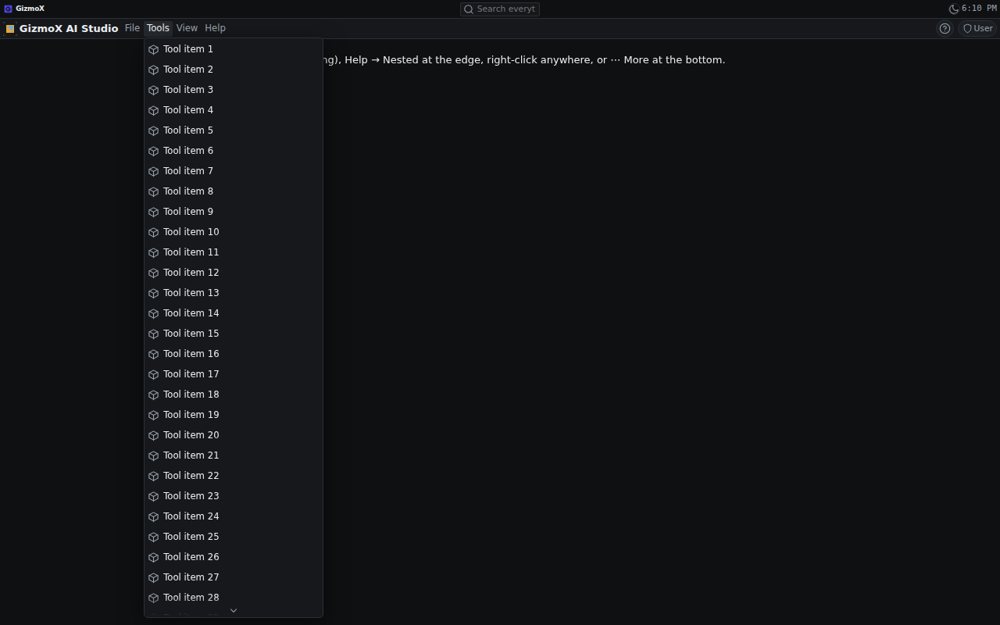
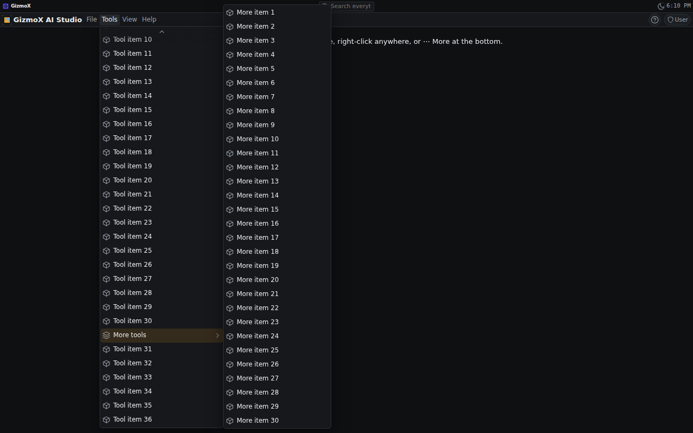
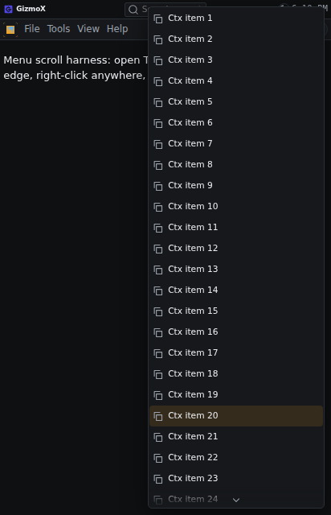

# menu-scroll: menus stay on screen and scroll

Brett, Nov 3 2026 (voice): "The application menus need to be scrollable when they reach beyond the screen."
Profile Urgent, build `menu-scroll`, branch `claude/menu-scroll`. Assigned agent: Janitor Joey. Model: Opus.

## What changed

Framework level, so the console, axHub web, AmberX (Capacitor), Molly and every plugin inherit it.

- **New pure engine `framework/core/engines/menufit.ts` (menu-fit@1).** `fitMenu({ mode, anchor, size, box })` →
  `{ left, top, maxHeight, scroll, flip }`. Order: open where it belongs (below the button, beside the row, at the
  pointer) → flip (up; submenus to the left) → shift inside the box → only then cap the height and scroll.
  `menuBox()` = the visible viewport minus safe-area insets minus the edge inset.
- **New `framework/react/components/menuFit.ts`.** Measures the box from `visualViewport` (so an open keyboard and
  pinch zoom count), `env(safe-area-inset-*)` and the layout asset's `phoneEdge` token (`--fx-layout-phone-edge`),
  through one hidden probe. `useMenuFit` keeps a menu fitted while open (content resize, a live list filling in, window
  or keyboard resize, a parent menu scrolling). `installMenuFit` (mounted by `AxfProvider`) fits every self-placed
  `.fx-popover.fx-dropdown` / `.fx-popover[role=menu]`, which covers the plugins' ⋯ menus with no plugin changes.
  `focusMenuItem` scrolls the keyboard-highlighted row into view.
- **App menu drop-downs (`AppMenu.tsx`)** are placed under their menubar button (they used to rely on static
  position), stretch edge to edge on phones, scroll inside, and the phone drill-down keeps its Back row pinned above
  the scrolling list (the old fixed `max-height: 70vh` is gone). Arrow keys / Home / End scroll the row into view.
- **Submenus (`MenuSub`)** are placed inside their parent menu box instead of their row (`.fx-menu__li` is static
  now), so a scrolling parent never clips them. They still open right, flip left at the edge, shift inside on compact
  widths, move up to fit, and scroll when taller than the screen.
- **Context menus (`Overlays.tsx`)** use the same fit at the pointer (flip above, shift over the pointer, scroll).
- **Scroll hints:** `data-fx-more="up|down"` on the box. Framework menus get a fade overlay
  (`--fx-surface` → transparent) and a chevron at that edge; a tap on the chevron scrolls most of a page. Self-placed
  menus (no submenus) fade with a mask. Sizes from tokens: fade height `--fx-dens-row-menu`, chevron padding
  `--fx-dens-gap-xs`, colours `--fx-muted` / `--fx-accent`.
- **Touch:** `overscroll-behavior: contain` (the page behind never scrolls), `touch-action: pan-y`, momentum scrolling.
- No asset contract changed: the cap is the room on screen; no new tokens were needed (a ceiling per asset is
  supported by the engine's `maxHeight` input if a later build wants one in the app-menu / context-menu asset).

## Before / after (real browser, 412 × 640 phone and 1280 × 800 desktop)

Same harness, same long menus (Tools: 37 rows plus a 30-row submenu; Help → nested submenus at the right edge;
34-row context menu; a plugin-style ⋯ menu at the bottom right), the old and new framework.

| Check | Before | After |
|---|---|---|
| phone: Tools drop-down inside the screen | ✓ (70vh cap) | ✓ |
| phone: drop-down scrolls with a hint | ✗ no hint | ✓ |
| phone: wheel scrolls the menu, not the page | ✓ | ✓ |
| phone: keyboard End shows the last row | ✓ | ✓ |
| phone: drill-down panel inside the screen | ✓ | ✓ |
| phone: context menu near the bottom inside the screen | ✗ ran 257 px off the bottom | ✓ |
| phone: plugin ⋯ menu at the bottom inside the screen | ✗ ran 618 px off the bottom | ✓ flipped / shifted |
| desktop: Tools drop-down inside the screen | ✗ ran 215 px off the bottom | ✓ |
| desktop: drop-down scrolls inside | ✗ | ✓ |
| desktop: wheel scrolls the menu | ✗ | ✓ |
| desktop: keyboard End shows the last row | ✓* | ✓ |
| desktop: long submenu reachable, on screen, not clipped | ✗ the row was off screen | ✓ |
| desktop: nested submenus at the right edge on screen | ✓ | ✓ |
| desktop: context menu near the bottom inside the screen | ✗ ran 97 px off | ✓ |
| desktop: plugin ⋯ menu at the bottom inside the screen | ✗ ran 618 px off | ✓ |
| phone, keyboard open (412 × 340 visible) | ✓ | ✓ |
| **Total** | **7 / 16** | **16 / 16** |

\* before: the row was "inside" the unclipped box, not on screen.

Screenshots: `menu-scroll/shots/before/` and `menu-scroll/shots/after/` (`phone-*` 412 px, `desktop-*` 1280 px), with
`results.json` from each run.

 
 
 

## Tests

- `npx -y tsx framework/spec/check-menu-fit.mts`: 14 engine cases (long menu at the bottom of a short phone, ⋯ near the
  bottom flipping up, too tall for either side, context menu shift / fill / flip, nested submenu at the right edge,
  compact width, submenu near the bottom and taller than the screen, keyboard open, safe areas, ceiling). Added to CI.
- Browser harness above (Playwright, throwaway Vite page over the console's baked assets): 16 / 16.
- `check-theme` ✓ (935 files), `check-controls` ✓, `shared-assets check` ✓, console `tsc --noEmit` ✓.

## Re-bakes

`apps/console-web`, `apps/axhub-web`, `apps/amberx-droid`, `apps/molly` re-baked (they were current before this build).
`apps/demo` and `apps/walkthrough-studio` were already behind and are left for their own re-bake.

## Known gaps

- Android (Compose) twin deferred, recorded in `framework/spec/PORTING.md` (Android port on hold).
- The "banner / toolbars" bound is the screen itself: drop-downs open under the menubar and over the banners by
  design (Oct 22 2026), so nothing else is subtracted.
- A per-asset height ceiling is not exposed as an asset field (no contract change on Opus); the engine supports it.
