# one-look-default — Fable review of the one default look, the banner contract, the precedence rule

Brett, Nov 1 2026 (voice): "How come the refactor didn't compress banners. I need a new default style and color theme
that GizmoX, amberx, and axhub all inherit from axhub. Change in one changed all. Then I need the 2 new themes to be
combined into a default design theme. When a design theme is loaded the individual style and color themes are not
applied. Only when something changes is the design pack overridden with the individual packs. Remove all appearance and
theme editing abilities from the settings interface that is read from axHub and changes every apps interface only allow
selecting design, style, and color themes."

The headless Fable build `one-look-default` died on the weekly limit (Nov 1). The work was then built on Opus in a
claude.ai session and merged as PR #228 (`_claude/builds/reports/one-look-opus.md`). This run (`one-look-default-2`,
Fable, Nov 3 2026, branch `claude/one-look-default-2`) is the Fable review that report asked for, plus the part of the
brief the Opus build left as a contract change: the banner asset. Nothing merged by #228 is redone.

Apps: GizmoX AI Studio (Dev Console, `apps/console-web`), axHub web (`apps/axhub-web`), AmberX (`apps/amberx-droid`).

## 1. Why the banners didn't compress (exact cause)

Two causes, one fixed by #228 and one left to this build:

| Cause | Where | Before | After |
|---|---|---|---|
| The banner default every banner falls back to was never compacted | `DEFAULT_BANNER_PREFS` in `react/components/BannerSettings.tsx` | density `regular`, launch `expanded`, no row cap; `banner-fix` (Oct 31) only compacted the activity banner's own launch and its 30 vh cap | density `compact`, launch `minimized` (one line), at most 6 rows open (**#228**) |
| The thin banner asset was forked per app | `banner/amberx-thin` | the framework copy (clock only, pinned by `fixtures/banner.json`, `check-widgets.mts` and the Kotlin `ConformanceTest`) and a newer per-app copy with the day/night switch in `apps/{console-web,axhub-web,amberx-droid}/src/assets-overrides/banner/` (three identical files); `hub-look-all-assets` kept the fork because the framework copy was fixture-pinned | **this build:** the framework copy carries the `theme-switch` (`day-night`, right), the three overrides are deleted, `banner.json` regenerated (`place` rows only gained the input attachment; the placed output is unchanged because the fixture's `exists` list doesn't name the switch, so the Kotlin banner test replays as before), `check-widgets.mts` pins clock + switch, shared assets re-baked into every listed app, no `assets-overrides/banner` folder is left anywhere |
| Older banner look settings in appearance@1 `settings` | the live hub document | checked: it carries only `axf.appearance.overrides` and `axf.banners.group`; no `axf.banners.prefs` / `axf.banners.look` override the compact default | nothing to migrate |

So on the live hub every app renders `amberx-thin` (the document's `banner` slot) at the compact default: one line, logo left,
search centre, switch + clock right, plugin badges attached. `check-hub-look.mts` now proves every one of the three
apps resolves `amberx-thin` to the framework's data (no per-app copy) and that Hub Default puts it in every app.

## 2–3. Default style theme, colour theme, design theme (landed in #228, verified here)

`style-theme/hub` (Inter 13 px, compact, radii 4/8/12, space 7), `color-theme/hub-night` (graphite + AmberX amber),
`design-package/hub-default` (= both, Classic IDE layout, standard behaviour, compact chrome, tight spacing, toolbar
hidden). All three manifests default to `hub-default` / `hub` / `hub-night` (`check-hub-look.mts` asserts it per app).
Every listed app ships all 471 shared assets (`shared-assets.mjs check`), so a pick made anywhere resolves everywhere.

## 4. The precedence rule as written (`framework/spec/APPEARANCE-SOURCE.md` → Design theme precedence)

1. While a design package is loaded (slot `design-package`), its style and colour theme are in force; a style or colour
   slot the document still carries is ignored. **The app's default package counts as loaded** (a document without the
   slot leaves the app on `hub-default`, whose themes win the same way).
2. Picking a style or colour theme afterwards records an override for that part only (`axf.appearance.overrides` in
   `settings`, so every app agrees); picking the package's own theme drops it; the slot is pushed too for older readers.
3. Loading a design package (again) clears every override. **A design package is never just a slot:** `swap`, the
   generic `swap:design-package:…` action and `design.package:…` all load the package. Reloading the loaded one clears
   the overrides.
4. **Restore default = the default design theme loaded in full** (settings and overrides cleared, manifest defaults,
   then the manifest's default package with its extras). `appliedDesignPackage()` is the `design-package` slot.
5. An override or package theme the app doesn't ship falls back override → package → pick; a package the app lacks is
   skipped like any slot id.

Why the overrides ride `settings` and not a first-class document field: the appearance@1 contract, its fixture and the
Kotlin `AppearanceEngine` stay unchanged on both ports; the key follows the same per-key last-write-wins rule as every
plugin look setting; `resolveAppearance` stays package-agnostic. The cost (two keys describe one pick) is reconciled
in one pure function, `designLookSlots`. Decision: keep it in `settings`.

## 5. Settings → Appearance (apps): selection only (landed in #228, verified here)

Removed by #228: Lock the look, Save the current look, Sliders (`axf.look`), the settings-asset picker, the per-slot
Assets picker, Asset appearance (`axf.custom.*`), Assets in rolls / Randomize (`axf.roll.*`), Display → Spacing.
Kept: Design theme / Style theme / Colour theme pickers + Restore (`libs/settings/index.tsx` → `LookPickerPanel`),
Display → Text size / Animations / Level toolbar (device, not the look), every plugin's own settings (Banner settings
and its Apply to all included; Brett: "only for the apps, not plugins"), the plugin theme override (`libs/plugintheme`,
a plugin's own Appearance sub-panel under Settings → Plugins). Help entries and the coverage ratchet were updated in
#228 (`check-help.mts` 214, `help-coverage --check` green, `menu-reach` 324 green here).

## The Fable review: what was checked, what changed

| Reviewed (from `one-look-opus.md` → "For the Fable review") | Verdict | Change in this build |
|---|---|---|
| `designLookSlots` / `overrideAfterPick` / `normalizeDesignOverrides` | sound: pure, total, fall back override → package → pick, bad ids dropped | none |
| `applyAppearance` reading the overrides | correct: the document's map wins when the document carries `settings`, local otherwise (and local is synced to the document first) | spec rule 1 now says the default package counts as loaded |
| `swap('design-package', id)` | **gap**: moved the slot without the package's themes, so another app (which applies the slot's package on receipt) showed different themes than the app that swapped; only the `design.package` action was safe | `swap` delegates to `applyDesignPackage` for that type (`runtime.ts`); proven across apps in `check-hub-look.mts` |
| `restoreDefaultAppearance` | **gap**: reset to manifest defaults left the default package's extras (tight spacing, hidden toolbar) unapplied, so "Restore" and "load Hub Default" gave different looks; and `appliedDesignPackage()` read a local, unshared note, so apps disagreed on the loaded package | Restore ends by applying the manifest's default package quietly (`applyDesignPackage(id, { quiet: true })`); `appliedDesignPackage()` returns the shared slot |
| `axf.appearance.overrides` riding `settings` | keep (reasons above, written into the spec) | none |
| `RETIRED_LOOK_SETTINGS` + one-shot clean | correct for settings; **gap**: the retired `appearance-package` *slot* (the live hub document still carries `appearance-package: fresh`) was kept forever by `mergeAppearance` ("keys the change doesn't name are kept") | `APPEARANCE_NEVER` gains `appearance-package`: dropped on read (never even "skipped"), gone from the hub with the next write by any app; fixture row `retired-slot` |
| New assets `hub`, `hub-night`, `hub-default` | validate on both validators, fixture rows present, `default` tag moved | none |
| `DEFAULT_BANNER_PREFS` | compact / minimized / 6 rows; the banner's own saved choice still wins (plugin setting) | none; the asset fork is the other half (section 1) |
| Save coalescing in `HubAppearanceSource` | fine: `combineAppearanceChanges` folds every push in a tick into one PUT; a 409 re-reads and re-merges this app's keys once | none |
| Kotlin twin | deferred (Android on hold) | gaps listed in `PORTING.md` (`NEVER` += `appearance-package`, the three runtime changes, `retired-slot` test row) |

Not changed on purpose: loading a design package *with extras* still clears every other look setting (banner prefs
included) — that is design-package@1's "whole look" semantics from Oct 27 and `hub-default` ships `settings: {}`; a
banner Brett tunes afterwards is kept until the next package load. Flagged below as a question, not changed.

## Contract changes

- `banner/amberx-thin` (framework asset): `attach` gains `{ type: "theme-switch", id: "day-night", at: "right" }`;
  `spec/fixtures/banner.json` regenerated (4 `place` rows gain the input attachment; outputs unchanged).
- `core/engines/appearance.ts`: `APPEARANCE_NEVER = ['uac-policy', 'help', 'appearance-package']`;
  `spec/fixtures/appearance.json` gains the `retired-slot` row (parsed + resolved).
- `core/runtime.ts`: `swap(DESIGN_PACKAGE_TYPE, id)` → `applyDesignPackage(id)`; `applyDesignPackage(id, { quiet })`;
  `restoreDefaultAppearance` applies the manifest's default package last; `appliedDesignPackage()` = the slot.
- `spec/check-hub-look.mts`: 42 → 110 checks (slot swap loads the package, Restore in full, retired slot, and the three
  real apps — their manifests, baked shared assets, own assets and overrides — on one in-memory hub).
- `spec/check-widgets.mts`: the default banner's right side is clock + switch.
- `spec/APPEARANCE-SOURCE.md`, `spec/PORTING.md`: rules and the deferred Kotlin twin.
- Apps: `src/axf/{core,react,ui,schemas,libs,assets}` re-baked (console, axHub web, AmberX); `assets-overrides/banner/`
  removed in all three. `apps/molly` (new, also ships the shared set) got the asset re-bake only; its framework code
  was already stale before this build and is not touched.

## Screenshots (UI Review → group "One look - Nov 1", PR #244)

UI Review items (waiting): `r-20261103-544dadf5` (console, before + after), `r-20261103-e9462e34` (axHub web),
`r-20261103-ce0a234a` (AmberX).

Console before = `origin/main` (what #228 merged), after = this branch; axHub web and AmberX after only, with the live
hub document mocked in the browser (so they show Hub Default with the colour override the hub carries right now,
Arctic Daylight). Files: `_claude/builds/reports/one-look-default/shots/{before,after}/` (console) and
`after/{axhub-web,amberx-droid}/`. Captured with `framework/cli/rebuild-shots.mjs` (console, hub source off) and
`shots/apps-shots.mjs` (the two apps, built dist + Playwright routes for the hub).

| Screen | Phone | Desktop |
|---|---|---|
| Console home, before | 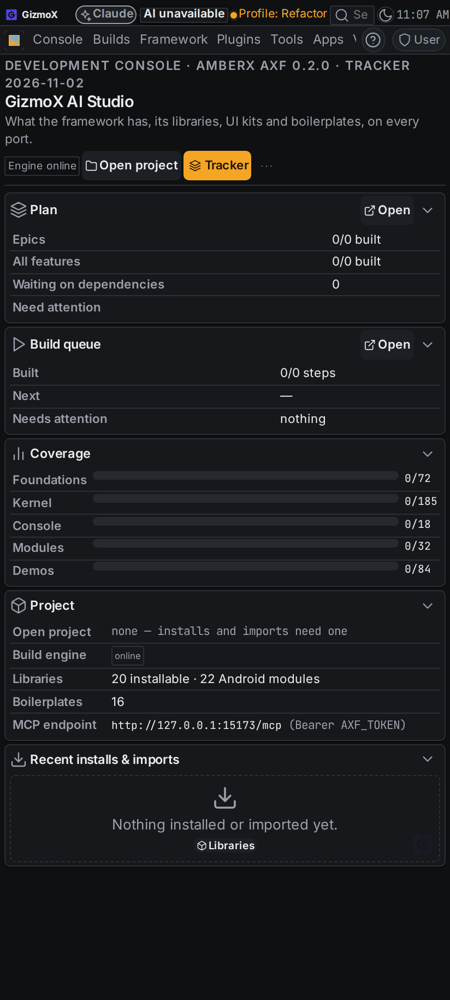 | 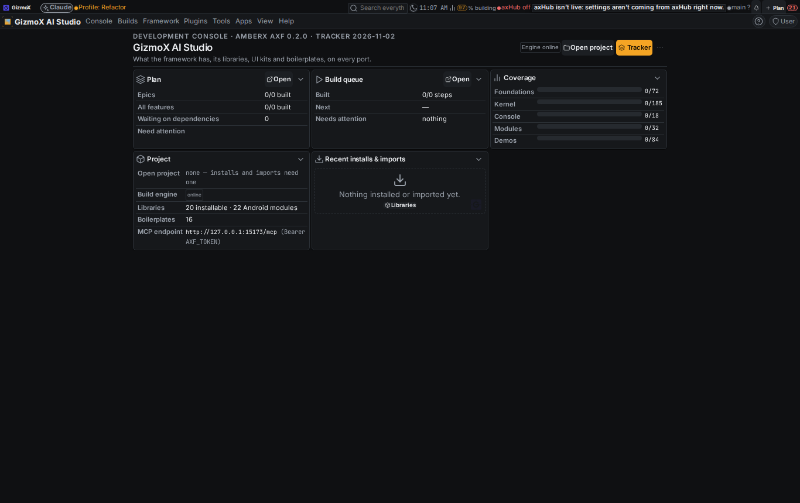 |
| Console home, after | 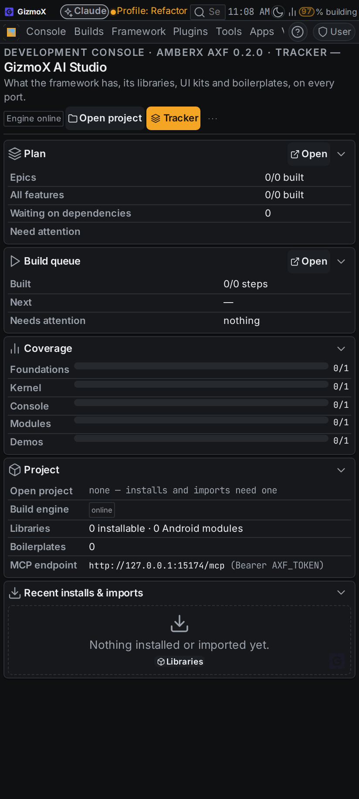 | 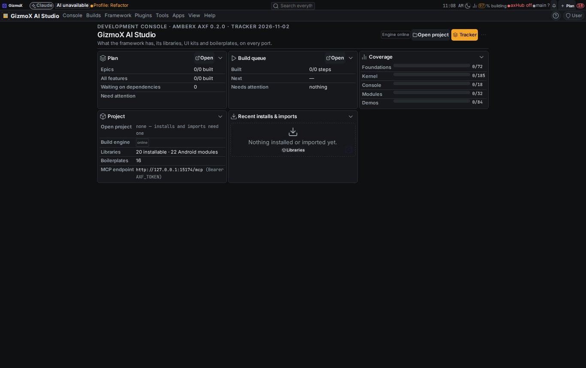 |
| Console Settings → Appearance, after | 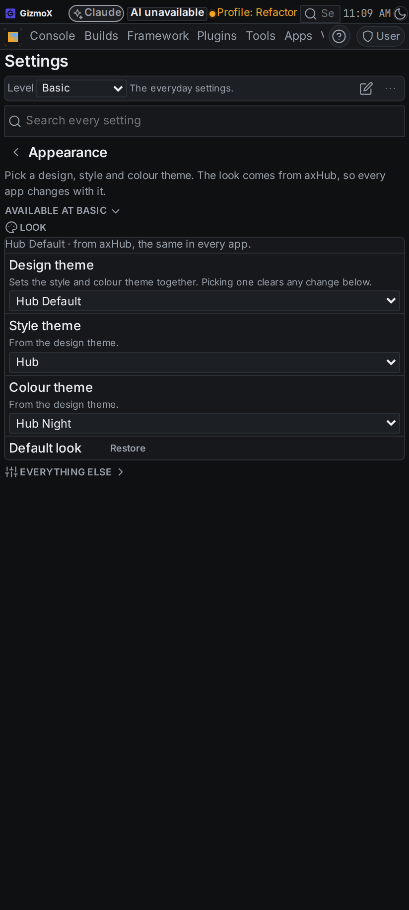 | 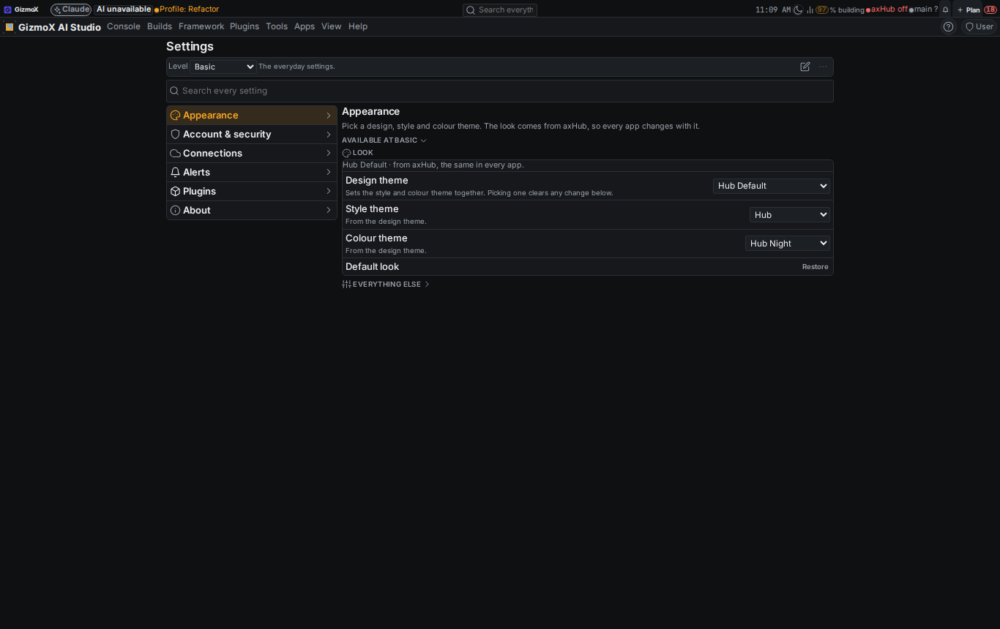 |
| Console, style changed ("Hub Default (style changed)") | 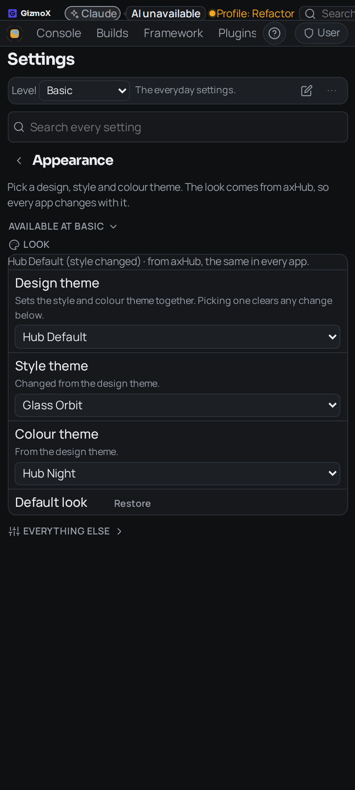 | 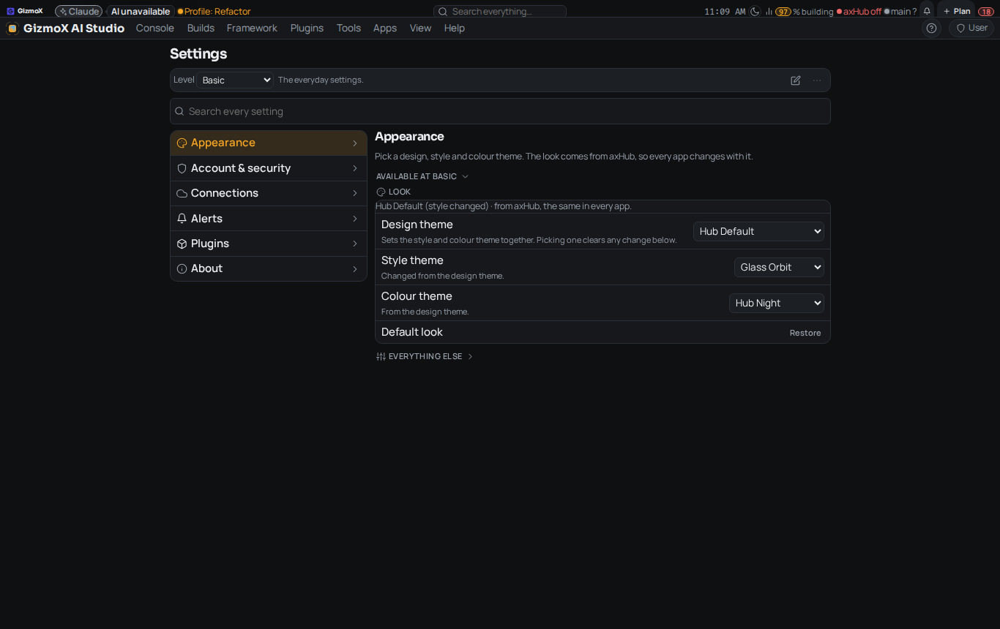 |
| axHub web home | 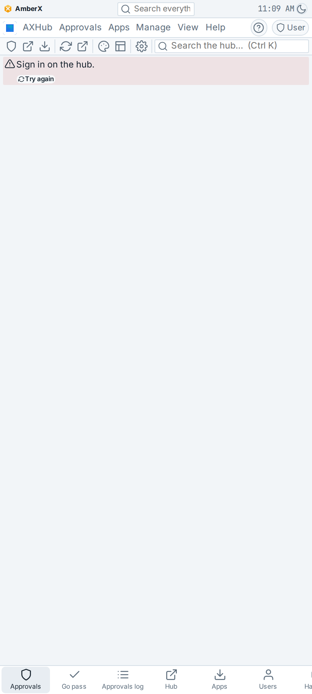 | 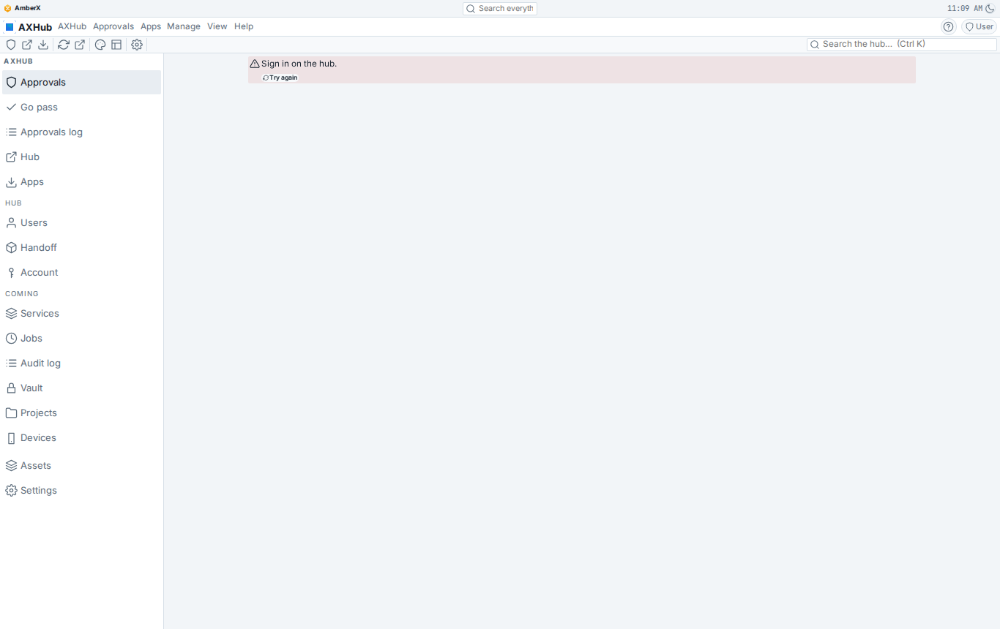 |
| axHub web Settings → Appearance | 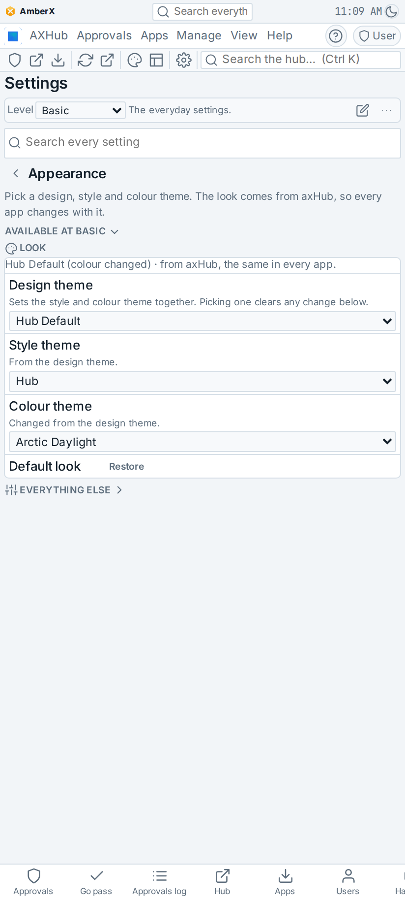 | 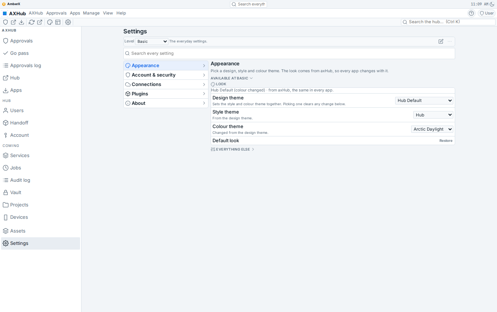 |
| AmberX home | 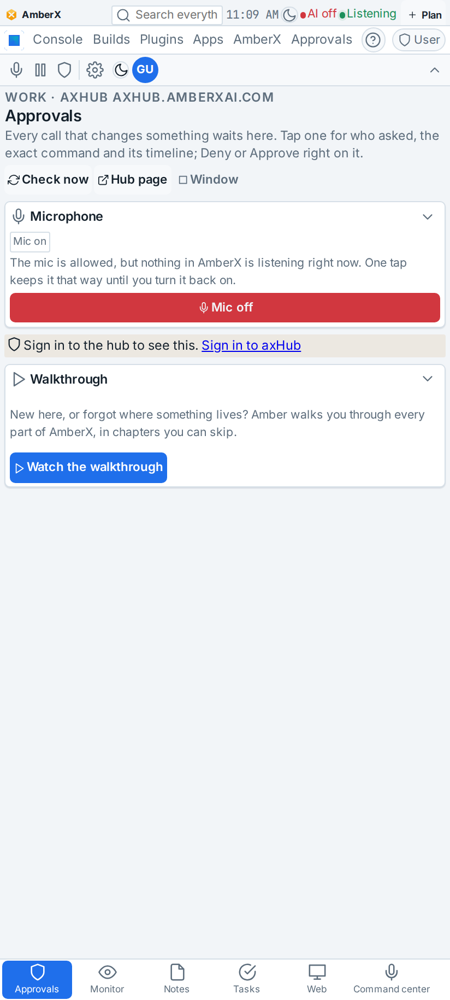 | 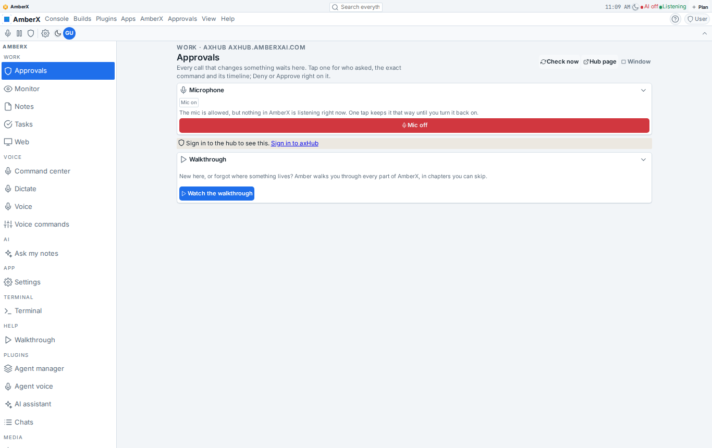 |
| AmberX Settings → Appearance | 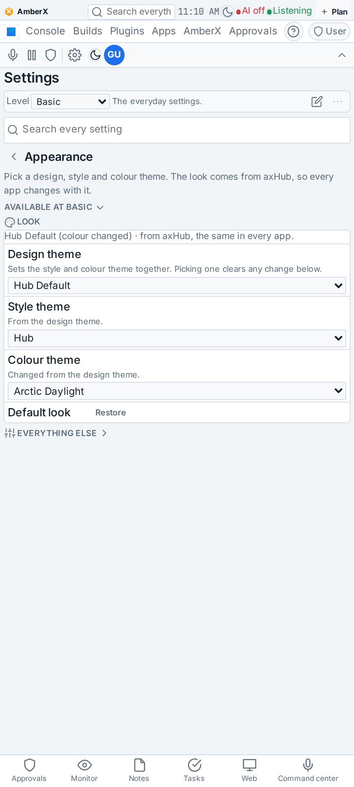 | 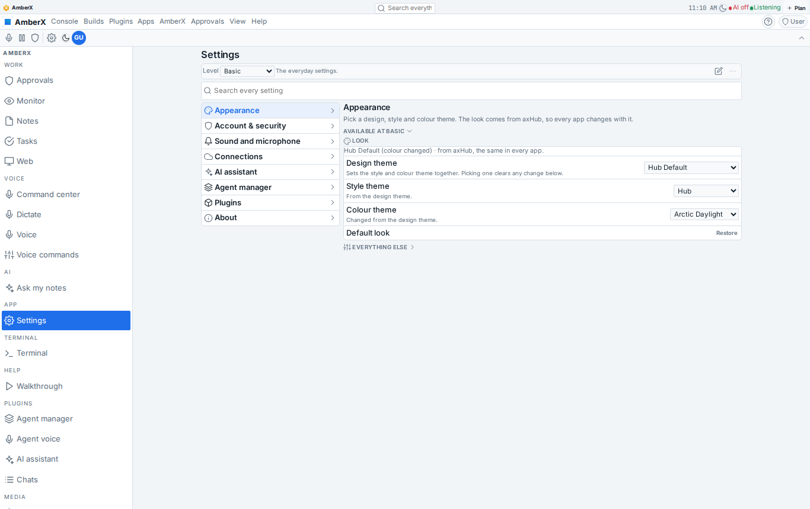 |

The console's before and after look the same on purpose: the apps already carried the switch in their override; the
change is where the asset lives (one framework copy, fixture-pinned) and that no app can fork it again.

## Checks

| Check | Before (main) | After |
|---|---|---|
| `check-hub-look.mts` | 42 | **110** (slot swap loads the package, Restore in full, retired slot, the three real apps) |
| `check-widgets.mts` | 248 (clock right) | 248 (clock + switch right) |
| `check-appearance.mts` | 107 | 107 (fixture row `retired-slot` added, regenerated) |
| `check-design-package.mts` | 1238 | 1238 |
| `gen-fixtures.mts` | — | `banner.json` (+20 lines), `appearance.json` (+19); nothing else moved |
| `validate --framework` | 479 | 479 |
| `shared-assets.mjs check` | 4 apps, 471 | 4 apps, 471, no own copies (the three banner overrides are gone) |
| check-theme, check-controls, check-conform, check-help (214), help-coverage, menu-reach (324), settings-ui (43), appearance-lock (27), banner-hide (58), interface (68), roller (138), scale (485), style-packages (857), project fixtures (16) | pass | pass |
| AmberX `test.mjs` / axHub web `test.mjs` | 2184 / 232 | 2184 / 232 |
| `tsc --noEmit` + `vite build`: console, axHub web, AmberX | pass | pass |
| `tracker.mjs --check` | "391 item(s) without a status" | same (pre-existing, not this build) |

Not run here: `check-help-mode.mts` (jsdom; CI), Gradle / Kotlin (CI; the Kotlin banner and appearance tests replay the
same fixtures and their own doc lists, so nothing new is pinned on the Kotlin side until the twin lands),
`theme-swap.mjs` (Playwright in CI).

## Known gaps and questions

- **Loading a design package with extras clears plugin look settings** (banner prefs included): design-package@1's
  "whole look" semantics since Oct 27; `hub-default` ships `settings: {}`. Brett said plugin settings stay editable and
  shared, which they are, but a Design theme pick resets them. If that's not wanted, the fix is one line in
  `packageSettingsPlan` (don't clear keys a package doesn't name) and a spec note; not changed here.
- **Kotlin twin deferred** (Android on hold): `AppearanceEngine.NEVER` + the `retired-slot` test row, the three
  `AxfRuntime` changes, `DesignPackageEngine` precedence functions (`PORTING.md`).
- The live hub document still carries the retired `appearance-package: fresh` slot; it disappears with the first write
  by any app running this build (dropped on read already).
- The phone banner clips its right side (clock cut at 412 px, search collapsed to "Se") in both before and after:
  the "attached things snap, never overlap" rule (Oct 28) says the host should scroll sideways; pre-existing, not touched.
- `apps/molly` ships the shared assets (re-baked here) but its framework code was already stale before this build.
- `apps/console-web/src/hubAppearance.tsx` is only the hub source attach (not a look editor): nothing to remove there.
  Build Pilot's own Look page is in the Build-Pilot repo, out of scope.
- The 25 Claude files `claude-sync` holds (THREADS.md, the builds store, journal, orchestrator exports: changed on the
  hub and in the repo) were not resolved by this session; Brett picks a side (`claude-sync resolve … --keep local|hub`).
