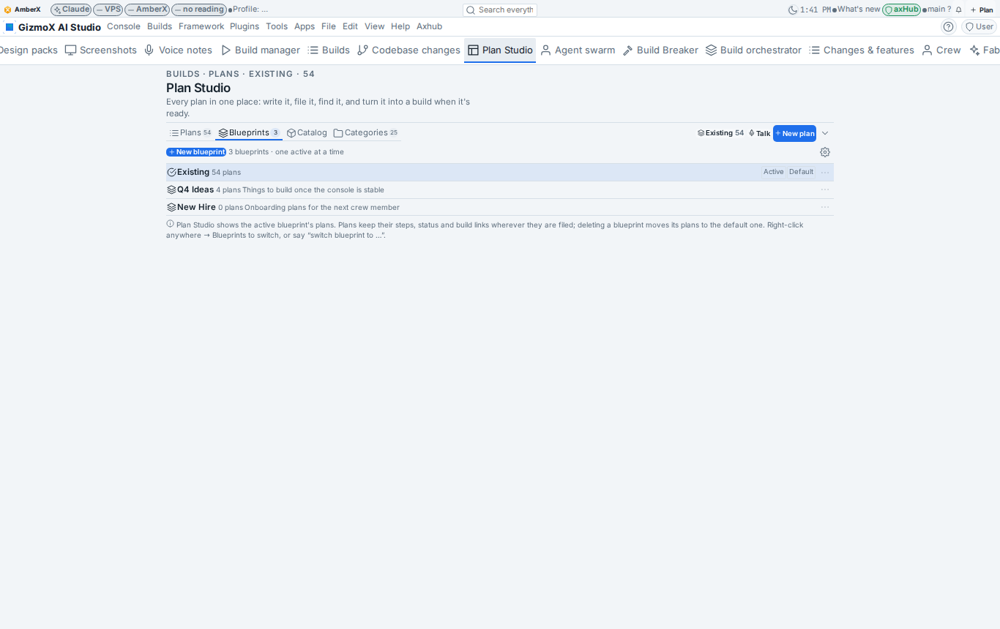
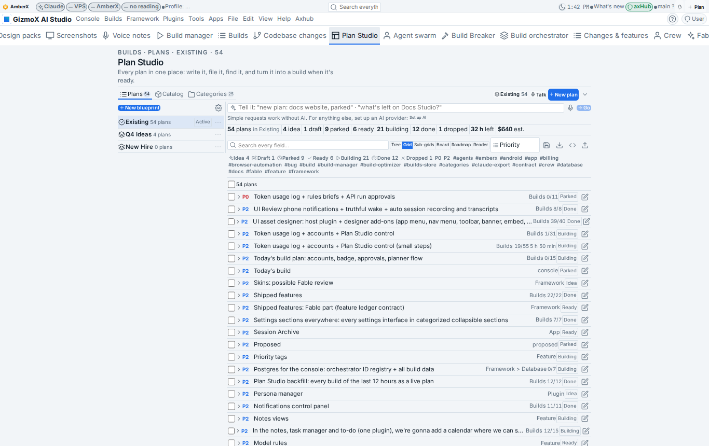
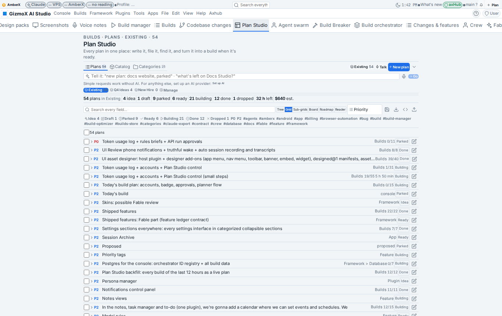
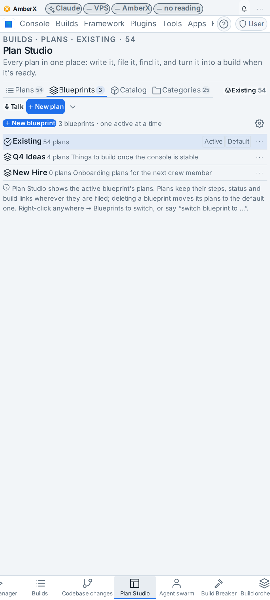
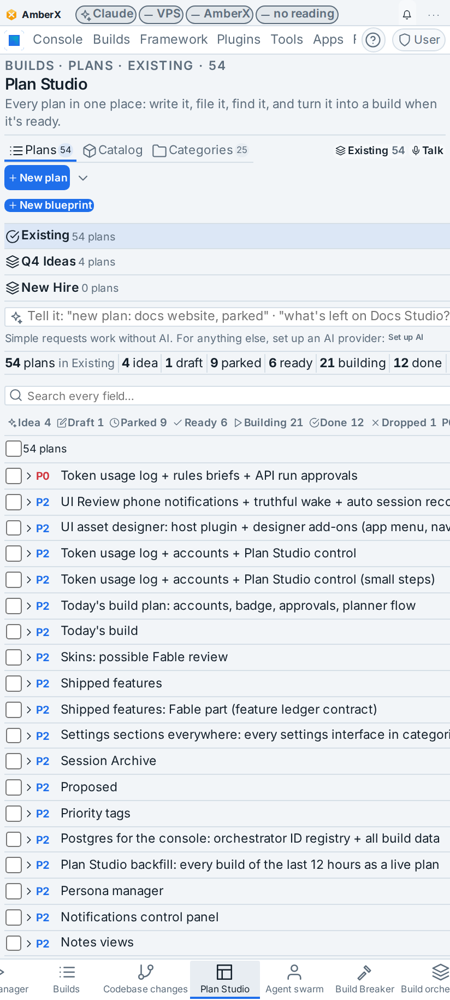
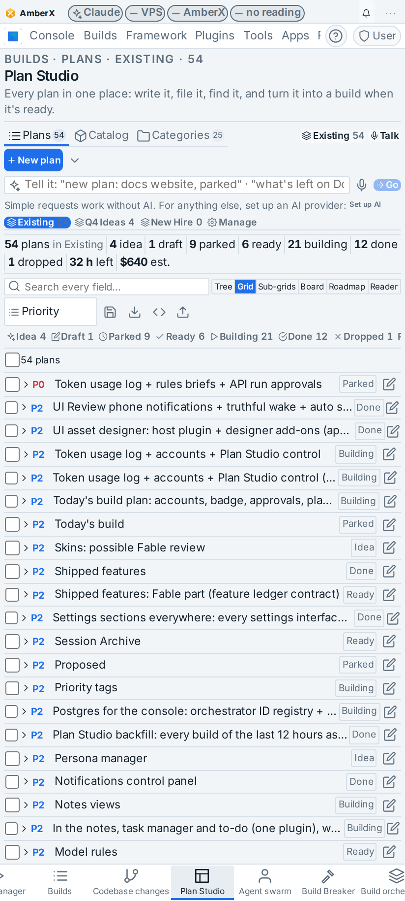

# Plan Studio: Blueprints (`plan-blueprints`)

**Brett said (Nov 7 2026):** "A named package of plans in Plan Studio, like build profiles but for plans. Only one
blueprint is active at a time; Plan Studio shows only the active blueprint's plans. Plans keep their exact structure
(steps, sub-items, status, build links) inside a blueprint." (full text on the build's origin:
`node framework/cli/build-origin.mjs get plan-blueprints`)

**Model:** Fable (agent Gina), s1–s2 Fable, s3–s7 Opus-pinned steps run in the same Fable session (a downgrade needs
nobody; nothing was launched on a higher model than its pin).
**Branch:** `claude/plan-blueprints` (committed, not pushed from the sandbox).

## The superseded build

`plan-archive` (queue id hl-mw6dmjiy-7w) had **already run** before this build started (12:26 → 12:47 UTC, exit 0,
tmux session gone) and committed on `claude/plan-archive` (never pushed). It had also changed live hub data: all 58
plans carried an `archived` stamp. Done here: the build is archived in the orchestrator with a note, its worktree and
branch were discarded (its commits lived only locally), and this build's migration stripped the `archived` stamp from
every plan while filing them in **Existing**. Its UI Review item `r-20261107-d94ad1b4` is moot (no PR, no branch).
Its one real find was kept: step ids were cut to 40 characters on every save, so long backfilled ids
(`<plan id>-12`) clashed and were renamed with random endings; the cap is now 80 like plan ids (5 hub plans, 124 ids).

## What changed

- **Contract `blueprint@1` / `plan-blueprints@1`** (`plugins/plan-studio/web/plan-core.mjs`, Fable): a blueprint is
  `{ id, name, description, created, plans }`; the document `<store>/blueprints.json` is `{ active, default, items }`.
  Plans carry an optional `blueprint` field (schema `plan.schema.json`, fixture case); missing or unknown = the
  document's default blueprint, so older writers and single-plan writes through axHub keep working. Each blueprint's
  `plans` is a projection of the plans' fields, refreshed on read (`projectBlueprints`): plans are the truth for
  membership. Pure ops `blueprintOp` (create · rename · describe · switch · default · move · duplicate · delete) and
  `migrateBlueprints`; `diffBeyondBlueprint` proves a move or migration changed nothing but `blueprint` / `updatedAt` /
  `version`. Duplicate copies the package with copies of its plans (new ids, no build link, `copiedFrom`); delete moves
  the plans to the default (or named) blueprint and the last blueprint can't go.
- **control@1 `planner.blueprints`** (24th target, appended; `framework/core/engines/control-rules.mjs`, snapshot,
  fixture, `spec/CONTROL.md`, `check-control.mts` 376 checks): list / get / add / set / remove / act `switch`,
  `rename`, `duplicate {name, withPlans}`, `move {ids}`; `planner.plans` gained `select.blueprint` (the active
  blueprint's plans by default; a name, an id or `all`) and `act move {blueprint}`; CLI alias `axf blueprint …`. MCP
  `control_*` take the new target (`mcp_server.py`). Baked copies re-baked (console-web by hand, AmberX `rebake.mjs`).
- **Store, CLI, API** (`plans.mjs`): `blueprints()` (migrates a store that has plans and no document: every plan into
  **Existing**, a plan titled "New Hire" into **New Hire**), `blueprintChange`, `migrateBlueprintsStore` (refuses to
  write if anything beyond the blueprint would change), `plansIn`; new plans land in the active blueprint, a plan that
  never had one is written where it already shows (the default). API ops `blueprints`, `blueprint {change}`,
  `blueprint-migrate`; CLI `plans.mjs blueprint list | active | add | switch | rename | describe | duplicate | delete |
  move | default | migrate [--strip <field>] [--dry-run]`, `list [--blueprint <id|name|all>] [--all]`; plans@1 service
  `blueprints()` / `blueprint()`.
- **UI** (`web/blueprints.tsx`, `ui.tsx`, `editor.tsx`, `index.tsx`; tokens and framework controls only): the
  **Blueprints section** (New blueprint, inline create / rename / describe, Switch, Duplicate, Make default, Delete
  with the confirm naming where the plans go, "Move N here" for selected plans), the **switcher** in the top bar, the
  bulk bar's **Blueprint…** select and a row's **Move to blueprint…**, the editor's Blueprint field, *Sub-grids group
  by blueprint*. Settings in place: the section's gear opens *Blueprints show as* (tab / rail / bar) and the switcher
  toggle right there (the same keys live in Settings → Plugins → Plan Studio).
- **Context menu:** Plan Studio's right-click block gained a **Blueprints** submenu listing every blueprint with its
  count (the active one ticked); picking one switches, **Manage blueprints…** opens the section. The list is redrawn
  from the page store whenever blueprints change (`rt.addContextItems` replaces by id).
- **Plain English and voice** (`web/plan-ai.mjs`, op `blueprint`): "switch blueprint to X", "use blueprint X",
  "new blueprint X", "move this to the X blueprint", "which blueprint is active?"; the store applies the ops after the
  plan edits (`applyBlueprintOps`), the model prompt knows the op.
- **Migration on the hub** (13:30 UTC): 58 plans → Existing. Every plan checked against the pre-archive backup:
  identical apart from `blueprint` / `updatedAt` / `version`; 28 build links intact; `archived` gone; long step ids
  kept. Backups: `~/hub/data/amberx-axf/backups/plan-studio-before-archive-20261107/` (pre-archive) and
  `…/plan-studio-before-blueprints-20261107/` (just before this migration). No plan titled "New Hire" existed.

## UI Review (item `r-20261107-9e6acb75`, group "plan-blueprints - Nov 7 1:45 PM", 3 options as `tab-group` assets in `plugins/plan-studio/assets/tab-group/plan-studio-blueprints-mw6gemdb-{tab,rail,bar}.json`)

| Own tab (default) | Rail beside the plans | Chips above the plans |
| --- | --- | --- |
|  |  |  |
|  |  |  |

Also shot: the right-click **Blueprints** submenu, the top-bar switcher open, the in-place settings, the bar's folded
*Manage blueprints* section. Shots come from the console built on this branch with a copy of the hub's plans and two
extra blueprints (Q4 Ideas, New Hire) in the mock only.

## Checks

`npx -y tsx apps/console-web/plugins/plan-studio/test.mjs` 26 → 30 (migration identical + idempotent, switch filters,
move changes only the blueprint, duplicate without builds, delete moves plans, voice rules, store round trip with a
linked build, CLI, API, AI apply) · `python3 …/plan-studio/test.py` 15 → 19 · `token-control/test.mjs` 20 → 21
(planner.blueprints + planner.plans blueprint select / move / confirm-delete) · `check-control.mts` 376 (24 targets) ·
`test_mcp_tools.py` 203 · help coverage 100% (13 entries written) · theme / controls / chrome-assets / toolbars ·
plugin-lifecycle plan-studio clean · plugin commands · menu-reach 378 · console `tsc` clean · `vite build`.

## Known gaps

- The live console runs main's code until this merges; it already reads plans with the `blueprint` field fine (unknown
  fields are kept) and shows all 58.
- axhub-web, molly, walkthrough-studio and demo were already behind the framework before this build and were left as
  they were (`rebake.mjs status`); AmberX and the console carry the new control registry.
- Kotlin twin of the plan field and the control target: none needed yet (plan@1 has no Kotlin reader; control@1's
  Kotlin twin stays deferred in PORTING.md).
- "Add to Shipped features": the Shipped features plugin isn't on main; this report is what What's new reads once the
  branch merges.
