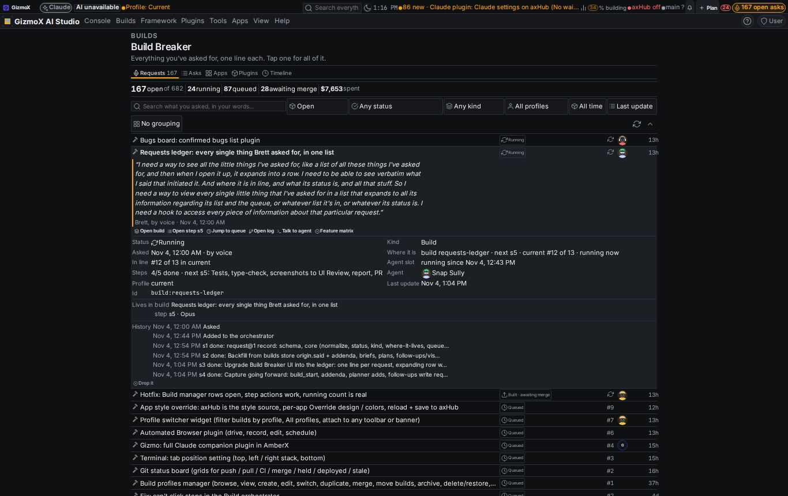
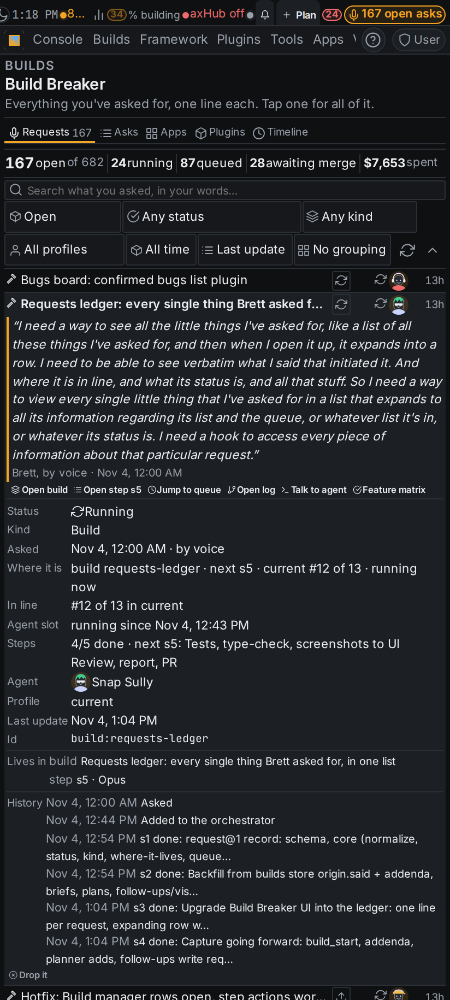

# requests-ledger: every single thing Brett asked for, in one list

Build `requests-ledger` (Current profile). Agent: Snap Sully (headless, Opus 5.5; every step Opus, no model switch).
Branch `claude/requests-ledger`.

## What Brett said (verbatim, Nov 4 2026, voice)

> I need a way to see all the little things I've asked for, like a list of all these things I've asked for, and then
> when I open it up, it expands into a row. I need to be able to see verbatim what I said that initiated it. And where
> it is in line, and what its status is, and all that stuff. So I need a way to view every single little thing that
> I've asked for in a list that expands to all its information regarding its list and the queue, or whatever list it's
> in, or whatever its status is. I need a hook to access every piece of information about that particular request.

## What landed

### s1 request@1 (`apps/console-web/plugins/build-breaker/web/requests-core.mjs`, pure, typed in `.d.mts`)
One record per ask: `id, kind (build | addendum | bug | plan | follow-up | setting | crew), title, said (verbatim),
verbatim, at, source (voice | chat | console | code | memory), capturedBy, parent, where[] (build, step, bug, plan,
memory file, thread, old ask, pr), status, supersededBy / supersedes / reversedBy / amendedBy, queue {list, position,
of}, slot {running | waiting, position}, agent + agentId, pr, branch, costUsd (+ costEstimated), profile, steps
{done, total, next}, history[], notes[], updatedAt`. Open schema.

Statuses: idea, planned, queued, running, paused, built (awaiting merge), merged, live, dropped, superseded, plus
**untracked** (a brief with no record in the builds store, so nobody can say where it is; shown, not hidden).

Most of it is **derived on every read**, so nothing goes stale: builds store (status, steps, queue order per profile,
origin.said + addenda, notes → agent), agent-slots (running / waiting + position; a running slot beats a stale
`pending`), change log (cost: actual when counted, else estimate). The `request-ledger@1` file only holds what no
source knows: hand-captured requests, patches (dropped / live / superseded stick; any other hand-set status yields to
live progress), links, notes, and the status / place-in-line history seen over time. It lives in the hub's shared
data (`/projects/amberx-axf/_data/build-breaker/requests-ledger.json`), like Plan Studio's plans.

### s2 Backfill (live, from everything that exists)
Builds store (311 builds, 8 stored addenda), every `/root/axf-builds/*/.brief.md` (140 briefs: "What Brett said" /
"Brett said" blocks fill builds without words; "Addendum N" blocks become addendum requests), Plan Studio plans,
follow-ups.md / vision.md / naming.md (one request per bullet ask or section), THREADS.md rows with his quotes, the
old build-asks@1 list (390 asks; an ask naming a build joins that build), bugs (bugs-board, when it lands).
Dedupe: the same words in two places = one request, the richer home keeps them and lists the other as a link.
Reversals: an addendum saying "never mind" marks the ask **reversed** (e.g. profile-lists-home-card ← "Leave it as
filters."); "overrides …" in a heading marks it **amended**; a memory section "SUPERSEDES the N sections above" marks
those **superseded** (naming.md: "axHub = Patches" → "Patch Hub" → "axHub stays axHub").

First run on the VPS: **682 requests, 167 open** (24 running, 87 queued, 28 awaiting merge), 61 addenda, 26 untracked
briefs, $7,653 of recorded spend.

### s3 UI: Build Breaker → **Requests** (the default tab; the old list stays as Asks · Apps · Plugins · Timeline)
- One line per request: kind icon + title, status chip, place in line (`#4`, or a spinner when running), agent face,
  age. Totals strip: open of total, running, queued, awaiting merge, spent.
- Tap = the full row: his exact words (quote, how and when), hooks **Open build · Open step · Open PR · Open bug ·
  Open plan · Jump to queue · Open log · Talk to agent** (+ any grid row hooks, e.g. Feature matrix), facts (status,
  kind, asked, where it is, in line, agent slot, steps, agent, PR, branch, cost, profile, last update, id), Related
  (parent, addenda, reversed / replaced by), Lives in, History, Notes, and Drop it / Mark live.
- Search in his words, filters (open / everything / done, status, kind, profile, dates), sort (newest, oldest, last
  update, place in line, status, most spent, title), group by status / build / kind / profile.
- Live: polls every 15 s while visible (only a fingerprint comes back when nothing moved) and tints rows whose status
  or place changed. Server caches one read for 8 s so the page, badge and card share it.
- Banner badge "N open asks" (tap → the list; Settings → Plugins → Build Breaker → *Open requests on the banner*).
- Home card: suggestion "What you asked for" (card-rules CARD_SUGGESTIONS → `build-breaker/requests-summary`).

### s4 Capture going forward (zero tokens)
- Builds, addenda (store or brief / tmux addendum pattern), plans, follow-ups and bugs are picked up by the next read:
  nothing has to remember to write.
- `deploy/claude-headless.sh` runs `requests.mjs capture --build <name> --by <agent>` at launch ("Launched by …").
- CLI `apps/console-web/plugins/build-breaker/requests.mjs list | get | update | link | add | capture | sync | export | summary | paths`.
- REST `/api/plugins/build-breaker/requests`, `requests/summary`, `request?id=`, `requests/update|link|add`.
- MCP `requests_list`, `request_get` (read-only, run with no veto), `request_update`, `request_link`; the server
  instructions tell sessions to answer "where's that thing I asked for" with `request_get` (id, build id or words).

## Checks
| Check | Result |
|---|---|
| `node apps/console-web/plugins/build-breaker/test.mjs` | 22 checks (was 14), all pass |
| `python3 apps/console-web/server/test_mcp_tools.py` | 200 checks, 62 tools |
| `npx tsc --noEmit` (console-web) | clean |
| `check-theme`, `check-controls`, `check-toolbars` | clean |
| `framework/spec/check-card.mjs`, `check-plugin-commands.mjs` | pass |
| `builds-store.mjs verify` | ok |
| `plugin-lifecycle check build-breaker` | only the gitignored local `.axf-focus.json` (Watch live) |

## Screenshots
UI Review item `r-20261104-fd8c44c2` (group "requests-ledger - Nov 4 8:18 AM", non-blocking):
`requests-ledger/shots/` — list and open row, phone + desktop.

## Known gaps
- Ages are from the recorded date; many origins only carry a day, so they read from midnight.
- 26 briefs have no record in the builds store ("Not tracked"): launched before the store or under another id.
- "Live" (deployed) is not detected; merged requests can be marked live from the row or `request_update`.
- First page load on a busy VPS takes a few seconds (one ~850 KB read); later polls send only a fingerprint.
- bugs-board isn't built yet; the ledger already reads bug@1 from the places noted on that build.
