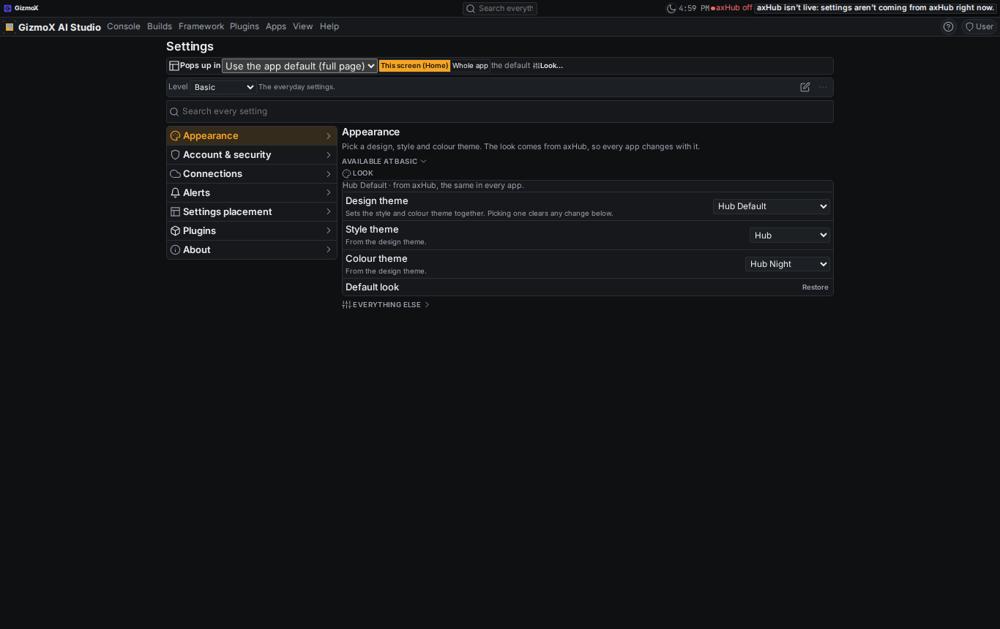
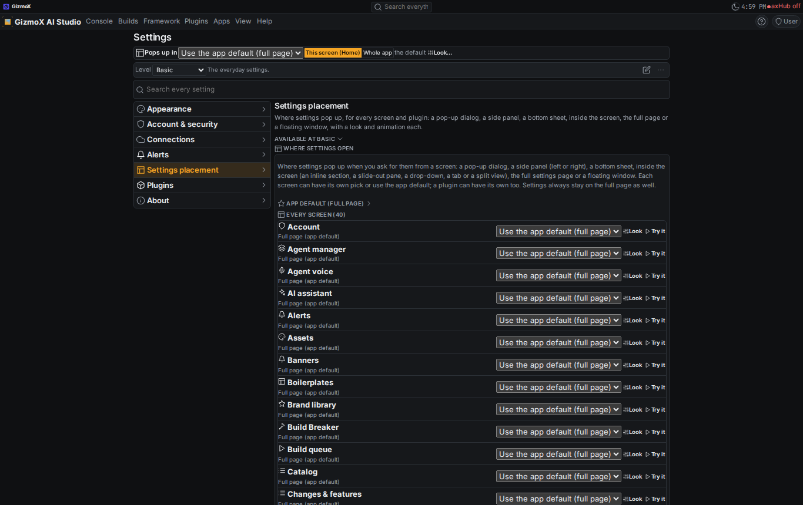
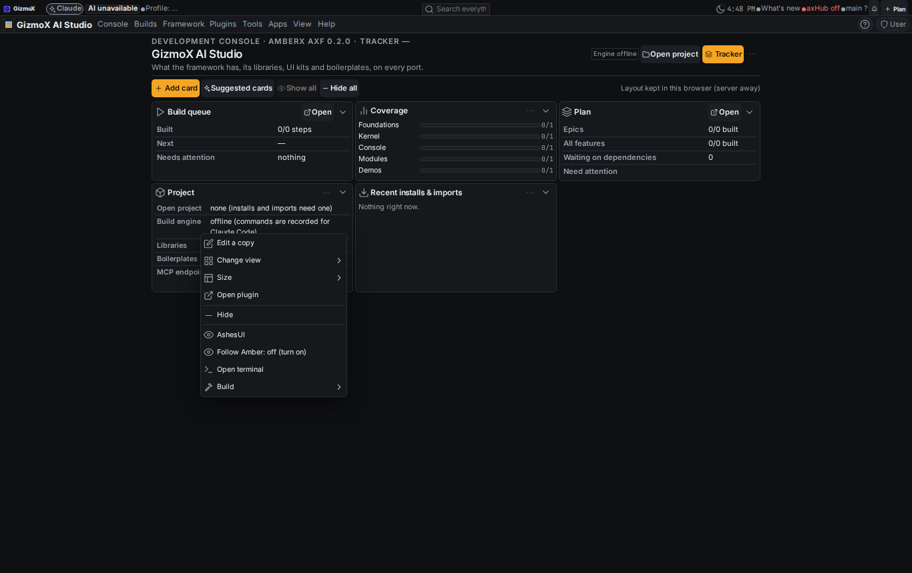
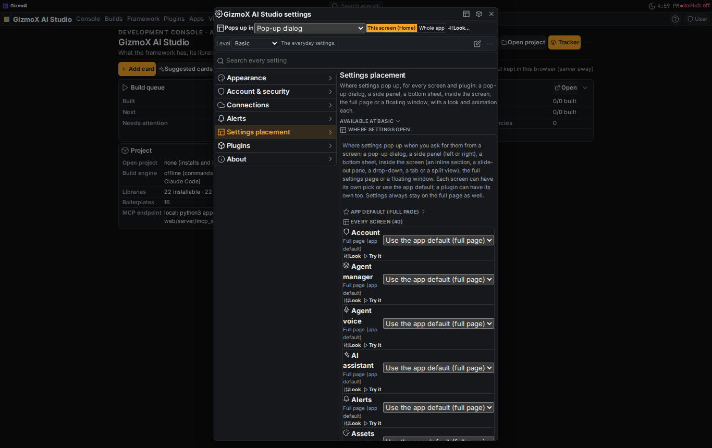
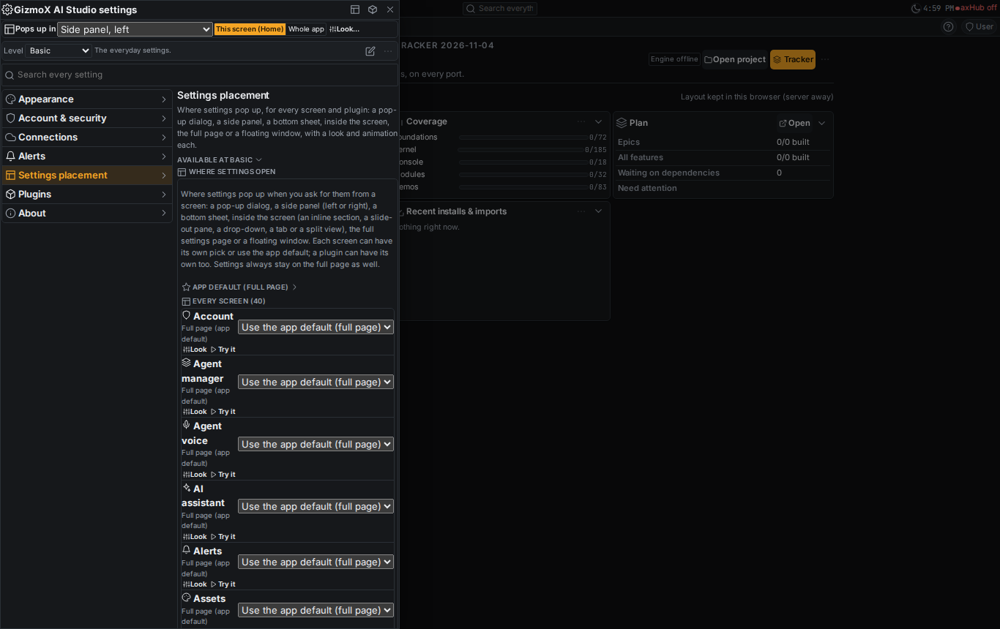
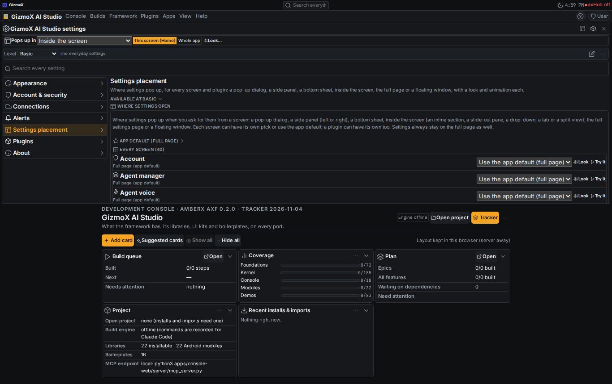
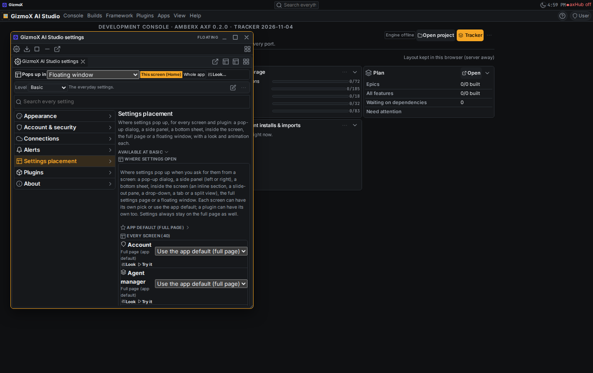
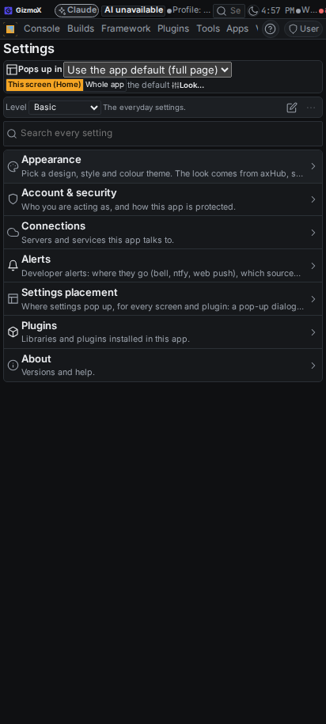
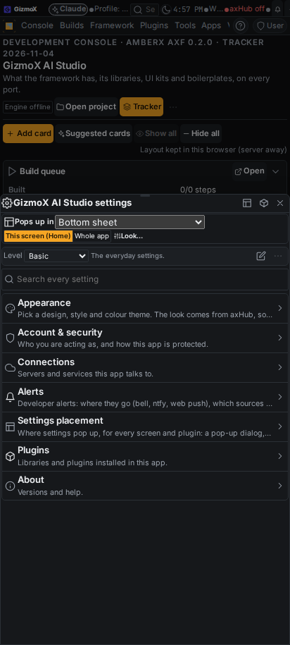
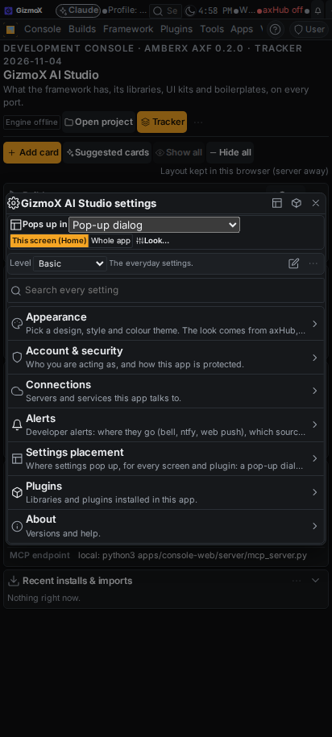

# settings-placement-everywhere (Current profile; Fable; agent Greenlight Gina, headless worktree session)

## What Brett said (verbatim, Nov 4 2026, voice)

> "Set the settings interface for Molly to open in a dialog." … "I should be able to select in every screen where its
> settings pops up."

Addendum 1 (Brett, voice, Nov 4): "Every settings interface should have a setting to declare where it pops up."

Branch `claude/settings-placement-everywhere` (= main + PR #289 merged + this build). PR #329 (supersedes #289, closed).

## PR #289 (plugin-settings-placement) landed into this branch

#289 was red: 594 commits behind main with conflicts in `framework/react/index.ts`, `framework/ui/axf.css`, the console
Terminal (`TerminalHost.tsx`, `TerminalSession.tsx`) and every app's baked `src/axf` + lock. Resolved: both sides kept in
the framework index and stylesheet; the Terminal keeps main's tabs, grips and window menu with #289's `<SettingsHost>`
wrap; every app re-baked from the merged framework. Two CI failures fixed: the plugin named the Terminal plugin in its
manifest and test (plugin-lifecycle stale reference), and `window-handles-check.mts` expected the old `axf.settings.tab`
dialog (the placement system draws a surface instead). The merged state was pushed to `claude/plugin-settings-placement`
so #289's CI ran on it; this build's PR supersedes #289 (it contains every #289 commit).

**Fable review of settings-placement@1 (what the report asked for):**

| Found | Done |
|---|---|
| The vocabulary (inside / dialog / window / main) wasn't the one Brett asked for (dialog / side panel / bottom sheet / inside / full page / floating window); the page pane was a "fallback" look key nobody could pick | v2 vocabulary in one plain-JS registry (`settingsplacement-rules.mjs`) shared by the TS engine, the console server, the CLI and the plugin; `main` → `page`, `fallback` look → `panel`, older picks still load |
| Picks were per plugin only; no screen could choose, and no app default was seedable | Scopes: screen → plugin → plugin default → settings asset `opensIn` → app default (manifest `settingsPlacement`) → legacy → page (`pickFor`, source reported) |
| `effectivePick` normalized an invalid upper layer on the lower one, so a bad interface value silently became the app default labelled "interface" | A scope that names no placement is skipped (`hasPlacement`) |
| Closing was instant (no exit animation) | Surfaces animate out the way they came in (`closing`, `animationend`, fallback timer; reduced motion drops at once) |
| Only the Terminal hosted settings inside itself | Every screen is a `<SettingsHost>` (AppShell wraps the main area; the host scrolls), a plugin may still add its own |
| The whole settings interface (`app.settings`) ignored placement; only one tab could be placed | `app.settings` and `settings.open` without a tab open the whole interface where the screen says |
| The "Settings placement…" context item was registered under a key no target matches | `*:axf-settings-placement` (every target) + "Settings opens in" on the canvas, nav items, toolbar and window titles |
| The fixture was hand-written | Generated from the engine by `spec/gen-settings-placement.mts` (60 resolve, 14 normalize, 12 scope, 30 parse cases) |

## What changed (framework level: every app on the framework)

| Piece | Where |
|---|---|
| Contract `settings-placement@1` v2: `dialog` / `panel` (side left, right) / `sheet` / `inside` (pane, dropdown, tab, split, inline) / `page` / `window`; choices `dialog, panel-left, panel-right, sheet, inside, page, window` (+ `default`); spoken words (`parsePlacementChoice`: "side panel left", "bottom sheet", "in a dialog", "inside as a split view") | `framework/core/engines/settingsplacement-rules.mjs` (+ `.d.mts`), `settingsplacement.ts` |
| Scopes (`pickFor`): `axf.settingsPlacement.screen.<view>` → `axf.settingsPlacement.<plugin>` → plugin@1 `settingsPlacement` → settings asset `opensIn` → `axf.settingsPlacement.default` (seeded by manifest `settingsPlacement`) → legacy "Opens in = dialog" → page | engine; `framework/core/types.ts` (`AxfManifest.settingsPlacement`) |
| `opensIn` on the settings interface asset (settings-ui@1): a placement word or a pick; every `settings` asset may declare where it pops up | `framework/schemas/asset-types.json`, `core/engines/settingsui.ts` |
| Every screen a settings host; page-level dialog, side panel and bottom sheet; exit animations; the **Pops up in** row; the full picker per scope; `settingsTargetOf` (a screen's settings = its plugin's first tab, else the whole interface) | `framework/react/settingsHost.tsx`, `AppShell.tsx`, `framework/ui/axf.css` |
| `app.settings`, `settings.open[:tab]`, `settings.open-for:<view>`, `settings.place:<scope>:<choice>`, `settings.placement:<scope>`; the whole interface or one tab on a surface / window / page; **Settings → Settings placement** (app default, every screen, every plugin); right-click / long-press a screen, its nav item, the toolbar, a window title → **Settings opens in** (choices, the current one ticked, Use the app default, Look and animation…) | `framework/libs/settings/index.tsx` |
| Molly's settings open in a dialog | `apps/molly/axf.manifest.json` (`"settingsPlacement": "dialog"`) |
| control@1 target `console.placement` (list / get / set / reset; `console.placement` items in every console's catalog: `app`, `screen:<view>`, `plugin:<id>`, with the choice in force) → `place` message to the open console; MCP `console_placement`, REST `POST /api/console/placement`, CLI `axf console placement [<screen>] [--in <where>]` / `axf console placement plan studio side panel left`; `console_list(kind="placement")` | `control-rules.mjs`, `console-commands.mjs` (+ `.d.mts`), console-commands plugin (web, server, CLI), `mcp_server.py` |
| Settings placement plugin keeps per-screen picks on the console server too (`GET/PUT /screens/{view}`), v2 words | `apps/console-web/plugins/settings-placement/` |
| Expenses (vendored `@axf/core` 0.0.25, MUI): placement store (kv `settings-placement`), the six placements (Dialog, Drawer left / right / bottom, full-screen Dialog, floating draggable Paper, inline section at the top of the module's own screen), the Pops up in row on every surface, **Settings opens in…** context row | `apps/expenses/vendor/axf-core/src/settings/placement.ts`, `SettingsDialog.tsx`, `shell/ModuleHost.tsx`, `ctx/commands.ts`, `ctx/universal.ts` |
| Rule + porting note | `_claude/rules/RULES.md` ("Every screen picks where its settings pop up"), `framework/spec/PORTING.md` |

Settings always stay on the full settings page too; a placement only picks where an opening lands.

## Tests

| Check | Before | After |
|---|---|---|
| `npx -y tsx framework/spec/check-settings-placement.mts` (fixture replay, scopes, parsing, choices, opensIn, every console plugin opens as pane / dialog / panel / sheet / window / page, tokens only, AppShell host + library markers) | 1504 checks | 2007 checks (60 resolve, 30 parse, 60 plugins with settings) |
| `npx -y tsx framework/spec/check-control.mts` | 23 targets | 24 targets (`console.placement`) |
| `npx -y tsx framework/spec/check-console-commands.mts` | 8 tools | 66 checks, 9 tools |
| `node apps/console-web/plugins/console-commands/test.mjs` | 7 tests | 8 tests (CLI words + runner set / reset / list / get for placements) |
| `python3 apps/console-web/plugins/settings-placement/test.py` | 12 checks | 20 checks (screens, choice words, older names, bad side / view id) |
| `python3 …/console-commands/server/test_console_commands.py`, `python3 apps/console-web/server/test_mcp_tools.py` | 72 / 203 | 72 / 203 (console_placement is a write tool) |
| `apps/console-web/scripts/window-handles-check.mts` | expected the old `axf.settings.tab` dialog | 35 checks (asserts the placement surface) |
| `check-settings-ui`, `check-plugin-commands`, `check-help`, `check-hub-look`, `check-appearance-lock`, `check-interface`, `check-embed`, `menu-reach`, `shared-assets check`, `help-coverage --check`, `check-theme`, `check-controls`, `check-toolbars`, `plugin-lifecycle check` (all plugins) | pass | pass |
| Console `tsc --noEmit`, Expenses `tsc --noEmit` | pass | pass |

## Screenshots

`_claude/builds/reports/settings-placement-everywhere/shots/` (desktop 1366×860, phone 412×915; the built console served
locally with the appearance source off, picks made through the right-click menu). UI Review group
`settings-placement-everywhere - Nov 4` (non-blocking). PR #329.

| Shot | What |
|---|---|
|  | The settings page: the **Pops up in** row at the top (This screen (Home) / Whole app, Look…) |
|  | Settings → Settings placement: the app default, every screen (55) with its pick, Look, Try it |
|  | Right-click on a screen → **Settings opens in** (the submenu lists the seven choices, the app default, Look and animation…) |
|  | Home → Pop-up dialog: the whole settings interface in a dialog |
|  | Home → Side panel, left |
|  | Home → Inside the screen: an inline section at the top of Home |
|  | Home → Floating window |
|  | The settings page on a phone, with the row |
|  | Home → Bottom sheet on a phone |
|  | Home → Pop-up dialog on a phone |

## Gaps / notes

- Kotlin twin deferred (Android on hold): recorded in `framework/spec/PORTING.md`.
- `tab-group-assets` (running, Fable) is building the shared default + per-app custom settings-interface assets; this
  build's `opensIn` is a field on the `settings` asset, so each of those interfaces can declare where it pops up without
  further contract work. A note was left on that build.
- Molly's framed apps (AmberX, axHub, Console, Expenses) keep their own placement picks (each app is its own runtime);
  Molly's own settings interface opens in a dialog.
- Expenses runs on the vendored core: its picks live in the app's kv store, not in the AXF settings registry, and it has
  no control@1 surface yet (follow-up with the Expenses re-theme).

## Resume r2 (Nov 4 2026, Gina, Fable)

Brett paused the build so the merge queue could land, then said "start building". PR #329 was red on the console job.

- **Why CI was red:** `check-control.mts` pins the control@1 registry as append-only. `console.placement` had been inserted
  inside the console block, shifting `pass.scopes` and the plugin targets. Fixed: `console.placement` is now the last target
  (after `tokens.nav`), the check pins it there, `CONTROL.md` names and describes it (the check now requires that), the control
  fixture and schema snapshot were regenerated, and the console, Molly, AmberX web and axHub web were re-baked.
- **Queue readiness:** a dry merge against main showed five add/add conflicts, all synced data (`changes/…`, `sessions/archive/…`).
  The branch now carries main's copies, so the queue sees no conflict. Nothing else was pulled from main (queue rule).
- **Checks run here:** control@1 (375), console commands (66 + 8), plugin commands (57), settings-placement@1 (2007),
  settings-placement server (20), console MCP tools (203), console-commands server (72; one timing flake on the first run,
  green twice after), help coverage, agent-card and widgets fixtures, console and Expenses type-checks.
- **Landing:** PR #329 is in the merge queue. The queue holds it while its UI Review item (r-20261104-da11afcc) waits for Brett.
