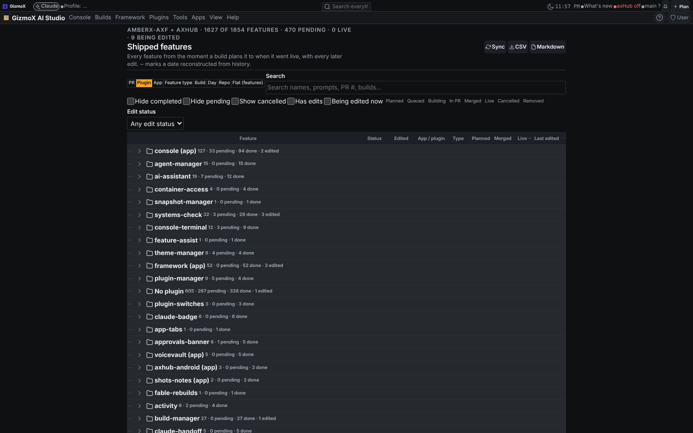
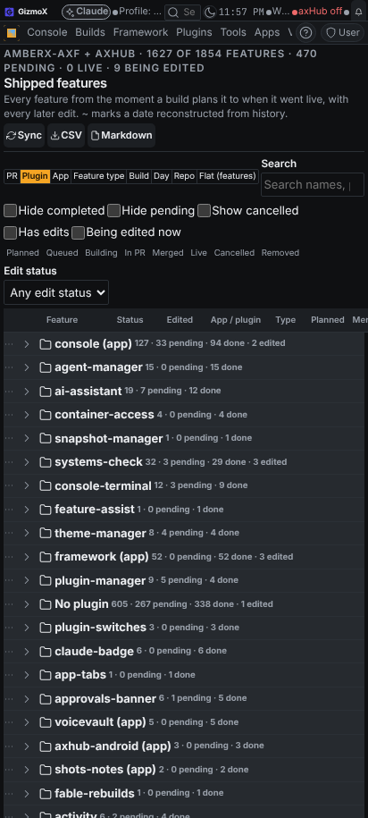
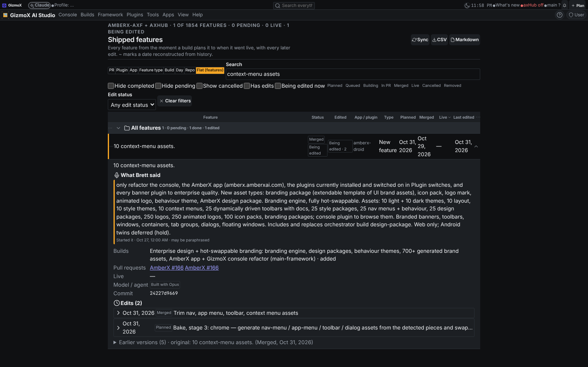
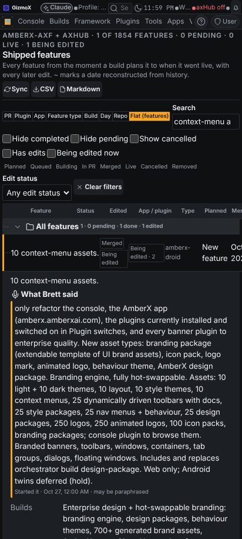

# Shipped features (shipped-features-r2)

**Asked (Brett, Nov 4 2026, voice):** "Where's the list of features that can be sorted, and when they went live?"
**Addendum:** "As soon as a prompt goes through that plans on building the features, they go into that list, and have
it sortable so you can hide completed ones and pending ones." "Anytime a feature in that list is getting changed or
altered, it will appear as an edit. It will update that list and show edits to that feature."
**Model:** s1–s2 Fable (feature-ledger@1, deploy-log@1); s3–s15 Opus because this account had no Fable credits
(Brett, Nov 4: "Finish it with opus redo fable later"). The Fable review list is in the progress file.

## What shipped (branch `claude/shipped-features-r2`, draft PR #350)

- **build-hook@1** (`framework/core/build-hook.mjs`, `framework/cli/build-hooks.mjs`): one event stream from every
  builds store write (created, steps-added, step-done, status, pr-opened, pr-merged, addendum, cancelled, restored),
  stable ids, outbox + listeners from plugin.json `buildHooks`, journal replay. 2358 events from today's journal.
- **feature-ledger@1 conformance** finished: fixture written, build refs without a profile now fold into the same
  build with one (58 checks).
- **SQLite ledger** (`apps/console-web/plugins/shipped-features/ledger/db.mjs`, migrations 001 + 002): features with
  every earlier version kept, feature ↔ build step links, edits table, PRs, builds, prompts, deploys.
- **Planned features on create:** a created build's steps become Planned features (or Planned edits of existing ones)
  with his verbatim prompt; statuses follow the build; cancelled builds keep them as Cancelled.
- **Importers:** builds journal, merged PRs (git or GitHub API), early commits, seed file. On the shallow test clone:
  1854 features, 59 edits, 256 PRs.
- **Deploy log writers:** `axf_deploy_log` (shell) in the console and site installers; failed updates logged too;
  live dates per target from the first deploy containing the merge commit, guessed (~) backfill before the log.
- **Grid:** Builds → Shipped features. View by PR / plugin / app / type / build / day / repo / flat; status and edited
  chips; Hide completed, Hide pending, Show cancelled, status multi-select, Has edits, Being edited now, edit status
  (remembered per device); details with what Brett said, builds, PRs, live per target, the Edits timeline and earlier
  versions; CSV / Markdown export; menu badge; plugin commands (REST / MCP / CLI) with titles.

## Screenshots (mocked API, real ledger data from the test clone)

| Desktop | Phone |
| --- | --- |
|  |  |
|  |  |

UI Review: not submitted from this cloud session (no console here). Submit these from the VPS:
`node apps/console-web/plugins/ui-review/review.mjs submit --kind screen --name "Shipped features" --app console --screen shipped-features --group "shipped-features-r2 - Nov 5" --shots <files> --branch claude/shipped-features-r2 --pr 350 --console`.

## Tests

`node apps/console-web/plugins/shipped-features/test.mjs` (7) · `python3 apps/console-web/plugins/shipped-features/test.py` (10) ·
`node framework/spec/check-feature-ledger.mjs` (58) · `node framework/spec/check-build-hook.mjs` (16) ·
`bash framework/deploy/test.sh` (49) · builds store checks unchanged (37 + 5) · console `tsc --noEmit` clean ·
theme, controls, toolbars, plugin pages, plugin lifecycle, plugin commands checks clean.

## Known gaps

- AI feature split and AI edit matching are hook points (`ctx.split`, `ctx.match`, `data/features-seed.json`,
  `ledger.mjs seed-draft`), not wired to a model; the plain fallback is one feature per step and scope + name / file
  matching. Many old build steps have no files, so their app / plugin is guessed from the text or left empty.
- axHub: history needs `AXF_AXHUB_REPO` or `GITHUB_TOKEN` on the VPS; axHub's installer needs its own
  `axf_deploy_log` call (axHub repo).
- Old builds' `createdAt` is the store migration date, so planned dates before Oct 31 are clamped to the merge date.
- Fable review pending for s3–s5 and s12 (contracts, hook contract, SQLite schema, edit matching).
