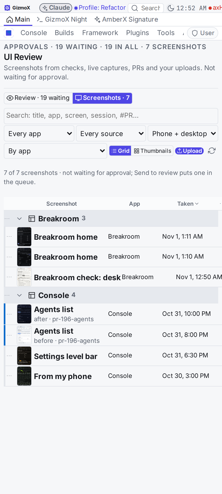
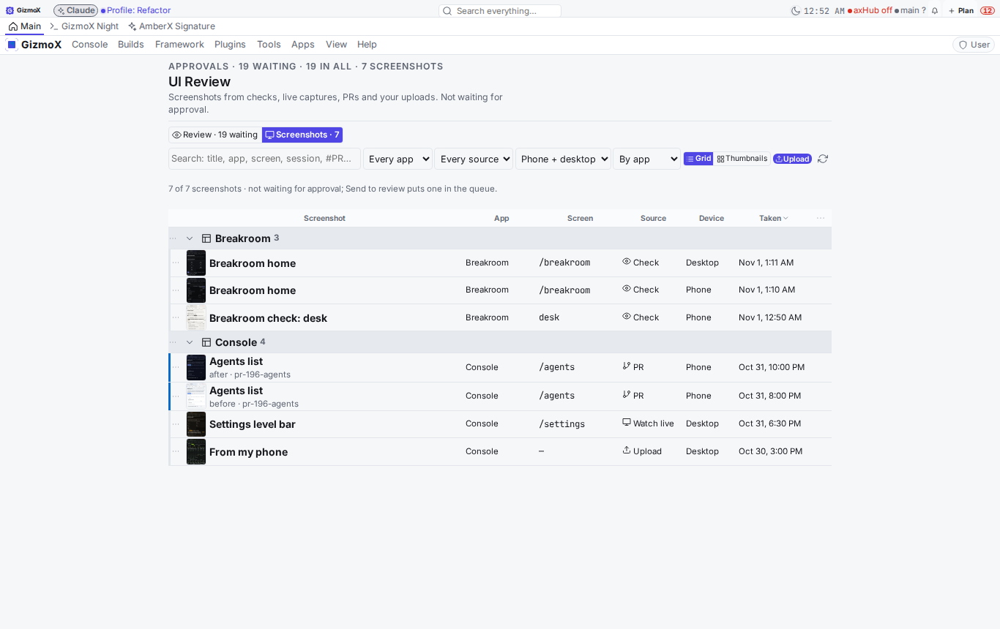
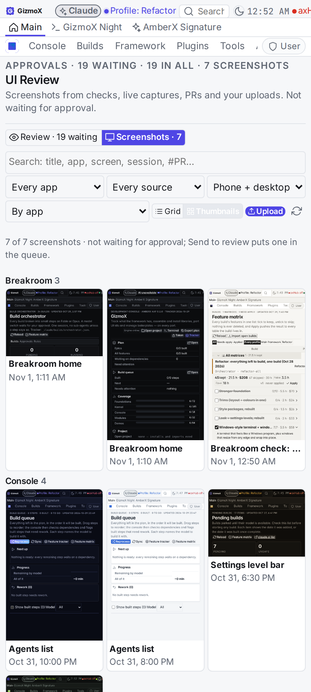
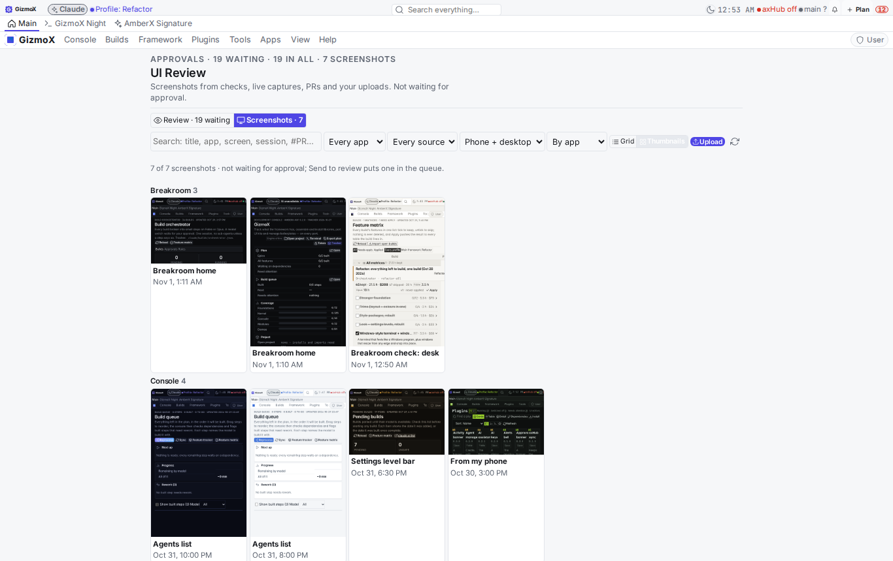
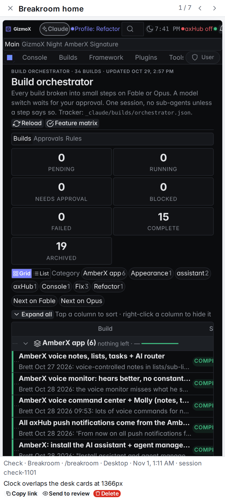
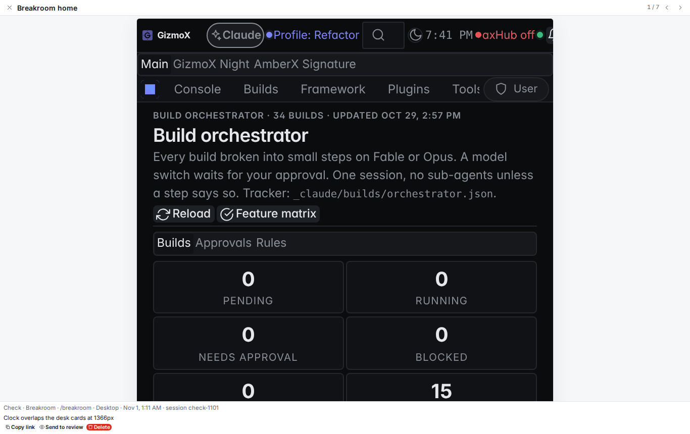
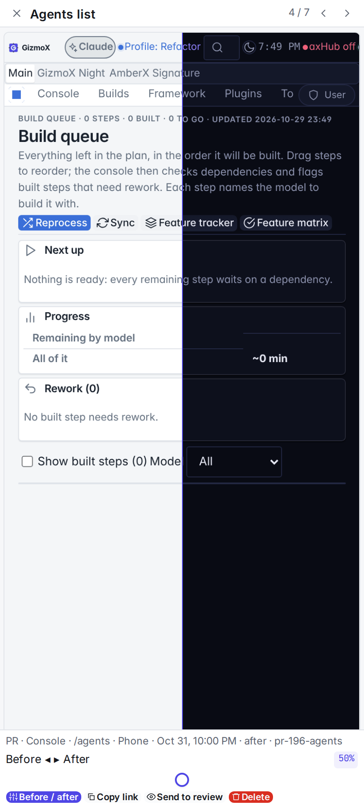
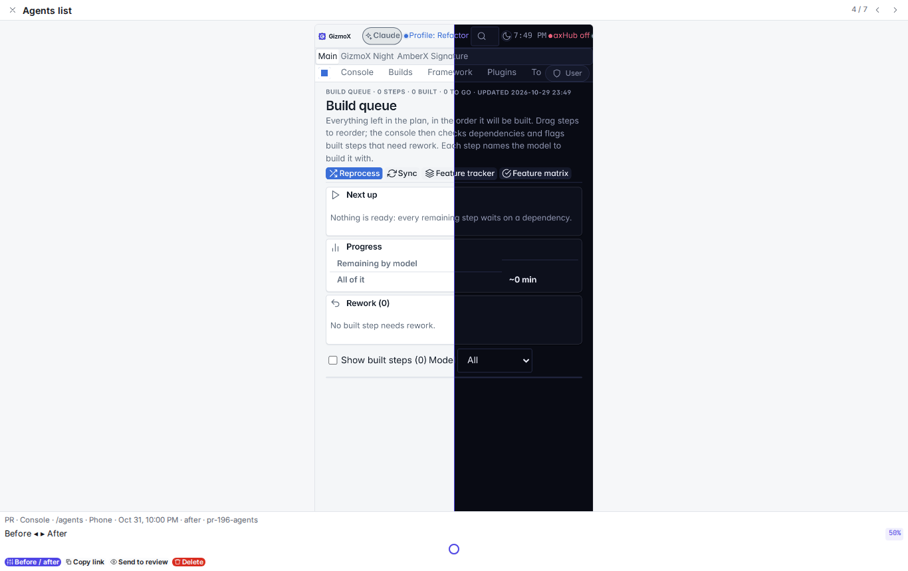

# UI Review → Screenshots tab (`shots-tab`, Nov 1 2026)

Headless VPS build, Opus, one session, branch `claude/shots-tab` → pushed to `main`.

**Ask (Brett):** UI Review only showed planned build screens waiting for approve / reject. There was no place for
ad-hoc screenshots: a session checking a screen like the Breakroom, live captures, PR before/after, his own uploads.

## What landed

| Part | Where |
|---|---|
| Store (`ui-screenshot@1`): id, title, source (`check` / `build` / `pr` / `manual` / `watch-live`), session, build, agent, app, screen, viewport, takenAt, addedAt, before/after `pair` + `side`, note, branch, PR, by, promoted. Files on the console data volume: `<ui-review data>/screenshots/index.json` + `screenshots/files/<id>.<ext>`. Separate from `items.json`, so it is never in the approve / reject queue and never counted by `ui-review@1` state. | `apps/console-web/plugins/ui-review/server/screenshots.py`, `web/shots-core.mjs` (+ `.d.mts`) |
| Intake API: `POST /api/plugins/ui-review/shots` takes JSON (`data` base64 / data URL, or `files: [...]`) or multipart (`curl -F file=@x.png -F title=…`, parsed with the stdlib, no new dependency). Auth = the plugin mount (console token or a signed-in admin); no token → 401. Also `GET shots`, `GET shots/file?id=`, `POST shots/update`, `shots/remove`, `shots/promote`, `shots/migrate`. | same |
| CLI: `node framework/cli/shot.mjs <file>… --title --app --screen --source --session [--viewport] [--pair --side] [--note] [--pr]`, also `axf shot …`; `list`, `promote <id>`, `migrate`, `paths`. Posts to the console when `AXF_CONSOLE_URL` + `AXF_TOKEN` are set, else writes this checkout (`--console` / `--local` force it). Finds the handler by capability `service:ui-screenshots@1`, never by folder. | `framework/cli/shot.mjs`, `framework/cli/axf.mjs`, plugin `shots.mjs` |
| UI: a **Review · Screenshots** tab strip under the page title (and View → Screenshots, nav, app menu). Framework `DataGrid` (search; app / source / device filters; sortable columns incl. the *Taken* date; column menu) grouped by app / screen / source / day / none, or a **Thumbnails** layout. Tap → full-screen viewer (portal; swipe, ← →, Esc), **before / after** slider (framework `Slider`) when paired, **Copy link** (`?ui-shot=<id>` opens that picture), **Send to review**, **Delete** (Button `confirm`, behaviour theme decides). **Upload** button (`accept="image/png,image/jpeg,image/webp"`, camera roll works on a phone). Framework controls + theme / scale tokens only. | `web/screenshots.tsx`, `web/ui.tsx`, `web/index.tsx`, `web/keys.ts`, `web/menu.ts`, `web/ui-review.css` |
| Send to review: copies the picture into a normal waiting review item (`source: screenshots`, `fromShot`); the screenshot stays and lists the item in `promoted`. | `server/__init__.py` `promote_shot`, `shots.mjs promoteLocal` |
| Migration: review items titled `Breakroom check: …` move into Screenshots (one per picture, source `check`, app kept / Breakroom, device kept, the item and its `shots/<id>/` folder removed, note in `screenshots/migrated.json`). Runs when the server part starts and on `POST shots/migrate` / `shot.mjs migrate`; idempotent. Real review items are untouched. | `server/screenshots.py` `Store.migrate`, `shots-core.mjs` `migrateItems` |
| Tell builds: shared RULES line ("Screenshots that aren't for approval go to Screenshots, not the review queue"), one line in the Build manager's headless brief (`briefFor`) and in the orchestrator's phase brief (`brief`). | `_claude/shared/rules/RULES.md`, `plugins/build-manager/web/orchestrate.mjs`, `plugins/build-orchestrator/web/orchestrator-core.mjs` |
| Docs | plugin `README.md` (Screenshots section), `plugins/README.md`, `plugin.json` 0.3.0 (+ `service:ui-screenshots@1`) |

## Tests

| Check | Before | After |
|---|---|---|
| `python apps/console-web/plugins/ui-review/test.py` | 34 | **64** (+30: intake JSON + multipart, bad image / no picture / bad PR refused, list + sources, never in the queue, never holds a PR, file served, bad id refused, update can't touch the file, promote → waiting item + picture copied + holds its PR, migration moves only `Breakroom check:` items + idempotent + note, delete, **auth through the real console**: no token / wrong token / read without token → 401, console token → 200 with `by`) |
| `node --experimental-strip-types …/ui-review/test.mts` | 11 | **15** (screenshots core, `migrateItems`, `shot` CLI end to end incl. `axf shot`, pair sides, content sniffing, promote, migrate; handler found by capability) |
| build-orchestrator `test.mjs` / build-manager `test.mjs` + `test.py` | pass | pass (18 / 126 / 42) |
| console `npm run build` (tsc + vite) | pass | pass |
| `check-theme`, `check-controls`, `check-plugin-pages`, `menu-reach` | pass | pass |
| `plugin-lifecycle check` (every plugin) | pass | pass (in a clean worktree) |

Full local block from `.github/workflows/android.yml` was run in a clean worktree of the commit and of `origin/main`.
Same results on both apart from my changes, except these, which **fail identically on clean main** here (environment,
not this build): `tracker.mjs --check` and `plugins.mjs --check` (they read the hub's live `/projects` data, where
several files are held in a sync clash), `session-checkin/test.mjs` (headless env makes it "unattended"),
`check-windows.mts` and `amberx-droid/test.mjs` (need `node_modules` CI installs), `test_wall_users.py` (needs a
built `dist/`; passes 56/56 once the console is built). CI runs on Node 22; this host is Node 20.

## Screenshots (demo data: 6 screenshots + 1 migrated `Breakroom check:` item)

| View | Phone | Desktop |
|---|---|---|
| Grid, grouped by app |  |  |
| Thumbnails |  |  |
| Full-screen viewer |  |  |
| Before / after slider |  |  |

Captured with `bash /tmp/shots-demo/make.sh` (demo data through `shot.mjs --local` + one `review.mjs submit` titled
`Breakroom check: desk`) and `AXF_APPEARANCE_HUB=off AXF_UI_REVIEW_DIR=/tmp/shots-demo/data node framework/cli/rebuild-shots.mjs
--shots _claude/memory/docs/ui-review/screenshots-tab/shots.json …`.

## Notes / gaps

- The live console's `Breakroom check:` items move the first time the console restarts on this code (the server part
  migrates on start); `shot.mjs migrate --console` does it on demand.
- Signed-in hub **users** (not admins) reach it only if an admin grants them the UI Review plugin, same as the rest of
  the plugin; no separate upload-only permission was added.
- Bulk select / bulk delete in the grid wasn't added (delete and Send to review are per screenshot in the viewer;
  `shots/remove` and `shots/promote` already take many ids).
- Not added to the Build orchestrator (headless brief with an explicit scope; no profile card possible).
