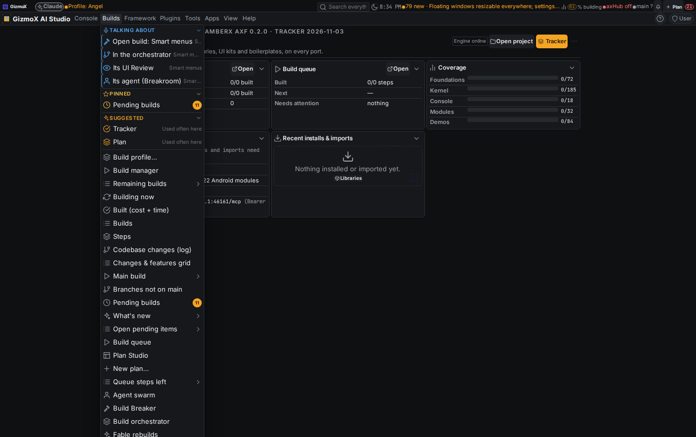
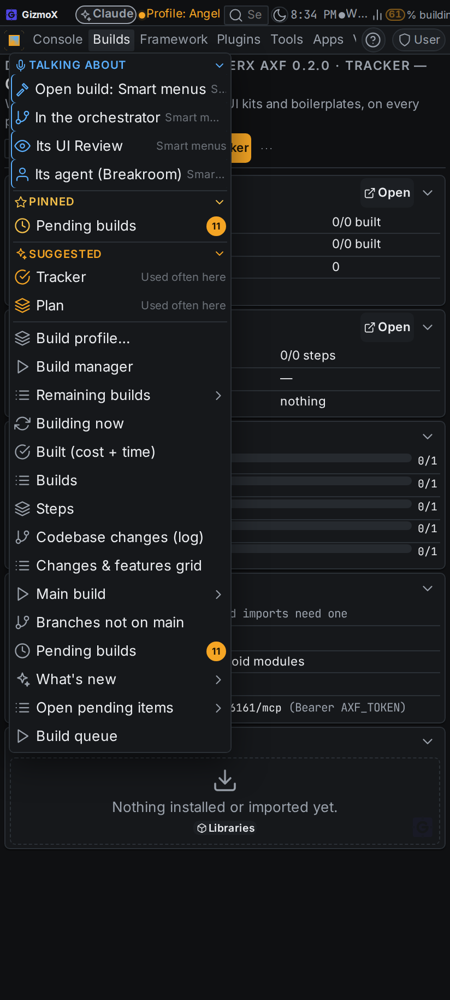
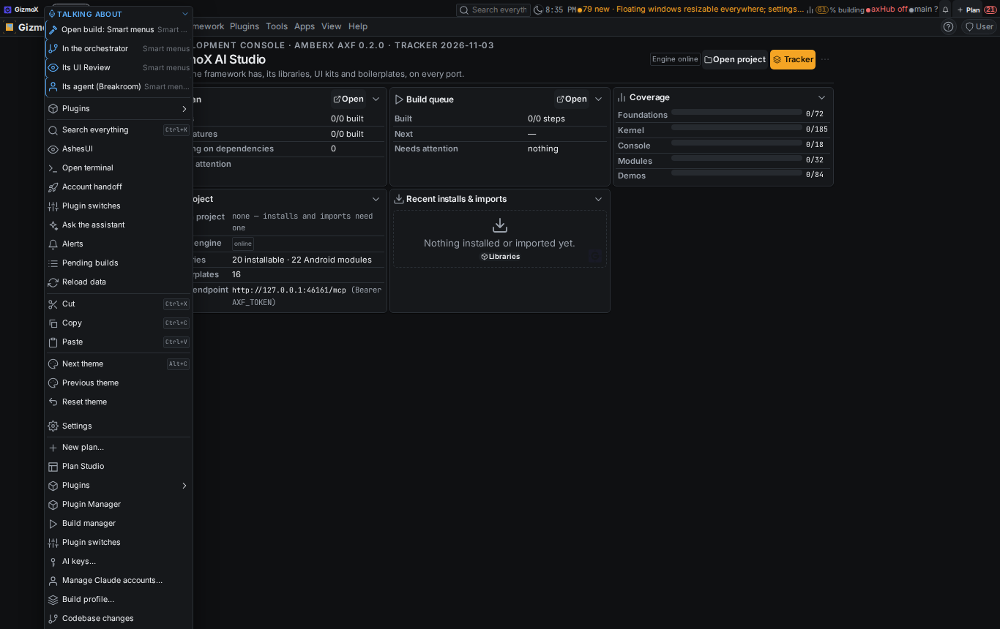
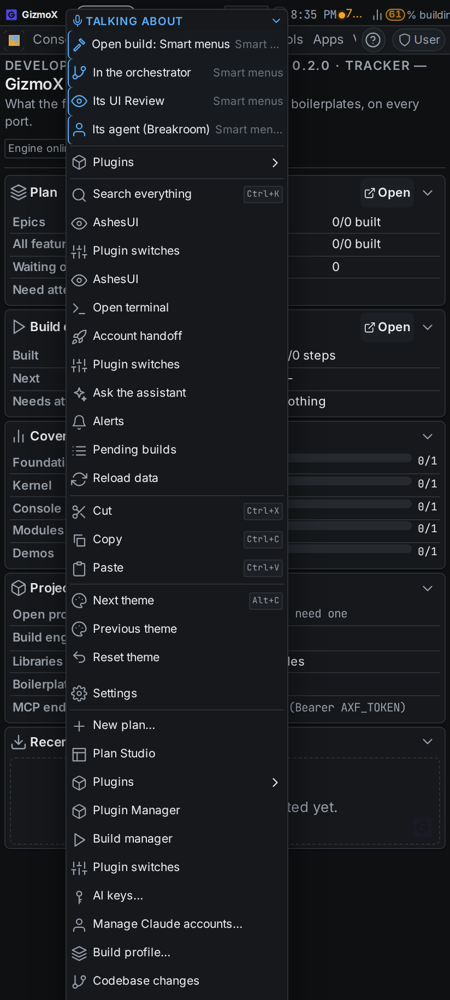
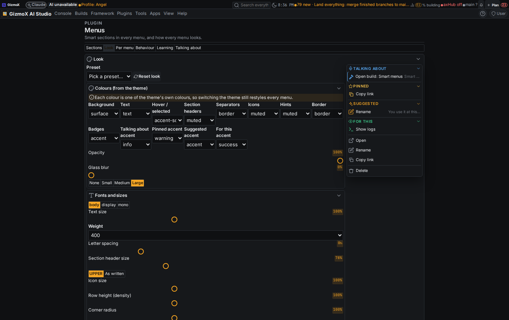
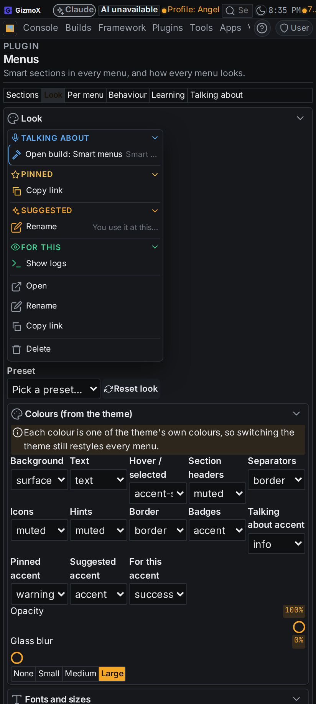
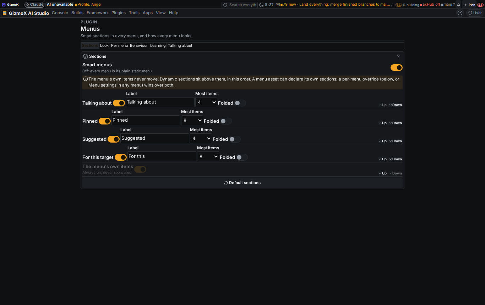
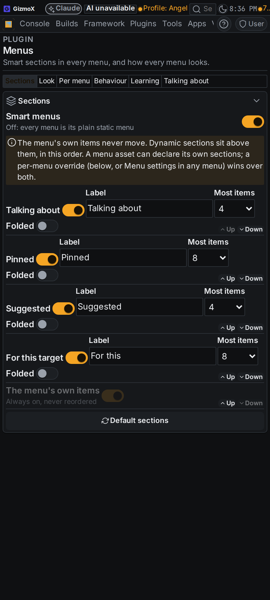

# smart-menus — Smart menus (Urgent)

Brett, Nov 3 2026 (voice, + addenda 1-3). Branch `claude/smart-menus`, model Opus (all steps), agent Earl the Ear.

## What it does

Every context menu and every application-menu dropdown in every app draws **dynamic sections above its fixed items**.
The fixed items keep their order (muscle memory); nothing in them ever moves.

| Section | What's in it |
|---|---|
| **Talking about** | Actions on what Brett and Amber are discussing now (`console_context` MCP tool). A build topic in the Builds menu gives Open build / In the orchestrator / Its UI Review / Its agent. |
| **Pinned** | Items Brett pinned to that menu. |
| **Suggested** | The 3-5 items he's most likely to pick next, learned from his picks (with a tiny "why" hint). |
| **For this** | Contributed items whose `when` condition matches this target / state / screen / device. |
| static | The menu's own items, in their own order. |

Destructive items (delete, remove, reset, stop, deny…) are never promoted into a dynamic section; they stay where the menu has them.

## Pieces

- **Engine** `framework/core/engines/smartmenu.ts` (smart-menu@1, pure, zero tokens): context keys (menu | target | state words | screen), `when` conditions, frecency with a 7-day half-life + 25% credit for picks elsewhere + time-of-day boost (4-hour buckets) + first-order Markov "what comes next" boost, topics (merge, decay, replace), section composer, and the menus' look (`axf.menus.look` → `--fx-menu-*`, colours are theme-token names, sizes are multipliers of theme tokens).
- **Runtime seam** (`framework/core/runtime.ts`): `rt.setMenuSections(provider)`, `menuDraw`, `menuPicked`, `menuBehavior`, `menuLookVars`, `menuSectionsChanged`. No provider = plain static menus (conditional items that don't apply are still dropped).
- **Renderers**: context menus (`Overlays.tsx`) and app menus (`AppMenu.tsx`) draw foldable section headings, hints and per-menu look vars, and report picks. Targets can carry `data-fx-ctx-state` ("running has-pr"); Pending build cards now do. Menubar menus can open on hover; long-press time and 1-9 / Esc keys come from the plugin.
- **Asset fields**: context-menu `sections` / `targetSections`, app-menu `menus[].sections`, menu items `when` / `destructive` (asset-types.json).
- **Menus plugin** `apps/console-web/plugins/smart-menus` (plugin@1, lifecycle install/uninstall): per-person settings, pins, pick log and suggestion snapshots on the console server (data folder on the VPS that runs axHub; never sent elsewhere), one rolling topic list, MCP tool **`console_context`**, page View → Menus, Settings → Plugins → Menus (Sections, Behaviour, Look, Per menu, Talking about, Learning, Install & uninstall), a **Menu settings** hook at the bottom of every context menu. Look editor: 13 colour roles, opacity, glass blur, shadow, font, size, weight, letter spacing, header size/case, icon size, density, radius, min/max width, open animation (fade/scale/slide/drop/none), speed, easing, row stagger, hover style, Talking-about pulse, 6 presets, reset, export/import (`menu-look@1`), per-menu look overrides, live preview drawn by the real renderer. Reduced motion turns every menu animation off.
- **Commands once → REST + MCP + CLI** (plugin-commands@1): `smart-menus_state`, `_set-settings`, `_pin`, `_reset-learning` (confirm), `_topics`, `_set-topics`, `_clear-topics`, `_suggestions`; plus `console_context`.
- **Rule**: shared RULES.md (Sessions) + CLAUDE.md: when the conversation moves to something in the console, call `console_context` with it.

## Tests

- `npx -y tsx framework/spec/check-smart-menu.mts` — 22 checks + golden fixture `framework/spec/fixtures/smart-menu.json`: ranking math (recency beats old volume, elsewhere = ¼, Markov "Often next", time-of-day buckets), context keys, `when` conditions, conditional items dropped without the plugin, destructive never promoted, section order + static order untouched, cold menu shows no Suggested, learning off, context section off, topics fill/decay/refresh/replace, reset (all / menu / context), prune, section normalising, look (theme tokens only, clamps, reduced motion, per-menu override), **zero tokens: the engine imports no LLM client and makes no network call**.
- `apps/console-web/plugins/smart-menus/server/test_smart_menus.py` — 8 tests (settings clamps, per-menu, behaviour, picks prune/reset, topics merge/replace/decay/ttl, console_context).
- Console `tsc --noEmit`, `check-theme`, `check-controls`, `plugin-lifecycle check smart-menus`, `check-plugin-commands`, `menu-reach`, `axf validate --framework`: all pass.

## Screenshots (after; seeded demo data: one build topic, a few picks, one pin)

| | Desktop | Phone |
|---|---|---|
| Builds app menu |  |  |
| Context menu |  |  |
| Menus → Look |  |  |
| Menus → Sections |  |  |

## Known gaps / follow-ups

- **`menu-style` asset type not created.** Addendum 3 asked for export/import "as a menu-style asset". A new asset type is a contract change (Fable, needs Brett's upgrade approval), so the look is exported/imported as `menu-look@1` JSON and stored as the `axf.menus.look` appearance setting (shared through axHub). Registering `menu-style` as an asset@1 type is a separate Fable step.
- **Fable review** of the smart-menu engine contract (new framework engine built on Opus) per the Nov 1 rule.
- **`console_context` policy ALLOW** is set on axHub's side (its downstream tool policy), not in this repo: the tool is navigation-only (no veto) here; axHub must list it as allow.
- Topics reach open consoles by polling every 15 s and on focus (not a push stream).
- Only Pending build cards carry `data-fx-ctx-state` so far; other targets (build cards on the Builds page, orchestrator rows) can add it without touching the engine.
- menu-scroll (#268) and the toolbar build's hook@1 / drop-target@1 aren't on main; nothing here touches their files. Menus composed here go through the same renderers, so menu-scroll's placement applies once it lands.
- Kotlin twin deferred (Android on hold, `framework/spec/PORTING.md`).
- Learning is per signed-in console user; MCP/console-token calls count as `console-token`.
