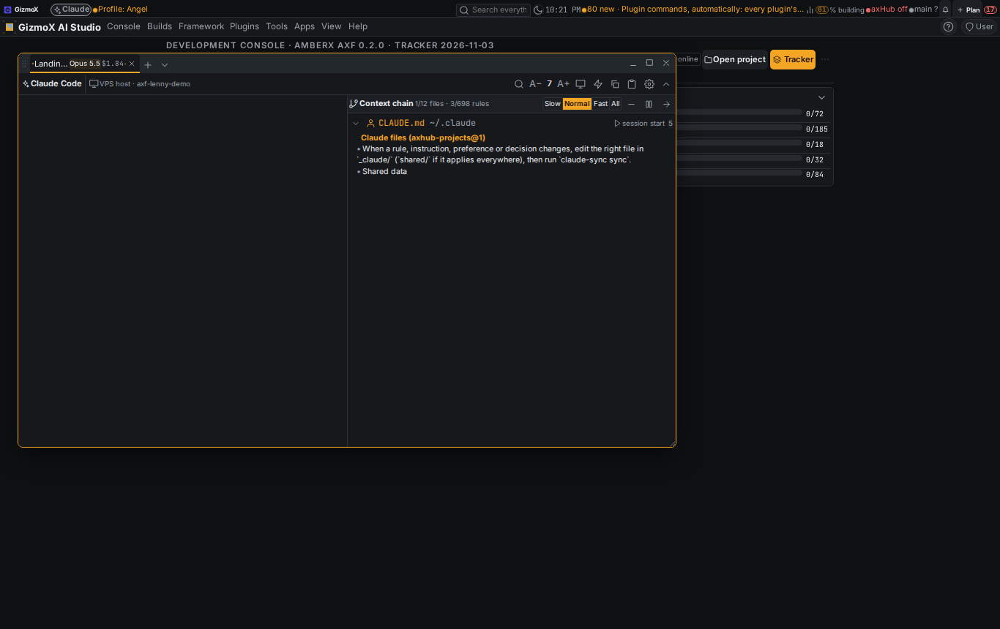

# terminal-drag-chain-tree — report

Build `terminal-drag-chain-tree` (Current profile), Nov 3 2026. Model: Opus 5.5, one headless worktree session
(agent: Landin' Lenny). Branch `claude/terminal-drag-chain-tree`, built on window-resize-fix (#278).

Brett (voice, Nov 3 2026):
- "There's nowhere to click to drag the terminal menu, the terminal window around. There's nowhere to click. It's all tabbed."
- "In the context chain in terminal for the MD files on the headless sessions, it needs to show them like a tree. So every file that is chained, it needs to open indented."
- Addendum 1: "And I need the context menu on the terminal to open its settings."
- Addendum 2: "I need to be able to change the size of the text in the main window here on the left side. It's too big."

## 1. Drag the Terminal window

**Cause.** The frameless Terminal uses its tab strip as the title bar; only the empty space after the tabs dragged
(`axp-wt__drag`, `flex: 1`). Tabs are `flex: 0 1 …` and fill the strip, so with a few tabs that spacer is a sliver or
gone, and tabs only did HTML5 drag-to-reorder.

**Fix, in the framework window host (every frameless window, every app):**
- `WindowGrip` (`framework/react/windows/WindowHost.tsx`): a move grip the content puts first in its strip; sticky, so a
  full strip scrolls under it, never over it; drag = move, double-tap / double-click = maximize / restore; 44 px target on
  touch screens (`max(var(--fx-row-h), calc(var(--fx-space) * 5.5))`, tokens). `orientation="column"` for a stacked
  tab list (terminal-tabs-left: grip at the top of the stack).
- Host fallback: a frameless window whose content shows no `WindowGrip` gets a floating grip in its top-left corner
  (`claimGrip` tells the host one is mounted).
- `useTabPress` + pure `tabPressIntent` / `reorderIndex` (`framework/core/engines/windows.ts`): a quick tap switches tabs;
  a horizontal drag reorders (pointer-based now, works on touch); press-and-hold (450 ms; long-press on a phone) then
  move drags the window, and so does a vertical pull; a long-press released without moving opens the tab menu (the
  browser's own long-press menu is held back). A held tab shows a dashed "armed" outline; the click after a drag is
  swallowed.
- `WindowFrameHooks.moveFrom(x, y)`: the move without the double-tap check, shared by the title bar, the grip and tabs.

## 2. Context chain as a tree

**Data (`deploy/claude-meter.mjs`):** every context-chain@1 item now carries `reason`, `parentI` and, for followed
mentions, `why` (the line that mentions it):
- `session-start` — Claude Code loads it (user / project memory, `.claude/rules`)
- `import` — an `@path` in the file above (was already nested by depth; now with `parentI`)
- `reference` — a loaded Markdown file mentions its path (code span, link or bare path; partial paths such as
  `memory/decisions.md` match too) and the session then Read it; the latest such file is the parent
- `session-start rule` — the mentioning line says to read it first / on every load / at session start
- `read` — nothing loaded mentions it (a root); `nested memory` — a folder's CLAUDE.md loaded on demand

Built from the real load order and the real file texts, not a list. On this checkout a session that reads THREADS.md,
the builds README and decisions.md gives:

```
~/.claude/CLAUDE.md                     session start
  ~/hub/CLAUDE.md                       @import
CLAUDE.md                               session start
  _claude/shared/rules/RULES.md         @import
  _claude/rules/RULES.md                @import
    _claude/THREADS.md                  start rule
      _claude/builds/README.md          reference
    _claude/memory/decisions.md         reference
    _claude/memory/docs/build-reporting.md  reference
  _claude/persona.md                    @import
```

**Server:** `GET console-terminal/headless/{name}/chain` returns `tree` (the items nested, `children`) next to `items`
(`sessions.chain_tree`; same rules as the web `chainTree`; older chain files that only kept `depth` still nest).

**Pane (`web/ChainPane.tsx`):** an indented tree with guide lines; per row: fold ▸/▾ (children), file icon, name + folder,
why it loaded (icon + label, the mentioning line in the tooltip), rule count; a folded row shows `+N`. The reveal walks
the tree depth-first (a file read later that lands earlier in the tree is simply next); tapping a file types its
content out again from the start (tap again folds it); Fold all / Open all; Slow / Normal / Fast / All, Pause, Skip.

## 3. Context menu opens Terminal settings (addendum 1)

- Right-click / long-press on the strip, the grip, the toolbar's empty part or the body's margins: a window menu with
  **Terminal settings** first, then New tab, Claude Code tab…, Show / Hide toolbar, Minimize, Maximize / Restore, Close.
- **Terminal settings** is also first in the tab menu and in the terminal text menu (copy / paste stay as they were).
- It runs `settings.open:terminal`, so it opens where the Terminal's *Opens in* says (dialog = pop-up; the in-plugin
  pane comes with plugin-settings-placement).
- *Opens in* wording, for every plugin with the choice: "Where Terminal (Open a tab) opens, and where these settings
  open: Dialog opens them in a pop-up over what you're on, the other choices on the Settings page." (was "Where Open a
  tab opens.").

## 4. Text size per pane (addendum 2)

- Panes: the terminal text (left / main) and the context chain. Toolbar **A− / size / A+** act on the pane last
  touched; tapping the size resets it; Ctrl/Cmd + − / = / 0, Ctrl/Cmd + wheel and two-finger pinch act on the pane
  under the pointer (the page's own zoom is held back).
- Remembered per device (localStorage) for the tab and for its Claude Code profile; other tabs keep the default.
- Defaults (Settings → Terminal → Appearance): *Text size* (computer, unchanged 14 px), new *Text size on a phone*
  (default **Auto** = the theme's small text token `--fx-type-root-sm`, so the phone default follows the typography /
  density assets; 0 or 7–28 px) and *Context chain text size* (60–200 %). Font family and line height stay global.
- Desktop Auto (no saved size) = `--fx-type-root-md`.

## Tests

| Check | Before | After |
|---|---|---|
| `framework/spec/check-headless-tabs.mts` | 30 | 58 (tree from nested imports / mentions / start rules / partial paths, depth-first reveal, replay, tap vs reorder vs hold-drag vs long-press, reorder index, text size resolve / step / reset / pinch) |
| `apps/console-web/scripts/window-handles-check.mts` | 30 | 35 (host grip on frameless, none on standard, 44 px touch rule, sticky grip, Opens in wording) |
| `apps/console-web/plugins/console-terminal/test.py` | new tree checks pass | 4 new (nested tree, roots, load order, two-level imports) |
| `framework/spec/check-windows.mts` | 383 | 383 |
| check-theme, check-controls, console `tsc` | pass | pass |

`console-terminal/test.py` stops at "a console token reset closes every terminal" on this VPS — the same on a clean
`origin/main` checkout (timing under load), not from this build.

## Re-baked
console-web, axhub-web, amberx-droid, molly (only this build's framework files differed). demo and walkthrough-studio
were already behind and are left for their own re-bake.

## Screenshots

Desktop, this branch, local console (`AXF_APPEARANCE_HUB=off`, headless session mocked with a real chain built by the
meter on this checkout): the grip at the strip's start, the headless tab with its split, the toolbar's A− / size / A+
and the context chain as a tree revealing at Normal speed.



That capture is from before the text-size fix in `TerminalSession` (its size reads 7 there: the session only loaded the
settings once its xterm started; now settings and the token size load on mount, so it shows 14 / the phone's Auto).

**Phone shots and the rest of the desktop set are not done:** the VPS sat at load average 60–100 (8 headless agents)
and the local console didn't paint inside the capture windows on four runs (rebuild-shots gained `--start-timeout`).
UI Review item `r-20261103-axtev01` (desktop, group "terminal-drag-chain-tree - Nov 3 6:43 PM") is waiting for Brett;
hired job `job-ui-screenshots-2026-11-03-2348` (Snap Sully) is queued for the phone + desktop set into the same group.

## Clashes and left out
- `terminal-tabs-left` (running in another session) changes TerminalHost too: a note on it says to reuse `WindowGrip
  orientation="column"` + `useTabPress`. `terminal-sessions-nav` (#286, open) also touches TerminalHost; whichever
  merges second resolves.
- Android twin deferred (Android on hold): `framework/spec/PORTING.md` line added.
- Reorder in the strip is horizontal only; vertical reorder belongs to the stacked layout (terminal-tabs-left).
