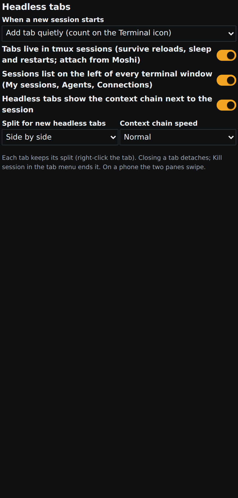

# terminal-no-focus — new sessions stop stealing the Terminal

**Brett said (verbatim, Nov 4 2026, voice):** "I don't want the terminal to come to the front on every session."

Profile `current` · agent Janitor Joey · Opus · branch `claude/terminal-no-focus`.

## What was wrong
`console-terminal/web/headless.ts` polls the VPS for headless `axf-…` tmux sessions every 5 s. Every new one went
through `openHeadless()`, which opened a tab (a new floating window when none was open), switched to it, restored the
window and focused it (`focusSession`). So every build launch popped the Terminal over whatever Brett was doing, and
every console load did it again for each running build without a tab.

## What changed
- New Terminal setting **When a new session starts** (`newSession`, Settings → Plugins → Terminal → Headless tabs,
  Simple level):
  - **Add tab quietly** (default): the tab is added in the background of an already open Terminal window: no new
    window, no tab switch, no restore, no focus. With no Terminal window open nothing opens; the session waits and the
    tab appears once Brett opens the Terminal himself.
  - **Do nothing**: no tab by itself; the sessions nav still lists the session.
  - **Bring Terminal to front**: the old behaviour.
- Count on the Terminal toolbar icon (badge `terminal.sessions.new` on the console-search toolbar's Terminal item):
  new sessions Brett hasn't looked at. A session counts as seen once its tab is the front tab of its window, or when it
  ends. Tapping the icon with a count opens the oldest unseen session (new action `terminal.toolbar`); without a count
  it opens a terminal as before.
- Explicit opens still bring it up: Open, Jump in / Mirror (sessions nav), the Crew's Terminal tab, `terminal.attach`.
- Reachable everywhere: REST `GET/PUT /api/plugins/console-terminal/new-session` (`{newSession}`), also in
  `GET/PUT settings` and the `headless` answer; plugin commands `new-session-get` / `new-session-set` give the MCP tools
  and CLI (`axf console-terminal new-session-set --newSession quiet|nothing|front`).

## Files
`console-terminal/server/{store.py,__init__.py}`, `plugin.json` (commands), `web/{headless.ts,headless-core.ts,
hosts.ts,index.tsx,look.tsx,panels.tsx,api.ts}`, `src/assets/toolbar/console-search.json`,
`framework/spec/check-headless-tabs.mts`, `console-terminal/test.py`.

## Tests
- `npx -y tsx framework/spec/check-headless-tabs.mts`: 58 → 63 checks (mode default/fallback, quiet with and without a
  window, nothing, front).
- `python3 apps/console-web/plugins/console-terminal/test.py`: 136 → 139 checks (default quiet, PUT saves, bad value
  refused).
- `tsc --noEmit` (console-web) clean; check-theme, check-controls, check-toolbars, plugin-commands test, asset
  validate all pass.

## CI fixes on the way
- help coverage ratchet: help entries for the new setting and the `terminal.toolbar` action.
- menu-reach: the toolbar's Terminal action is also in the app menu (Plugins → Terminal → Open terminal (new sessions
  first), with the same count).
- Pre-existing on main: the apps' baked `assets/help/framework-drafts.json` had drifted from the framework copy
  (shared-assets check red for every PR); re-baked into console-web, axhub-web, amberx-droid and molly.

## Known gaps
- "Seen" is per browser page (in memory); a reload recounts sessions that got a quiet tab only if they no longer have
  one.
- Hub-run output tabs (approved VPS commands, `showHubRuns`) are not sessions and keep their own behaviour.

## Screenshot
UI Review item `r-20261104-22549d23` (phone, non-blocking).

