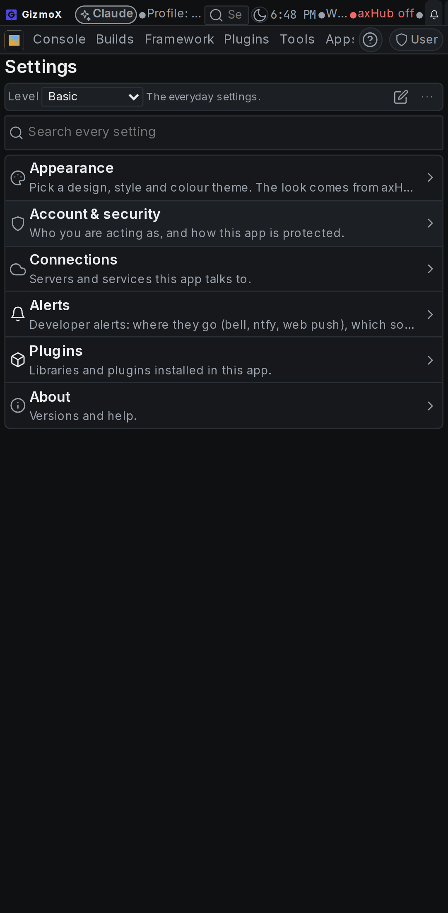
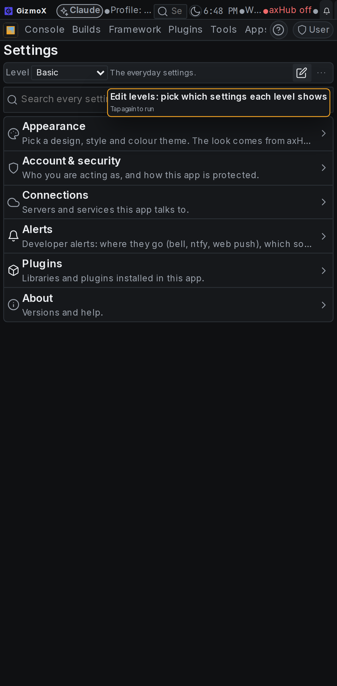
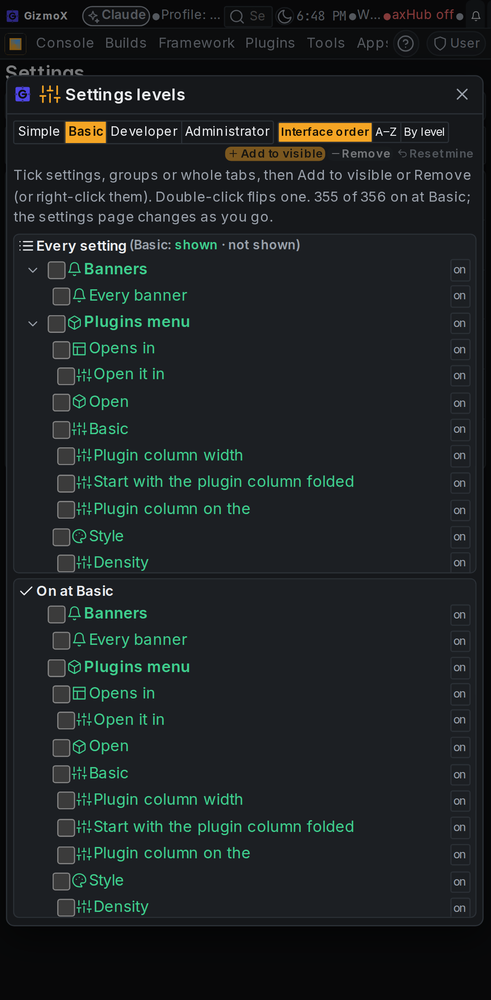
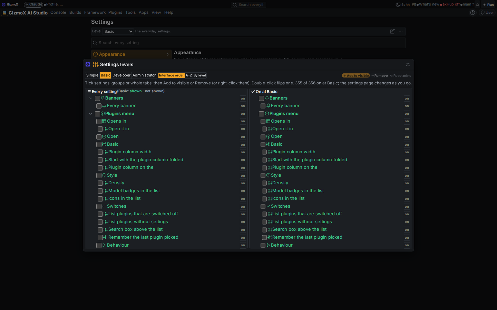
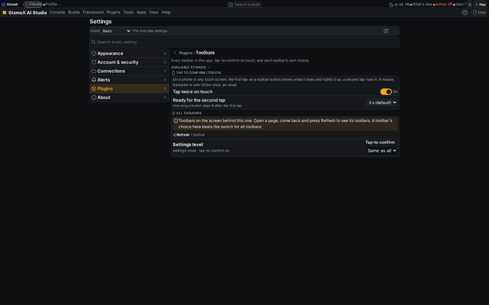

# toolbar-tap-confirm — Toolbars plugin: tap-to-confirm on touch (part 1)

Build `toolbar-tap-confirm` (Urgent), Brett, Nov 3 2026 (voice) + Addendum 1. Branch `claude/toolbar-tap-confirm`.
Agent: Landin' Lenny (headless session `build:toolbar-tap-confirm`, Opus). Status: **part 1 shipped (s1–s7)**, s8–s21 still to do.

## Summary

- **Tap-to-confirm on every toolbar, touch only.** A finger tap on a toolbar button shows what it does and lights it up
  with a countdown bar (3 s by default). A second tap on it inside the window runs it. A tap on another button re-arms that
  one. Mouse, trackpad, pen and keyboard (Enter/Space) stay a normal single click with the usual hover tooltip. The choice
  is made per click from the pointer type of the press, so a touchscreen laptop gets the double tap from a finger and a
  single click from its mouse.
- **One shared behaviour, no per-toolbar code.** `framework/core/engines/tapconfirm.ts` is the pure state machine with the
  settings keys. `framework/react/tapConfirm.ts` is one delegated listener that `<AxfProvider>` installs on the document.
  Every element with `role="toolbar"` gets it in every app on the framework, including new ones.
- **Toolbars plugin (`lib-toolbars`).** It is installed in the console, axHub web, AmberX, Molly, walkthrough-studio and the
  three app templates. Settings → Plugins → Toolbars has:
  - **Tap twice on touch** (on by default)
  - **Ready for the second tap** (1.5–10 s, default 3 s)
  - **All toolbars**: every toolbar on screen, with its own override (Same as all / On / Off), stored per toolbar id
- **Every toolbar adopted.** 37 toolbars across the console, its plugins, the framework libraries and chrome, AmberX and
  walkthrough-studio now carry `role="toolbar"` and a label, which is their settings id. The app toolbar's stable id is
  `app`.
- **Future-proof.** `framework/cli/check-toolbars.mjs` (in CI) fails on:
  - an element that looks like a toolbar but isn't marked as one;
  - a toolbar without a settings id;
  - a toolbar that switches the behaviour off in code without `data-axf-tap-confirm-reason`.
- **Rules.** The rule is in shared `RULES.md`, the project `RULES.md` and `CLAUDE.md`.

## No "Tooltip mode" existed to lift

The brief says Tooltip mode was built in headless-tabs PR #259, step s8. It isn't there:

- `headless-tabs` has 7 steps (no s8).
- The PR body doesn't mention it.
- No branch, worktree or file in the repo contains a tooltip/tap-confirm mode for the Terminal.

So it was built fresh in the framework to the spec in the brief. Nothing had to be removed from the Terminal plugin, and
the Terminal's toolbars use the framework version like every other toolbar.

## Toolbar inventory (s1)

The app toolbars come from the `toolbar` asset (`framework/assets/toolbar/*`, 29 assets; app copies in
`apps/*/src/assets/toolbar`). Every one is drawn by the framework's `Toolbar` / `AssetToolbar`.

**Already `role="toolbar"`** (20; labels checked):
- **Framework**
  - app `Toolbar` (folded and open)
  - `AssetToolbar`
  - settings level bar (`libs/settings/levels.tsx`)
  - workspace toolbars (`libs/workspace`)
- **Console plugins**
  - Basic filter
  - Build Breaker
  - Build manager
  - Changes grid
  - Terminal commands
  - Terminal extra keys
  - Feature matrix
  - Plan Studio (catalog and list)
  - Theme editor
  - Theme manager
  - UI Review (screenshots ×3, queue)
- **Molly**
  - xlayout toolbars

**Adopted in this build** (37 marked, 1 opted out):
- **Framework**
  - Window toolbar
  - Minimized window bar
  - Output terminal channels
  - Watch live tools
- **Framework libraries**
  - AshesUI inspector bar
  - MCP server bar
  - Plugin look bar
  - Tree search
  - Tree filters
- **Console**
  - Plan filters (`src/views/Plan.tsx`)
- **Console plugins**
  - Basic filter rule actions
  - Builds view and Steps selection bars
  - Claude handoff files, file and look roller bars
  - Context chain
  - Context-menu designer actions search
  - Notes browser
  - Plugin commands
  - Plugin Manager list bar
  - Plugins menu
  - Session check-in
  - Theme manager token tree and saved themes
  - To-do
  - What's shipped
- **AmberX**
  - note card actions
  - command filters
- **walkthrough-studio**
  - Browser
  - Recorder
  - Recording
  - Files
  - Projects
  - Find a project
  - Index filters
  - Player
  - Compile
  - Find in captions
- **Opted out in code, with a recorded reason**
  - Terminal **Extra keys**: every tap types a key, so a confirm tap would type nothing

**Looked like toolbars but aren't** (`data-axf-not-toolbar` with the reason):
- the layout region around the app toolbar
- AI assistant tool-call chips (×2)
- chat-viewer tool steps
- walkthrough-studio grid totals, sort note, and piece title row

**Templates and boilerplates.** No toolbars of their own. They get the behaviour through `AxfProvider` and the Toolbars
settings through `lib-toolbars`, now in all three app templates (react-ts, next-ts, web-fastapi-wall).

## Screenshots

These are from the console's Vite build, with the hub off (local look).

| | |
|---|---|
| Phone, before the tap |  |
| Phone, first tap: lit + tip "Tap again to run" |  |
| Phone, second tap ran it (levels editor) |  |
| Desktop, one mouse click ran it at once (no arm, no tip) |  |
| Desktop, Settings → Plugins → Toolbars |  |

The Playwright run also logged:
- phone: `armed 1`, the tip text, then `armed 0` after the second tap;
- desktop: `armed 0, tip 0` after the click.

## Tests and checks

| Check | Before | After |
|---|---|---|
| `npx -y tsx framework/spec/check-tapconfirm.mts` (in CI) | — | 40/40 |
| `node framework/cli/check-toolbars.mjs` (in CI) | — | ✓, 320 files |
| `check-theme` | ✓ | ✓ |
| `check-controls` | ✓ | ✓ |
| `help-coverage --check` | ✓ | ✓ |
| `axf.mjs libraries` | ✓ | ✓ (toolbars listed) |
| `tsc --noEmit` on console-web, axhub-web, amberx-droid, molly, walkthrough-studio | clean | clean |

`check-tapconfirm.mts` covers:
- touch vs mouse, pen and keyboard;
- the arm window edge and expiry;
- re-arming on a different button;
- a mouse click on a touch-armed button;
- global, per-toolbar and bad override values;
- disabled buttons, buttons outside toolbars, and code opt-outs;
- dispose.

## Overlaps noted (not changed)

- **Molly `toolbar-designer` plugin** and **lib-workspace `<ToolbarCustomizer>`**: both edit toolbars today. The Toolbar
  editor (s11–s12) should absorb or replace them, not add a third editor.
- **`context-menu-designer`**: the per-target configure dialogs and saved actions (s18) should reuse its action picker
  (`ActionsWindow`) and the control@1 / plugin-commands registry.
- **`lib-dnd`** already has pointer drag with a touch grip, zones and a ghost. The drag layer (s15) builds on it.
- **Banners**: untouched. banner-pack (#251), banner-editor (#254) and banners-one are Brett's to review; the banner drop
  target (s17) goes only through the generic `drop-target@1`.
- **The level toolbar's "Reset all" / plugin-look "Tap again to reset all"** keep their own confirm on top, as specified.
  On touch that means arm → tap → confirm tap.

## Model and what's left

Steps s8–s12 (per-toolbar look/layout settings, the context-menu hooks on every toolbar, the All toolbars page polish,
and the Toolbar editor with save as asset) are pinned to Opus. **s13–s14 (`hook@1` / `drop-target@1` contracts and the
drop semantics engine) are pinned to Fable**: they are new cross-port contracts. This session runs on Opus, so it stops
before them. Reaching them needs Brett's upgrade approval
(`orchestrator.mjs request-upgrade toolbar-tap-confirm <phase>`). s15–s21 (drag layer, drop targets, dialogs, commands,
tests, shots) are Opus after that.

Android twin: deferred (Android on hold). Recorded as `axf.toolbars.android` in `framework/libs/toolbars/library.json`.

## Known gaps

- **Per-toolbar override id.** It is the toolbar's label slug, or `data-axf-toolbar`. If a label is renamed, the override
  saved under the old id is dropped. Stable `data-axf-toolbar` ids are worth adding where labels might change.
- **Lit-button colour.** The armed state uses `--fx-accent-soft` with an inset accent ring. Some control hover styles have
  higher specificity, so the fill can look faint. The ring and the tip always show.
- **Lenny's card.** `agent-job.mjs` has no "book without launching" command, and this run was launched as
  `build:toolbar-tap-confirm` without `AXF_AGENT`. The run is recorded on the build's note, not on his card.
