# ui-all-assets — the scale assets on every screen (Oct 31 2026)

**Build:** Angel `ui-all-assets`, steps s3–s5 (Opus, headless, one session). s1–s2 (Fable, PR #181) made the three
asset types; this build makes every screen read them and makes the default tighter.
**Branch:** `claude/ui-all-assets` → `main`. **Asked:** Brett, "the screen don't look tighter".

## Result in one paragraph

Before this build the typography / density / sizing assets existed but nothing read them: every stylesheet still had its
own sizes (≈1,720 hand-written font sizes, gaps, paddings and margins across 80 files), and the defaults equalled the
Oct 30 look, so swapping an asset changed nothing on screen. Now every font size and spacing in the framework stylesheet,
the console, all 45 plugin pages, the libraries, AmberX, axhub-web, Walkthrough Studio and the app templates is a scale
token; the default (`compact`) is tighter than Oct 30; and Settings → Appearance → Assets has the three pickers, so
"compact vs roomy vs touch" is one pick that changes every screen live (and through the axHub look, every app).

## Screenshots

`_claude/builds/reports/ui-all-assets/{before,after}/<screen>-{phone,desktop}.png` — 9 screens × 2 viewports, same
data, taken with `framework/cli/rebuild-shots.mjs` (shots file `ui-all-assets/shots.json`):
home, pending, tracker, catalog, settings, plugin-manager, build-manager, systems-check, plan-studio.

| Screen | Before (phone) | After (phone) |
| --- | --- | --- |
| Home | 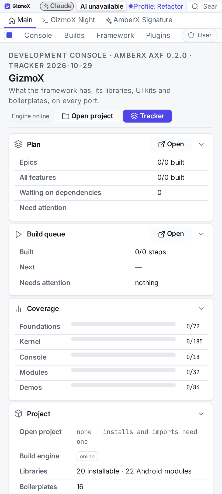 | 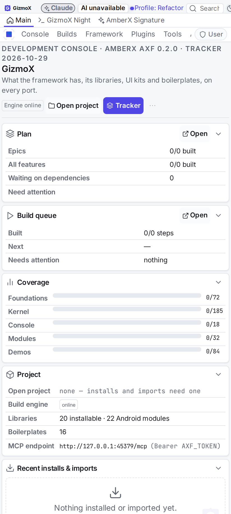 |
| Plugin manager | 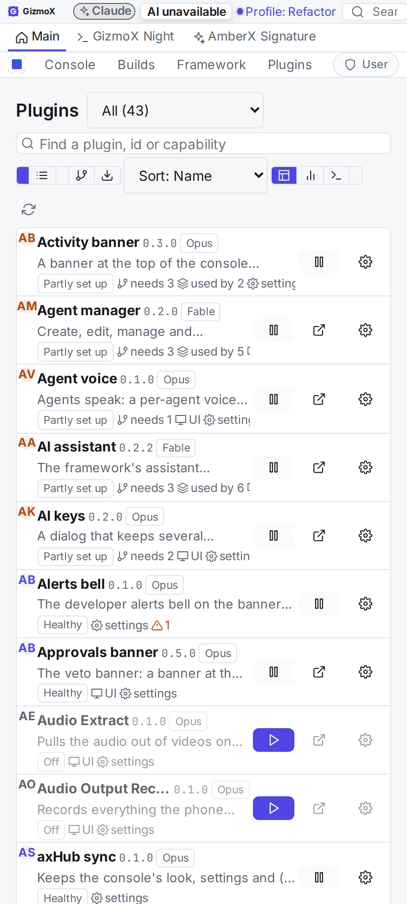 | 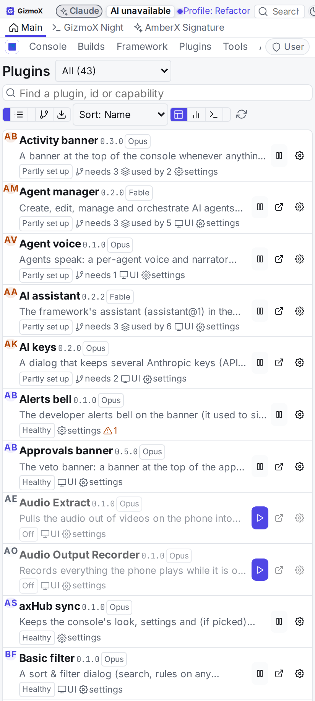 |
| Settings | 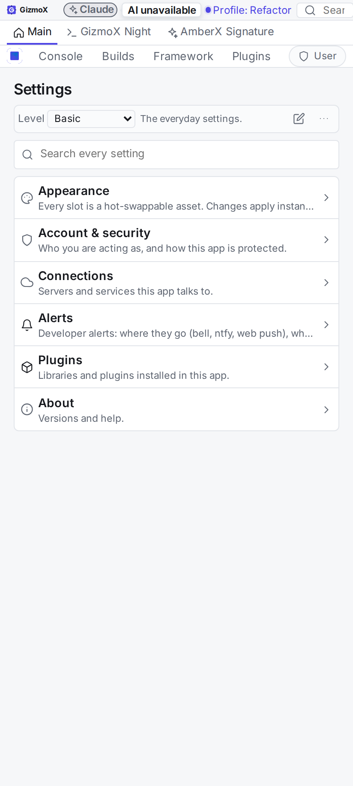 | 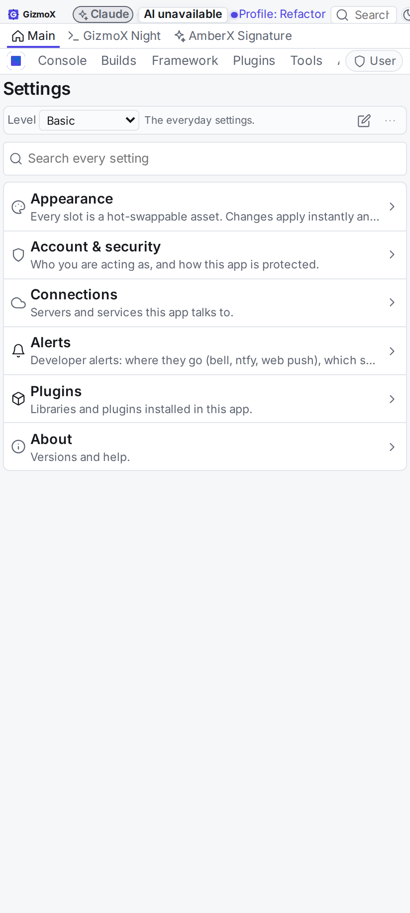 |
| Build manager | 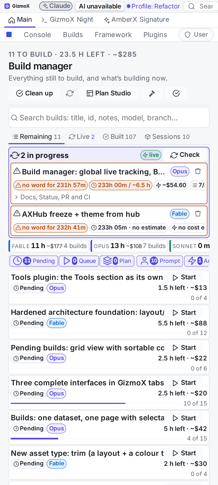 | 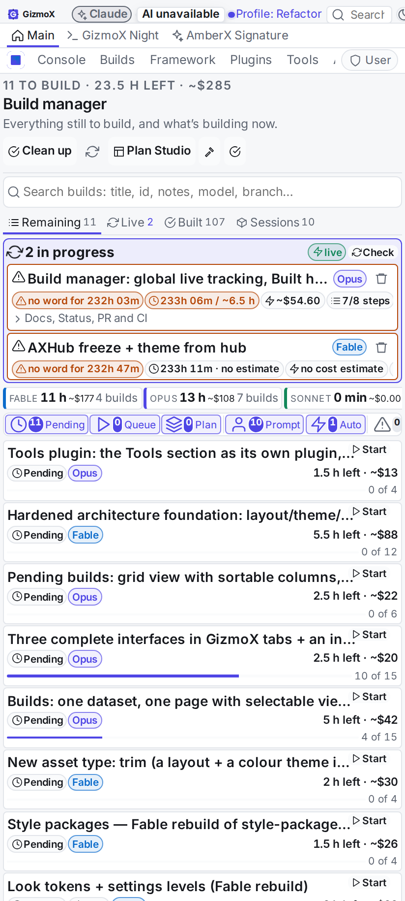 |
| Systems check | 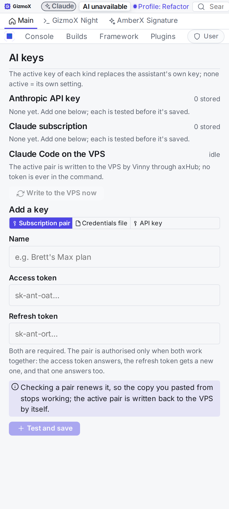 | 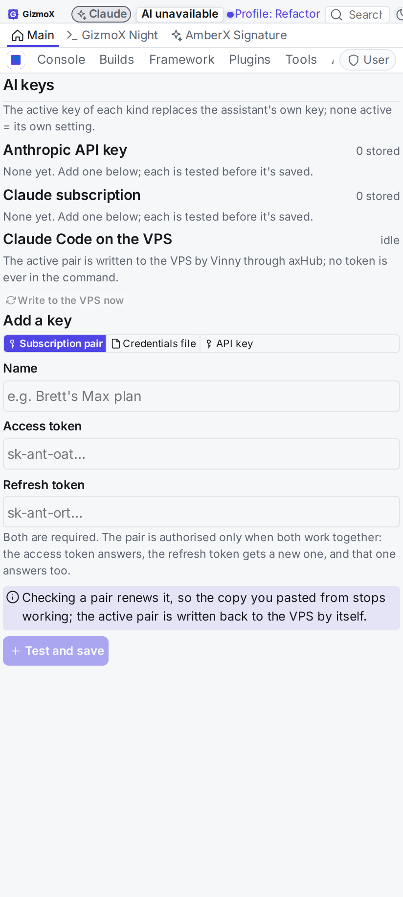 |
| Plan Studio |  | 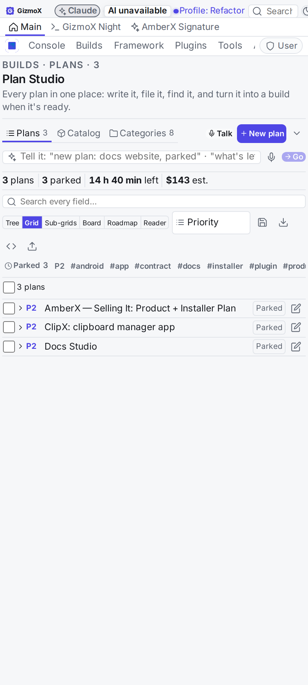 |

What shows: Plugin Manager on a phone fits 11 plugins per screen instead of 9, and descriptions run the full row instead
of cutting at "…" after three words; Home's cards are about 25% shorter; the page head (eyebrow, title, line) takes two
thirds of the height it did; the side padding on a phone went from 4 space to 1.25 space.

## What changed, by layer

### The contract (scale-rules.mjs, small Opus change on top of the Fable design)
- **Defaults are now the compact look** (was: equal to the Oct 30 sizes). The Oct 30 sizes moved to new `standard`
  starters (typography, density, sizing), so nobody loses them.
- **Seven text steps** `--fx-type-scale-{2xs,xs,sm,md,lg,xl,2xl}` (was five) and **nine spacing steps**
  `--fx-dens-gap-{2xs … 4xl}` (was five), so every size the stylesheets used has a step to land on.
- **Root-anchored text twins** `--fx-type-root-<step>` = `calc(var(--fx-font-size) * step)`: sizes that were written
  from the base size stay that way (a label inside a small cell doesn't shrink twice). First after-shots showed the
  problem (mono text in Home's table went to ~9 px); the twins fixed it.
- Compact vs standard: text 0.66/0.74/0.82/0.9/1.06/1.26/1.7 (standard 0.68/0.76/0.86/0.93/1.1/1.35/2); spacing
  0.1 … 2.4 space (standard 0.125 … 3); card padding 1.1 space (1.6); page padding 1.25 space (2); table cells
  0.45 × 0.75 space (0.75 × 1.25); list rows 2.3 lines (2.75); chips 1.4 lines (1.6). Buttons stay 2.1 lines high
  (≈30 px), icon buttons 1.75 lines: still a finger's target.
- Fixtures (`scale.json`, `roll.json`) and JSON schemas regenerated; `check-scale.mts` 338 → 433 checks.

### The framework stylesheet (framework/ui/axf.css, 254 lines)
- **Loose before:** the Oct 30 "compact frame" block hard-coded its sizes, and buttons read `var(--fx-btn-py, …)` —
  the button asset's px padding always won, so buttons never got tighter; page padding was 3.5 / 4 / 6 space.
- **Now:** a "scale frame" block where buttons, small buttons, icon buttons, chips, segmented controls, cards, card
  heads, tabs, tables, fields, menu rows, the page head (title, description, eyebrow, mono) and page padding read
  only sizing / density / typography tokens, with no var() fallbacks. Every other rule in the file (banner, toolbar,
  nav, menus, dialogs, toasts, inspector, md, windows, tab groups…) had its font sizes and spacing moved to the steps.

### The console (apps/console-web/src)
| Where | Loose before | Now |
| --- | --- | --- |
| console.css (137 lines) | Explorer tree, plan board, pipeline bars, phone preview, bubbles: `calc(var(--fx-space) * n)` and `* 12 / 14` font sizes | density gap steps + root text steps |
| changeBatch.css, pluginLifecycle.css | same | same |
| views: Plan, BuildManager, Explorer, LibraryTemplates, Boilerplates, Plugins, consoleSettings | inline `style={{ gap/margin: 'calc(…)' }}` | inline styles read the tokens |

### Plugin pages (apps/console-web/plugins/*/web) — lines moved per plugin
plugin-manager 120 · claude-handoff 80 · build-manager 75 · systems-check 59 · plan-studio 58 · ai-assistant 57 ·
console-terminal 47 · codebase-changes 42 · agent-manager 39 · project-wizard 32 · build-breaker 31 · push-banner 31 ·
todo-manager 28 · session-checkin 27 · activity 26 · basic-filter 25 · brand-library 22 · plugins-menu 22 ·
context-menu-designer 20 · ui-review 20 · agent-voice 18 · fable-rebuilds 15 · feature-matrix 15 · snapshot-manager 15 ·
feature-assist 14 · theme-manager 13 · build-orchestrator 12 · container-access 11 · voice-notes 11 ·
approvals-banner 10 · plugin-switches 9 · plugin-update 6 · build-profiles 5 · audio-extract 4 · changes-grid 4 ·
main-build-status 4 · output-recorder 3 · molly-guide 1.
What was loose everywhere: each plugin decided its own badge, row, toolbar and card sizes with `calc(var(--fx-space) * n)`
and `calc(var(--fx-font-size) * 11 / 14)`; now they are the shared steps, so the badges, rows and gaps of every plugin
shrink or grow with the one density/typography pick.

### Libraries, other apps, templates
- framework/libs: ashes 25, workspace 16, mcp 14 (the MCP servers pages named in the build), settings 11, alerts 10,
  approvals 10, plugintheme 6, datagrid 5, tree 5, dnd/hubstatus/hubsync 2, recorder 1.
- **AmberX** (apps/amberx-droid): approvals terminal, commands, dictation, notes, tasks, voice, web, windows (42 lines);
  ships the scale starters and defaults to compact.
- axhub-web (3), Walkthrough Studio (35), templates react-ts / next-ts / web-fastapi-wall (34): same move; axhub-web
  and Walkthrough ship the starters and default to compact.
- **Patches skipped** (all Patches work is paused). **Android framework (Kotlin):** on hold — PORTING.md records the
  twin (replays `scale.json`, root twins included).

### Assets, design packages, pickers
- Starters per type: typography compact / standard / classic / reader; density compact / standard / classic / dense /
  roomy; sizing compact / standard / classic / touch. Copied into console, AmberX, axhub-web, Walkthrough.
- All 26 design packages name the three slots (generator `framework/cli/asset-library.mjs` + hand-made ones):
  compact by default; Kiosk Display and Touch Tablet → touch sizing + roomy density; Data Desk → dense; Humanist
  Reader / Swiss Editorial → reader type; Executive Suite → standard.
- Settings → Appearance → Assets now lists Typography, Density and Sizing pickers (they appear once an app ships the
  assets); a pick is an ordinary swap, saved to the axHub look like every other slot.

### Checks (s5)
- `framework/cli/scale-adopt.mjs` — the codemod that moved the sizes (re-runnable; maps a value to the nearest step).
- `check-theme.mjs` rule **scale**: any font size, gap, padding or margin written as a number of em or
  `calc(var(--fx-space|--fx-font-size) * n)` off the scale fails CI, everywhere (framework CSS included; Patches
  exempt while paused). It now knows the computed scale tokens too.
- `apps/console-web/scripts/theme-swap.mjs` also picks every typography / density / sizing asset in the built console
  and fails when too few sizes follow: typography 178 / 634 elements move, density 186 / 195, sizing 89 / 650
  (sizing owns only buttons, chips, tabs, tables, cards).

## Main was red before this build — fixed here (fix-it-yourself rule)
CI on main (e1611a9d) failed two jobs; fixed so this push lands green:
- **Plugin lifecycle stale references:** plan-studio's mic holder labels named agent-voice by folder → generic
  `holderLabel()`; systems-check's Claude sign-in fix named the ai-keys tab → read from the `axf.ai-keys@1`
  capability (`settings_tab`, `open_action`); plan-studio's catalog tagged matrix features `'feature-matrix'` → plain
  words; THREADS.md and the Plan Studio doc lines got their `axf-plugin:` markers and are listed in the plugins'
  `mentions`.
- **menu-reach:** Audio Extract and the Audio Output Recorder had pages but no `web/menu.ts` → both have one (page +
  setup in the axHub menu; Audio Extract keeps its two quick actions).

## Tests
Local copy of android.yml's web block (Node 20 here, so `--experimental-strip-types` steps ran through tsx):
every validator, tracker, plugins, manifests, fixtures, build steps, orch-sync, github, theme, controls, plugin pages,
all plugin lifecycle checks, every `framework/spec/check-*.mts`, brand library, menu-reach, AmberX / axhub-web /
Walkthrough tests, Python contract + server tests, every plugin `test.py` + `test.mts` — green. Console, AmberX,
axhub-web and Walkthrough `npm run build` green; theme-swap + interface-scope-check green.
Environment-only notes: `codebase-changes/test.py` "repo comes from the git remote" fails in this worktree because the
session runs as root on an axfbuild-owned checkout (passes in a clean checkout); the Android/Gradle job isn't run here
(CI compiles it).

## Known gaps
- Row heights (`min-height` of custom plugin rows) and widths are still per plugin; density's `row.*` drives the
  framework's own rows and menus only.
- `font:` shorthands with em sizes and spacing over 3.5 space (empty states, layout columns) are left as layout.
- Kotlin twin deferred (Android on hold).
