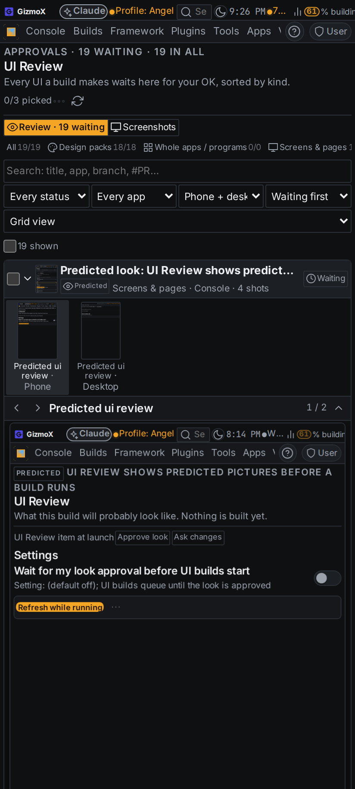
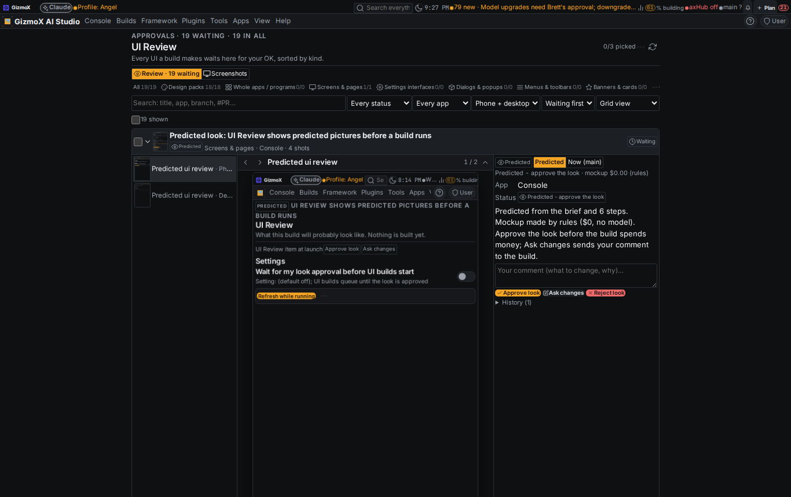
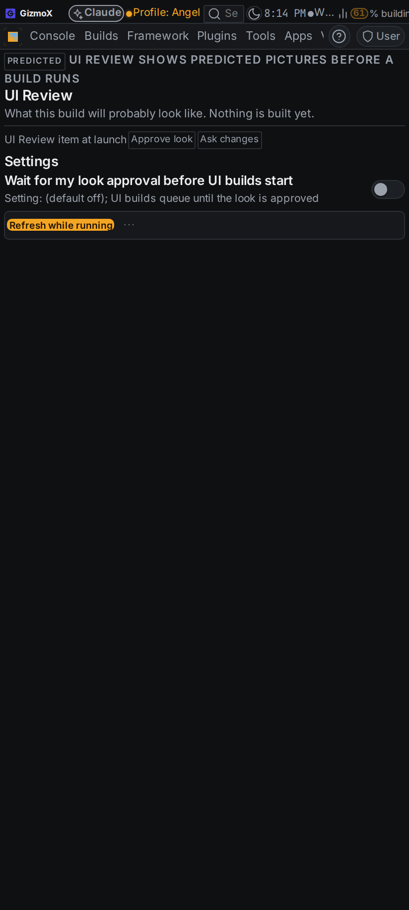
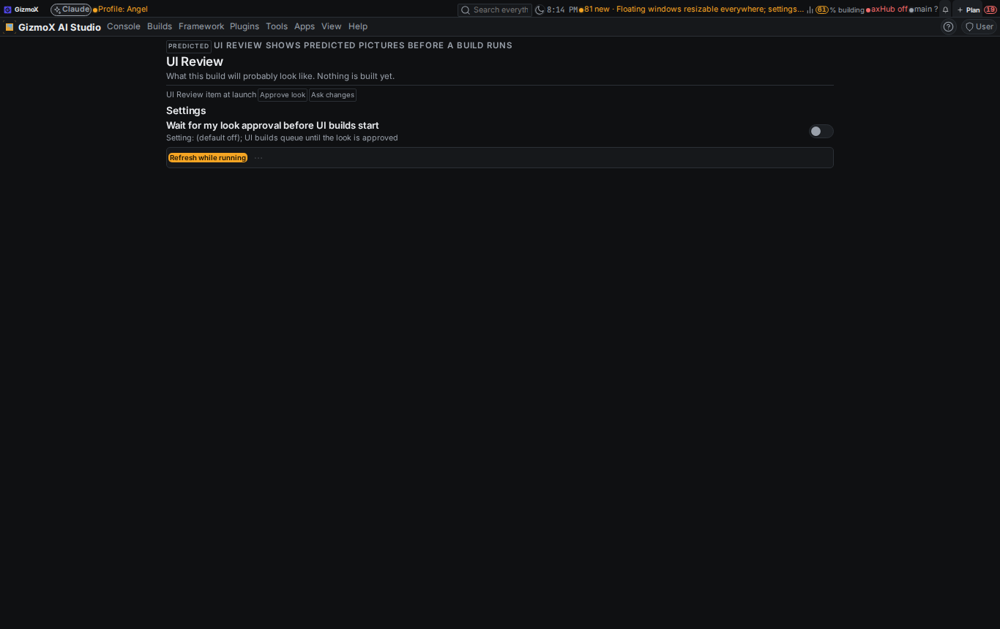
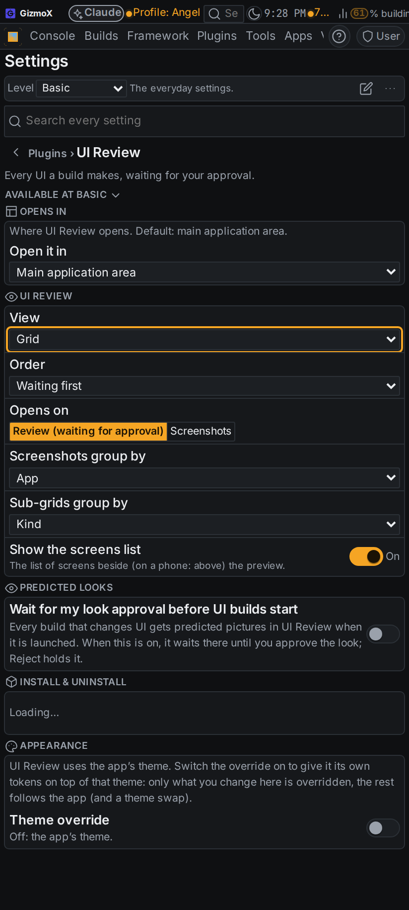
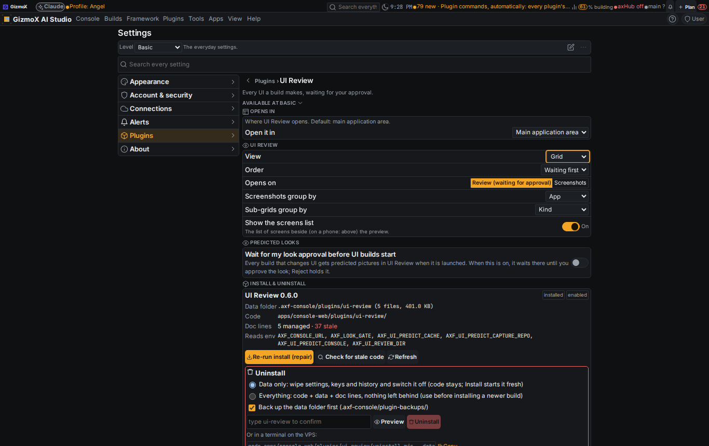
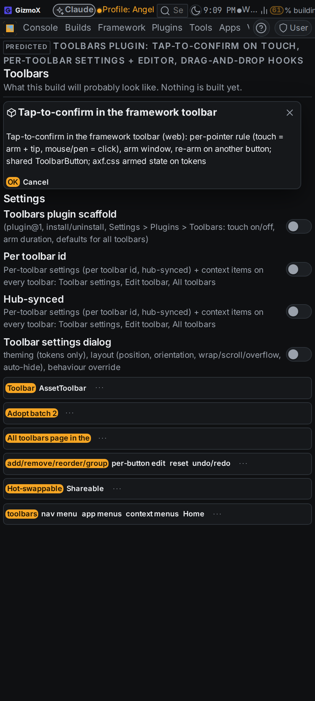
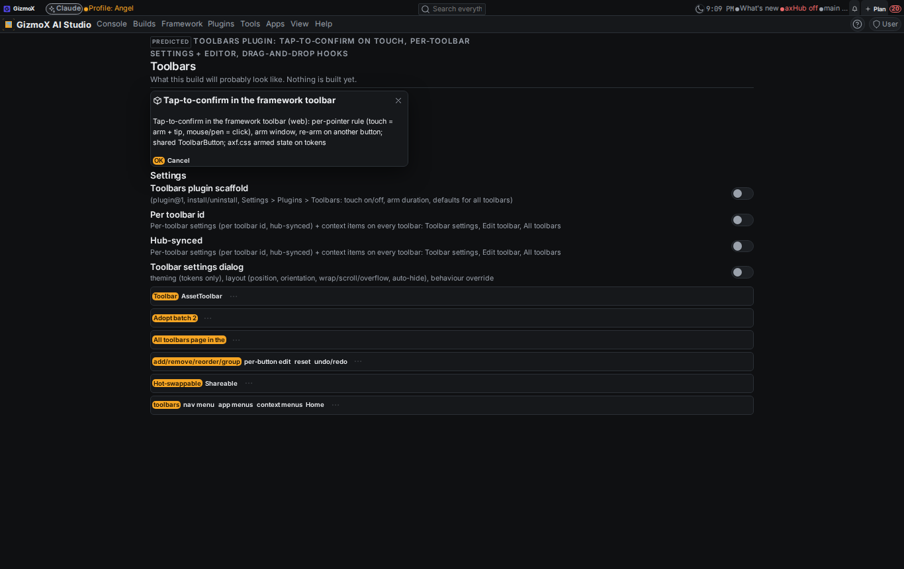

# ui-review-predicted — UI Review shows predicted pictures before a build runs

Urgent build, Nov 3 2026. Brett (voice): UI Review must show **predicted** pictures, what a build will probably look
like, **before** it is built, so he can approve the look before an agent spends money. Agent: **Snap Sully** (`sully`,
booked as a swarm-run@1 with source `assign`); built on main after `ui-review-shots` s1–s3 (its finding: every shot
already lives in the bind-mounted store, nothing to move). Model: Opus, every step. Branch `claude/ui-review-predicted`.
The predicted-shots part of pending `batch-manager` (Angel) was moved here (note on that build).

## What it does

1. **At launch** (`deploy/claude-headless.sh` → `framework/cli/ui-predict.mjs gate`): a build that changes UI and has no
   prediction yet gets one made in the background.
2. **Prediction** (`ui-predict.mjs predict <build>`): the pure core `framework/core/ui-predict.mjs` reads the build's
   title, detail, steps and the files its worktree / branch touched so far, picks the screens it touches and turns each
   UI step into a block (settings rows from quoted labels, toolbar, badges, `A / B / C` action buttons, list with demo
   rows, card, dialog; plumbing steps such as tests, CLI, report draw nothing). That is a `ui-mockup@1` spec.
   UI Review's new mockup page (`?ui-mockup=<spec>`) draws it with the framework's own controls in the console chrome
   under the current theme. `rebuild-shots.mjs` (the existing capture tool, no new capture system) captures phone +
   desktop of the mockup **and** the screen as it is now (main), under the agent cap's heavy lock.
3. **UI Review item**: one per build, group `Predicted looks - <Mon D>`, shown as **Predicted - approve the look** with
   a **Predicted** badge on every row and card; before = the screen now, after = the mockup. Buttons read **Approve
   look / Ask changes / Reject look**. Ask changes sends the comment to the build (an orchestrator note through
   `ui-predict.mjs addendum`, and the launcher adds it to the brief). A predicted item has no branch / PR and never
   holds a merge.
4. **Setting** (Settings → Plugins → UI Review → *Predicted looks*): **Wait for my look approval before UI builds
   start**, default **off**, kept server-side so the host launcher reads it. On: a UI build queues until the look is
   approved (a waiter relaunches it by itself); changes asked = it starts with the addendum; rejected = held, never
   started (on or off).
5. **While running**: `ui-predict.mjs follow` runs next to the headless session and re-predicts every 5 min when the
   spec changed (the diff grew); when the session ends it captures the real screens from the worktree and posts them:
   badge **Real**, the item waits for the real OK (now with branch / PR), the look decision stays, and the detail's
   switch shows *Real · Now (main) · Predicted · Predicted vs real*.
6. **Commands declared once** in `plugin.json` (`plugin-commands@1` items) → REST `/api/plugins/ui-review/…`, control@1
   MCP + CLI: `predicted`, `predict`, `predict-real`, `approve-look`, `settings`, `settings-set`. CLI
   `ui-predict.mjs predict | real | list | approve | settings | gate | wait | follow | addendum | addenda | which |
   backfill | spec`.

**Cost**: the mockup spec is made by rules, not a model: **$0.00 per build** (recorded on each item as
`prediction.cost {usd: 0, model: "rules", tokens: 0}`). The only cost is the capture's CPU time (~1–2 min per build
under the heavy lock).

## Contract changes

- New `ui-mockup@1` and `ui-prediction@1` (framework/core/ui-predict.mjs + .d.mts). Kotlin twin deferred (Android on
  hold).
- `ui-review-item@1`: new optional field `prediction` (review items only; both validators, registry snapshot
  `framework/schemas/ui-review.json`, generated JSON Schema). Existing items are unaffected; no migration.
- `ui-review@1` state: items that are still predictions are not counted for a branch / PR.
- Server routes: `GET|PUT settings`, `GET predicted`, `POST predict`, `POST predict/real`, `POST approve-look`; decide
  on a predicted item decides its look too.
- Launcher: look gate after the model gate (`AXF_LOOK_GATE=off` skips), `.axf-look-wait.log`, `.axf-look-follow.log`.
- Console re-baked through `rebake.mjs apply apps/console-web` (lock hashes updated).

## Backfill (s5)

Predicted items were made on the live console for the seven queued / running UI builds (see the table below). The
live console still runs main's code, so they were filed through `submit` (the CLI's fallback) and carry the full
`prediction` block; once this PR is live they behave as predicted items (badge, look buttons, gate).

BACKFILL_TABLE

## Tests

| Check | Before | After |
|---|---|---|
| `python3 apps/console-web/plugins/ui-review/test.py` | 155 | 178 (predicted flow: setting, predict / refresh, look decisions, addenda, gate verdicts, real swap, merge holds) |
| `npx tsx apps/console-web/plugins/ui-review/test.mts` | 23 | 23 |
| `node framework/spec/check-ui-predict.mjs` (new, CI) | — | 12 |
| `node framework/spec/check-ui-review.mjs` | 91 | 91 |
| `node framework/spec/check-plugin-commands.mjs` | pass | pass (ui-review 13 reads · 22 commands) |
| console `tsc --noEmit` + `vite build` | pass | pass |
| `check-theme`, `check-controls`, `check-plugin-pages` | pass | pass |

## Screenshots

| What | Phone | Desktop |
|---|---|---|
| A predicted item opened: badge, *Predicted / Now (main)* switch, $0.00 rules cost, Approve look / Ask changes / Reject look |  |  |
| The mockup page itself (this build's own predicted look) |  |  |
| Settings → Plugins → UI Review → *Predicted looks* |  |  |
| Backfill example: `toolbar-tap-confirm` predicted Toolbars screen |  |  |

Also fixed on the way (the phone shot shows it): UI Review's item detail used the desktop columns on phones (the
wide rules' `:where(:not([data-fx-narrow]))` matches any ancestor), so the screenshot list, preview and facts
overlapped; phone overrides put the stacked layout back.

## Known gaps

- Mockups are rule-based: they show the right controls and labels in the current theme, not the exact layout a build
  will end up with. An LLM refine pass can slot into `mockupSpec(build, { refine })` later without changing the format.
- "Before" shots exist only for console screens the global search reaches; axHub web / AmberX screens get the mockup
  only.
- Real after-shots at the end need `node_modules` in the build's worktree (skipped with a note otherwise; the build's
  own UI Review submit still lands as usual).
- Claude settings plugin (#275) is not merged yet, so the setting lives in UI Review's settings only.
