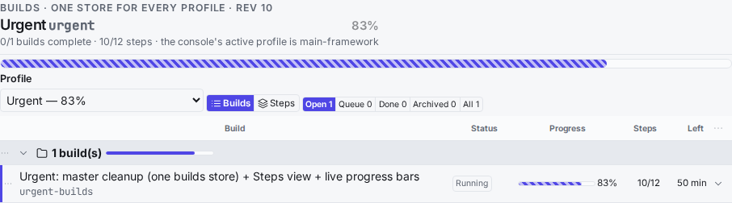
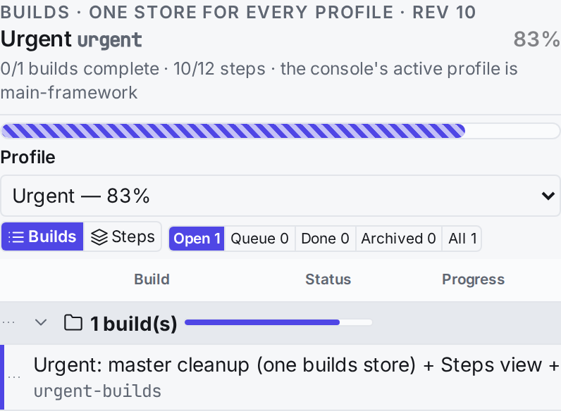
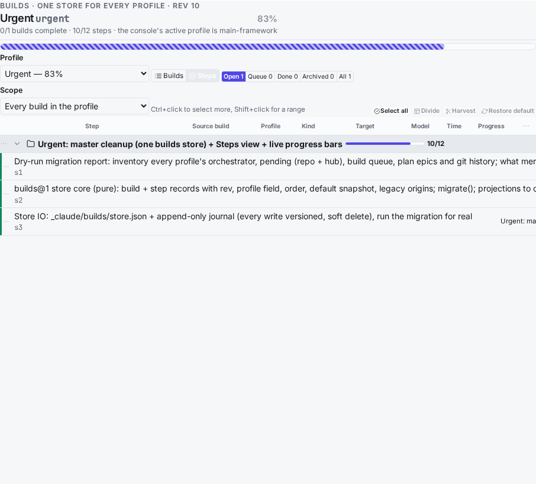
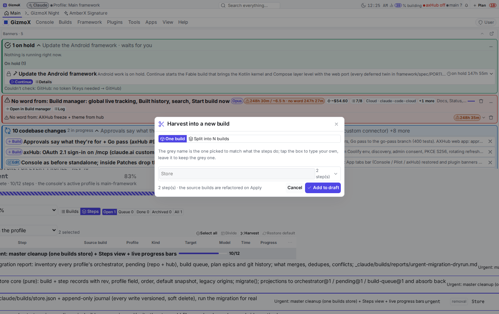
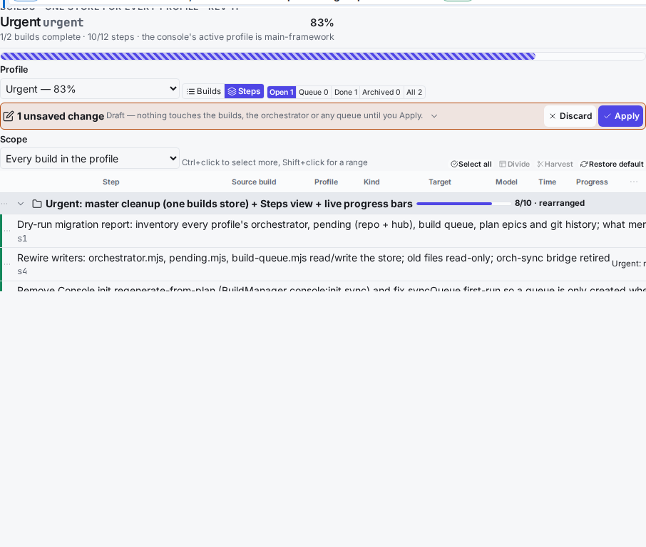

# Urgent profile — master cleanup, Steps view, live progress bars

Build `urgent-builds` (profile **Urgent**, orchestrator), branch `claude/urgent-builds`, Opus, one headless session,
Oct 31 – Nov 1 2026. Spec: `/projects/amberx-axf/_data/framework/plan/specs/prompt-profiles-and-queue-reconciler.md`
(items 4, 4b, 4c, "GO GIVEN" and the duplicate-PR bug folded into item 4). Dry run first:
[`urgent-migration-dryrun.md`](urgent-migration-dryrun.md).

## What was wrong (before)

| Problem | Where | Effect |
|---|---|---|
| The same builds lived in 5 places per profile (orchestrator.json, pending.json repo + hub, build-queue.json, plan epics) and drifted | `_claude/builds[/profiles/<id>]/orchestrator.json`, `framework/plan[/profiles/<id>/framework/plan]/{pending,build-queue}.json` | the hub's Refactor Pending list had **0 items** while the repo had 38; 14 build ids were copied into two profiles with different content |
| Profiles were separate folders with copies | `framework/cli/persist.mjs` PROFILED | one build in two profiles = two records that diverged (e.g. `design-package`, `enterprise-branding`) |
| Console init re-created the queue from the plan on every boot | `apps/console-web/src/views/BuildManager.tsx` `initBuildSync` → `syncQueue` with `first = !queue \|\| !queue.order?.length` | Refactor (empty plan) got "Build queue created from the plan" every boot and an empty queue |
| Writes bypassed versioning | every writer did a plain `writeFileSync` | nothing to restore from when data vanished |
| orch-sync bridge (Orchestrator ↔ Pending only, not the queue) | `framework/{cli,plan}/orch-sync.mjs` | a second copy kept in step by hooks; the queue never synced |
| Push banner reopened duplicate PRs after a squash merge | `plugins/push-banner/server/__init__.py` `open_pr` | #217 merged → #218 opened for the same branch (counted "commits ahead") |
| `plan-studio/web/voice.ts` failed `tsc` on main (TS2532) | `holderLabel` | console `npm run build` red |

## What it is now (after)

**One store** — `_claude/builds/store.json` (`builds@1`), owned by the orchestrator (pure core
`framework/plan/builds-store-core.mjs`, IO `framework/cli/builds-store.mjs`):

- 241 build records / 1229+ step records for all 5 profiles. A build has `profiles: [...]` (a field) and an `order`
  per profile; Pending is a status; the queue is the order of plan-epic builds.
- Every step is its own record: `uid` (never changes, also across a harvest), `title` (rename), `rev`,
  `origin` (harvested / divided from). Each build keeps its **default breakdown** (Restore default).
- **Every write is versioned**: store `rev`, record `rev`, and one line per write in `_claude/builds/journal/<YYYY-MM>.jsonl`
  with every changed build before and after. `builds-store.mjs history <id>`, `restore <id> <rev>`. Removals are soft.
- `orchestrator.mjs`, `pending.mjs`, `build-queue.mjs`, the console API, the MCP tools and every plugin read and write
  **projections** of the store under one lock (`absorbOrchestrator` / `absorbPending` / `absorbQueue`).
- The old files stay for one release as **read-only exports** regenerated after every write (repo + hub, written in
  place so the hub files keep the console user's owner). A direct write by an old checkout is detected and taken in
  **newer-only** (adds/updates builds written after the migration, never reverts or removes) — that is how the
  agent-swarm session's Breakroom progress on main came in during the merge.
- `syncQueue` only creates a **missing** queue; the console's start no longer re-creates or re-syncs it.
- `orch-sync` (both files + its check) is deleted: one data set, nothing to sync.

**One Builds page** — new plugin `apps/console-web/plugins/builds-page` (console + AmberX):

- **Builds** view: one row per build, live progress bar + %, status, steps, time left; rename by double-click /
  double-tap, or right-click / long-press › Rename (Enter saves, Esc cancels, empty refused, id unchanged); drag to reorder.
- **Steps** view: every step record for one build or the whole profile; expandable rows (text, why, files, checks,
  fix context, record + rev); kind (fix / creation / edit / removal) and target; multi-select (Ctrl / Shift click,
  long-press, optional checkboxes or switches in settings); drag to reorder steps and builds (warning that it refactors
  the build); **Divide**; **Harvest** into one build or **split into N** (default names greyed — tap to type your own,
  drag or arrows to order); **Restore default** (confirm, per build or the whole view); rename.
- **Draft until Apply**: everything in the Steps view goes into a saved draft (survives a restart); the bar shows the
  count and what they do; **Apply** (the orchestrator refactors the builds, versioned) or **Discard**.
- Profile rename in the page head (registry `profiles.json`, id unchanged).
- **Live progress bars** per build, per step and per profile (framework `Meter`, animated while active); the banner
  shows the active profile's **percentage** (framework counter widget, number pulses while a build runs, taps to the page).

**Push banner**: no PR for a branch whose exact head was already merged or whose tree equals main's; the merged head
branch is deleted after a merge (same repo only; never main/site/gh-pages/go-pass).

## Files touched

| File | What |
|---|---|
| `framework/plan/builds-store-core.mjs` | new: records, migrate + verifyNothingLost, projections + absorb, drafts, harvest/split/divide/restore, progress |
| `framework/cli/builds-store.mjs` | new: store IO, lock, journal, exports + foreign-write absorb, CLI (migrate/verify/history/restore/export/progress/draft/apply/discard) |
| `framework/spec/check-builds-store.mjs` | new: 34 checks (migration loses nothing, round-trips, reorder, rename, divide, harvest, split, restore, apply/discard, journal, newer-only) |
| `framework/cli/{pending,build-queue,engine-rpc}.mjs` | read/write the store; orch-sync calls removed |
| `framework/plan/build-queue-core.mjs` (+ console baked copy) | `syncQueue` creates only a missing queue |
| `framework/{cli,plan}/orch-sync.mjs`, `framework/spec/check-orch-sync.mjs` | deleted |
| `apps/console-web/plugins/build-orchestrator/{orchestrator.mjs,web/orchestrator-core.mjs,test.mjs}` | store-backed CLI; `rename` / `rename-step`; step `uid`/`title` kept; complete builds without ticked steps stay complete |
| `apps/console-web/plugins/builds-page/**` | new plugin (CLI, server, web, css, lifecycle, test.py 14 checks) |
| `apps/console-web/src/views/BuildManager.tsx` | `initBuildSync` only loads |
| `apps/console-web/plugins/push-banner/{server/__init__.py,test.py}` | duplicate-PR fix + branch delete; 133 checks |
| `apps/console-web/plugins/plan-studio/web/voice.ts` | TS2532 fix |
| `_claude/builds/store.json`, `journal/`, `*/orchestrator.json`, `framework/plan/**/{pending,build-queue}.json` | migrated store; old files now exports |
| `.github/workflows/android.yml` | `check-orch-sync` → `check-builds-store` + `builds-store verify` |

## Tests (local run of the CI blocks, CI env `AXF_BUILD_PROFILE=main-framework`, clean worktree of the merged HEAD)

- First block: validate, tracker, plugins, projects, fixtures, plugin-catalog, axf-server, build-steps, profiles,
  feature-matrix, **builds-store (34)**, **builds-store verify**, pending/queue `--check-steps`, github, theme,
  controls, plugin pages, project-wizard, session-checkin (outside the headless env vars, as in CI): all green.
- Plugin lifecycle for every plugin: 0 failures. Init sweep (4 templates + 16 boilerplates), library templates (8),
  deploy self-test (42): green.
- tsx/spec block (39 commands): green, incl. menu-reach (293) and AmberX test (1996).
- Python block + every plugin `test.py` (console image container): green (codebase-changes 173 and systems-check 216
  need git reachable in the container).
- Console (CI re-bake), axhub-web, AmberX (bundles `builds-page`), Walkthrough builds: green. Theme swap +
  interface-scope: green. API + MCP smoke (33 tools, queue, pending, Builds + orchestrator routes): green.

## Known gaps / honest notes

- **Pushed and merged (Nov 1 2026):** `claude/urgent-builds` reached main through `2a057cc4` once the host had git credentials; the `blocked:push` banner alert no longer applies. Wrap-up step s12 closed by the Leftovers session (`_claude/builds/reports/leftovers.md`).
- The old pages (Build manager, Pending builds, Build queue, Fable rebuilds, Tracker) still exist; they now read the
  same store, so they can't drift, but folding their UIs into the Builds page and removing them is the follow-up.
  Duplicate-view candidates from the audit: build-manager, pending (core view), build-queue (core view),
  fable-rebuilds, feature-matrix (reads pending/queue directly), changes-grid vs codebase-changes, main-build-status vs push-banner.
- "Divide further" proposes parts by splitting the step's text; a Claude-driven split (axf.llm@1) isn't wired.
  "Open the target live with focus highlight" and the toolbar-asset right-click editor (4c) are not built.
- Versioning is the store's own journal; writes don't go through `axhub.memory_write`, so axHub's memory_history
  only sees them via claude-sync.
- Model rule: schema + migration design would be Fable; Brett's brief pinned this whole build to Opus.
- `output-recorder/test.mts` fails on untouched main too (extension-less import under `--experimental-strip-types`).
- Hub path oddity: the spec lives at `/projects/projects/amberx-axf/...` (nested), so `axhub.memory_read` for it 404s.
- claude-sync still **holds** 6 shared files (both sides changed); every one of them is now an export of the store,
  so either copy is safe, but Brett picks (`claude-sync resolve <id> --keep local|hub`).
- During testing, `docker inspect` printed the console container's `AXF_WALL_SECRET` into this session's local log
  (not committed anywhere). Rotating it is advised.

## Screenshots (UI Review item `r-20261101-itzed01`, waiting)

