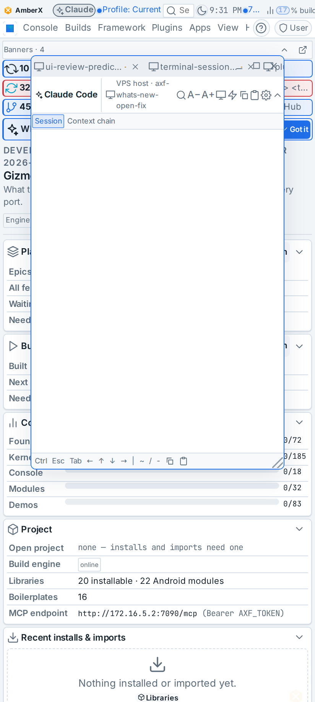
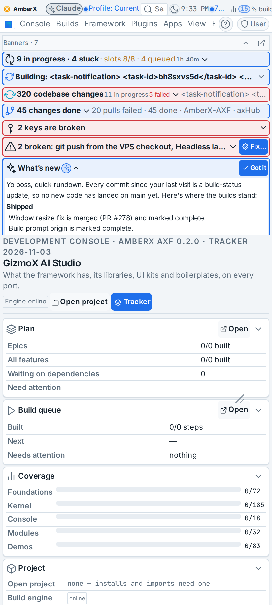
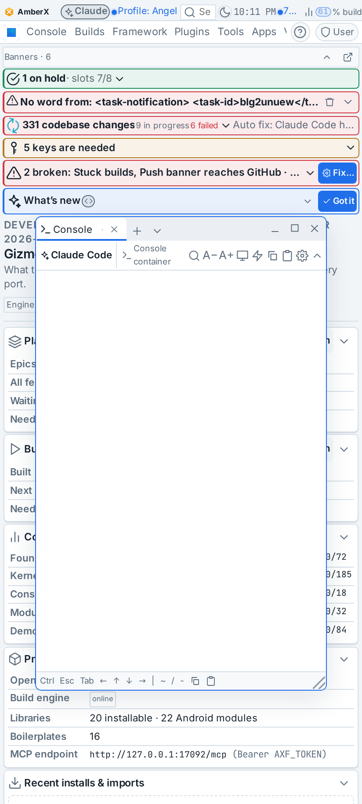
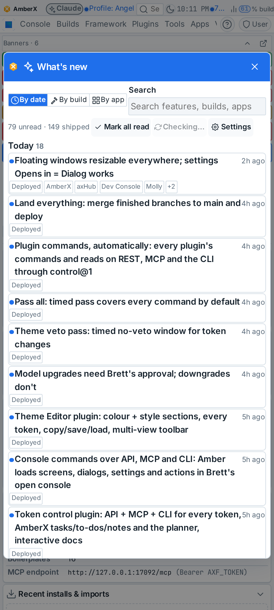
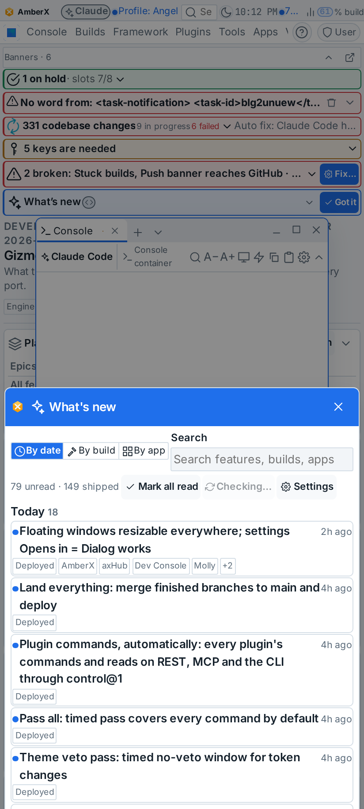

# whats-new-open-fix (Current, bug fix, Nov 3 2026)

Brett (voice): "I see the What's new banner and I'm clicking it. But I'm not seeing anything." Addendum: "I have this
banner open. I can't close it."

Agent: Janitor Joey (the router is not on this checkout). Model: Opus. Branch `claude/whats-new-open-fix`.

## What was wrong

Reproduced on the live console (phone viewport, Brett's hub look and live data) and on this checkout's console.

1. **A floating window sat on top of the Banners strip.** The console Terminal opens a floating window with the
   headless sessions on load. On a phone it opened at the top of the page, over the Banners strip. Floating windows
   are z 60; the strip is z 42. Every tap on the strip's rows, including the "What's new" row, landed in the window.
   
2. **The strip's "What's new" row only folded open in place.** That row (systems check) expanded its commit list
   inside the strip, which is capped at 45% of the screen. With six other banners above it, the details landed
   clipped or off-screen. It never opened the What's new panel.
   
3. The top-bar What's new chip (`status/shipped`) worked: tap → `whats-shipped.open` → the panel, phone and desktop.

Closing: X, outside tap and Escape already worked for every dialog theme (all ship `closeOnBackdrop` /
`closeOnEscape` on). Missing were Android back, swipe down, and a finger-sized X: under Brett's compact look the X was
19 px. There was also no way for Amber to close a dialog by the dialog's own command.

## What changed

- **Windows open below the chrome** (`framework/core/engines/windows.ts`, `framework/react/windows/WindowHost.tsx`):
  `WindowManager.chromeTop()` is set by the web host to where the banner, menu bar and banner strip end;
  `openFloating` opens new windows below it and shrinks them to fit (never under their minimum height). Maximize and
  snapping are unchanged.
- **The strip's What's new row opens the panel** (`systems-check/web/WhatsNew.tsx`): tapping the row dispatches
  `whats-new.open` when a plugin provides it. A separate chevron button folds the banner's own details (commits,
  plugin changes, AI summary). Without the panel, the row folds them as before.
- **`whats-new.open`** (`whats-shipped/web/index.tsx`): the app-wide "open What's new" action. It is registered by the
  What's new plugin, so the systems check doesn't name another plugin.
- **Every dialog closes every way** (`framework/react/components/Overlays.tsx`, `framework/ui/axf.css`): visible X
  (finger-sized on touch, `max(space × 5.5, 2.75rem)`), outside tap, Escape, **Android / browser back** (one history
  entry while a dialog is open, dropped when it closes another way), and **swipe down on the title bar** (the dialog
  follows the finger; past a quarter of its height it closes).
- **control@1 `console.dialogs` act `close`** (`control-rules.mjs`, `console-commands.mjs`, client, REST, MCP, CLI):
  path `current` closes whichever dialog is open; a dialog's id or name closes only that one.
  - MCP: `console_dialog(action="close")`, or `console_dialog(dialog="whats-shipped.panel", action="close")`.
  - REST: `POST /api/console/dialog {"action": "close"}`.
  - CLI: `axf console dialog close [id]`.
- Other banner items: top-bar widgets and badges are plain buttons that dispatch their `link` (checked: every tap
  target in the banner is a `<button>` on screen). The strip's other rows had the same window-over-the-strip problem;
  fix 1 covers them all.

Snapshot `framework/schemas/control.json` and fixture `framework/spec/fixtures/control.json` regenerated. The framework
was re-baked into console-web, molly, axhub-web and amberx-droid. Android twin recorded as deferred in
`framework/spec/PORTING.md`.

## Tests

| check | before | after |
|---|---|---|
| `check-windows.mts` | 383 | 387 (opens below chrome, shrinks to fit, min height kept, already-below kept) |
| `check-console-commands.mts` | 60 | 66 (close current / named / unknown, gate, message valid) |
| `check-control.mts` | 361 ✓ | 361 ✓ (snapshot regenerated) |
| `check-theme.mjs`, `check-controls.mjs` | ✓ | ✓ |
| console-web `tsc --noEmit` | ✓ | ✓ |
| console-commands `test.mjs` | 6 | 6 |

Browser run (Playwright, this checkout's console with Brett's hub look):

- **Phone:** the window opens at y 246, where the strip ends at 246. Strip tap → panel. Back, swipe down, outside tap
  and X each close it. The X is 35×35. The chevron folds and leaves no dialog.
- **Desktop:** the same, with Escape instead of swipe.

## Known gaps

- A window that is already open stays where it is; only newly opened windows go below the chrome. The Terminal
  window is opened fresh on each load.
- In the local harness the Banners strip sometimes stayed hidden until its banners loaded (seen only with partial
  hub data; the live console shows it).
- Inside Molly: the console runs as in a phone browser, so the same fixes apply; not separately tested on a device.
