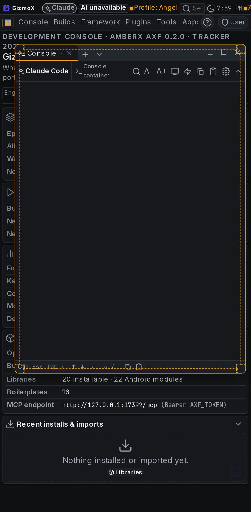
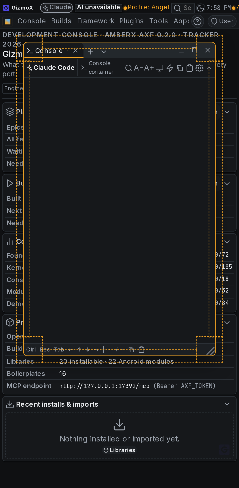
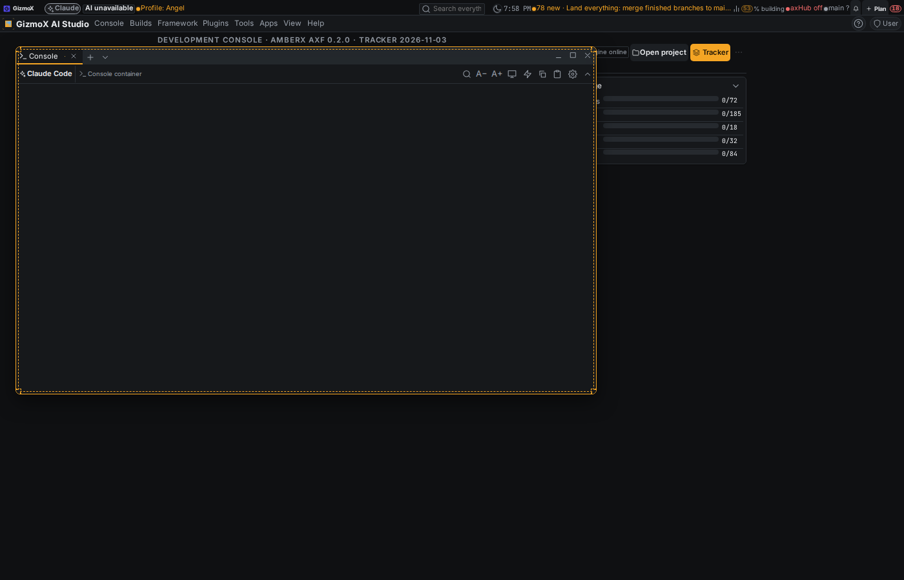
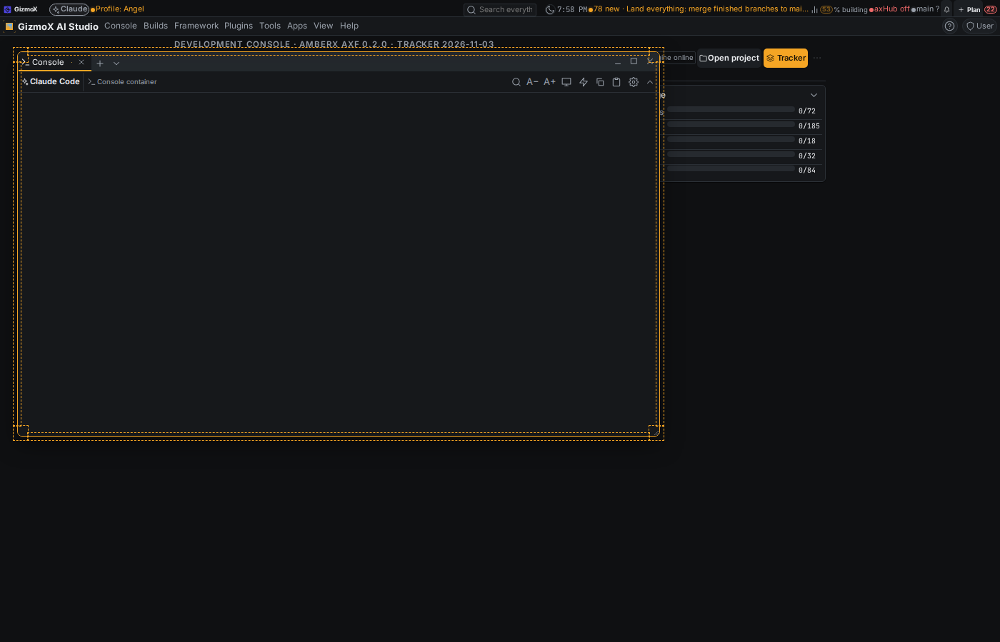
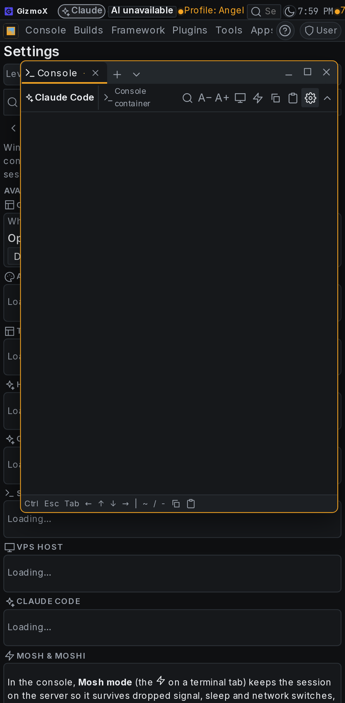
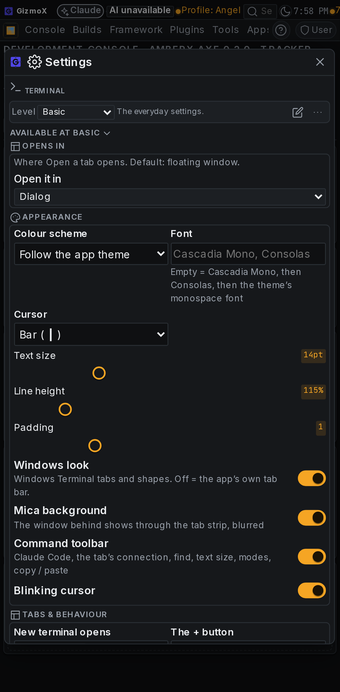
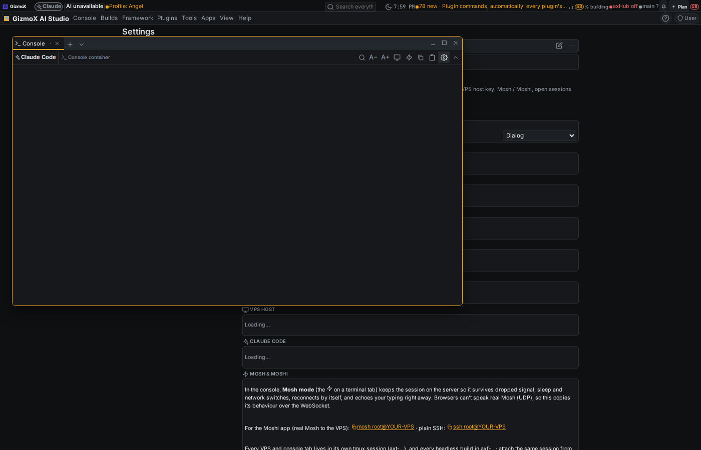
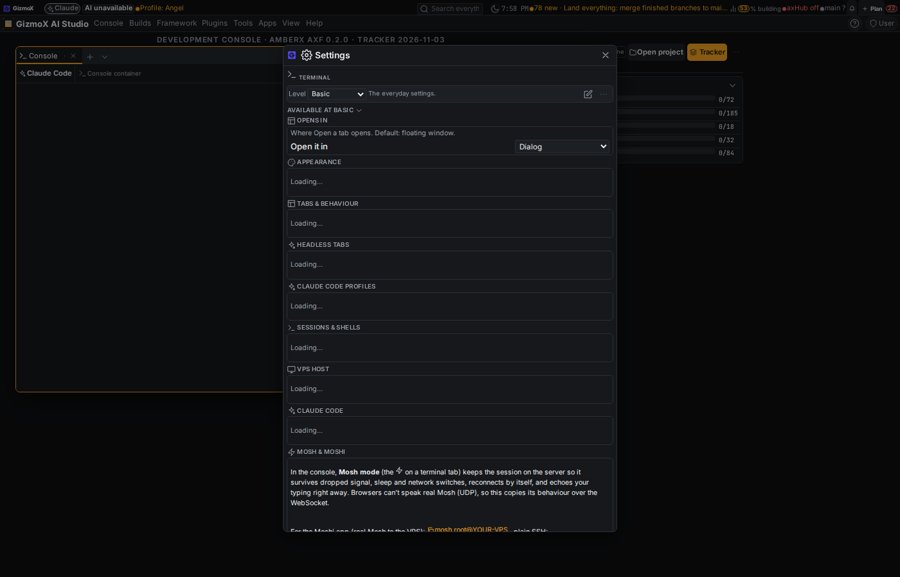

# window-resize-fix (Current profile, urgent; Opus; agent: Landin' Lenny, headless worktree session)

Brett (Nov 3 2026, voice): "Why can't I resize terminal? All floating windows need to be resizable. And also, I selected
dialog for the terminal settings in its settings, but it doesn't open." Merged on Brett's order (Addendum 1).

## Bug 1: floating windows could not be resized

**Cause** (reproduced in headless Chromium, Pixel 7 + desktop, local console on this branch's base):
- The 8 handles existed and the engine resized correctly, but the hit bands were `--fx-space` wide: **3.4 px with a mouse,
  6.8 px on a phone**, invisible, and inside the border only (the window's `overflow: hidden` clipped anything outside).
- The frameless Terminal showed no grip at all (the grip was only drawn for `standard` frames).
- On a phone the Terminal opened at x = 24 with its right edge 8 px from the screen edge, inside Android's edge-swipe
  (back) gesture zone, so the side handles were unreachable.

**Fix** (framework, so every floating window in every app):
- `framework/react/windows/WindowHost.tsx`: the handles render in a `.fx-window__grips` layer over the window's rect,
  drawn right after the window, so bands straddle the border.
- `framework/ui/axf.css`: band = `--fx-space × 3` (~10 px) with a mouse, `--fx-row-h` (22 px; corners 44 px) on a coarse
  pointer; half outside, half inside; `touch-action: none`; a visible grip in the bottom-right corner on every frame.
- `console-terminal/web/open.ts`: on a touch screen the Terminal opens centred with 40 px each side (desktop unchanged).

## Bug 2: Terminal settings "Opens in: Dialog" did nothing

**Cause:** two things together.
1. Floating windows used `z-index: 60 + w.z`, and `w.z` grows on every focus tap. After ~10 taps the window sat above the
   dialog backdrop (70), menus and toasts, so anything opened from it (settings page, dialogs) opened **behind** it.
2. The Terminal's "Opens in" choice only governed its "Open a tab" picker (a dialog, so picking Dialog changed nothing);
   the gear always went to the main settings page, which on a phone is hidden behind the Terminal window.

**Fix:**
- Every floating window and its grips share one layer (`WINDOW_LAYER = 60`); stacking among windows is DOM order
  (already sorted by `w.z`), so dialogs, menus and toasts stay above windows.
- `framework/libs/settings`: `settings.open:<tab>` follows the owning plugin's "Opens in" pick: **Dialog** opens that
  settings tab in a pop-up dialog (`axf.settings.tab`, with the level toolbar); every other choice opens the main
  settings page as before. Applies to every plugin with the option (every library with `opens` + a settings tab), since
  all gear / Plugin Manager / search paths dispatch `settings.open`.

## Tests

| Check | Before | After |
|---|---|---|
| Drag matrix (se corner in/out, e, w, s, n; mouse desktop + CDP touch Pixel 7) | corner only with a 3-7 px target | 12/12 resize |
| Terminal gear, Opens in = Dialog, window focused 15× (desktop + phone) | settings page behind the window | dialog on top, Terminal tab, 11 panels |
| Opens in = Main | settings page | settings page |
| `apps/console-web/scripts/window-handles-check.mts` (new, CI) | n/a | 30/30 |
| `framework/spec/check-windows.mts` | 383 | 383 |
| check-theme, check-controls, shared-assets check, console `tsc` | pass | pass |

## Screenshots (headless, dark, Pixel 7 + 1400×900; resize bands outlined dashed in the resize shots)

| | Before | After |
|---|---|---|
| Terminal resize, phone |  |  |
| Terminal resize, desktop |  |  |
| Gear with Opens in = Dialog, phone |  |  |
| Gear with Opens in = Dialog, desktop |  |  |

## Re-baked
console-web, axhub-web, amberx-droid, molly (only these 3 framework files differed). demo and walkthrough-studio were
already behind the framework before this build and are left for their own re-bake.

## Left out (Brett: "fix the two bugs, no extras")
- Window size is not remembered across reopen (the engine remembers position only, in memory). Engine change = a Fable
  step; worth a follow-up.
- Min / max window size as tokens (still per-window `minWidth` / `minHeight` in px).
- The "Opens in" description still reads "Where Open a tab opens" for the Terminal; it now also decides where its
  settings open. The queued plugin-settings-placement work should give settings their own choice.
- Android twin: none needed (web host only; the engine contract is unchanged).
