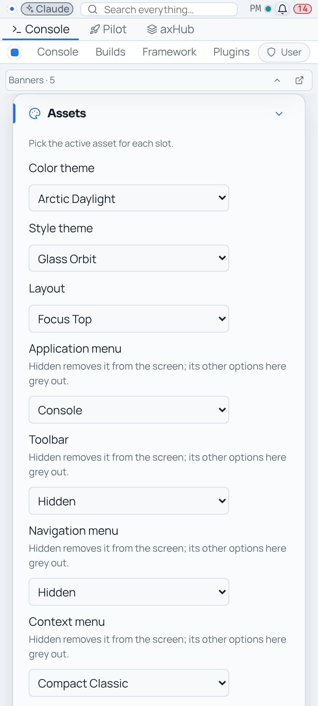
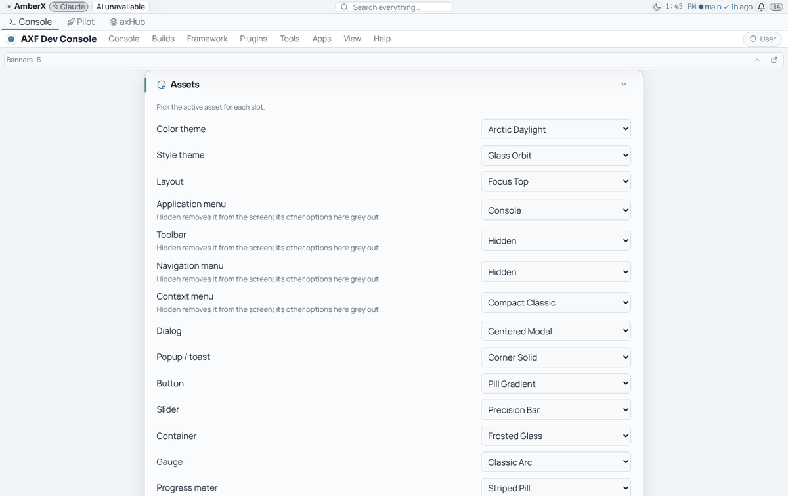
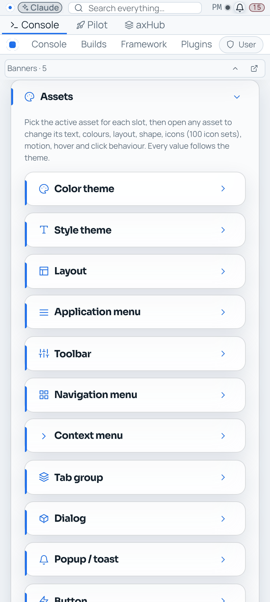
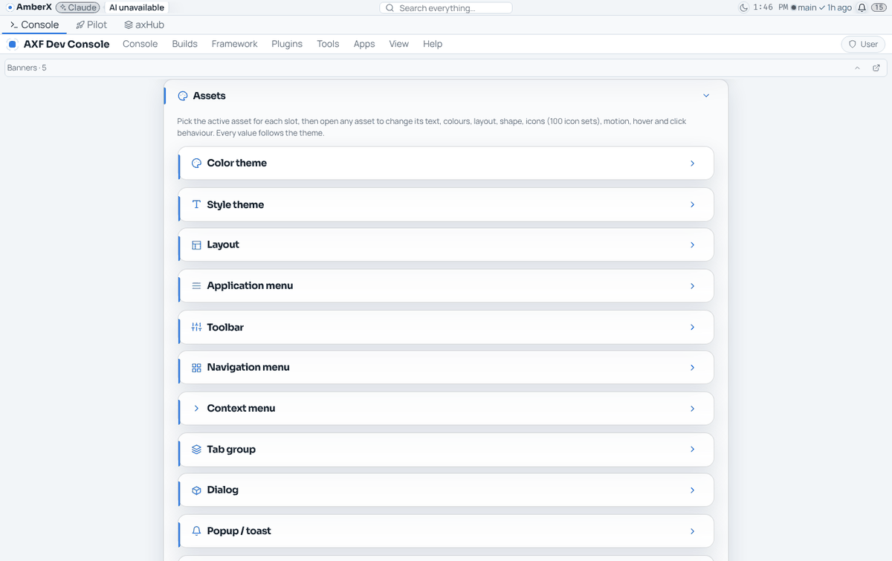
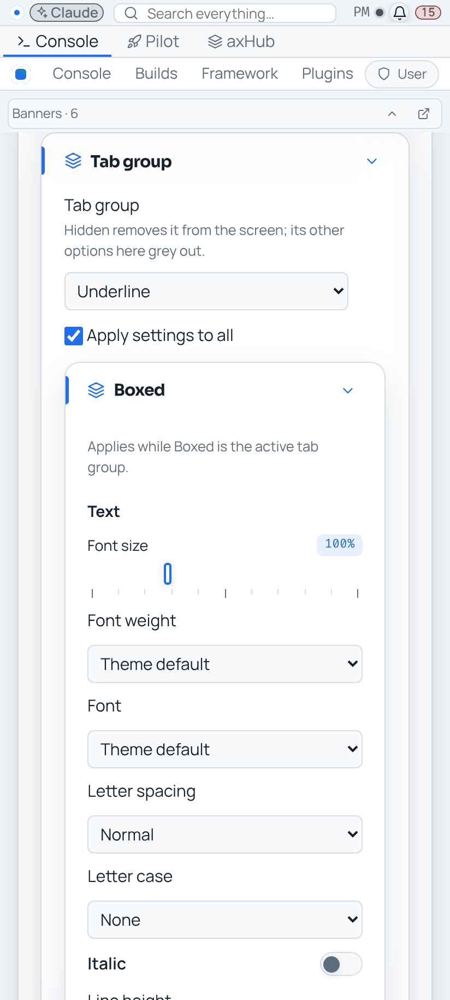
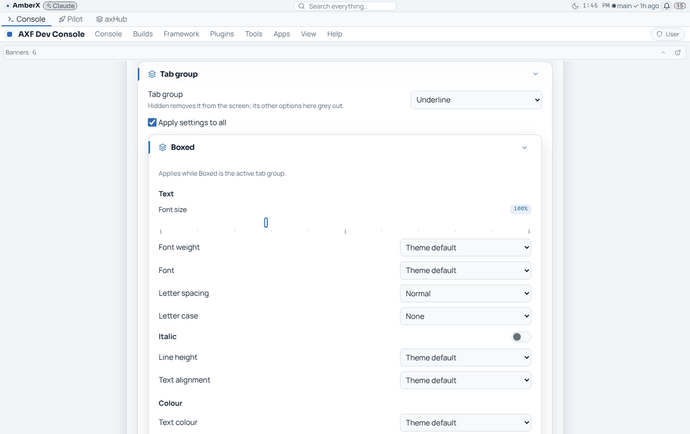
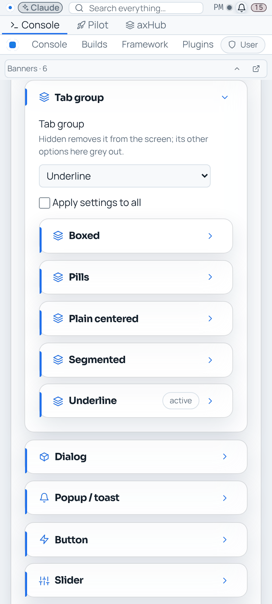
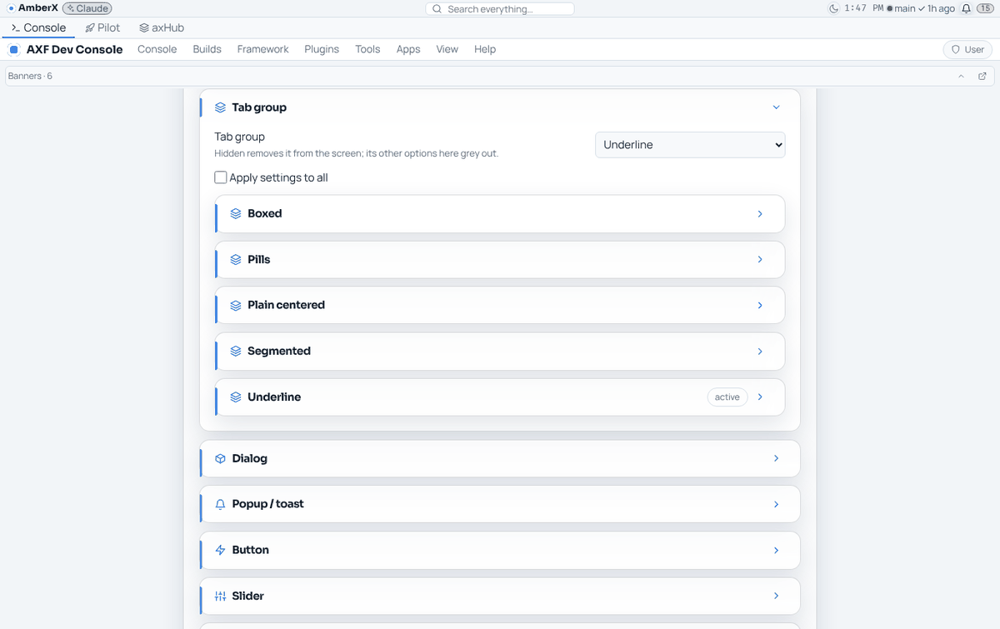

# Appearance asset tokens — screenshots (PR #61)

Settings → Appearance → Assets in the web Dev Console, phone (412 px) and desktop, taken with
`framework/cli/rebuild-shots.mjs` (`AXF_APPEARANCE_HUB=off`, scratch data). Before = main at 4444f07, after = PR head.

| | Phone | Desktop |
|---|---|---|
| Before: one drop-down per slot |  |  |
| After: a collapsible card per asset type |  |  |
| After: Tab group, Apply settings to all ticked (first asset editable) |  |  |
| After: Apply settings to all unticked (every asset editable) |  |  |
