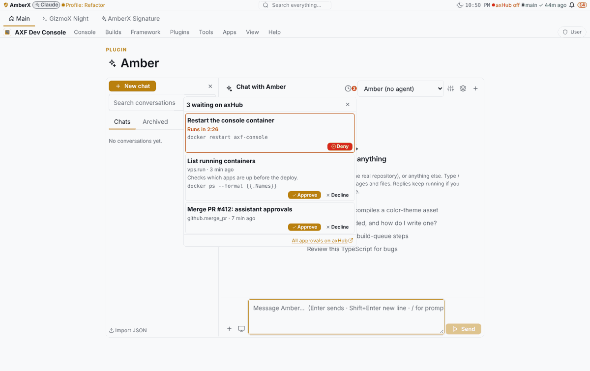
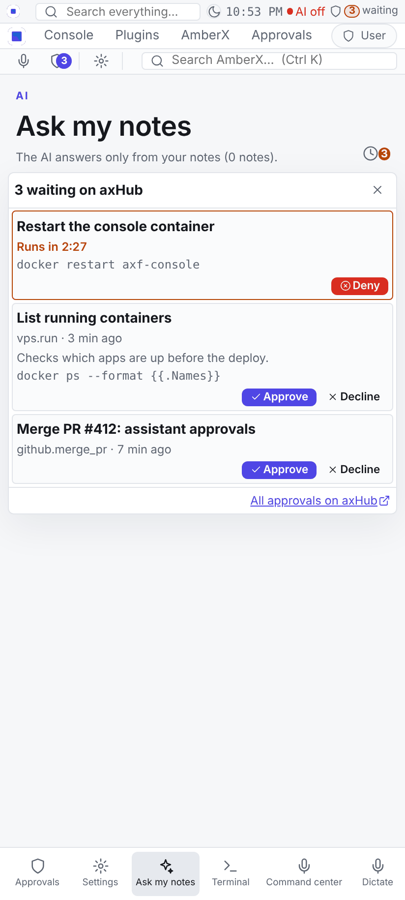

# Approvals in the assistant's title bar (lib-approvals)

Brett, Oct 28 2026 19:19 EDT: "Make approvals pop up in the assistant's title bar, click to approve" — the same
mechanism for the Dev Console's AI assistant and the AmberX app's assistant, both powered by axHub.

Built on Opus as refactor-all s77–s80 (group assistant-approvals), branch `refactor-all/assistant-approvals`. Brett
skipped the Fable contract step (approval-badge@1), so there is **no new cross-port engine or fixture**: a small shared
web library over what already existed (lib-hub `hub.ts` feed + `veto.ts` held calls).

## What it does

- A badge in the assistant's title bar while axHub has anything waiting: the count (a countdown when the only item is
  held), warning colour for held calls, danger at 30 s or less, a short pulse when something new arrives. Nothing is
  drawn while nothing waits or the app's hub session can't read the feed.
- Click: a popover listing each item: title (the caller's `reason.title`, else "Run <tool>"), tool + age or the live
  countdown, description, command; **Approve / Decline** for approvals (as the hub lists them), **Deny** with the
  countdown for held (veto@1) calls, never Approve. "All approvals on axHub" at the bottom. Result toasts: the hub's
  words when the app decided directly, or "decided on axHub" / "no longer held" when an item it acted on leaves the feed.

## Where

| Piece | Where |
| --- | --- |
| Library | `framework/libs/approvals` (`core.ts` pure, `index.ts` watcher, `react.tsx` badge + popover, `approvals.css`, `library.json`), baked into console-web and amberx-droid; README section in `framework/libs/README.md` |
| Self-test | `npx -y tsx framework/spec/check-approvals.mts` (62 checks; in CI next to check-hubstatus) |
| Console | the AI assistant plugin's chat header (`web/chat.tsx`), toggle Settings → Plugins → AI assistant → Title bar; plugin 0.2.1 |
| AmberX | `src/plugins/ai/web/index.tsx` (Ask my notes header, toggle `amberx.ai.approvals`, action `approvals.popover[:<id>]`), `src/plugins/approvals/web/deny.ts` `decideFromPhone` + `setApprovalsHost` in its `register`, `src/plugins/monitor/web/index.tsx` (`approvalIdOf`: an approval notification tap opens the popover) |

## How deciding works (first that applies)

1. The app's host `decide` (`setApprovalsHost`). AmberX: Deny = native `vetoDeny` with the phone's hub session
   (fallback: the call's page); Approve / Decline open the approval in the signed-in hub web view (`native.hubOpen`),
   where Approve is on the first screen. The console AI assistant chat, when it runs inside AmberX, uses the same host.
2. A page on the hub's own origin decides directly: `POST /auth/api/approvals/<id>` `{action, rev}` with
   `X-AxHub-CSRF` (the AXHub web app's `act`), Deny through veto@1 `denyVeto`.
3. `frame`: the hub's approval page inside the popover (the console: the hub lists its origin in
   `AXHUB_APPROVALS_FRAME_ANCESTORS`). "Back" returns to the list; the frame closes when the item leaves the feed.
4. Otherwise the page opens (`host.open` or `window.open`; AmberX routes hub URLs to its hub view).

The console can't approve with one click itself: the hub checks Origin + CSRF, so a true one-click approve needs the
hub page (framed) or the phone's native session.

## Live updates

Polled every 5 s while the page is visible (2 s – 5 min, `everyMs`), on focus, on `axf:hub-check`
(`checkApprovalsNow()`), and on `ApprovalsWatcher.push(raw)`. The hub has no approvals event stream today
(placeholder `axf.approvals.live`). One watcher per hub address is shared by every badge on the page.

## Shots

`_claude/memory/docs/rebuilds/assistant-approvals/shots/{before,after}/` — `assistant-*` (console, via
`framework/cli/rebuild-shots.mjs`) and `amberx-*` (AmberX `vite preview` + Playwright), phone and desktop, title bar and
popover. The feed (and, for AmberX, the hub's data reads) were faked in the page, since no hub was reachable.

## Known gaps

- No approval-badge@1 contract / fixture and no Kotlin twin (PORTING.md notes it).
- AmberX's own Approvals page and the console approvals banner still read the feed themselves (three watchers on the
  same feed in the console when the banner is on); folding them onto lib-approvals is a later cleanup.
- The AmberX "Approve" is one tap to open the hub view plus Approve there; a native one-tap approve would need a shell
  method (`hubDecide`) like `vetoDeny`.
- Postpone / Ignore stay on the hub page.
- axhub-web and walkthrough-studio baked copies are now behind by the new lib folder (rebake when they need it).
