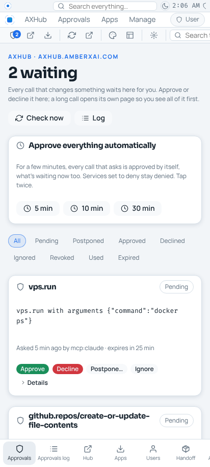
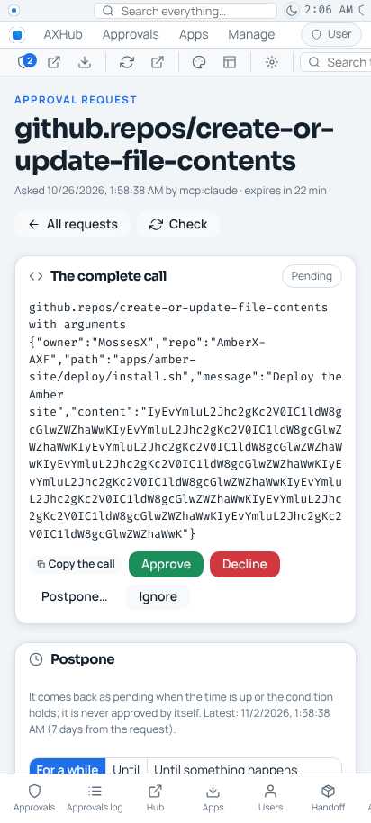
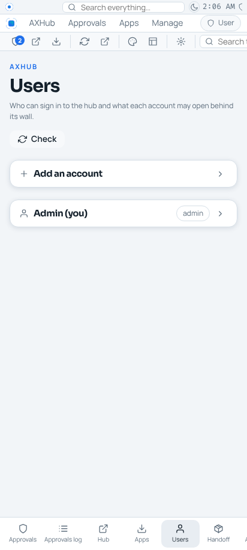
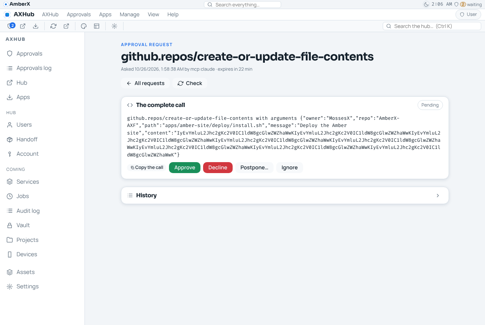
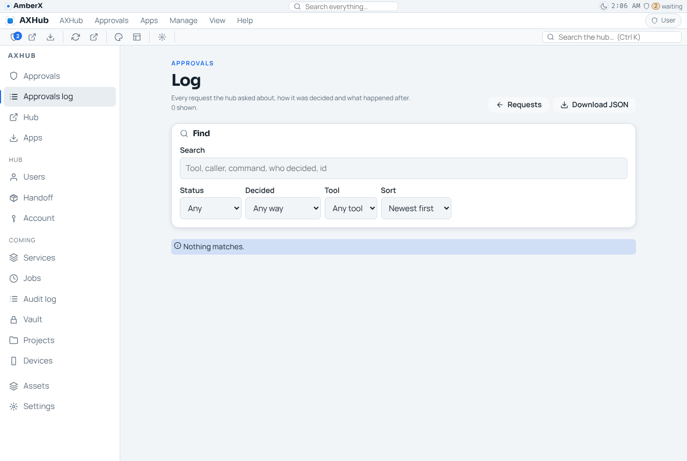
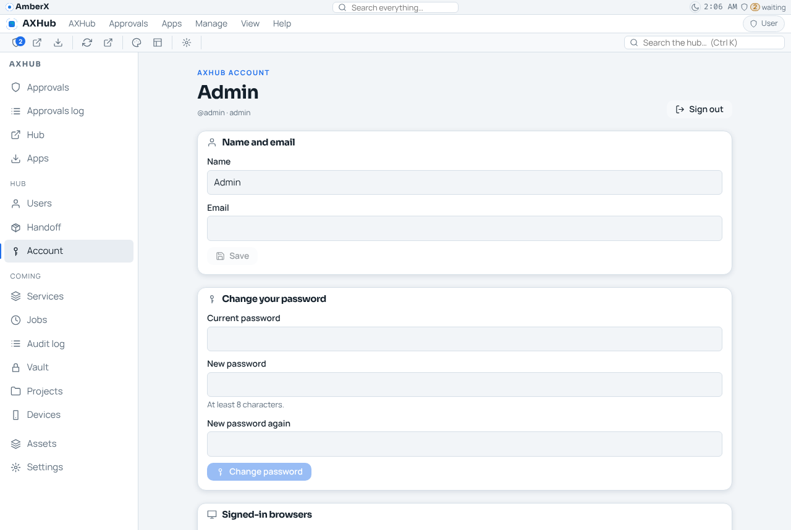

# axHub's pages in the AXHub web app (Oct 26 2026, Opus; axHub decision #96)

Asked by Gizmo: "Fix axhub.amberxai.com so everything goes to the new style pages that look like console … delete all
other pages." Pending item `axhub-pages-console-style`; branches `claude/project-thread-139zmj` (AmberX-AXF) and
`claude/axhub-console-pages` (axHub).

## What moved

| Old hub page (plain HTML, deleted) | Now | Old address |
|---|---|---|
| Approvals grid, filters, pages, auto-approve 5/10/30 min | `#/approvals[?status=]` (view `home`) | `/auth/admin/approvals` → 302 |
| One request: whole call, Approve / Decline / Postpone / Ignore / Revoke / Reopen, history | `#/approvals/<id>` (view `approval`) | `/auth/admin/approvals/<id>` and `/postpone` → 302 |
| Approvals log + auto-approve windows | `#/approvals/log` | `/auth/admin/approvals/log` → 302 (`log.json` download kept) |
| Users | `#/users` | `/auth/admin/users` → 302 |
| Your account, browsers, sign out | `#/account` | `/auth/account` → 302 |
| Apps | `#/apps` | `/apps` → 302 (`/apps.json`, downloads kept) |
| Handoff results + live installation page | `#/handoff`, `#/handoff/<id>[?file=]` | `/handoff…` → 302 (raw files + the run-key progress POST kept) |

Kept on the hub as HTML: sign-in (`/auth/login`), first password (`/auth/first`, now with Sign out), and a 503 page
at `/` for when the web app's container isn't running (says how to approve from the terminal).

## How the pages talk to the hub

`/auth/api/*` (hub `web.ts`, `approvals-web.ts`): browser session cookie only (the MCP bearer token never reaches it),
writes need the hub's own Origin, a JSON body and `X-AxHub-CSRF` = the session's CSRF value from `/auth/api/session`;
no CORS. Approve and the rest still go through `applyApprovalAction`, the revision check, compare-and-set, the audit
log and the approvals log. Client: `apps/axhub-web/src/hub/api.ts` (one retry on an expired CSRF value).

## Deploy order

The new web app needs the new hub API and the new hub redirects to the new web app. Merge AmberX-AXF first (the web
app updates itself within 5 minutes; on the old hub it says the hub hasn't got its new pages yet and links the old
approvals page), then axHub (Coolify redeploy). Pending approvals are kept across the redeploy (they live in the
hub's database), and `axhub confirmations approve <id>` in the hub's terminal works throughout.

## Not done (Android on hold)

AXHub Android app auto-approve, lib-hub Kotlin `signOut`, `LockedWebView` without JavaScript: see `framework/spec/PORTING.md`.

## Screenshots (local hub, Oct 26 2026)

 
 
 
