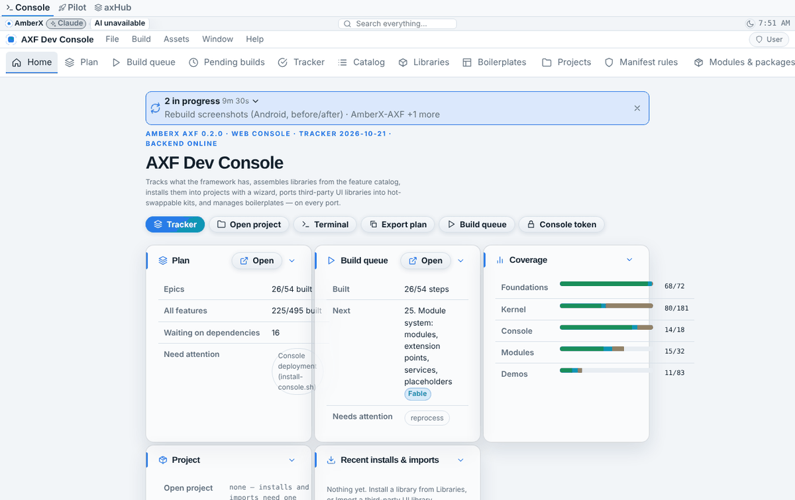
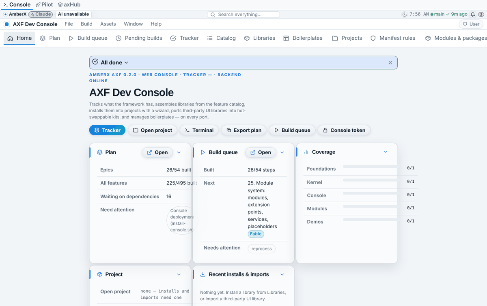
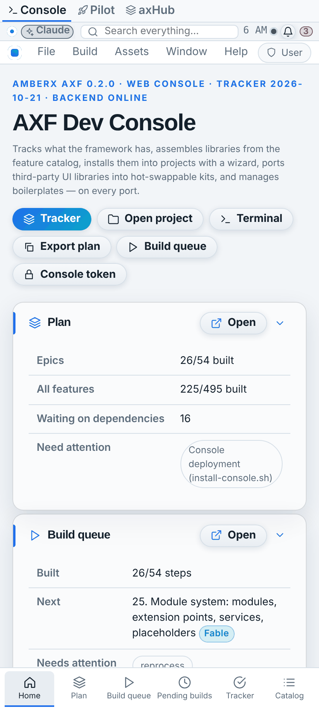
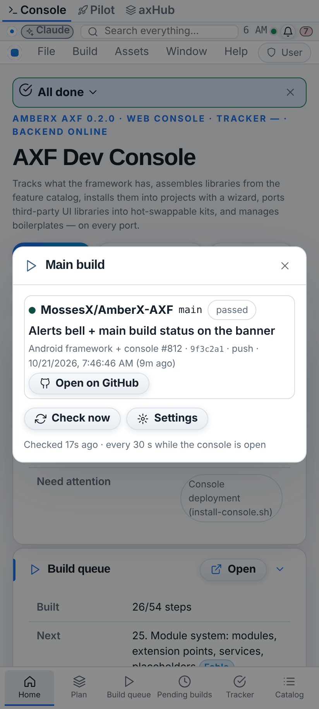
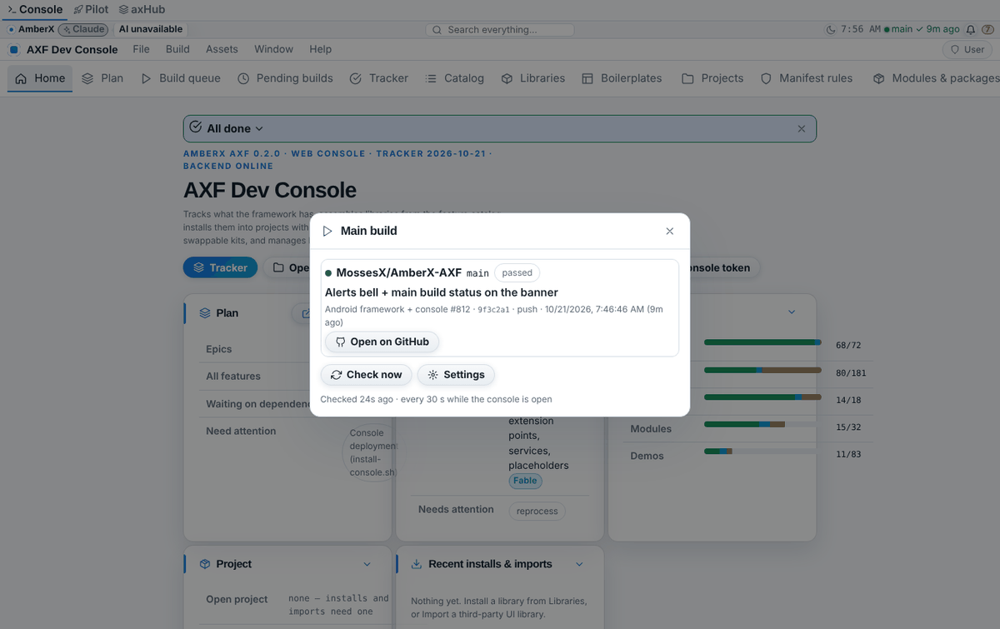
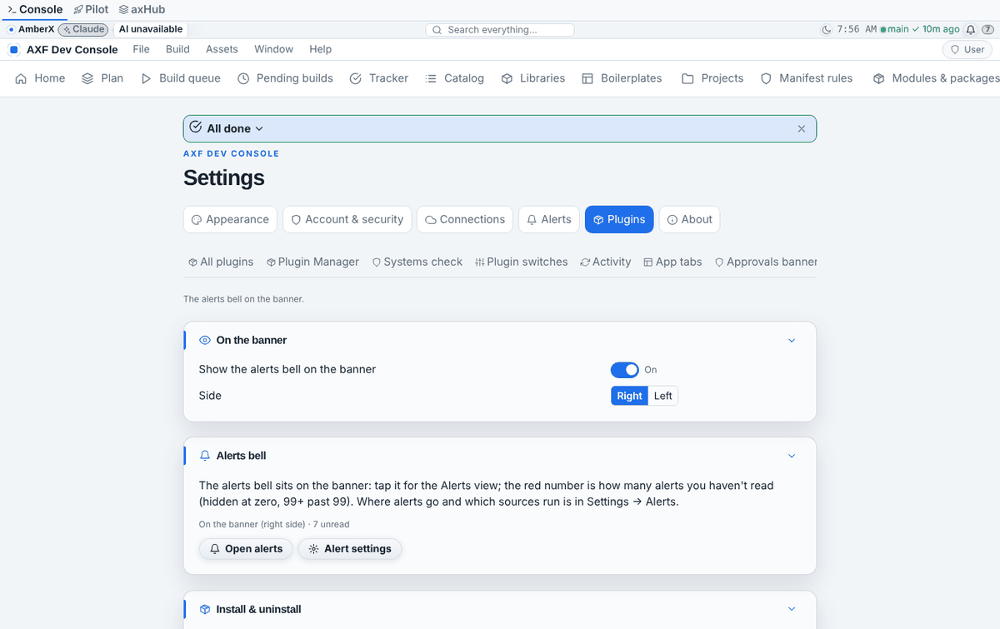

# Banner: main build status + alerts bell (Oct 21 2026, Opus)

Two small web console plugins (folders under `apps/console-web/plugins`), built from **existing widget kinds**, no new
asset types, no Android code (Android on hold). Branch `feat/banner-status-bell`.

## main-build-status

- A framework **`status`** widget on the banner's right, just after the clock (order 25; the bell is at 30/31).
- Text + dot: green `main ✓ 2m ago`, red `main ✗ 5m ago`, accent `main ⟳ 3m` while queued/running (elapsed), grey
  `main ?` when unknown (no `GITHUB_TOKEN`, no runs, cancelled, GitHub error). Phones (≤ 480 px) show the dot only,
  because the right side is crowded.
- The plugin re-registers its own asset `status/main-build` on every answer (same origin, so never an asset
  conflict) and sets counters `build.main.known | running | failing` (other widgets can bind to them).
- Tap → dialog **Main build**: repo, branch, result chip, run title, workflow + run number, short commit, event, time,
  the previous result while one runs, failed jobs (each a link), **Open on GitHub**, Check now, Settings.
- Default watch: `MossesX/AmberX-AXF` · `main` · `android.yml` (= "Android framework + console"). The watch list is
  open (up to 10; the banner shows the first); workflow may be the file name, its numeric id, or the name GitHub
  shows (then runs on the branch are filtered by name).
- Server (the plugin's `/api/plugins/<folder>` prefix): `GET /status[?refresh=true]` (30 s cache), `GET/PUT /config`
  (`{watch}` or `{reset: true}`), console token on every method, 404 when the plugin is off, never on MCP. GitHub via
  lib-github (`axf_server.github`): token to the API origin only, no redirects, size caps, scrubbed errors; only
  `https://github.com/…` links reach the browser. Data: `config.json` in its lifecycle data folder (0600).
- Polls every 30 s while the tab is visible and on focus; stops when the console detaches it (plugin switched off).
- Settings → Plugins → Main build status: show/hide (this browser), Now (state + Check now), What it watches,
  Install & uninstall.

## alerts-bell

- The alerts bell **left the toolbar** (`console-search` toolbar 1.1.0: the `alerts` item is gone; Brett: banner only).
- Now two framework widgets on the banner's right after the clock: `action-button/alerts-bell` (bell icon, action
  `alerts.open`) and `counter/alerts-bell` (counter `alerts.unread`, danger tone, hidden at zero, `99+`, tap opens alerts).
- Settings → Plugins → Alerts bell: show/hide + side (right/left), status line, Open alerts, Alert settings.
- The alerts library (`framework/libs/alerts`: Alerts view, Settings → Alerts, transport, the counter) is unchanged;
  nothing else referenced the toolbar item (search, theme-swap script, tests checked).
- Web-only, no server part, no data.

Both: `install.mjs` / `uninstall.mjs` / `hooks.mjs` (plugin-lifecycle@1), banner items attached with origin = the
plugin id (the console's disable path calls `rt.detachAll(<plugin id>)`), pure logic in `web/core.ts` (tested against
the framework runtime by each plugin's `widget-check.mjs`), theme tokens only.

## Tests

| check | result |
| --- | --- |
| `python3 …/main-build-status/test.py` (fake GitHub on loopback + runtime replay) | 43 ok |
| `python3 …/alerts-bell/test.py` (runtime replay + toolbar) | 19 ok |
| console `npx tsc --noEmit` + `npx vite build` | ok |
| `node framework/cli/check-theme.mjs` | ok |
| `npx -y tsx framework/spec/check-widgets.mts` | 215 ok |
| `node framework/cli/plugins.mjs --check`, `tracker.mjs --check` | ok |
| `node framework/cli/axf.mjs validate apps/console-web` | valid (66 assets; baked-file warnings were there before) |
| `plugin-lifecycle.mjs check <folder>` (both) | clean |

## Screenshots

Before = `bbef259` (main), after = this branch; fake GitHub run (green, "Android framework + console" #812) and
3 unread alerts set for the shot. The PNGs are palette-shrunk by `shrink-shots.py`, so the small dot's green can look
grey in the phone shots; the computed colour was checked in the browser (`--fx-success`).

| | before | after |
| --- | --- | --- |
| Banner, desktop |  |  |
| Banner, phone |  |  |
| Tap the dot (phone) | — |  |
| Tap the dot (desktop) | — |  |
| Settings → Plugins → Alerts bell | — |  |

Re-take (fake GitHub on port 18765):

```bash
python3 _claude/memory/docs/banner-status-bell/shots/fakegh.py 18765 &
AXF_APPEARANCE_HUB=off GITHUB_TOKEN=fake GITHUB_API_URL=http://127.0.0.1:18765 \
  node framework/cli/rebuild-shots.mjs --repo . --out _claude/memory/docs/banner-status-bell/shots \
  --shots _claude/memory/docs/banner-status-bell/shots/shots.json --label after
```

Note: `rebuild-shots.mjs` keeps only the last `--env` flag (its argument parser builds an object), so set extra
variables in the environment, as above.
