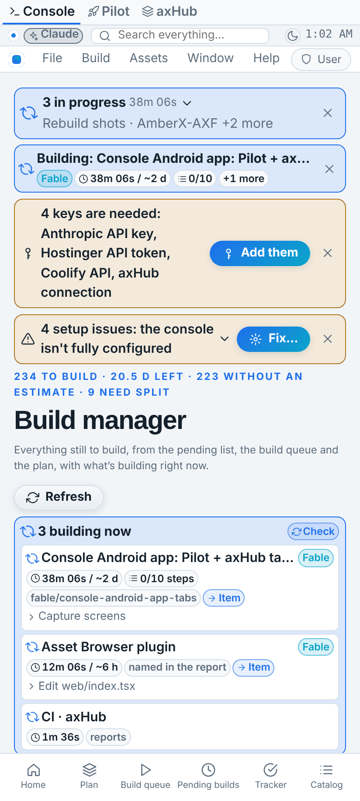
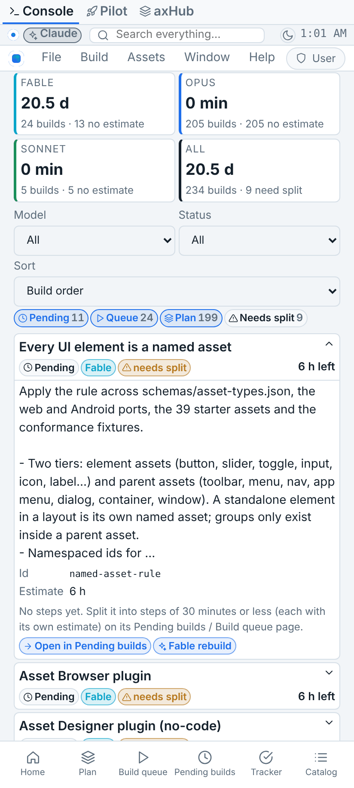
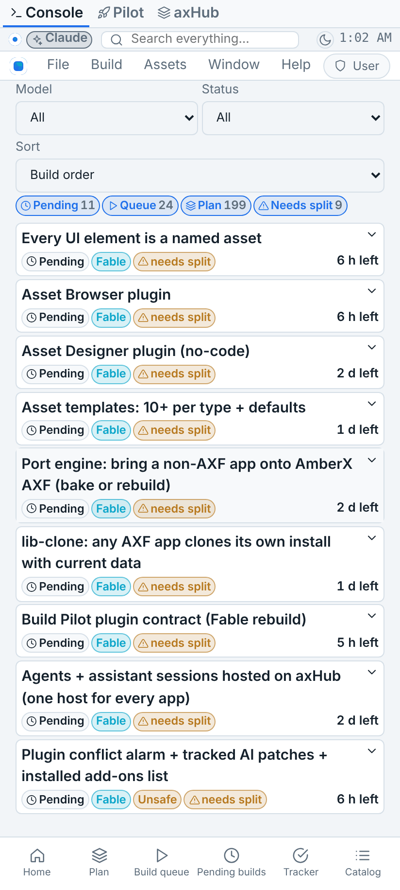
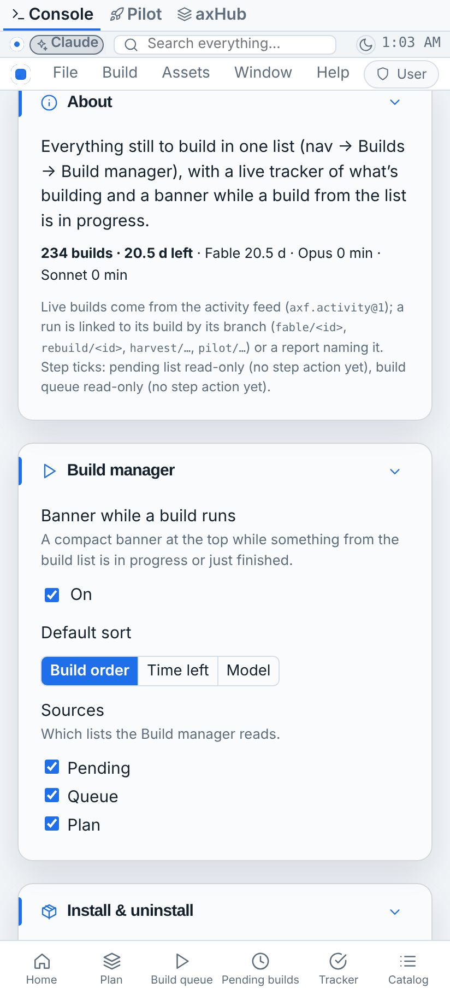
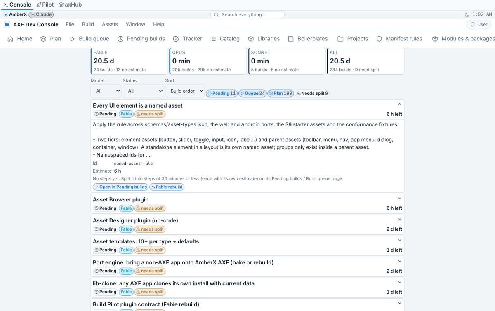
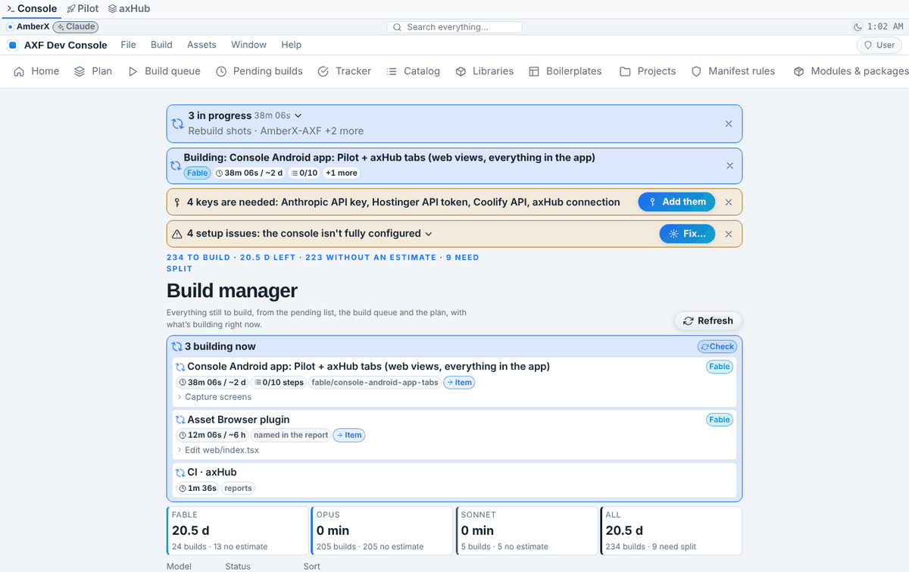
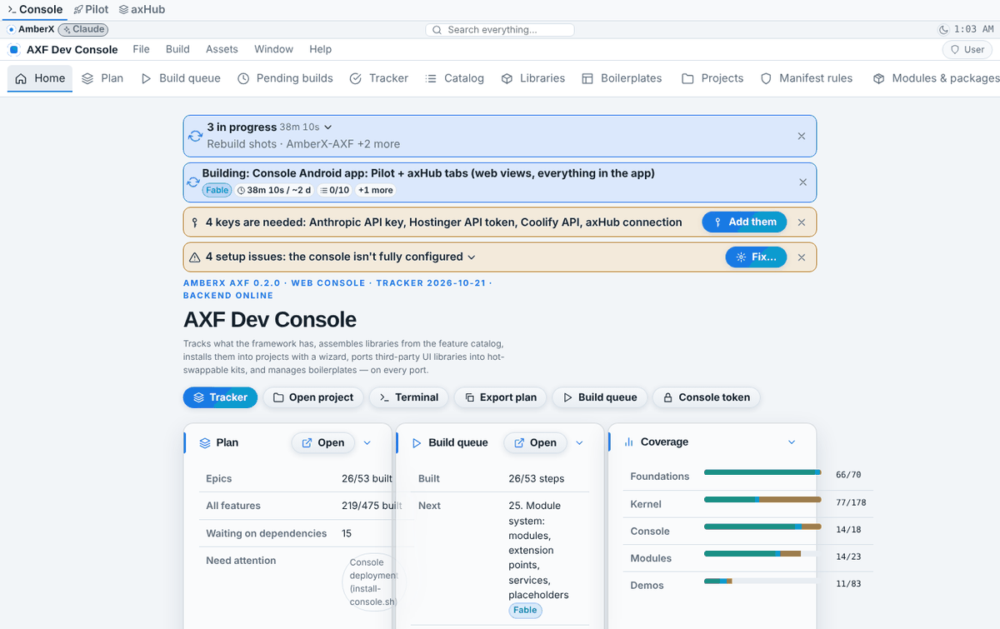
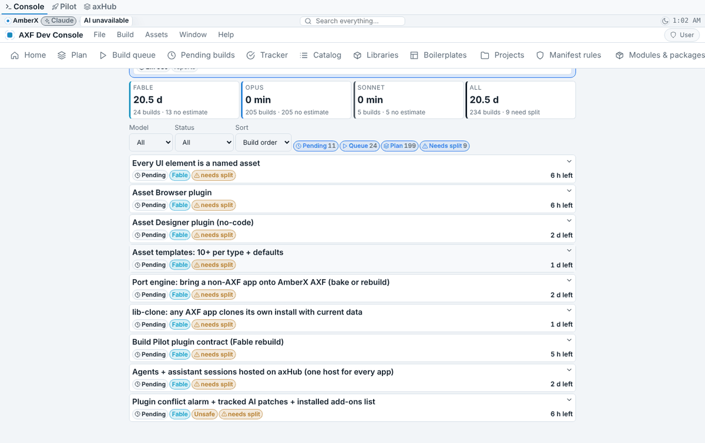
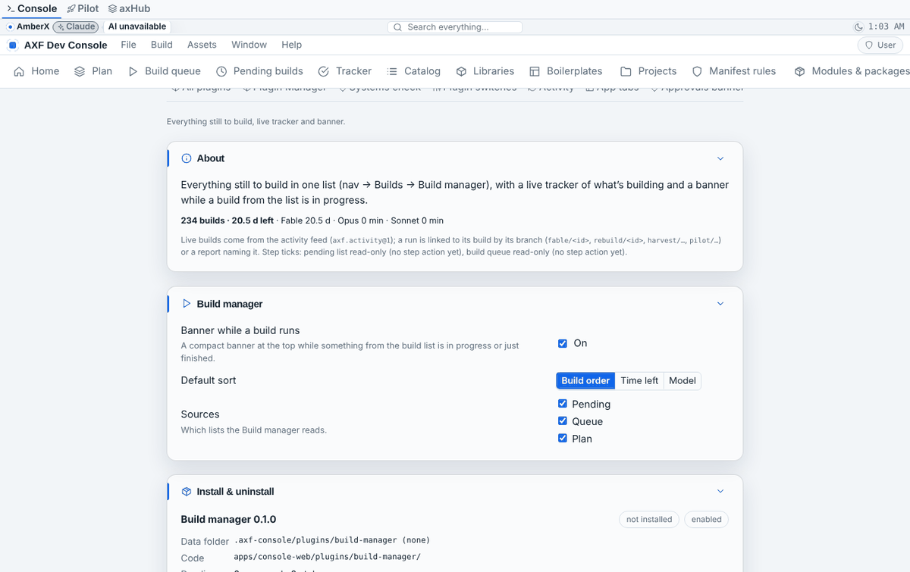

# Build manager (console plugin)

Built Oct 21 2026 on Opus. Plugin `apps/console-web/plugins/build-manager` (`ai.amberx.axf.console.build-manager`, 0.1.0). <!-- axf-plugin:build-manager -->
Nav → **Builds → Build manager**. The core view that was labelled "Build" is now **Build queue** everywhere (route `build` unchanged).

## What it shows

**Everything still to build, one list** (one row per build, nothing counted twice):

| Source | What's listed | Steps / estimate read from |
|---|---|---|
| Pending | pending items not complete (pending, unsafe, broken, failed); Fable ones are the Fable rebuilds | item `estimate?`, sub prompts `{text, estimate?, done?, doneAt?}` |
| Queue | build-queue steps not done (queued, in progress, blocked, needs rework) | `StepRecord.estimate?`, `StepRecord.steps?: {text, estimate?, done?, doneAt?}[]` |
| Plan | unbuilt plan features no epic covers (`feature.epic` / `epic.catalog`) | optional `estimate` / `steps` on the feature |

A pending item linked by `planId` replaces the queue step or plan feature with that id (the row keeps the queue position).
Each row: title, source badge, model chip, status, **time left** (its estimate, else its steps added up, minus done steps;
"no estimate" badge when there's none), steps bar (n of m), **needs split** when over 30 min with no steps (rule "Small
steps for big builds"), and a drop-down with details and every step (estimate + tick). Filters: model, status, source,
needs split. Sort: build order, time left (shortest first), model. **Totals by model**: time left on Fable / Opus / Sonnet + all.

**Live tracker** at the top: activity-feed items (capability `axf.activity@1`: GitHub runs, console update, assistant
replies, VPS jobs, Claude Code reports) plus builds marked in progress (plan status `in-progress`, elapsed since its
"Build started" history line). A run is linked to its build by branch `fable/<id>`, `rebuild/<id>` (also `<id>-fable`),
`harvest/<plan id>` (dots = dashes), `pilot/<…>`, or a report naming the id. Each entry: elapsed vs estimate (amber when
over), current step, progress bar, link to the item and the run. Finished entries linger 4 s, then leave.

**Banner** (order 4.5, right after the Activity banner) only while a build from the list is in progress or just
finished; tap opens the Build manager at that item; ✕ hides it until something new starts.

**Settings → Plugins → Build manager**: banner on/off, default sort, which sources; About (totals, tick status); Install & uninstall.

**Hooks**: action `build-manager.open[:<row key | id | planId>]`, `build-manager.refresh`; search provider
`build-manager.items` (every build); default context menu; context target `axf-build-item` on rows; "Open in Build
manager" on Pending builds rows (`axf-pending-item`) and Plan features (`axf-plan-feature`).

## Data and ticks

- Logic: `web/merge.mjs` (pure; `buildRows`, `timing`, `totalsByModel`, `filterRows`, `sortRows`, `linkRow`, `liveEntries`), estimates parsed by pending-core's `estimateMinutes` / `formatMinutes`.
- Server part (read-only, console token, 404 when off, never on MCP): `GET /api/plugins/build-manager/live` = the activity feed's running + recently finished items, or `{available: false}` without it. The build list comes from the console's own `/api/pending`, `/api/build-queue`, `/api/plan` (works offline from the page's snapshot). <!-- axf-plugin:build-manager -->
- No data of its own (dataDir stays empty); preferences are browser settings `build-manager.banner|sort|sources`.
- **Step ticks** call `POST /api/pending {action: 'step', id, index, done}` (pending-core `apply`) and `POST /api/build-queue/steps {id, index, done}` (build-queue-core `stepsAction`), both from the small-steps build (`fable/split-steps`); aligned at the wave-2 integration (`tickRequest` / `probeTicks` in `web/merge.mjs`, tested in `test.mjs`). The plugin still probes the shared cores on a throwaway state, so a console without those actions shows ticks read-only instead of failing.

## Tests

`python3 apps/console-web/plugins/build-manager/test.py` (12, runs `test.mjs` too) · `node apps/console-web/plugins/build-manager/test.mjs` (44: timing, no double counting, degrade without new fields, totals, filters, sort, branch/report linking, elapsed vs estimate, real repo data). <!-- axf-plugin:build-manager -->

## Screenshots

Phone:

   

Desktop:

Re-take: `node framework/cli/rebuild-shots.mjs --repo . --out _claude/memory/docs/build-manager --shots _claude/memory/docs/build-manager/shots/shots.json --label shots` (seeds three reports in the scratch activity feed).
