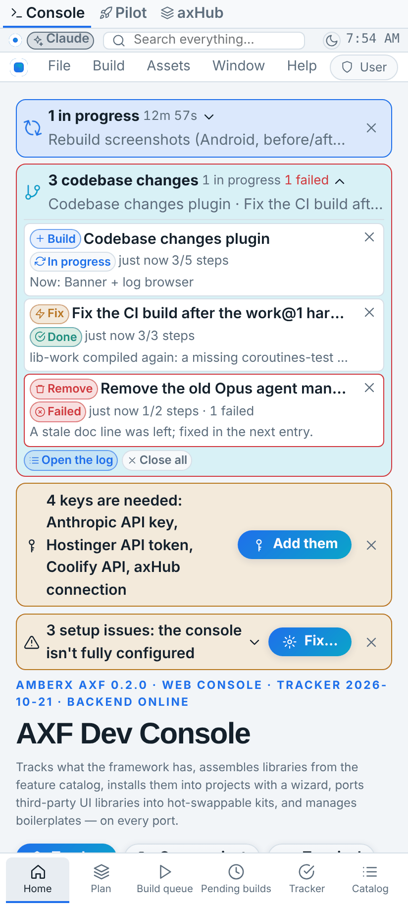
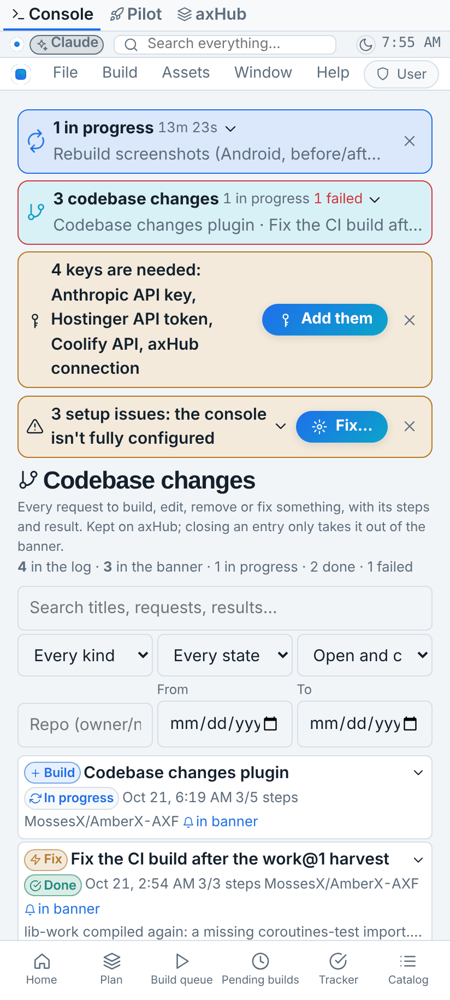
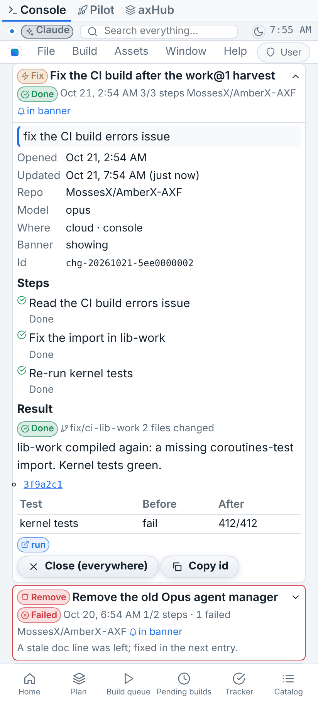
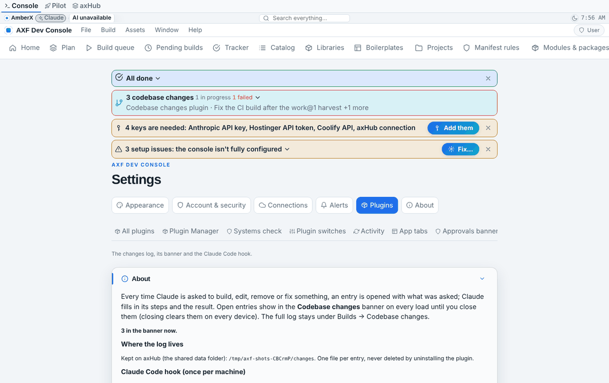

# Codebase changes (log + banner)

Built Oct 21 2026 on Opus, from Brett's request the same day (decision "Codebase changes log + banner" in `decisions.md`). Plugin `apps/console-web/plugins/codebase-changes` (`ai.amberx.axf.console.codebase-changes`, 0.1.0). <!-- axf-plugin:codebase-changes -->

## What it does

Every time Claude is asked to build, edit, remove or fix something, an **entry** is opened with what was asked. Claude breaks
the work into **steps** and records them as it goes, then records the **result** (branch, commits, files changed, tests
before → after, links to the report / PR / run). Entries show in the **Codebase changes banner** on every console load
until each is **closed**; closing is stored in the entry, so it's gone on every device. The permanent log is under
**Builds → Codebase changes**.

## Record: change-log@1

`{ $axf, id, createdAt, updatedAt, kind, title, asked, repos[], model, who {session, where, user, host}, state, steps[], result, closed }`

- `id` = `chg-<YYYYMMDD>-<hex>`; the date picks the file: `changes/<YYYY>/<MM>/<id>.json`.
- `kind` is an open set (build, edit, remove, fix, other have labels and icons).
- `steps[]` = `{text, state queued|running|done|failed|skipped, startedAt, finishedAt, note}`.
- `result` = `{state done|failed|partial|cancelled, summary, branch, commits[{sha, message}], filesChanged, tests {name: {before, after, state}}, links {name: https URL or repo path}}`; `state` (top level) = the result's state, else `running`.
- `closed` = `{at, by}` or null.
- Long text is cut, anything that looks like a token or password is hidden (same rule as activity@1), links are https or plain repo paths only, an entry is at most 64 KB.
- JSON Schema for editors: the plugin's `schema/change-log.schema.json`. The validators are `changes-core.mjs` (Node) and `server/store.py` (Python); the self-test runs both on the same cases and checks they agree.

## Where it lives

- **Main copy on axHub:** `/projects/amberx-axf/_data/changes/` (the console container mounts `/projects`; resolved like every other shared file through `persist.mjs` / `cx.persist_root()`). One file per entry, rewritten only to update that entry; atomic writes; in the hub tree files are 0660 and new folders 2770 so axHub (another user) can serve them, elsewhere 0600/0700.
- `changes/` is in the root manifest's `data.shared`, like `sessions/`: the repo copy is a synced snapshot (`claude-sync sync`), and entries written in a clone (`--to-repo`) reach the hub that way. The first time the console uses an empty hub folder it seeds it from the repo copy.
- No shared index file (two copies appending one would conflict on sync): the server indexes the files in memory (by mtime) for lists, filters and pages.
- **Uninstalling never deletes the log**, not even `uninstall.mjs --all`: it is Brett's record. Removing it is a deliberate manual step (deleting on the hub through axHub needs his approval).

## Recording

```bash
C=apps/console-web/plugins/codebase-changes/changes.mjs  <!-- axf-plugin:codebase-changes -->
node $C hooks install                         # once per machine: Claude Code hooks in ~/.claude/settings.json (.bak kept)
node $C open "Title" --kind build --step "first step" --step "second step"   # by hand (the hook does this itself)
node $C step last "first step" --state running            # then --state done | failed | skipped [--note "…"]
node $C result last --state done --summary "what changed" --branch feat/x --commit abc1234 --files 12 \
       --test "test.py=0→105" --link report=_claude/memory/docs/x.md
node $C close last | reopen last | show last | list [--open] | where | flush
```

Where a run writes (first that works): `AXF_CHANGES_DIR` → the shared data folder (hub) → the console API with
`AXF_TOKEN` (`AXF_CONSOLE_URL`, default https://console.amberxai.com; https only, no redirects, token only in the header)
→ `--to-repo` (this clone's `changes/`, commit it) → a local queue `~/.axf-changes/queue` (0700), sent on by the next run
that can reach one of the others (`flush`). `last` = the entry most recently opened on this machine.

**The hook** (`UserPromptSubmit`, `Stop`, `SessionEnd`; always exits 0, never blocks):

- `UserPromptSubmit`: a prompt that asks for a change opens an entry (title = its first sentence, request cut to 600
  characters with secrets hidden, repo from `git remote`, where = vps/cloud/local) and prints the entry id and the exact
  `step` / `result` commands into Claude's context. Same session + same prompt = same id, so nothing doubles.
- Classifier (simple on purpose, `classify()` in `changes-core.mjs`): slash commands and empty prompts are skipped; a prompt
  that opens like a question (what/why/how/where/when/who/which/is/are/does/explain/tell me/show me/list…) is a question
  unless it also says please / go ahead / can, could, would, will you; otherwise the **first** change word decides the
  kind — remove (remove, delete, uninstall, drop, get rid of, rip out, take out), fix (fix, repair, debug, resolve, patch,
  broken), build (build, create, add, implement, make, write, scaffold, set up, install, port, generate), edit (edit,
  change, update, modify, rename, refactor, move, replace, rework, tweak, adjust, improve, convert, migrate, rebuild).
- `Stop` (end of a turn): steps still `running` become `done` (note "auto: the turn ended"); the result stays open.
- `SessionEnd`: queued steps become `skipped`, and an entry with no result gets `partial` ("The session ended before a result was recorded.").
- The rule in `_claude/rules/RULES.md` ("Codebase changes log") tells every session to record steps and results.

## Console

- **Banner** (order 4.7, after Activity and the Build manager): shows on every load while any entry isn't closed:
  count, how many are in progress / failed, the newest titles. The drop-down lists each open entry (kind badge, title,
  state, time, steps n/m, result or current step) with ✕ (closed everywhere), **Open the log** and **Close all**; tapping
  an entry opens it in the log. There is no "hide for now": it stays until entries are closed (Settings has a per-browser
  off switch).
- **Builds → Codebase changes**: filters (text, kind, state, in banner / closed, repo, date range), counts, rows with
  kind/state/time/steps/repo/"in banner", tap for the detail: the request, facts, steps timeline with times and notes,
  result (summary, branch, commits linked to GitHub, files, tests table, links; repo paths open on GitHub), **Close
  (everywhere)** / **Show in the banner again**, Copy id. 30 per page, **Load more**.
- Action `codebase-changes.open[:<id>]`, search provider (every entry seen), "Codebase changes" in the default context menu.
- **Settings → Plugins → Codebase changes**: banner switch, where the log lives, the hook install command, Install & uninstall.

## Server (console token on every method, 404 when the plugin is off, never on MCP)

`GET entries?open=1|closed=1&kind=&state=&repo=&q=&from=&to=&cursor=&limit=` · `GET entries/{id}` · `POST entries`
(unknown fields refused; an existing id returns it unchanged) · `PATCH entries/{id}` (`steps` whole, `step` upsert,
`result` merged) · `POST entries/{id}/close|reopen` · `POST close-all {ids?}` · `GET where`. Bodies ≤ 128 KB.
Provides `axf.changes@1` (open, update, close, reopen, get, query) so other plugins can record changes without naming this one.

## Tests

`python3 apps/console-web/plugins/codebase-changes/test.py` (105: validation, Python = Node validators, routes, close everywhere, <!-- axf-plugin:codebase-changes -->
pagination + filters, hub-tree modes, the service, and the real console app in a child process for the token and 404)
and `node apps/console-web/plugins/codebase-changes/test.mjs` (67: rules, classifier, CLI, hook, queue + flush, <!-- axf-plugin:codebase-changes -->
console-API backend against a fake console, hooks install/remove). Console `tsc` + `vite build`, `check-theme.mjs`,
`plugins.mjs --check`, `tracker.mjs --check`, `plugin-lifecycle.mjs check codebase-changes` (+ `--after-uninstall` on a scratch copy).

## Screenshots

Phone + desktop in `codebase-changes/shots/after/` (`shots.json` replays them with `framework/cli/rebuild-shots.mjs … --env AXF_APPEARANCE_HUB=off`).

| Banner (phone) | Log (phone) | Entry (phone) | Settings (desktop) |
|---|---|---|---|
|  |  |  |  |

## On the VPS

1. After the merge, the console's 5-minute update rebuilds it with the plugin (enabled by default).
2. Once: `node apps/console-web/plugins/codebase-changes/changes.mjs hooks install` in the clone Claude Code uses (it writes the absolute path into `~/.claude/settings.json`). <!-- axf-plugin:codebase-changes -->
3. Claude Code runs on the host, where `/projects` isn't mounted: set `AXF_TOKEN` (the console token) in that shell's environment so entries go straight to the console; without it they wait in `~/.axf-changes/queue` (`changes.mjs flush` later).

## Not yet

- No Android twin (all Android work is on hold).
- The hook can't know the model reliably (Claude Code doesn't pass it to hooks); it records `ANTHROPIC_MODEL`/`CLAUDE_MODEL` when set, and `open --model` / sessions can fill it in.
- Activity integration (an entry in progress showing in the Activity banner) isn't wired; both banners show separately.
