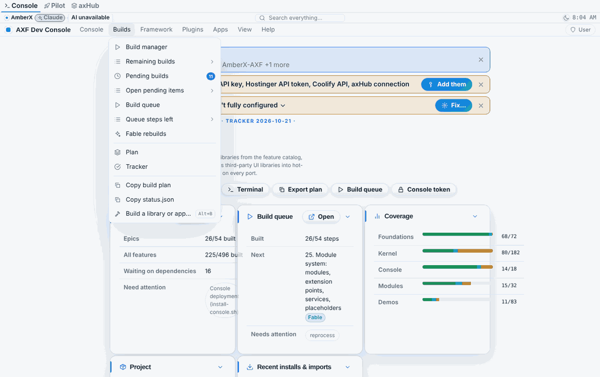
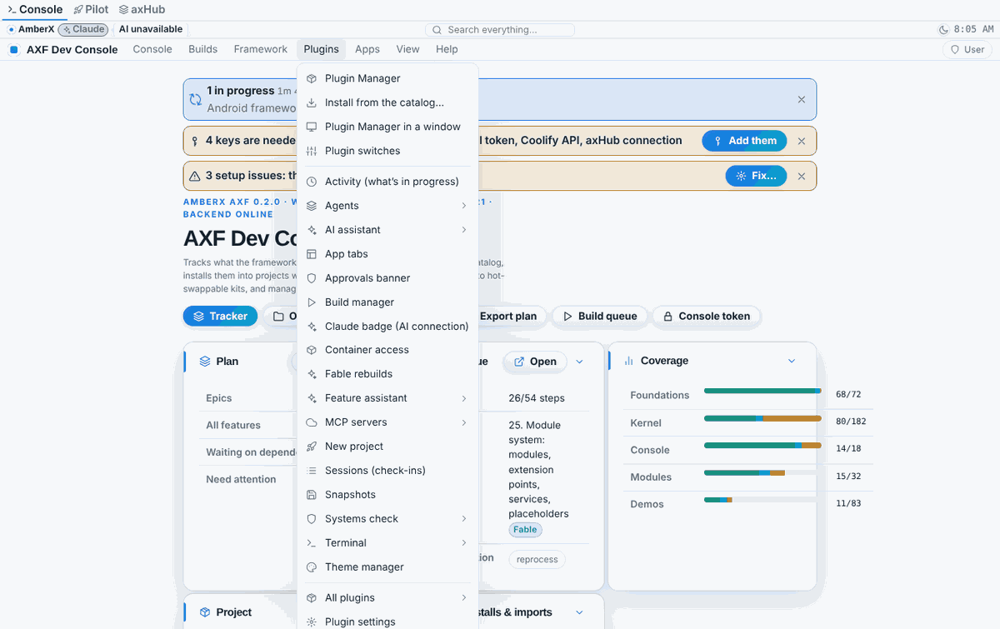
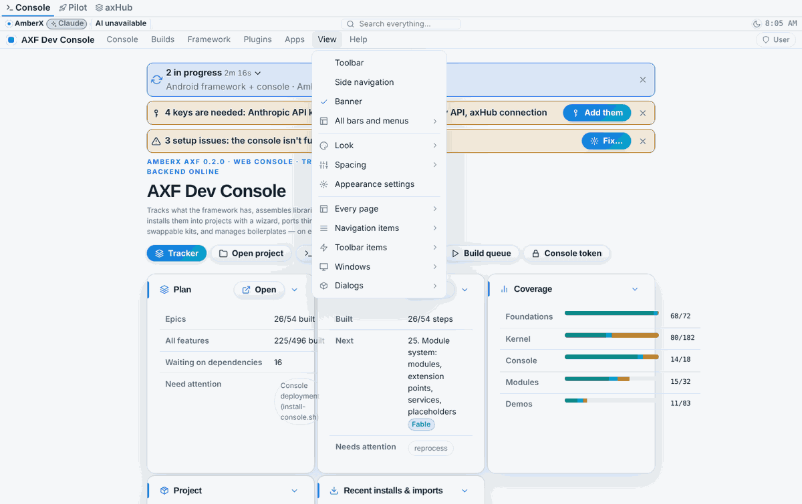
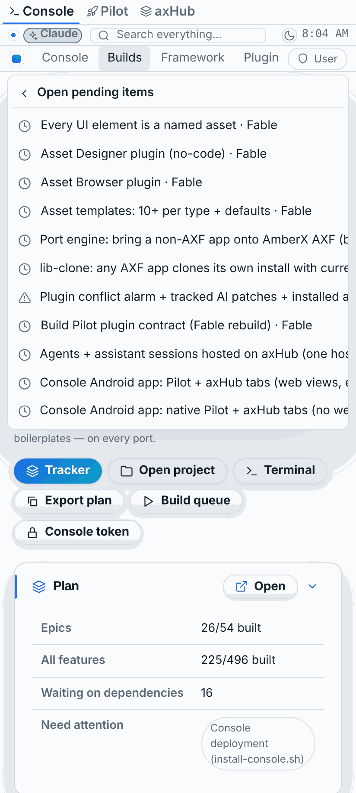

# Console application menu (Oct 21 2026, Opus, web only)

Branch `feat/console-menu` (from `fable/app-menu-hooks`). Brett: "Build out console's application menu with sub menus
where helpful and make sure it has hooks for everything … The app menu for console needs to reach everything including
in the toolbar and navigation menu so they can be hidden if desired." Decision (`memory/decisions.md`, Oct 21 2026):
the console hides both the toolbar and the side navigation by default once the menu reaches everything.

## What the console shows now

- Manifest: `app-menu: console` (new asset), `hidden: ["toolbar", "nav-menu"]`. Users' own choices still win
  (Settings → Appearance, or View → Toolbar / Side navigation).
- The menu bar shows in every console layout (the console's `studio-dock` copy turned `showMenubar` on).
- One-time per browser: if a saved look (the hub's appearance document) still names another app menu, the console
  moves to `console` once; picking another menu afterwards sticks (`axf-console:menu-console-v1`).

## The menu tree

```
Console    Home · Search everything… · Approvals waiting ▸ (badge) · Alerts (badge) · Ask the assistant…
           Settings · Settings pages ▸ · Account · Output terminal · New terminal (shell) · Reload data
           Open project… · Save · About the console
Builds     Build manager · Remaining builds ▸ · Pending builds (badge) · Open pending items ▸ · Build queue
           Queue steps left ▸ · Fable rebuilds · Plan · Tracker · Copy build plan · Copy status.json · Build…
Framework  Features ▸ (Catalog, Tracker, Plan, Not built yet ▸) · Libraries ▸ (All, Install…, Import UI…, Library list ▸)
           Modules ▸ (Modules & packages, Demos, Module list ▸) · Boilerplates ▸ (All, Boilerplate list ▸)
           Assets · Components · Import an asset… · Layouts ▸ · Standards ▸ (Projects, Manifest rules, New project…)
Plugins    Plugin Manager · Install from the catalog… · Plugin Manager in a window · Plugin switches
           one entry per plugin (Activity, Agents ▸, AI assistant ▸, App tabs, Approvals banner, Build manager,
           Claude badge, Container access, Fable rebuilds, Feature assistant ▸, MCP servers ▸, New project,
           Sessions, Snapshots, Systems check ▸, Terminal ▸, Theme manager) · All plugins ▸ · Plugin settings
Apps       Build Pilot ▸ (Show in a tab, Open in a new tab) · axHub ▸ (Waiting for approval ▸, Check now, Approvals,
           App catalog, Users, Your hub account, Show the app catalog in a tab, Open axHub) · Demo site ▸
           Back to the console · App tabs ▸ · App tabs settings
View       ✓ Toolbar · ✓ Side navigation · ✓ Banner · All bars and menus ▸ · Look ▸ (next colour/style/layout,
           Randomize, Reset, Theme manager…) · Spacing ▸ · Appearance settings · Every page ▸ · Navigation items ▸
           Toolbar items ▸ · Windows ▸ · Dialogs ▸
Help       Keyboard shortcuts · Documentation · Plugin guide · Systems check · About
```
▸ with a list icon = a live list, filled when it opens, capped with "More…" that opens the full page.

## How it's built

| Piece | Where |
|---|---|
| Static menus | `apps/console-web/src/assets/app-menu/console.json` (explicit `order`s so plugin entries slot in) |
| Console contributions (chrome toggles via `chromeToggleItems`, All bars and menus) | `src/menu.ts` (pure) |
| Console library: live lists, `pending.open` badge, actions, search dialog, rescue note, migration | `src/menuLibrary.tsx` |
| Plugin entries | `plugins/<folder>/web/menu.ts` (pure data) → `appMenu` in `web/index.tsx` |
| Reachability check (CI) | `apps/console-web/scripts/menu-reach.mts` |

Live lists: `console.pending` (open pending items → Pending builds, row flashed), `console.queue` (steps not done →
Build queue, row flashed), `console.features` (plan features not built → feature window), `console.libraries`,
`console.modules`, `console.boilerplates` (→ the page, row flashed / picked), `console.plugins` (→ Plugin Manager),
`build-manager.remaining` (→ Build manager row), `approvals.list` (→ the review dialog; since Nov 1 2026 each row also carries red Deny + green Approve, framework AppMenu row `buttons` + provider `act`), `app-tabs.tabs`; plus the
framework's `views`, `nav`, `toolbar`, `settings`, `windows`, `dialogs`, `chrome`.

New actions: `console.search`, `console.open:<pilot|demo|axhub|axhub-approvals|axhub-apps|axhub-users|axhub-account|plugin-guide|docs>`
(fixed list, new browser tab), `console.reveal:<view>:<text>[:pick]`, `console.pending.open:<id>`,
`console.queue.open:<id>`, `help.docs`, `plugin-manager.install`, `approvals.review:<id>`; `app-tabs.show:<id>` now
adds a known app to the tab bar first. Badges: `pending.open`, `approvals.waiting` (+ the existing `alerts.unread`).

## Can't lock yourself out

- The View menu never offers hiding the menu bar (the framework's toggles leave `app-menu` out).
- Ctrl/Cmd+K always searches: the search bar when one is on screen, else the **Search everything** dialog.
- With the menu bar *and* side navigation hidden (Settings → Appearance), every page shows a note with
  **Show the menu bar**.

## Reachability check

`npx -y tsx apps/console-web/scripts/menu-reach.mts` (CI, web tests block) merges and compiles the menu like the
runtime (asset + console + every plugin's `menu.ts`, every plugin on) and fails when a nav entry (console nav asset,
plugin nav sections, library pages), any item of any console toolbar, or any page in `src/App.tsx` isn't reachable,
a `nav:` target is unknown, a live list isn't registered, two modules use one id, a plugin with UI has no entry, the
manifest stops hiding toolbar + nav, or a layout hides the menu bar. Framework stand-ins the console gives no handler
(`file.new/open/export`, `edit.*`, `run.deploy`) count as reached through View › Toolbar items. Last run: 167 checks,
7 menus, 141 static items, 17 live lists, 35 contributions, 28 pages.

## Screenshots (`console-menu/shots/after/`, phone + desktop)

01 console with toolbar + nav hidden · 02 Console · 03 Builds · 04 Open pending items (live) · 05 Framework → Libraries ·
06 Library list (live) · 07 Plugins · 08 Apps → axHub · 09 View (toggles) · 10 View after showing the toolbar ·
11 Help · 12 Ctrl+K search dialog with the banner hidden · 13 the rescue note with the menu bar hidden.






## Known gaps

- **The default layout (`focus-top`) has `showToolbar: false`**, so View → Toolbar ticks but shows nothing until
  another layout is picked (Framework → Layouts). Pre-existing layout choice, not changed here.
- axHub has no data page to link (the "Data" entry Brett mentioned): the hub's `/projects` data is reached through
  its MCP tools only. Users / Account / Approvals open in a new tab (only the approvals and apps pages may be framed).
- Pilot pages can't be deep-linked (no URL routing in AXF apps yet): Pilot opens at its home.
- Android console: nothing (Android on hold); the Kotlin app-menu twin is a deferred gap in `framework/spec/PORTING.md`.
- The manifest's default toolbar is still `standard-icons` (CLAUDE.md says `console-search`); left as is — both are
  covered by the check.
