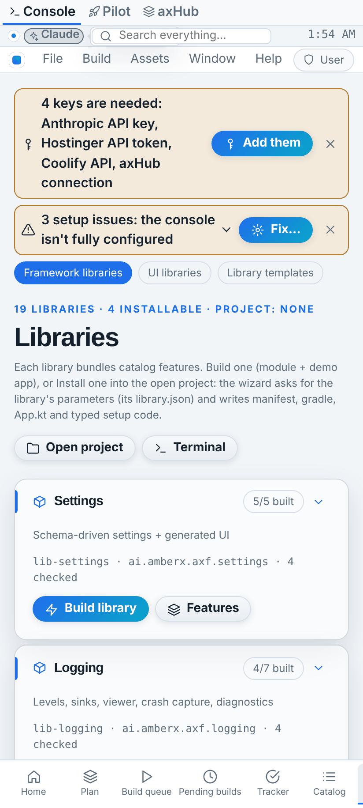
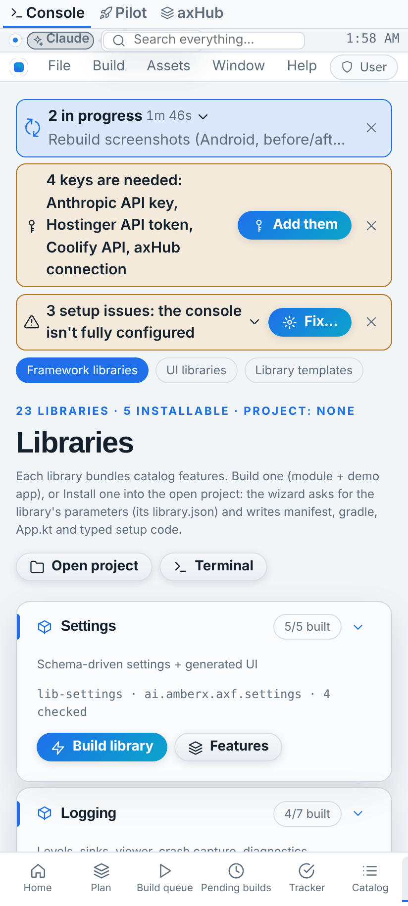
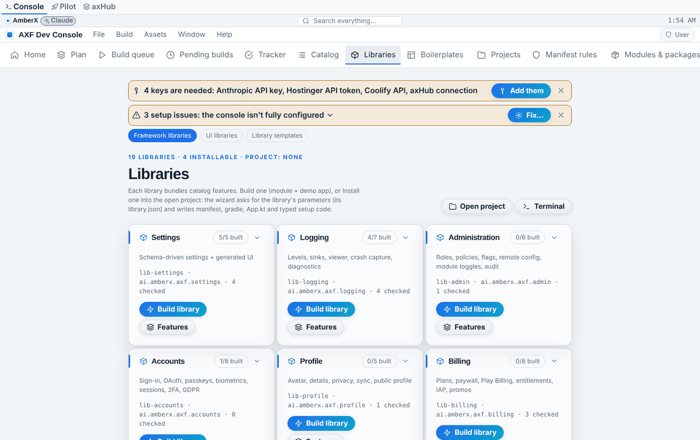
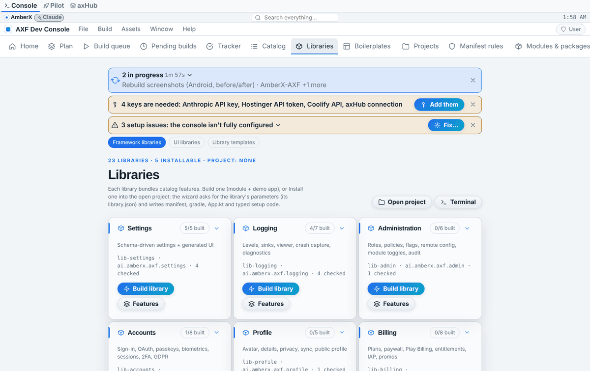
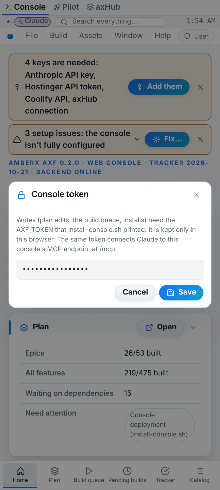
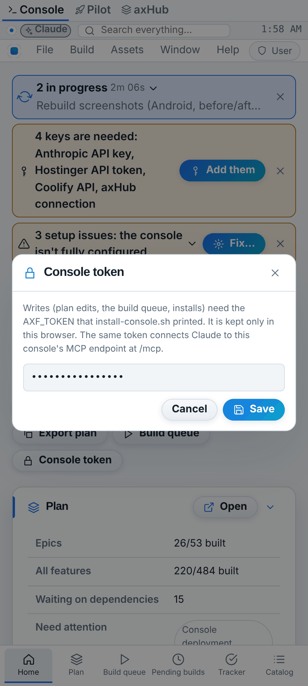
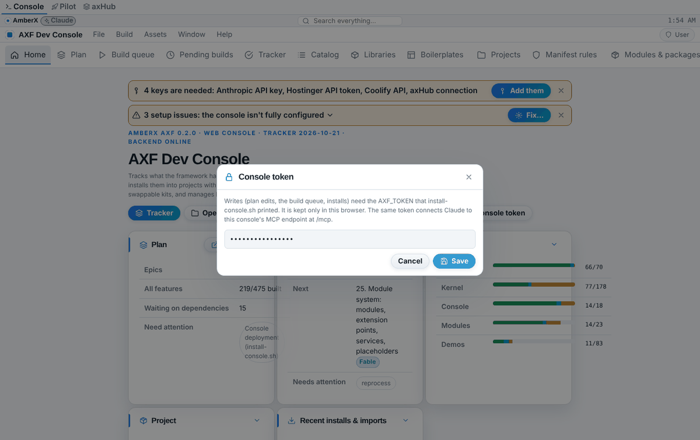
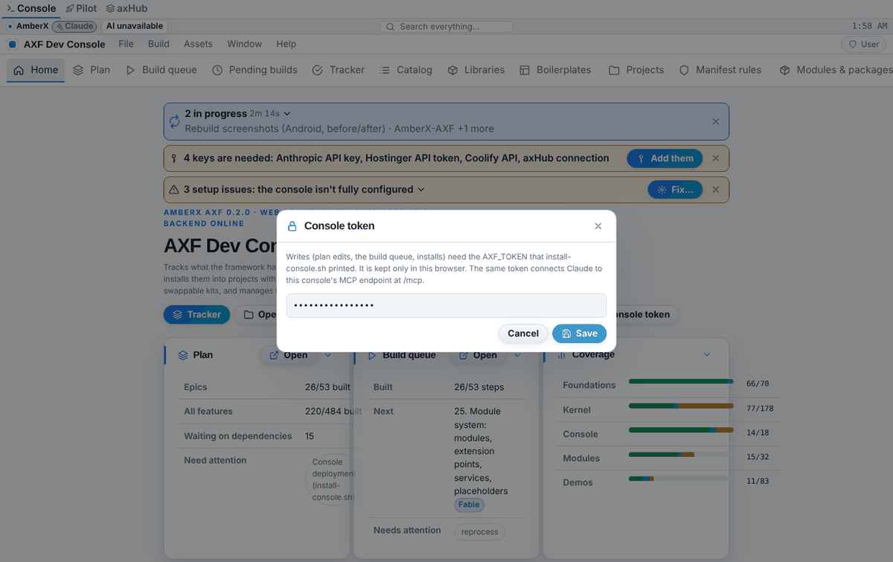

# Harvest — web-client group (Oct 20–21 2026, Opus 5.5)

Branch `harvest/h-web-client` (base `6406c87`). Three items from the harvest plan (row 10 SSE + API client, row 13 typed
catalog models + catalog-driven LibrariesView).

## What moved

| Item | From (copies) | To (one source) |
|---|---|---|
| SSE framing + reader | `framework/core/assistant.ts` (`parseSseBlock/parseSseText/sseLine/readSse`), `apps/console-web/src/changeBatch.tsx` `readEventStream`, `src/alertsTransport.ts` (inline reader + reconnect loop), `plugins/agent-manager/web/api.ts` `streamWorkflow` (inline reader) | `framework/core/sse.ts`: `parseSseBlock`, `parseSseText`, `sseLine`, `sseJson`, `readSse(response \| body, onFrame, signal)`, `SseHttpError`, `followSse(open, onFrame, opts)` (reconnect, 2 s doubling to 60 s, reset after a stream opens), `sseBackoffMs` |
| Token store | `src/api.ts` `getToken/setToken/TOKEN_CHANGED`, `src/plugins.ts` (direct localStorage read), `src/pluginLifecycle.tsx` (direct read) | `framework/libs/apiclient/client.ts` `createTokenStore`; console instance `consoleTokens` in `src/api.ts` (same key `axf-console:token`, same event `axf:token-changed`; `getToken/setToken/TOKEN_CHANGED` kept as thin exports, so systems-check, plugin-manager, console-terminal… are unchanged) |
| Bearer call + ApiError + standard messages | 9 copied `call()` wrappers: plugins agent-manager, ai-assistant, console-terminal, container-access, feature-assist, snapshot-manager, theme-manager, **fable-rebuilds** (a ninth copy, same code) in `web/api.ts`, mcp-client in `web/index.tsx` | `createApiClient` (call/post/put/patch/del/fetch/download/blob, `ApiError(message, status)`, `STANDARD_MESSAGES`); console helper `pluginApi(folder, label, { tokenHome?, unavailable? })` next to `pluginFetch` in `src/plugins.ts` |
| Token dialog | `src/views/BuildManager.tsx` `TokenDialog` | `TokenDialog` / `tokenDialog()` in `framework/libs/apiclient/index.tsx` (framework `Button` + `fx-*` classes); the console's dialog is now a 6-line wrapper with the same text, toasts and build-queue re-sync |
| Catalog models | `src/api.ts` interfaces (Catalog…, Tracker…, Boilerplate…, LibraryParam, InstallableLibrary + `paramDefaultText/paramToJson/paramError`), `apps/console/.../ConsoleRepo.kt` data classes + hand parsers | `framework/core/catalog.ts` = Kotlin `ai.amberx.axf.kernel.catalog` (`Catalog.kt`): catalog@1, status, tracker@1, library@1, libraries@1, boilerplate@1, boilerplates@1 types + lenient parsers, install-parameter rules, `libraryCards()` / `LibraryCards.of()` |
| Library list | hard-coded `LIBRARIES` (19 entries) in `apps/console/.../views/LibrariesView.kt` **and** the identical copy in `apps/console-web/src/views/Libraries.tsx` | data: catalog modules items now carry `library: { module, id, label, description, features }` (9 items added for libraries the old lists named but the catalog didn't: m.browser (built), m.editor, m.github, m.work, m.notifications, m.sensors, m.files, m.charts, m.plugins (planned); m.editor moved before m.ai to keep the old order), plus every library@1 and every `lib-*` module in the tracker |

## Who uses it now

- `framework/core/assistant.ts` imports the SSE framing and re-exports it (assistant@1 API unchanged; `readSse(body, onEvent)` of the assistant contract is now `readStreamEvents`; nothing outside the file used the old name).
- Console web: `changeBatch.tsx` (`readEventStream` = `readSse` + `sseJson`), `alertsTransport.ts` (`followSse`, 30 s poll kept), agent-manager `streamWorkflow` (`readSse`), ai-assistant streams via `HttpAssistantClient` → shared reader; its JSON calls via `pluginApi` (only its SSE reading and call wrappers changed; `test.py` 137 still passes).
- Console web token: `api.ts`, `plugins.ts` (`pluginFetch` builds headers with `authHeaders(consoleTokens)`), `pluginLifecycle.tsx`, Token dialog.
- Console web types: `api.ts` re-exports the catalog types under the old names (`Status`, `Suggestion`, `InstallableLibrary`, `STATUSES`, `paramDefaultText`, …) and parses every load with the contract parsers; `store.tsx` exposes `libraryCards`; `Libraries.tsx`, `DemosModules.tsx`, `Wizards.tsx` read it.
- Android console: `ConsoleRepo.kt` models are typealiases to `kernel.catalog` (views keep their imports), loading uses `Catalog/Tracker/LibrariesIndex/BoilerplateIndex/Boilerplate.fromJson`; `LibrariesView.kt` + `BoilerplatesView.kt` (`inferModules`) use `repo.libraryCards()`.
- `apiclient` boilerplate installs the library (`libraries: [{ library: "apiclient", params: { tokenKey } }]`).

## Deleted

`LIBRARIES` / `LibraryDef` (Kotlin, 19 entries) and `LIBRARIES` (TS, 19 entries; `LibraryDef` is now an alias of `LibraryCard`); the console's own catalog interfaces and param helpers; the three inline SSE loops; nine `call()` bodies; the console's localStorage token code (3 places); the console's hand-written TokenDialog body; ConsoleRepo's model classes and hand parsers.

## Contracts / fixtures added

- `framework/spec/fixtures/catalog.json` (new), generated by `gen-fixtures.mts` from `framework/spec/catalog-samples.json`: a **frozen** snapshot of the real files (catalog modules + lib items, status, tracker, libraries.json, 3 boilerplates + index) plus lenient cases, so the fixture only moves when the parsers do. Replayed by `framework/spec/check-web-client.mts` (TS) and `CatalogConformanceTest` (Kotlin, 8 tests). All other fixtures unchanged (`git diff --quiet framework/spec/fixtures` clean; assistant@1 SSE cases replayed through the shared parser).
- `framework/libs/apiclient/library.json` (library@1, web port, placeholders `axf.apiclient.android`, `axf.apiclient.refresh`), registered in `libraries.json` by `tracker.mjs`.
- `framework/cli/libraries.mjs`: a library whose `ports` has no `android` is installed into the manifest only (no Android module, Gradle line, App.kt or Setup.kt). Libraries without `ports` behave as before.

## Guards kept / tightened (and where copies differed)

- Token only in the Authorization header, never in a URL (alerts stream, all plugin calls) — kept. Token storage wrapped in try/catch everywhere (one copy in `plugins.ts` was; `pluginLifecycle.tsx` was; `api.ts` was) — kept in the store.
- Alerts stream: reconnect 2 s doubling to 60 s, reset only after a 2xx stream with a body, 30 s poll fallback, abort on unsubscribe — identical.
- Change-batch stream: a refused stream throws the server's `detail` or `request failed (N)` — identical text (now an `SseHttpError`, still an `Error`).
- The nine `call()` copies were identical except the 404 subject and mcp-client's 401 hint ("Home → Console token") and fable-rebuilds' 404 sentence ("is switched off or…"): each keeps its exact message through `pluginApi` options.
- SSE: the old console loops split `data: ` lines into separate events and required the space; the shared parser follows the assistant@1 rules (multi-line data joined, space optional, comments skipped, CRLF). No console server sends multi-line data, so behaviour is the same.
- **Stricter (both ports now agree):** install-parameter numbers accept plain decimals only (old TS took `0x10`/`Infinity`, old Kotlin took `6d`); error text formats bounds the same (`≥ 1`, `≤ 0.5`); `recommended` must be a real boolean on both ports (old Kotlin accepted `"true"`); download file names from Content-Disposition can't contain `/` or `\` (Build Pilot's copy allowed any).
- Android: a boilerplate saved from the console now keeps its `libraries` and `screenshots` (the old `toJson` dropped them).

## Tests before → after

| Check | Before | After |
|---|---|---|
| `axf validate --framework` / tracker `--check` / `plugins.mjs --check` / `project.mjs validate --all` / `check-theme` (206 → 208 files) / project fixtures | pass | pass |
| `check-alerts` / `check-widgets` 93 / `check-mcp` 164+210 / `check-plugin-inventory` / MCP Python 210 / plugin catalog 27 | pass | pass |
| `check-web-client.mts` (new) | — | 616 |
| Kotlin `CatalogConformanceTest` (new) | — | 8/8 with a local kotlinc 2.0.21 + kotlinx-serialization 1.6.2 + JUnit 4 (explicit-API mode); `ConsoleRepo.kt` compiled against it with Context/JsonDocumentStore stubs. The Compose views are written without a compiler: CI compiles them |
| Python: server tests + 13 plugin `test.py` | all pass except `test_wall_users` (no dist) | all pass, incl. `test_wall_users` 56 (dist built); ai-assistant failed once on "closed session's log removed" (server-side timing, untouched code) then passed 4/4 |
| plugin-lifecycle check (16 plugins) | clean | clean |
| console `tsc --noEmit` + `vite build`; `framework` `npm run check:libs` | pass | pass |
| `axf validate apps/console-web` / `apps/console` | valid | valid |
| `axf init … --boilerplate apiclient` (android-compose, react-ts) | — | ok (manifest only) |

## Screenshots (web; Android are captured by CI)

The Libraries page now lists 23 libraries (lib-lock, lib-mcp, lib-voice, apiclient appear by themselves; 5 installable). The token dialog is unchanged.

| | Before | After |
|---|---|---|
| Libraries (phone) |  |  |
| Libraries (desktop) |  |  |
| Token dialog (phone) |  |  |
| Token dialog (desktop) |  |  |

## Left for later

- Python catalog parsers (the console server reads the JSON raw; no Python catalog contract yet) and an Android port of apiclient (placeholder in its library.json).
- More console wrappers that could use `pluginApi`/`createApiClient` but word their messages differently (left as they are): systems-check (`SystemCheck.tsx`, `WhatsNew.tsx`, `panels.tsx`), plugin-manager `InstallView.tsx`, project-wizard, session-checkin, approvals-banner, `pluginLifecycle.tsx` `api()`, `alertsTransport.ts` `call()`.
- `store.tsx` still follows `/api/events` with EventSource (no token involved).

## Build Pilot adoption (read-only here; for a Build Pilot session)

1. Re-bake the framework into `src/axf` (at least `core/sse.ts`, `core/catalog.ts`, `core/assistant.ts`, `core/index.ts`, `libs/apiclient/`). `HttpAssistantClient` then reads streams through the shared reader with no code change.
2. `src/pilot/api.ts`:
   - `export const pilotTokens = createTokenStore({ key: 'build-pilot:token' });` `getToken = () => pilotTokens.get()`, `setToken = (t) => pilotTokens.set(t)`; delete `TOKEN_KEY`.
   - `export { ApiError } from '@axf/libs/apiclient';` (same shape: message + `status`).
   - `const client = createApiClient({ url: (p) => `/api/${p}`, tokens: pilotTokens, preferDetail: true, messages: { unauthorized: 'Set the Build Pilot token first.', unreachable: 'The Build Pilot server is not reachable.', failed: (s) => `Request failed (${s}).` } });` and `const call = client.call`. `preferDetail: true` keeps Build Pilot's rule that a server `detail` wins over the 401 text. One difference: an empty 2xx body returns `{}` instead of `null` (check callers of routes that answer 204).
   - `authFetch(url, init)` → `fetch(url, { ...init, headers: authHeaders(pilotTokens, init), cache: 'no-store' })` (it takes full URLs for the assistant client).
   - `apkDownload(id)` → `client.download(`projects/${encodeURIComponent(id)}/apk/file`, 'app-debug.apk')` (same `Download failed (N).`/detail text; a 401 without detail now says "Set the Build Pilot token first.").
   - `screenshot()` → `URL.createObjectURL(await client.blob(path, undefined, /^image\/(png|jpeg|webp)$/))`; wrap it to keep the old texts (`Screenshot not available (N).`, `Not an image.`).
3. `src/dialogs.tsx`: replace `TokenDialog` with `function PilotTokenDialog({ close }) { const pilot = usePilot(); return <TokenDialog tokens={pilotTokens} close={close} label="Token" description={<>Paste the token set as <code>BP_TOKEN</code> on the Build Pilot server. It stays in this browser.</>} allowForget requireValue saveIcon="lock" autoFocus onChange={() => pilot.reload()} />; }` (the field becomes monospace).
4. `src/pilot/contract.ts`: `CatalogBoilerplate` → `Boilerplate` from `@axf/core/catalog` and map `api.catalog()`'s `boilerplates` through `parseBoilerplate`; `categories` → `BoilerplateIndex['categories']`. Build Pilot's `libraries` rows have `ports: string[]` (server-shaped), unlike library@1's `ports` object: either keep that row type, or have the server pass library@1 through and use `LibraryDescriptor` (`Object.keys(lib.ports ?? {})` where a list is needed). `templates`, `buildOptions`, `assets`, `appDefaults`, `libraryTemplates` stay Build Pilot's own.
5. Run Build Pilot's tests and `npx tsc --noEmit`.
