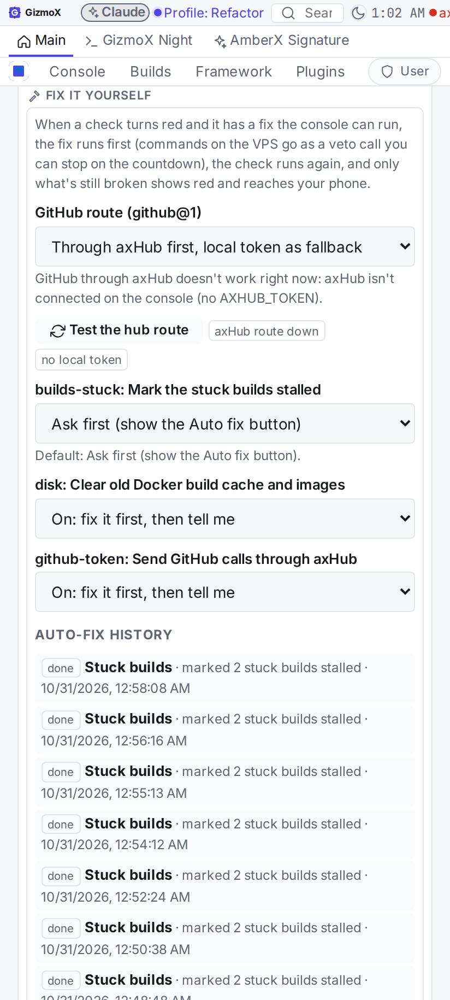
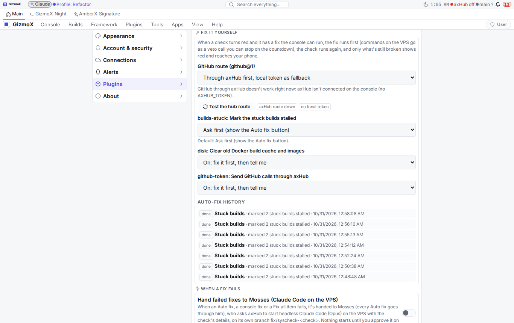

# Live key + health checks in the banners (Angel `live-key-checks`, Oct 30 2026)

Brett (voice): the console's `GITHUB_TOKEN` went dead (GitHub 401) and nothing told him. "You need to make sure things
like that go into one of the banners. I need to see that kind of shit."

Built in the systems-check plugin (it owns both the Keys banner and the systems check banner). Details and the
health@1 API: the plugin README (section *Live key + health checks*). Rule:
`_claude/shared/rules/RULES.md` → *Broken = a banner item with a fix*.

## What shows
- **Keys banner** turns red when a key is dead, expired or under-scoped: "GitHub token is broken", what broke, what it
  breaks, since when; **Fix** (paste a new one, tested before it's saved) and **New key** (GitHub's token page,
  pre-filled with Contents / Pull requests / Actions / Workflows). Amber a week before the GitHub token expires.
- **Systems check banner** says "N broken: …" with each item's *Breaks:* line and since-time: stuck builds (no heartbeat
  30 min, launches that exited at once), git push credentials on the VPS checkout, CI on main, containers in a restart
  loop, disk over 85%, hub calls denied or expired, ntfy, the push path to AmberX, Claude sign-in, OpenAI/ElevenLabs.
- Every new red item is pushed once to AmberX (console alert `system:<id>`); green again closes it.

## Screenshots (fake dead GitHub token, scratch console)
| Phone | Desktop |
|---|---|
|  |  |
|  |  |

Taken with `framework/cli/rebuild-shots.mjs` (`AXF_APPEARANCE_HUB=off`). In headless Chromium the banner strip kept
`data-fx-empty="on"` although its banners had content (framework `useStripEmpty`, `framework/react/components/Slots.tsx`),
so the shots add a style that shows the strip anyway. Worth a look in a real browser: if the strip ever hides real
banners there, nothing here can be seen.

## Findings on this checkout while testing
- `git push --dry-run` from this worktree fails: no GitHub credentials for pushing (the new git-push check reports it).
- The change log has builds with no heartbeat for over 30 minutes (the stuck-builds check lists them).

## Fix it yourself (section 8, Oct 31 2026)
- Rule (shared RULES.md, near the top, and CLAUDE.md): fix what the tools can fix, as a veto call with a plain reason,
  then tell Brett; ask only for his hands or a real choice, and then as a banner item with the steps.
- health@1 auto-fix: run first, amber while fixing, red only if still broken; per check on / ask first / off; history +
  change log. Auto-fixes: dead GitHub token → hub route, disk → Docker clean-up (veto call); stuck builds → stalled is ask-first by default (closing entries is Brett's call).
- github@1: framework `axf_server/github_hub.py` (`HubGitHubClient`, `ROUTES`, `HubLink`) + `axf.github@1` in the
  systems check. Hub first, local fallback (or reversed). Only read-only hub tools are routed: axHub's github service
  has no merge or branch-delete tool and its writes need approval, so auto-merge and branch cleanup still need a working
  local token until the hub adds them (axHub follow-up).
- Screenshots (scratch console, no hub token): Settings → Systems check → Fix it yourself.

  | phone | desktop |
  |---|---|
  |  |  |
- Tests: framework `axf_server/test.py` 390 (20 for github_hub, fake hub + fake GitHub: routes, typed args, pagination
  trailer → Link, hub down / hub token refused / hub's GitHub 401 / approval-held → local, 404 stands, local-first
  401 → hub), systems-check `test.py` 215 (31 new: auto-fix flows, veto parsing, github@1 with a fake hub).

## Follow-ups
- Push banner, auto-merge, branch cleanup, CI helpers: build their client from `axf.github@1` (orchestrator s12, owned
  by `claude/pr-only-merge`; don't edit push-banner from this build).
- axHub: add `pulls/merge` and `git/delete-ref` to its github service (allow policy for the console's client) so those
  writes can go through the hub too.
- After `claude/pr-only-merge` lands: move the push banner's token check onto health@1 (orchestrator step s7).
- enterprise-branding (`claude/enterprise-branding-3`) restyles these banners: the UI uses framework controls, theme
  tokens and the existing `axp-systems-check-*` classes only.
