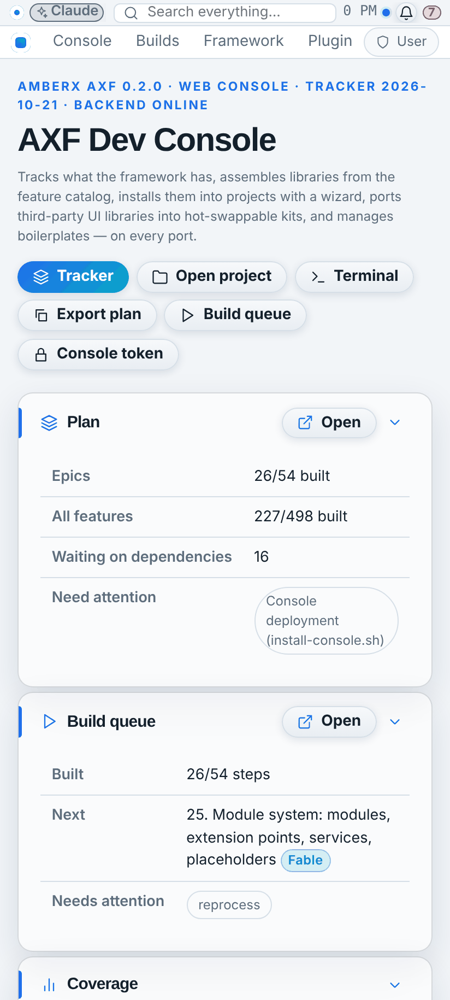
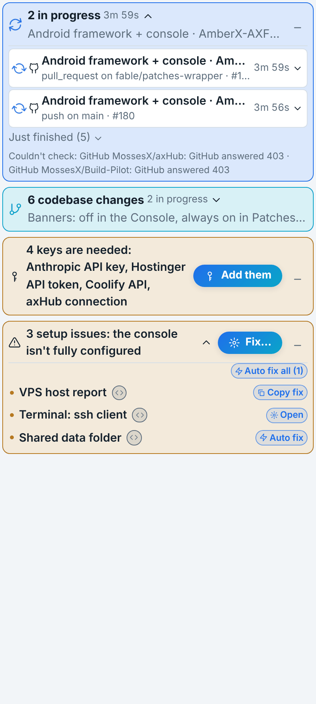
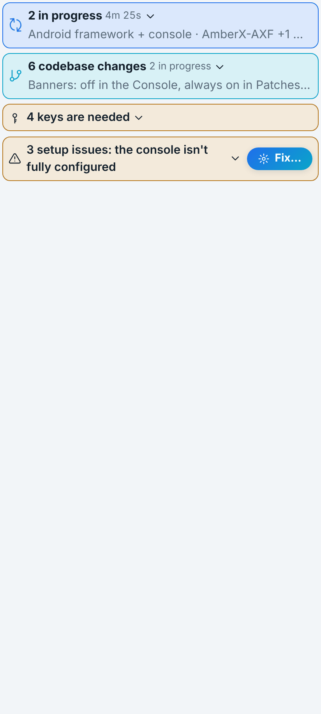

# Banners live in Patches (Oct 21 2026, Opus)

Brett: "Disable all banner plugins from console and enable them in Patches so they are always there regardless what
app you are in. Put a _ underneath the x on codebase changes to minimize banner. Replace the x with an _ for the 2
building banners and any error banners. All banners launch expanded."

## How it works
- **Console page:** plugin banners (codebase changes, build manager, activity, approvals, systems check, keys,
  What's new) no longer render on the console page. The plugins stay installed (servers, menus, views, settings
  untouched). Switch back: Settings → Plugins → Banners → **Show banners in the console too** (`console.banners.inConsole`,
  default off). The console's own menu-rescue note still shows on the console page.
- **Banner strip:** `https://console.amberxai.com/?axf-strip=banners` is the same console app rendering only the
  plugin banners (`src/bannerStrip.tsx`). It waits for axHub's look like the rest of the console.
- **Patches:** `views/BannerStrip.kt`: a web view above the banner and tab row (all tabs), loaded once the Console
  tab has reached the console (session good), console origin only, links out open in the browser. Height follows the
  banners through the `AxfPatchesStrip.height(px)` bridge (0 = hidden), capped at 45 % of the screen.
  Settings → Patches → **Banners above every tab** (`patches.banners`, default on).
- **Taps:** what a banner opens (an action a tap dispatches, any dialog, any view — an approval opening by itself
  included) goes to the Console tab over a same-origin BroadcastChannel (storage-event fallback) and
  `AxfPatchesStrip.open("console")` brings that tab up. The Console tab only runs relayed messages while it is
  embedded in Patches (`rt.embedded.host === 'patches'`).

## Buttons
- New framework icon `minimize` (an underscore, `framework/react/components/Icon.tsx`).
- **Activity** and **Build manager** (the two building banners), **Systems check** and **Keys needed** (error
  banners): the ✕ is now **_**, which folds the banner to its one-line summary (tap the summary to expand). It never
  hides the banner.
- **Codebase changes:** a **_** under the entries' ✕ column (bottom right, in the footer row) folds the list.
- **Every banner launches expanded** (activity, build manager, codebase changes, approvals, systems check, keys,
  What's new). Activity still only appears while something runs or just finished.

Build manager + codebase changes edits sit on top of PR #6 (branch `feat/patches-banners-bm`), since PR #6 rewrote
the build manager's banner.

## Screenshots (web, phone)
| Console page (no plugin banners) | Strip, expanded | Strip, minimized |
| --- | --- | --- |
|  |  |  |

Known gap: the strip sits above Patches' own banner bar (the Compose AppShell has no slot between its banner and
tabs; adding one is framework Android work, on hold). Kotlin written without a compiler: Android CI compiles it.
