# Plan Studio (Oct 30 2026, Opus, Angel orchestrator `plan-studio`, branch `claude/plans`)

Brett (voice, Oct 30): a planning studio to store and view every plan, entered by hand, categorized; every plugin and
app listed with its features checked off as have or planned. Plus (14:20) plain-English AI that edits plans, and
(14:22) voice planning in AmberX "like I'm talking to you".

Plugin: `apps/console-web/plugins/plan-studio/` (plugin-lifecycle@1; targets `axf-console` + `amberx-droid`). <!-- axf-plugin:plan-studio -->

## What's in it

| Part | Where |
| --- | --- |
| Contract `plan@1` (JSON + Markdown body) | `web/plan-core.mjs` (normalize/migrate/validate, categories, totals, diff, versions, templates, Markdown, build link, catalog overlay), `schema/plan.schema.json`, `fixtures/cases.json` → `fixtures/plan.json` |
| Migrations | plan@0 drafts (`name/description/state/tasks`), pending@1 items (`subPrompts` → steps), loose notes; unknown fields kept |
| Store + CLI | `plans.mjs` (`add | list | show [--md] | status | import | export | ai | categories | catalog | sync-builds | api`), one file per plan |
| Catalog discovery | `catalog.mjs`: builtPlugins + plugins.json, every `apps/*` with a project manifest, libraries.json + framework/libs, tracker modules, axHub; gone = seen before, missing now |
| Server | `server/__init__.py`: `state`, `api`, `catalog`, `ai/status`, `ai`; capability **`plans@1`** (`list/get/save/park/ai`) |
| Web | `ui.tsx` (Plans · Catalog · Categories; tree, grid, sub-grids, board with drag, roadmap, reader; search every field, filters, sort, saved views, counts, bulk), `editor.tsx` (sectioned editor), `catalog.tsx`, `capture.tsx` (quick capture), `ai.tsx` (command box + voice panel), `voice.ts` |
| AI | `web/plan-ai.mjs`: rules for common phrasings, the console's `axf.llm@1` for the rest; edits shown as a diff (Apply / Discard), optional apply-at-once with Undo; history note `AI, from: <what was said>` |
| Voice | `web/voice.ts`: turn loop until "I'm done", "undo that", "say that again", yes/no confirm for big edits and Turn into a build; mic through **mic-lease@1** (`globalThis.__axfMicLease`), listening via AmberX native speech else Web Speech; replies via **agent-voice@1** (`axf:agent-voice.say`) when installed, else AmberX native speak / Web Speech |

Where plans live: the hub's shared data `/projects/amberx-axf/_data/plan-studio/` (`plans/<id>.json`,
`history/<id>.json`, `categories.json`, `templates.json`, `views.json`, `catalog-seen.json`). claude.ai sessions:
`axhub.memory_read` / `memory_write`, project `amberx-axf`, area `data`, path `plan-studio/plans/<id>.json`. Off the hub
it's the plugin data folder `.axf-console/plugins/plan-studio/`. <!-- axf-plugin:plan-studio -->

Quick capture: banner **+ Plan**, Builds ▸ New plan…, right-click ▸ New plan…, the global search ("New plan").

Turn into a build: preview the steps (dependency order, model, estimate), then the plan's build is written into the
chosen profile's orchestrator tracker (orchestrator@1 file through `persist.mjs orchestratorPath`, never the
orchestrator plugin's folder); the build carries a note naming the plan, the plan carries `build` + a build link. Every
state load syncs progress: the plan's steps tick as the build's do, and when the build completes the plan is done and its
planned features become have.

Catalog features are read, not copied: plugin.json `provides`/`features`/`targets`, app plugins, tracker items (by
module), and the feature matrix items of a plan's build. Plans add planned features on top. Planned tracker items are
written back through the tracker's path (`framework/catalog/status.json` gets `plan: <id>`, `status: built` once the
plan is done; `tracker.mjs` regenerates).

## Imported (parked)

- **Docs Studio** (`docs-studio`): all 15 steps from `docs-engine-plan.md` on `claude/project-thread-y4x54r` (Fable s1–s3,
  Opus s4–s15, 7 h), the 5 layouts as decisions, category Framework > Docs. Draft PR #159 to be closed with "Moved to
  Plan Studio as the parked plan Docs Studio" (branch kept). Not built.
- **AmberX — Selling It: Product + Installer Plan** (`amberx-selling-it`): the claude.ai artifact couldn't be read from
  the VPS session, so it's the title, the link and a question to paste the text in. Category Product > Installer.
- **ClipX** (`clipx`): the parked clipboard-manager plan from `claude/clipx-plan` (16 steps), category Apps > ClipX.

## Checks

`python3 apps/console-web/plugins/plan-studio/test.py` (15 server checks, then `test.mjs`: 26 checks) · <!-- axf-plugin:plan-studio -->
`npx -y tsx apps/console-web/plugins/plan-studio/test.mjs` · console `tsc --noEmit` + `vite build` · AmberX `tsc`, <!-- axf-plugin:plan-studio -->
`test.mjs` (1990/1990), `vite build` (bundles plan-studio) and a typecheck of the plugin against AmberX's baked
framework · `check-theme`, `check-controls`, `check-plugin-pages`, `plugin-lifecycle check plan-studio`, `menu-reach`,
`plugins.mjs --check` (main profile).

## Screenshots (after; console with AXF_APPEARANCE_HUB=off)

| | |
| --- | --- |
| 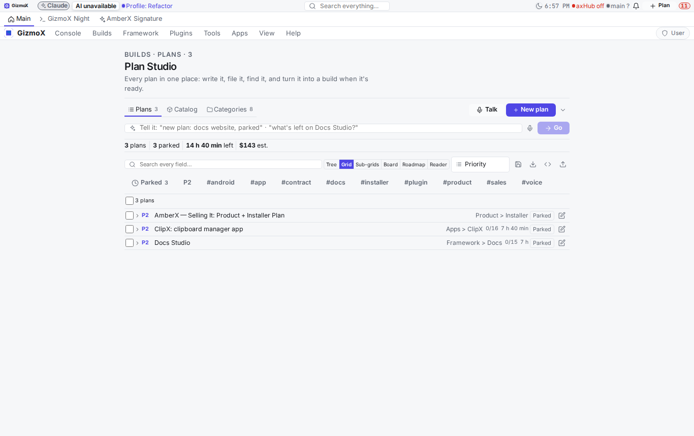 | 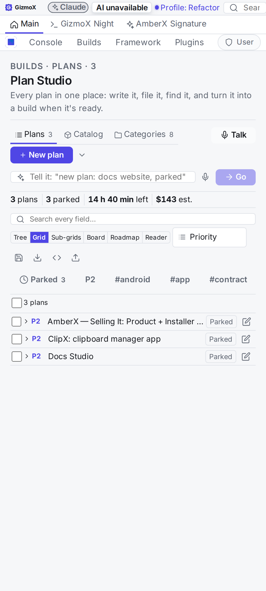 |
| 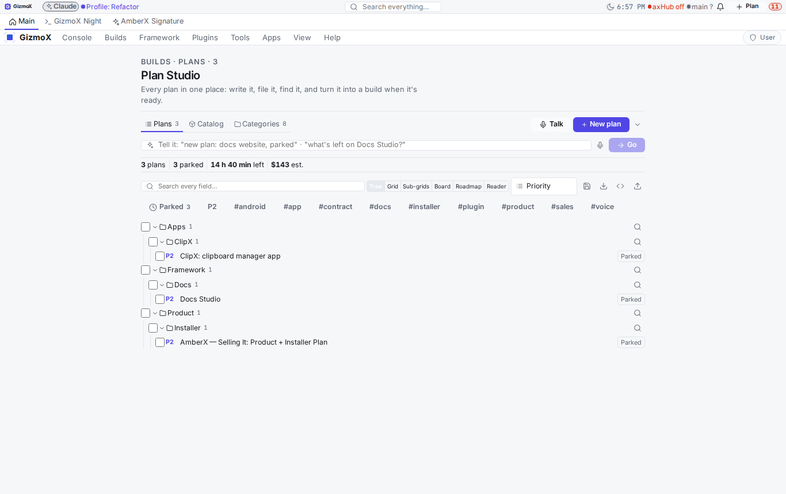 | 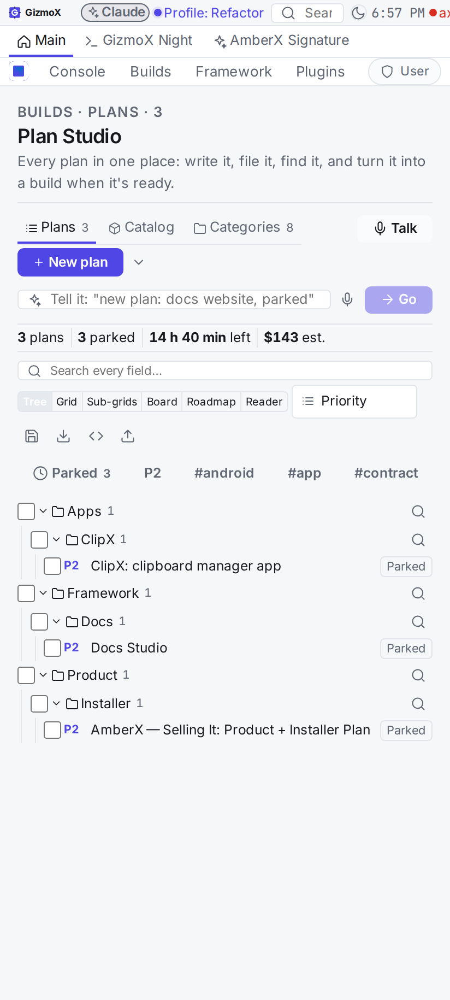 |
| 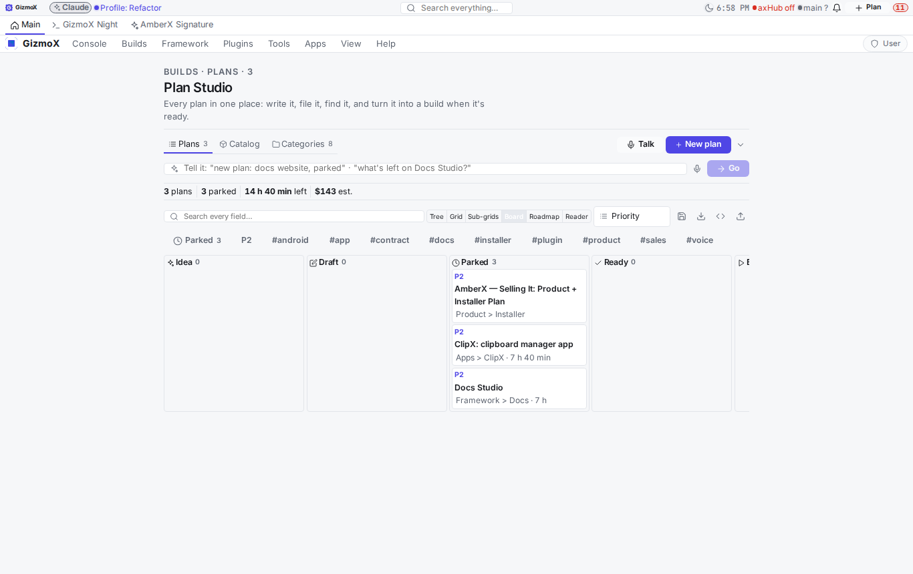 | 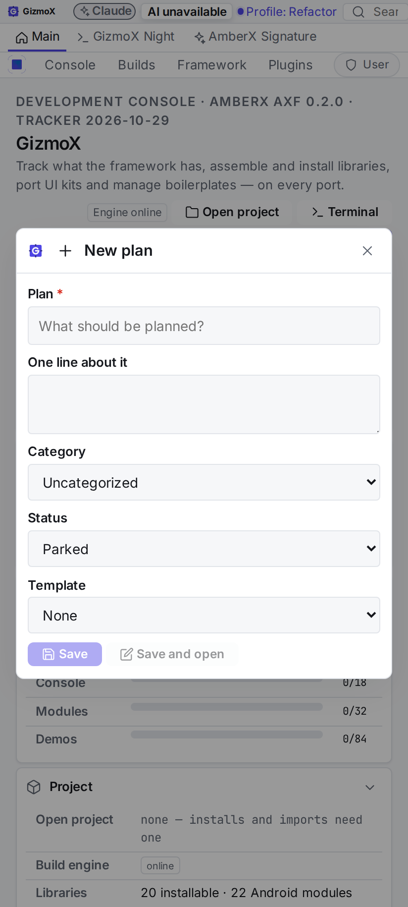 |
| 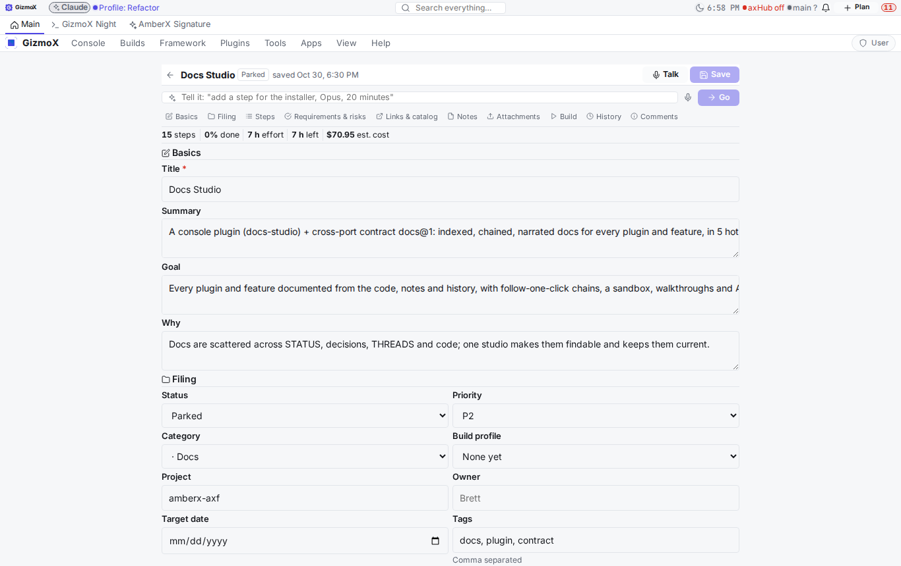 | 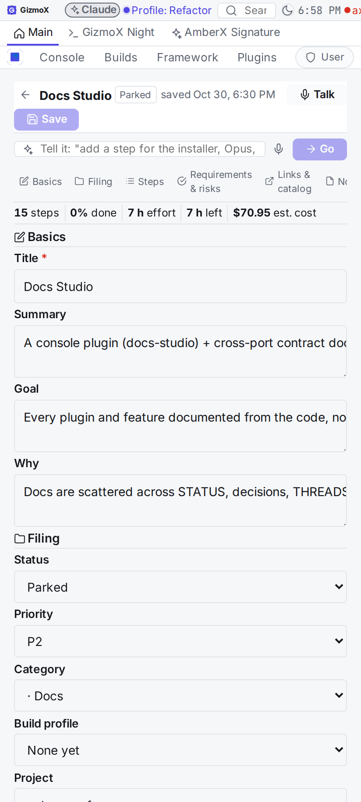 |
| 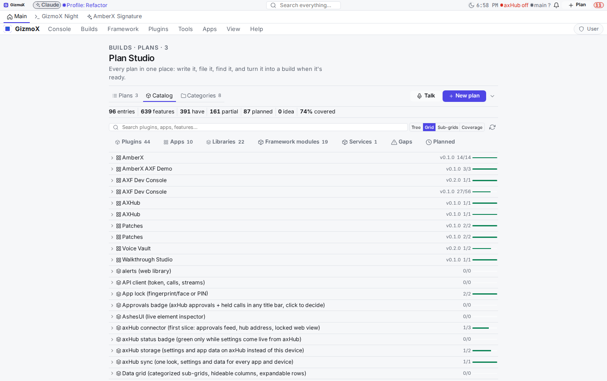 | 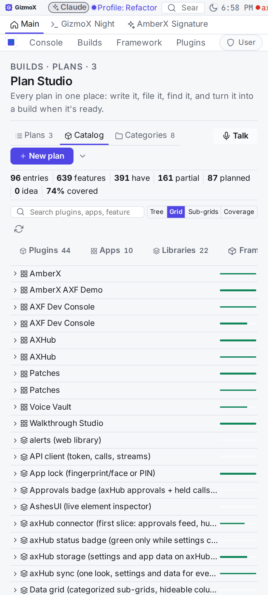 |
| 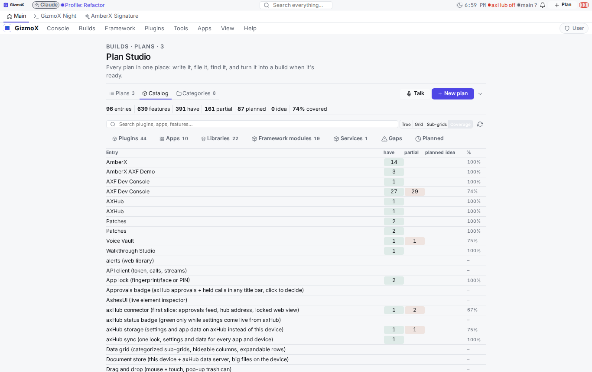 | |

Taken before two small fixes (section chips no longer wrap on a phone; apps show their project id next to the name).

## Known gaps

- No GitHub credentials in the build sandbox: push, PR and closing #159 go through one veto call (see THREADS).
- Agent voice (PR #177) isn't merged: Plan Studio talks to it through `axf:agent-voice.say` when it's installed and
  otherwise uses the device voice; it estimates when agent-voice finishes speaking (no "done" event in agent-voice@1).
- Voice with the screen off relies on AmberX's own hands-free foreground service; Plan Studio's loop runs in the page.
- Attachments are kept inline (data URLs, 2 MB cap each); big files should be links.
- UI Review submission waits until this is on main.
