# Rebuild report — `ai-assistant-plugin` (AI assistant plugin, Fable, Oct 20 2026)

Branch `fable/ai-assistant`. Replaces the Opus build of Oct 18 2026 (`apps/console-web/plugins/ai-assistant`), which was
removed first with `uninstall.mjs --all` (`plugin-lifecycle.mjs check --after-uninstall`: clean) and rebuilt in the same
folder under plugin-lifecycle@1.

## Summary

The assistant is now a **framework contract, `assistant@1`**, with the console plugin as its first host instead of a
console-only plugin. `framework/core/assistant.ts` (web reference) = Kotlin `ai.amberx.axf.kernel.assistant` = the
plugin's `server/contract.py` carry the provider registry (`framework/schemas/ai-providers.json`, one file for every
port), the canonical chat shapes, `ai-conversation@1`, every pure rule the engine applies (secret redaction, history
window, fallback chain, user permissions and clamps, SSE framing, the live-reply fold) pinned by a new fixture, and a
transport-agnostic `AssistantClient` + `HttpAssistantClient` + `watchReply` any AXF app (Build Pilot next) can drop a
chat UI on. Live sessions became an **open host registry** (local built, axHub a typed placeholder, modules add hosts
through `axf.live-host@1`), and an interrupted reply no longer loses what it had said. Every Opus feature and every
security guard survives (111 checks kept, 137 now); `axf.llm@1`, ids, routes, settings keys and data formats are
unchanged, so the agent manager, systems check, Claude badge and feature assist work as before.

## Removed
- The Opus plugin folder (via its own uninstall script) and its doc lines; the in-plugin copy of the provider
  catalog (`providers.CATALOG` literal) and the duplicated rule code (`_wire_history`, `_SECRET`, `_settings_for`,
  param clamps) — now read from the shared registry / `contract.py`.
- The fixed `HOSTS` list in `sessions.py` (replaced by the registry below).
- Nothing user-visible was removed.

## Kept (unchanged behaviour)
- Plugin id, folder, `plugin.json` provides (`axf.llm@1`, `axf.live-sessions@1`), actions `ai-assistant.open` and
  `ai.chat.start`, view `ai-assistant`, dialog `ai-assistant.chat`, settings tab `ai-assistant` (sub-tab of Plugins),
  every route, every settings key, data dir layout and file formats (`ai-assistant-config@1`, `ai-conversation@1`,
  live-session logs).
- `axf.llm@1` API (`profiles()`, `complete(messages, system, profile, model, tools, params)`, `embed()`): byte for
  byte the same calls; the other plugins' self-tests pass unchanged (claude-badge 17, systems-check 56,
  feature-assist 29, agent-manager 92, plugin-manager 52).
- Providers (18 kinds, 3 protocols, streaming, model lists, tests, stored/env keys, fallback chain), chat features
  (regenerate, edit-and-resend, fork, delete, pin/archive/rename/search, export MD/JSON, import, images + text files,
  console context, slash prompts, compare, usage + daily budget, auto-titles, extended thinking, redaction), tools
  (repo list/read/search, time, calculator, SSRF-guarded web fetch), agents via `axf.agents@1` (prompt, tools, memory,
  recorded turns), write-mode badge, change-batch approval cards with undo, batch outcomes in the next turn, the
  Claude Code MCP bridge (`cli_bridge.py`, per-turn 0700 socket, CLI env stripped of every secret, abs-path deny list,
  Edit/Write/Bash off, throwaway jail for plain-chat users), hub users (`wallUsers`, `assistant.*` permissions,
  owner-only conversations, admin-only batches, per-user daily cap, one running reply per user, admin replying with
  the user's rights, plain-text imports for users, trimmed `/status`, `/me`, `/app` page with CSP), live sessions
  (detached replies, SSE with `id:` seq, replay by seq, 409 while running, restart → `interrupted`, close on purpose).
- `safety.py`, `tools.py`, `cli_bridge.py`, `app.html`, `markdown.tsx`: copied as they were.

## Changed
- `providers.py`: catalog loaded from `framework/schemas/ai-providers.json` + `<dataDir>/providers.json` (open
  registry; `reload_catalog()`, `POST /providers/reload`); protocol dispatch through `PROTOCOLS` + `register_protocol`;
  per-kind `maxTokensField`, `noStreamUsage`, `embedModel` come from the registry instead of `if kind == …`.
- `sessions.py`: `SessionHost` base, `PlaceholderHost`, `SessionHosts` registry (`register/get/list/describe/resolve`),
  `LocalHost.on_interrupted` hook, session `owner`; `LiveSessionsService(hosts, local)` gains `register_host()`.
- `store.py`: `schema` field + `migrate()` runner (no steps today), `extra_provider_kinds()`, cached conversation
  index (`_scan`, mtime+size) so listing/search doesn't re-read unchanged files, `tag` filter, `all_tags()`,
  `user_usage_summary()`.
- `__init__.py`: rules delegated to `contract.py`; `_hosts()` merges an `axf.live-host@1` provider; `send_message`
  resolves the host (503 when none is available); `_keep_interrupted` saves streamed text on restart.
- Web: `api.ts` is a thin binding of `HttpAssistantClient` (types re-exported from `@console/axf/core`); `chat.tsx`
  uses `watchReply`/`applyStreamEvent` from the framework instead of its own copy; settings panel wording and
  the Live sessions panel show the contracts and hosts.
- Console bake: `apps/console-web/src/axf/core/{assistant.ts,index.ts}` and `src/axf/schemas/ai-providers.json`
  updated (CI re-bakes anyway).

## Added
- `framework/schemas/ai-providers.json` (`ai-providers@1`).
- `framework/core/assistant.ts` (exported from `core/index.ts`), `framework/spec/ASSISTANT.md`,
  `framework/spec/fixtures/assistant.json` (+ generator block in `gen-fixtures.mts`).
- Kotlin `framework/android/axf-kernel/.../assistant/Assistant.kt` + `AssistantConformanceTest.kt` (written without
  a compiler; CI compiles).
- Plugin: `server/contract.py`; routes `GET /contract`, `GET /tags`, `POST /providers/reload`; export `format=txt`;
  conversations `?tag=`; usage `users`; config keys `keepInterrupted`, `schema`; optional services
  `axf.containers@1`, `axf.live-host@1` declared in `plugin.json`; `AXF_AI_CLI_TIMEOUT`, `CLAUDE_BIN` listed in
  `lifecycle.env`; hooks check `provider-set-up`, `provider-registry`.
- Chat UI: tag chips + per-conversation tags, "live" pill while a reply runs on the host, Continue on an
  interrupted/stopped reply, interrupted marker, `/model`, `/tag`, `/stop`, `/export json|txt`, Escape cancels an
  edit; Live sessions panel: contract chips, Stop/Open per session, host-registry note; Behaviour: per-user daily
  cap + keep-interrupted switch; Usage: per-hub-user table; dialog prop `open` (open a given conversation).

## Contract / API / settings / fixture changes (old → new)
- New contract `assistant@1` (no old one). New fixture `spec/fixtures/assistant.json`; `live-session.json` unchanged.
- `GET /catalog`: `+ protocols[]`. `GET /sessions`: `hosts[]` now from the registry (`describe()`), `active` may be
  `""` when no host is available (was always `"local"`). `GET /usage`: `+ users[]`. `PUT /config`: `+ keepInterrupted`.
- Config file: `+ schema: 1` (written on first save; older files read fine). Session logs: `+ owner`.
- `plugin.json`: version `0.1.0 → 0.2.0`, `provides + action:ai.chat.start`, `optional + axf.containers@1,
  axf.live-host@1`, `mentions + framework/spec/ASSISTANT.md`.
- Web library `provides`: `['axf.ai-assistant'] → ['axf.ai-assistant', 'axf.llm@1', 'axf.live-sessions@1']`.
- Compatibility: nothing an existing app or plugin calls changed shape. A migration runner exists but no step was
  needed. A plugin that provided a host by editing `sessions.HOSTS` (none did) would now call `register_host`.

## Tests
- Before: Opus `test.py` 111/111 (fake providers, fake CLI, uvicorn hang-up test).
- After: `test.py` **137/137** — the 111 kept, plus: catalog = shared registry, protocols, `/contract`, 12 contract
  fixture checks (redaction, history windows, orphan tool results, chain, permissions, user settings, clamps, titles,
  summaries, owner kinds, SSE, backoff), tags listed/filterable, txt export, interrupted reply keeps its text (and
  only once), external host via `axf.live-host@1` (active, no fallback notice, reply runs there), `register_host` /
  unregister through `axf.live-sessions@1`, per-user usage, schema version, lifecycle files.
- Kotlin `AssistantConformanceTest` (6 tests over the same fixture) — written without a compiler; `KernelTest`/
  `LiveSessionConformanceTest` untouched.
- Also run: `tsc --noEmit` + `vite build` (console), `check-theme` (186 files), `axf validate --framework`,
  `tracker --check`, `plugins --check`, `plugin-lifecycle check ai-assistant` (clean), `check-alerts`,
  `check-project-fixtures`, `gen-fixtures`, the five dependent plugins' self-tests, console API boot with the plugin.

## Security
- Every Opus guard kept (see Kept): console token on every route, 404 when disabled, never on MCP; keys 0600 and
  never returned; masked headers; secret redaction (now the shared `SECRET_PATTERN`); CLI env/deny/jail rules;
  calculator and literal-search bombs; SSRF-pinned fetch; owner-only conversations; admin-only batches; signed wall
  headers; param clamps for users (now `clampUserParams`, fixture-checked on every port).
- Tightened: an external session host is only used when it is *available* (`resolve`), and a broken host can't
  break the host list; a chosen-but-missing host answers 503 instead of silently running locally without notice;
  per-user cap is editable (and visible) in the UI so it can't be forgotten; interrupted text is written only when
  the reply had no `done` and only once.
- Added surface: `POST /providers/reload` (admin-only by the usual route rule, reads two JSON files, no network);
  `<dataDir>/providers.json` is inside the 0700 data dir, so only the console owner can add provider kinds.

## Screenshots (web, no provider configured)
| | before | after |
| --- | --- | --- |
| Chat page (desktop) | 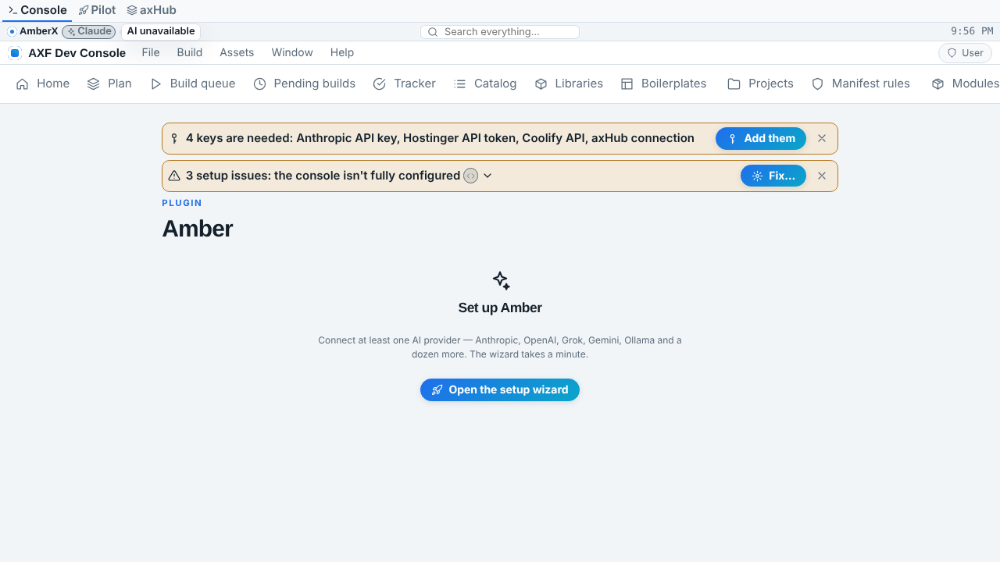 |  |
| Chat page (phone) |  | 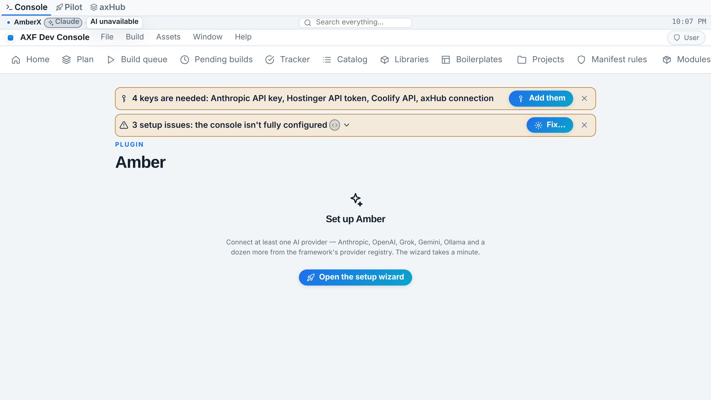 |
| Chat dialog (desktop) | 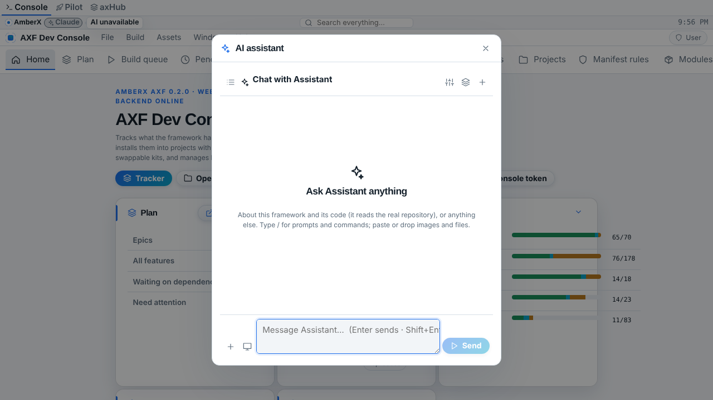 |  |
| Chat dialog (phone) | 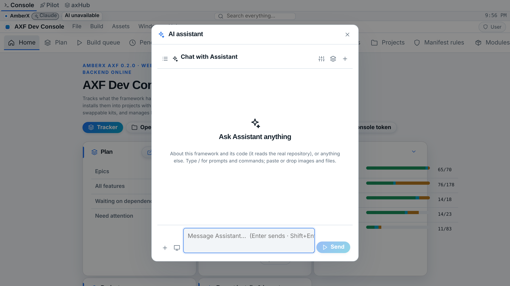 | 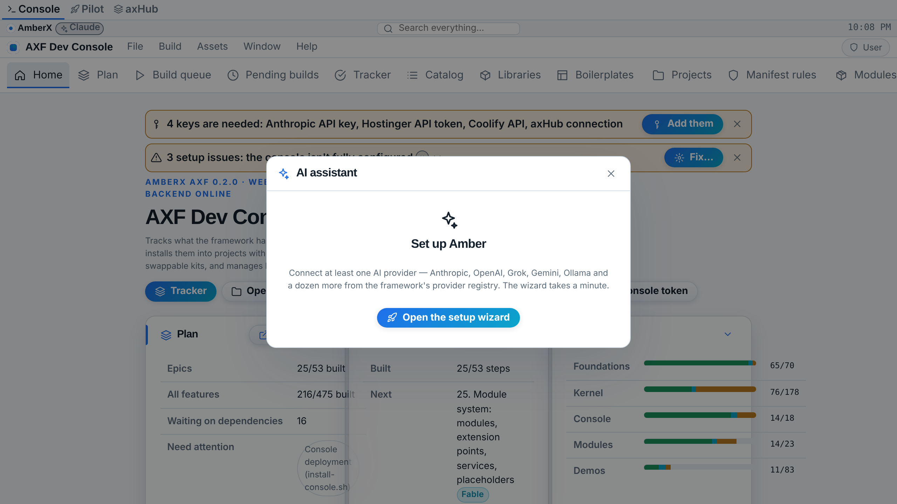 |
| Settings sub-tab + wizard (desktop, full page) | 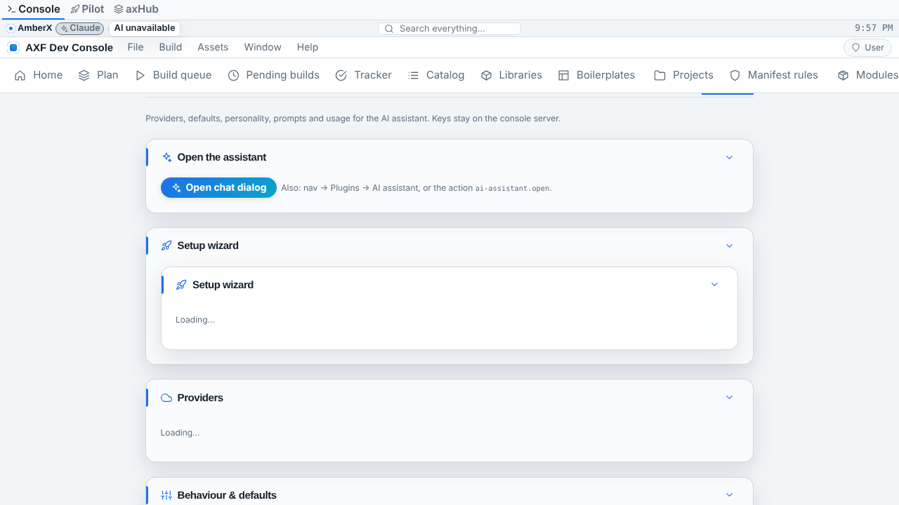 | 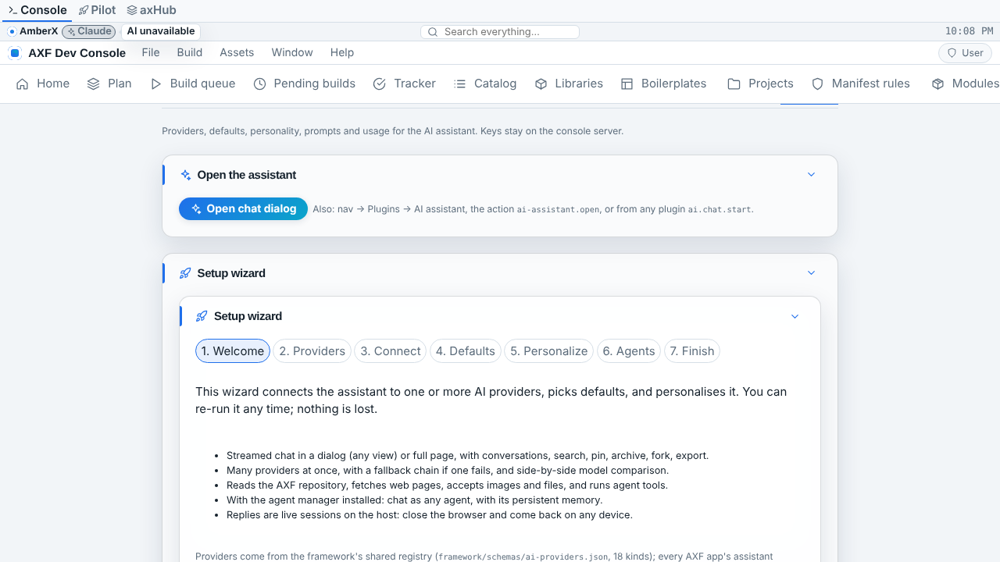 |
| Settings sub-tab + wizard (phone, full page) | 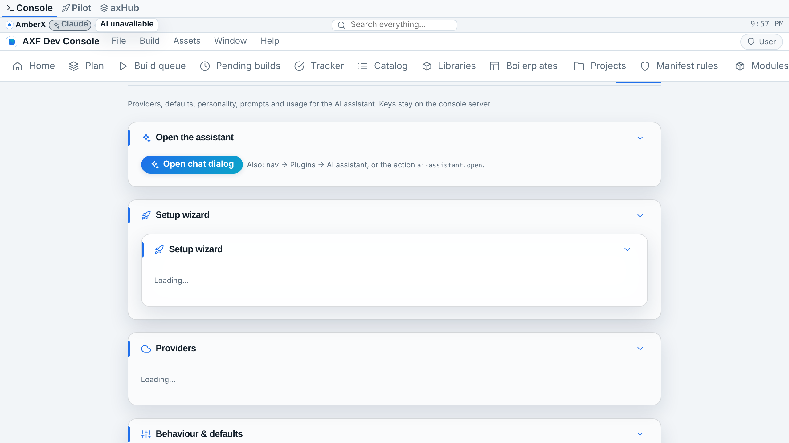 | 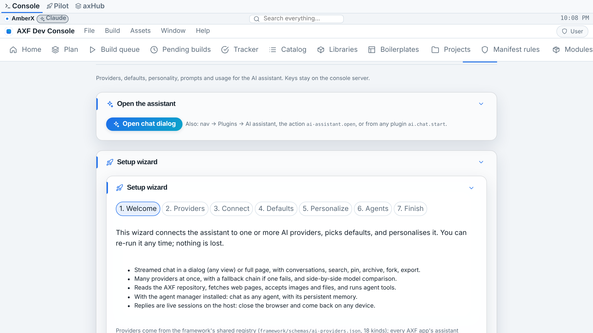 |
| Live sessions panel (desktop) | 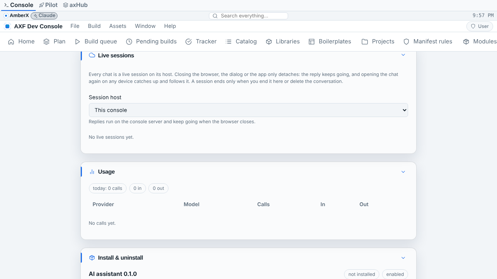 | 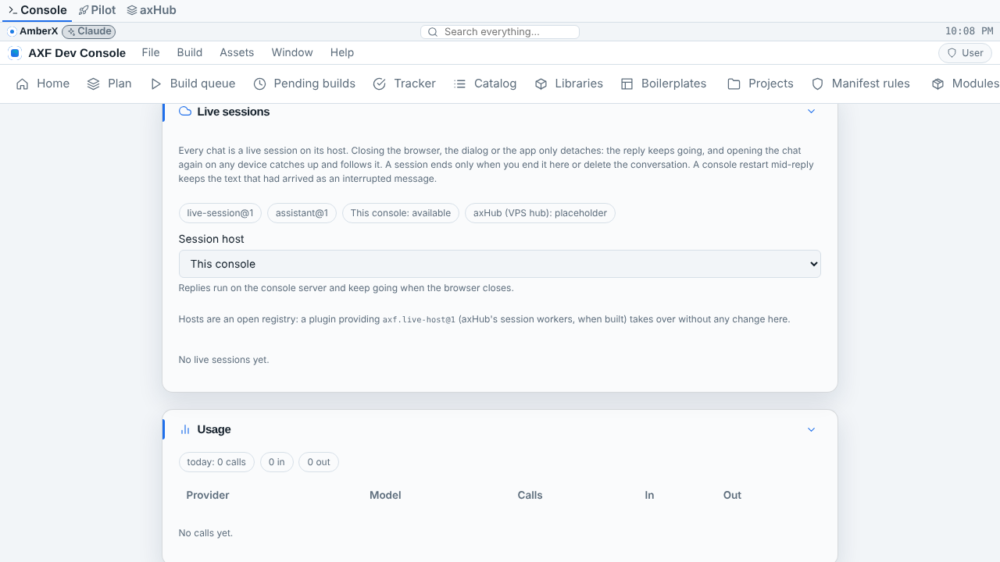 |
| Live sessions panel (phone) | 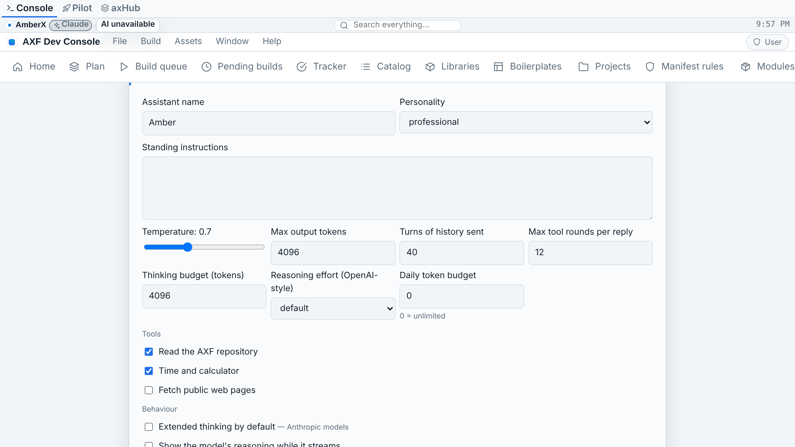 |  |

Visible changes: the chat page/dialog setup state mentions the shared registry (same layout); the Live sessions
panel shows contract chips, host availability and the host-registry note. The chat with a provider (tags row,
live pill, Continue, interrupted marker) needs a configured provider and isn't captured here.

Android: no screens affected (kernel contract + `AssistantClient` only, no Compose UI yet) — Android screenshots
pending CI once an Android assistant UI exists.

## Known gaps / placeholders
- `axhub` session host is a `PlaceholderHost` until axHub's workers provide `axf.live-host@1`.
- Resuming a reply mid-generation after a restart: the text is kept and "Continue" asks the model to carry on; the
  model run itself isn't resumed.
- Android: `Assistant.kt` ships types, rules, SSE and the `AssistantClient` interface; no implementation or UI.
  Kotlin written without a compiler — check the "CI build errors" issue.
- Build Pilot has not yet been switched to `HttpAssistantClient` (pending `build-pilot-agents`).
- Migration runner has no steps (formats unchanged); the first format change adds one.
