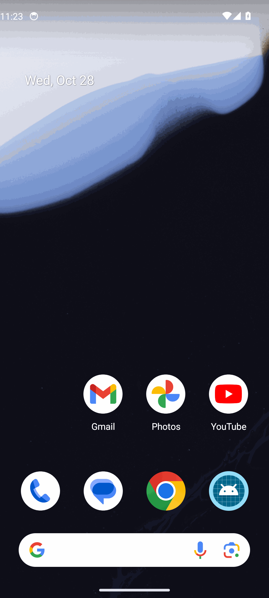
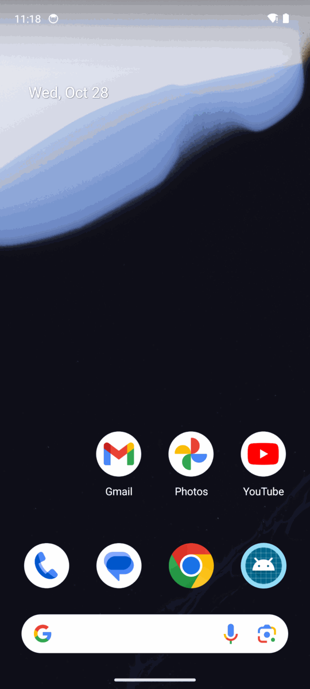
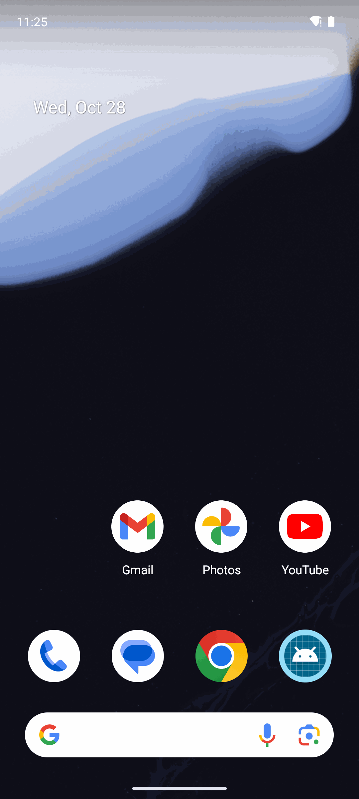
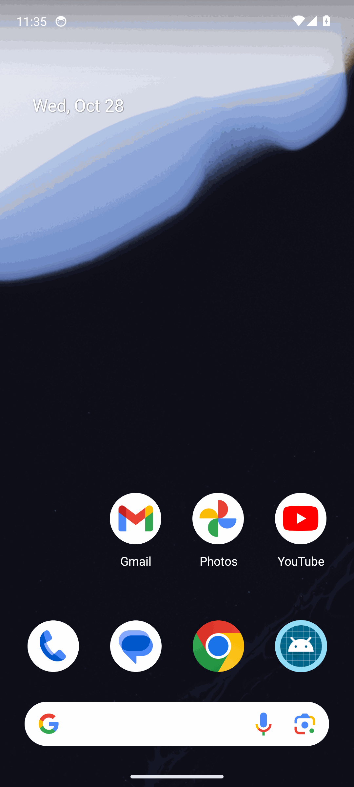

# Android screenshots — before / after

Captured automatically by `.github/workflows/rebuild-shots.yml` on an API 34 emulator (Pixel 6, demo-mode status bar).
Before = `9e20366611cc`, after = `2f816072b941` — [run](https://github.com/MossesX/AmberX-AXF/actions/runs/40676414168). ✓ = the capture reached that screen through the app's own nav; ? = it didn't (e.g. an app lock in front).

## ax-notes

| Screen | Before | After |
|---|---|---|
| Start | — | ✓  |
| Notes | — | ?  |
| Speak | — | ?  |
| Lists | — | ?  |
| Settings | — | ?  |

## axf-console-android

| Screen | Before | After |
|---|---|---|
| Start | ✓  | ✓  |
| Home | ?  | ?  |
| Tracker | ?  | ?  |
| Features | ?  | ?  |
| Libraries | ?  | ?  |
| Demos | ?  | ?  |
| Modules | ?  | ?  |
| Boilerplates | ?  | ?  |
| Assets | ?  | ?  |
| Components | ?  | ?  |
| Designer | ?  | ?  |
| Layouts | ?  | ?  |
| Roles | ?  | ?  |

## axhub-android

| Screen | Before | After |
|---|---|---|
| Start | ✓  | ✓  |
| Approvals | ?  | ?  |
| Hub | ?  | ?  |
| Apps | ?  | ?  |
| Services | ?  | ?  |
| Jobs | ?  | ?  |
| Audit log | ?  | ?  |
| Vault | ?  | ?  |
| Users | ?  | ?  |
| Projects | ?  | ?  |
| Devices | ?  | ?  |
| Settings | ?  | ?  |

## demo-ai

| Screen | Before | After |
|---|---|---|
| Start | — | ✓  |
| Home | — | ?  |
| Components | — | ?  |
| Assets | — | ?  |
| Account | — | ?  |
| Settings | — | ?  |

## demo-onboarding

| Screen | Before | After |
|---|---|---|
| Start | — | ✓  |
| Home | — | ?  |
| Components | — | ?  |
| Assets | — | ?  |
| Account | — | ?  |
| Settings | — | ?  |

## demo-overlay

| Screen | Before | After |
|---|---|---|
| Start | — | ✓  |
| Home | — | ?  |
| Components | — | ?  |
| Assets | — | ?  |
| Account | — | ?  |
| Settings | — | ?  |

## demo-speech

| Screen | Before | After |
|---|---|---|
| Start | — | ✓  |
| Home | — | ?  |
| Components | — | ?  |
| Assets | — | ?  |
| Account | — | ?  |
| Settings | — | ?  |

## demo-triggers

| Screen | Before | After |
|---|---|---|
| Start | — | ✓  |
| Home | — | ?  |
| Components | — | ?  |
| Assets | — | ?  |
| Account | — | ?  |
| Settings | — | ?  |

## demo-voice

| Screen | Before | After |
|---|---|---|
| Start | — | ✓  |
| Home | — | ?  |
| Components | — | ?  |
| Assets | — | ?  |
| Account | — | ?  |
| Settings | — | ?  |

## patches

| Screen | Before | After |
|---|---|---|
| Start | ✓  | ✓  |
| Console | ?  | ?  |
| Pilot | ?  | ?  |
| axHub | ?  | ?  |

## voice-vault

| Screen | Before | After |
|---|---|---|
| Start | ✓  | ✓  |
| Voice | ?  | ?  |
| Saved sites | ?  | ?  |
| Voice notes | ?  | ?  |
| Voice triggers | ?  | ?  |
| axHub sync | ?  | ?  |
| Settings | ?  | ?  |
