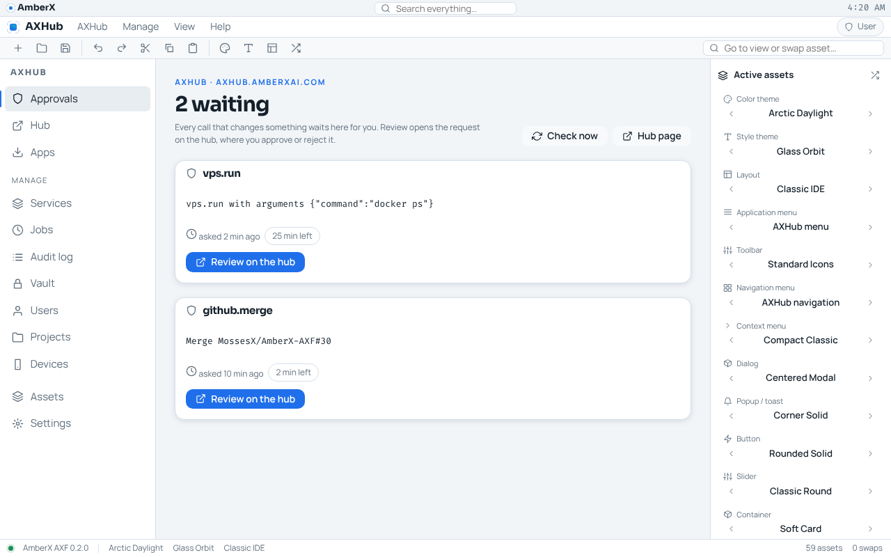
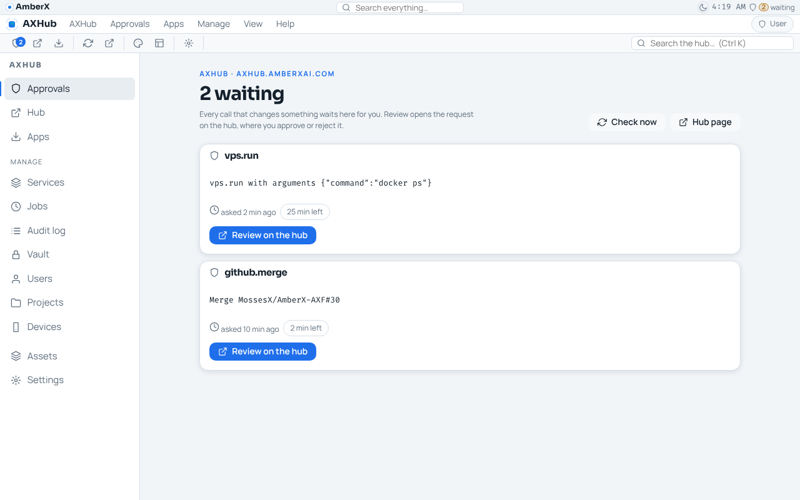
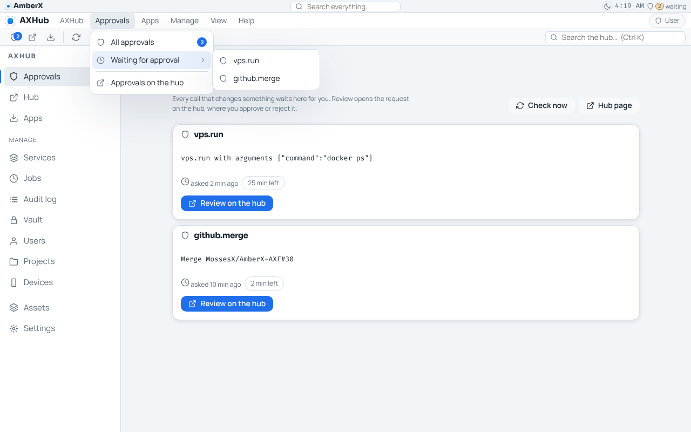
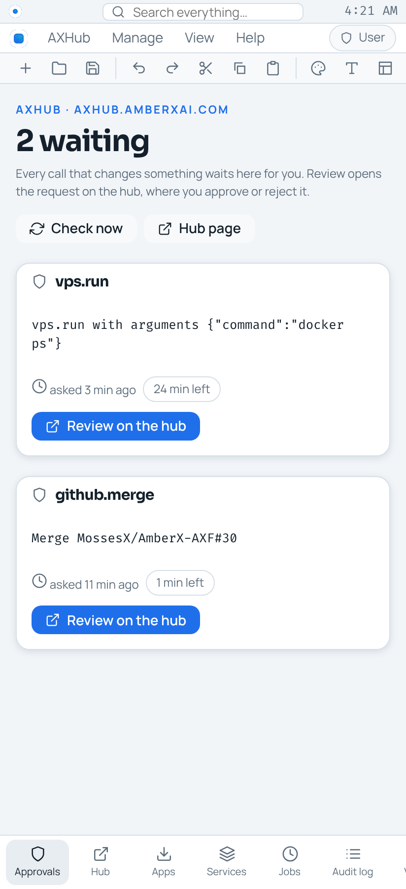
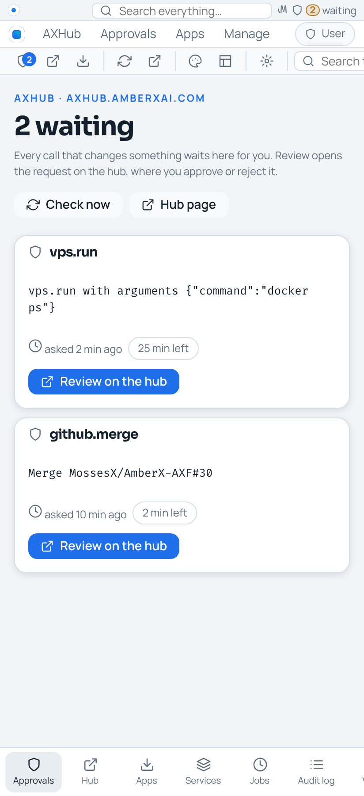

# axHub web app: console / Patches look + lib-hub harvest (Oct 23 2026, Opus)

Pending item **`axhub-web-console-look`** · branch `claude/project-thread-j1ri9d` · PR #30.

Brett asked (Oct 22 2026) to rebuild the axHub web app with the framework, its look and layout matching the Dev Console
and Patches, and to harvest libraries out of it. He chose that the AXF app serves the hub's UI (decision of Oct 22 2026:
`apps/axhub-web` is the page at `axhub.amberxai.com/`, the hub server keeps its API and wall and has no AXF code; the
serving itself landed in PR #36, `claude/axhub-web-on-hub`). On Oct 23 he chose to **keep the side nav and toolbar on
screen** (the console hides both); everything else follows the console.

## Before / after

| | Before | After |
| --- | --- | --- |
| Desktop |  |  |
| Menu |  |  |
| Phone |  |  |

Shots taken against a mocked hub (two waiting approvals, one app) in headless Chromium, desktop 1280×800 and phone 412 px.

## What changed in the app (`apps/axhub-web`)

- **Banner** = the console's `amberx-thin` (logo, search in the middle, day/night switch and clock on the right) plus the
  **approvals counter** (`counter/approvals`, "2 waiting", hidden at zero, tap → Approvals), attached at run time like
  the console's alerts bell. Removed before: no theme switch, no count.
- **Layout** `axhub-console` (new, default): menu bar under the banner, toolbar + left nav kept (Brett's pick), no
  inspector, no status bar, content 920 px like the console. `classic-ide` and `studio-dock` stay as choices.
- **Toolbar** `axhub-web` (new, default; replaces the generic `standard-icons` / `labeled-actions` / `text-commands`
  starters, which offered New file / Undo / Cut that do nothing here): Approvals with the waiting badge, Hub, Apps,
  Check now, Approvals on the hub, next colour / layout, Settings, and the console's live search box.
- **Application menu** `axhub-web` 1.0.0, laid out like the console's: AXHub (Approvals with badge, Hub, Search
  everything, Settings + Settings pages ▸, Account, Check now, Hub pages ▸, About), **Approvals** (All approvals,
  **Waiting for approval ▸** live list, on the hub), **Apps** (catalog, **Download the latest ▸** live list, on the hub),
  Manage (unchanged), View (Toolbar / Side navigation / Banner check marks, All bars and menus ▸, Look ▸, Spacing ▸,
  Appearance settings, Assets, Every page ▸, Navigation / Toolbar items ▸, Windows ▸, Dialogs ▸), Help.
- Pages keep their console structure (`fx-pagehead`, eyebrow, cards); Approvals now draws its cards and notes with
  lib-hub's `HubApprovalList` / `HubStatusNote`.
- Actions: `axhub.open:<page>` → lib-hub's `hub.open:<page>`; new `axhub.search` (focuses the live search box);
  `axhub.check` fires lib-hub's `checkHubNow()`. The framework was re-baked into `src/axf` (lock regenerated).

## What moved into lib-hub (`framework/libs/hub`, web)

- `apps.ts` (new): the `/apps.json` rules (`interpretApps`, `appDownloadUrl` = the only way a download link is made,
  caps 100 apps / 5 builds / 512 KB, `APPS_FEED_PATH`, `appsFeedUrl`, `fetchHubApps` with the feed's transport rules) and
  the display words (`formatSize`, `formatWhen`, `shortSha`, `expiry`, `statusNote`). From the app's `src/hub/feed.ts` +
  `client.ts` (deleted), unchanged in behaviour.
- `react.tsx` (new): `useHubApprovals(hub)` (one shared watcher per hub, ref-counted), `useHubApps(hub)`,
  `useHubBannerCount(hub, {counter, banner})`, `HubApprovalList`, `HubStatusNote`, `HUB_CHECK_EVENT` / `checkHubNow`.
- `menu.ts` (new): `installHubMenu(rt, {hub})`: live lists `hub.approvals`, `hub.apps` and actions `hub.open:<page>`,
  `hub.review:<id>`, `hub.download:<project>:<file>`; every link rebuilt from the hub address and checked with `isHub`.
- Fixture: `spec/fixtures/hub-approvals.json` gained an **`apps`** section (path, url, limits, 23 reply cases); nothing
  else in it moved. `spec/check-hub.mts` replays it and drives `fetchHubApps` (credentials, no redirects, size cap, bad
  address) and the display words.

## Security (unchanged rules)

No token anywhere; both feeds use the browser's hub session with redirects refused and capped replies; download and
approval links are rebuilt from the hub address and checked; nothing approves. The menu's live lists go through the same
code as the pages.

## Tests

- `npx -y tsx framework/spec/check-hub.mts`: 85 → **338** checks.
- `npx -y tsx apps/axhub-web/test.mjs`: 52 / 52 (now against the library).
- `apps/axhub-web`: `tsc --noEmit` + `vite build` clean; `axf validate apps/axhub-web` valid (57 assets).
- `check-theme`, `check-controls` clean.

## Gaps

- Kotlin twin of the catalog rules (replaying the `apps` section) and the Android AXHub app's Apps tab on them: deferred
  while Android is on hold (`spec/PORTING.md`), still pending item `axhub-web-hub-rules` (Fable).
- The console's approvals-banner plugin could use `HubApprovalList` / `installHubMenu` next time it is touched.
- The shared hub appearance document names the console's ids; ids this app doesn't ship (`focus-top`, `console-search`,
  `console`) fall back to this app's defaults, so the hub keeps its own toolbar, nav and menu.
