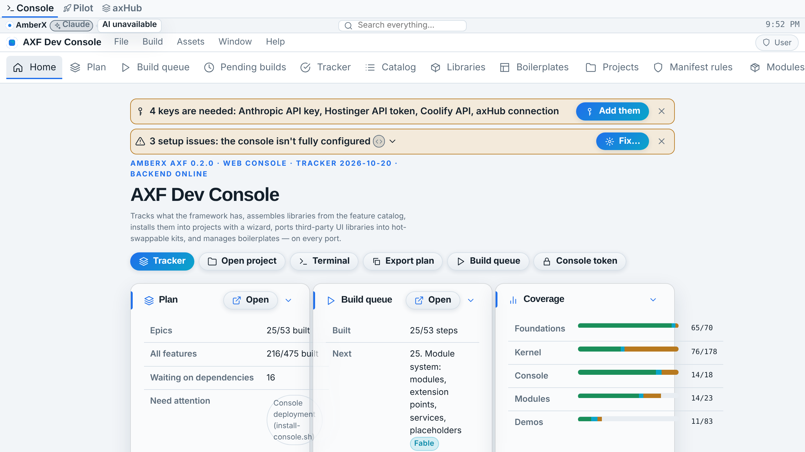
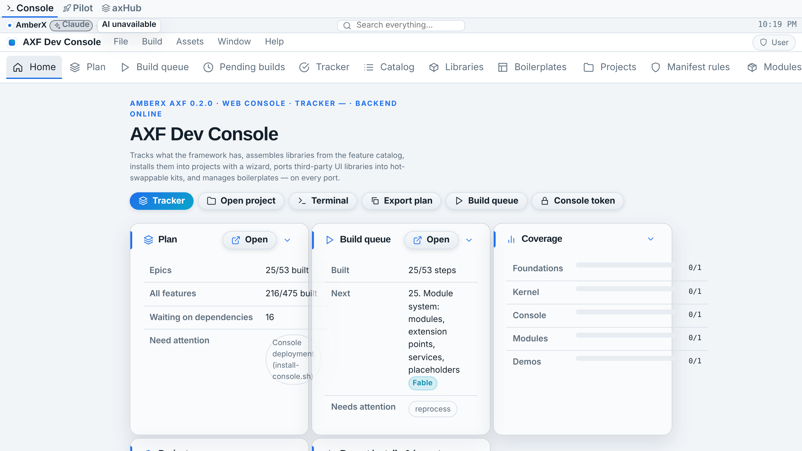
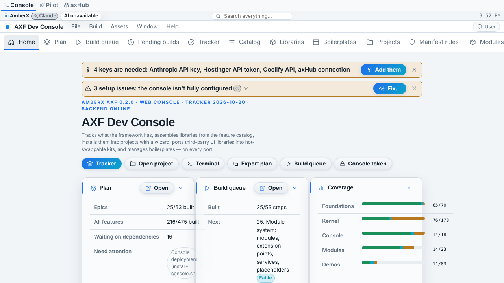
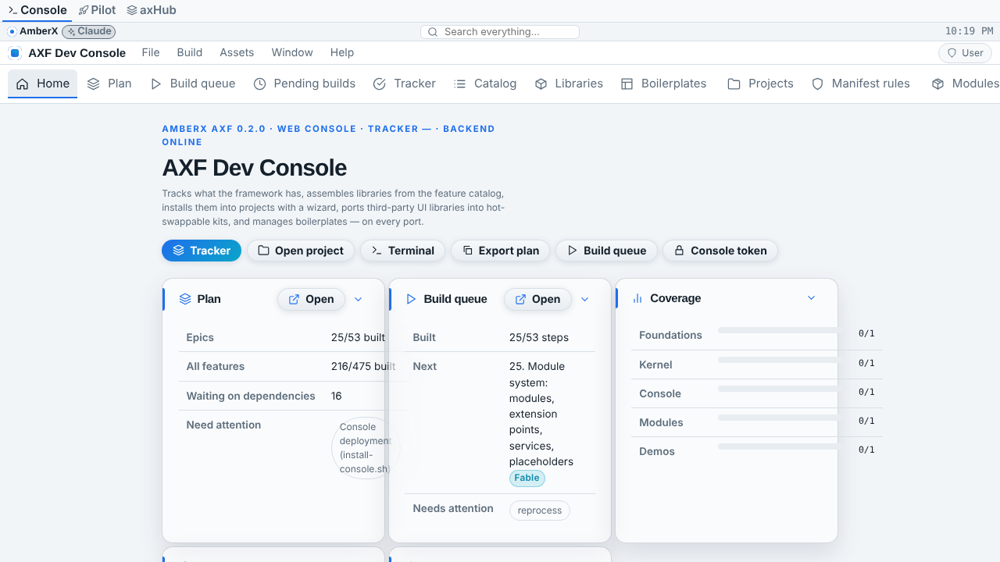
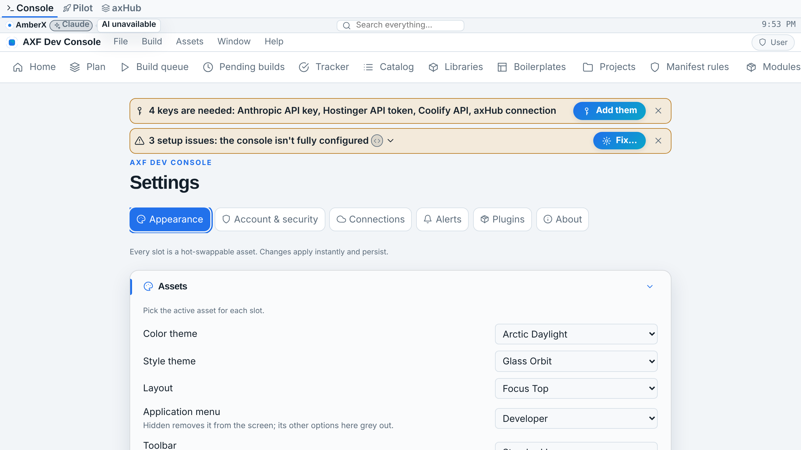
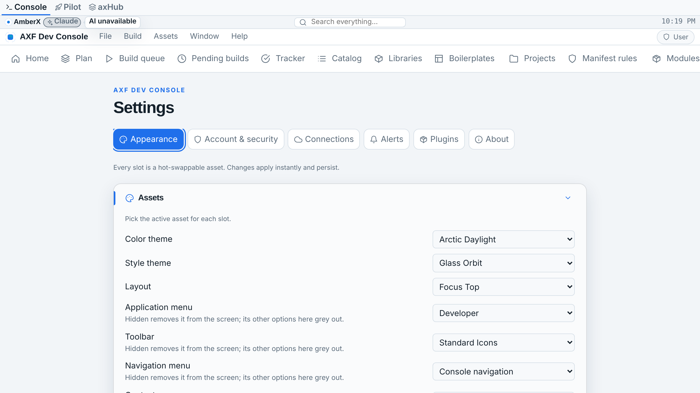
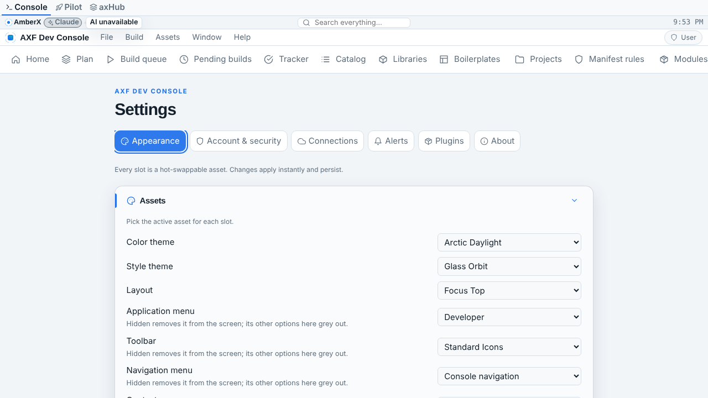
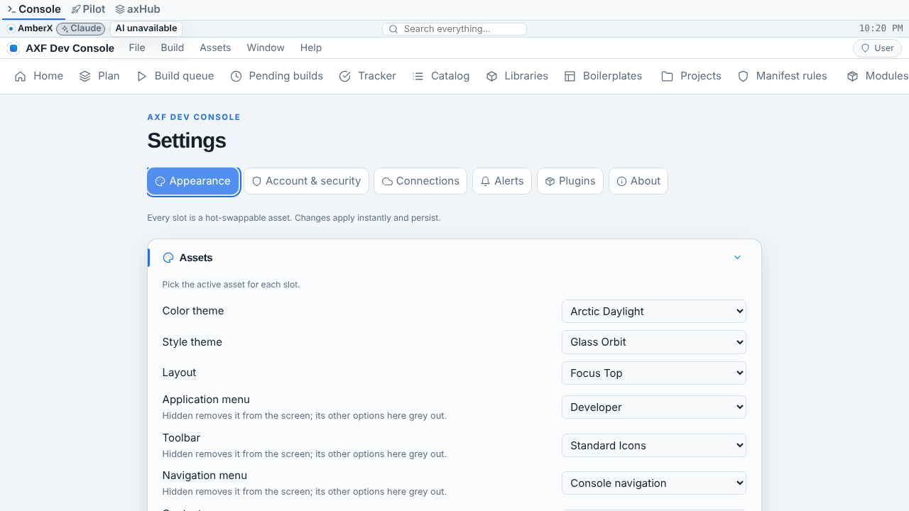

# Fable rebuild: `banner-assets` (Oct 20 2026, branch `fable/banner-widgets`)

Rebuilt together with `widget-assets` (see `widget-assets.md`; the two share the host engine). The banner, badge and clock asset types stay exactly as apps use them. What changed: the banner no longer hardcodes what it takes (the `banner.attach` block in `asset-types.json` is now the one definition read by the engine, every validator and both ports), bad attachments are caught at build time and at run time instead of vanishing, the runtime got one generic host store (banner + toolbar + any host a library registers) with `detachAll`, and the **Android Compose banner that Opus never built is here**: `AxfBanner` sits above the layout in every AXF Android app, with badges, pop-outs, the clock and the search bar, and the Android console shows it. Fixtures `banner.json` are byte-identical to the Opus set.

## Removed
- Nothing public. The hardcoded `ATTACHABLE_TYPES`/`BANNER_SIDES` literals in `banner.ts` and `BannerEngine.kt` are now derived from the spec (same values exported under the same names).
- `rt.bannerExtra` / `rt.toolbarExtra` private fields (replaced by one `hostExtra` map); no caller used them.

## Kept
- Asset types `banner`, `badge`, `clock` in `framework/schemas/asset-types.json`, all fields, enums, defaults, `"optional": true`, `"attachable": true`, `hideable`, roll rules.
- Starters `banner/amberx-thin`, `banner/amberx-accent`, `badge/new`, `clock/digital-12h|24h` (unchanged files).
- `spec/fixtures/banner.json` (byte-identical; `gen-fixtures.mts` regenerates it unchanged).
- Runtime API names on both ports: `assetOrNull`, `attachToBanner`, `detachFromBanner`, `banner()`, `showBannerPopup`, Kotlin `dismissBannerPopup`; `AxfState.bannerPopup`.
- React `Banner`, `BannerBadge`, `BannerClock` exports and every `.fx-banner*` CSS class; `claude-badge` plugin works unchanged.
- Every security guard: UAC gating of search results (hide/disable), no new routes, nothing new reaches the console MCP.

## Changed
- `framework/core/engines/banner.ts`: placement goes through `placeHost('banner', …)` from the widget engine; new `bannerHeight()`, `bannerSurface()` (unknown surface → `flat` instead of an unstyled bar), `clockTickMs()`, `BANNER_SURFACES`. `placeAttachments` always answers for the three sides even if a library replaced the host spec.
- `framework/core/runtime.ts`: one host store; `attachToBanner`/`attachToToolbar` are wrappers over `attachToHost(host, a)`. A bad attach (unknown host, type the host doesn't take, bad side, unregistered asset) is **reported in the output terminal** (channel `widgets`) instead of silently vanishing; the entry is still stored so it shows once the asset is registered. New `dismissBannerPopup()` on the web (parity with Kotlin).
- `framework/core/validate.ts`, `framework/cli/build-engine.mjs`, Kotlin `AssetValidator.kt`: validate `banner.attach` (and `toolbar.widgets`) entries — type must be one the host takes, side must exist, id non-empty, order a number. Same messages on all three. Fixture `validation.json` gained `banner-attach-bad`, `banner-attach-ok`, `toolbar-widgets-bad`; the Kotlin `ConformanceTest` now replays `validation.json` (it never did before).
- React `Banner.tsx`: clock timer aligns to the minute/second boundary (no drift, no 15 s polling); `<time>` element with the zone as tooltip; tapping a popup closes it; logo tolerates a missing `logo` block; `data-axf-origin` on items; banner marked `data-axf-search="off"` so its own words don't index.
- `apps/console-web/src/App.tsx`: a disabled plugin now has its items removed from **every** host (`rt.detachAll(id)`), not only the banner.
- Kotlin `BannerEngine.kt`: `HOST`, `SURFACES`, `surface()`, `clockTickMs()`; `ATTACHABLE`/`SIDES` read the host registry. `AxfRuntime.kt`: generic `attachToHost/detachFromHost/hostAttachments/detachAll` with the same terminal warnings as the web.
- `apps/console` (Android showcase): bundles the banner/clock/badge/search-bar starters and the manifest defaults name them, so the showcase draws the banner on first run.

## Added
- **Android Compose banner** `framework/android/axf-ui/.../components/Banner.kt`: `AxfBanner` (three sides as `1fr auto 1fr`, surfaces flat/raised/accent with `LocalBannerForeground` for accent text, divider, brand mark + logo text scaled to the height, context target `banner`), `AxfBannerBadge` (pill/icon/dot, tone tokens, `link` → action), the pop-out popup (auto-dismiss after its duration, tap to close). `AppShell` draws it above both grids (desktop and phone) and now owns the status-bar inset so the banner sits under the system bar once.
- `framework/spec/check-widgets.mts` (CI): replays `banner.json` + `widgets.json` through the reference engine, checks the TS and CLI validators agree on every `validation.json` case, and exercises the runtime host API (attach / replace / detach by origin / detachAll / warnings / hidden banner / popup). 93 checks.
- Kotlin `KernelTest.widget hosts: attach, replace, detach, warn` (runtime host API on a real kernel).

## Contract / API / fixture changes (old → new)
| Area | Old | New |
|---|---|---|
| `banner.attach` validation | not validated (bad entries skipped at run time) | validated on all three validators; same messages |
| `rt.attachToBanner` with a bad entry | silently dropped | stored + terminal warning (channel `widgets`) |
| `rt.dismissBannerPopup()` (web) | missing | added (Kotlin already had it) |
| `rt.detachAll(origin)` | missing | added, both ports |
| `bannerSurface()` | n/a (unknown surface → bare `.fx-banner`) | unknown → `flat` |
| Fixtures `banner.json` | — | **unchanged** |
| Fixtures `validation.json` | 10 cases | 13 cases (3 added; old ones unchanged) |
| Android banner UI | none | `AxfBanner` in `AppShell` |

Migration: none needed. Apps and plugins using the Opus API keep working (`claude-badge` unchanged). A banner asset with a mistyped `attach` entry that used to validate will now fail `axf validate` with a precise message; fix the entry.

## Tests
- Before (Opus): `axf validate --framework` ✓ 48 assets; `gen-fixtures` idempotent; Kotlin `ConformanceTest` banner/widget tests existed but were never compiled (no Maven); no web-side fixture replay for banner/widgets; tsc clean.
- After: `axf validate --framework` ✓ 48, `validate apps/console-web` ✓ 49, `validate apps/demo` ✓ 39; `gen-fixtures` → old fixture entries byte-identical; **`check-widgets.mts` 93 checks** (new, in CI); `check-alerts`, `check-project-fixtures` (16), `tracker --check`, `plugins --check`, `check-theme` (186 files) all pass; `tsc --noEmit` clean; console `vite build` ok. Kotlin: Maven unreachable here, so the kernel engines (`WidgetEngine`, `BannerEngine`, `SearchEngine`) were compiled with a standalone kotlinc 2.0.21 against a kotlinx-json stub and replayed every banner/widgets/search fixture: **88 checks ok**. The rest of the Kotlin (runtime, UI, tests) was parse-checked file by file; full compile + `ConformanceTest`/`KernelTest` run on CI ("CI build errors" issue).

## Security
- Guards kept: search results stay UAC-gated (`hide` dropped, `disable` locked and refused on pick with a toast); no new console routes; nothing exposed via MCP.
- Tightened: attachment lists are validated at build time (an asset can no longer carry a malformed `attach` that only shows up as a silent run-time gap). Run-time attachments from a disabled plugin are removed from every host, not only the banner.

## Screenshots (web console, before = Opus `d2f58a9`, after = this branch)
Banner on the home view (logo, Claude badge, search in the centre, clock right); visually unchanged by design — the rebuild is engine/API/Android work.

| | before | after |
|---|---|---|
| phone |  |  |
| desktop |  |  |
| Appearance → Assets (banner slot, hideable) phone |  |  |
| Appearance → Assets desktop |  |  |

Android screens affected (Android screenshots pending CI): every screen of the Android console (banner above the layout, phone + desktop window classes), the banner's badge pop-out, hidden-banner state (Settings → Appearance → Banner → Hidden).

## Known gaps
- Kotlin written without Maven: engines compiled and replayed locally with kotlinc; Compose UI, runtime and tests compile on CI only.
- Android badge `link` runs through `AxfActions.dispatch` (same as toolbar items); no long-press tooltip yet (content description only).
- The Android banner has no Compose `@Preview` yet (would need the preview tooling dependency in axf-ui); name reserved: `BannerPreview`.
