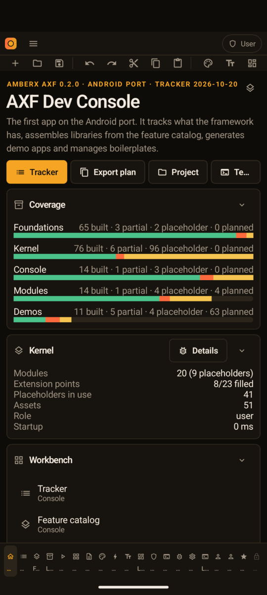
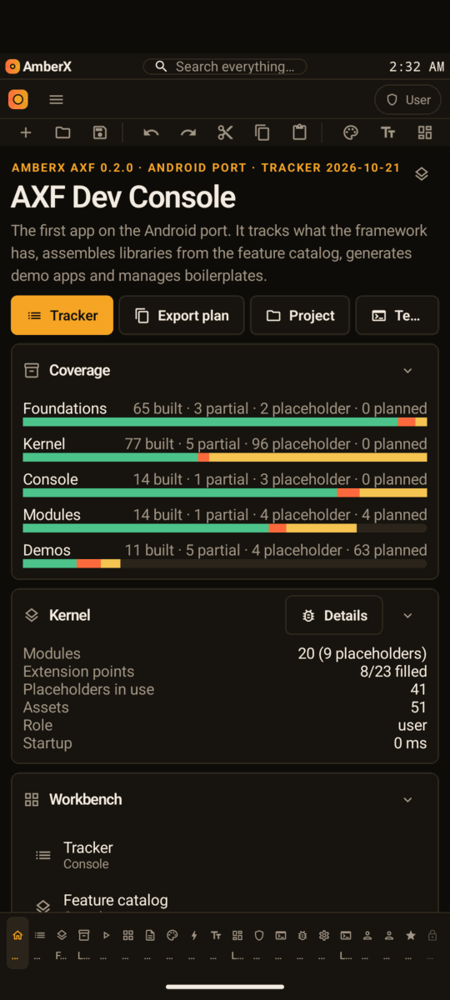

# Android screenshots — before / after

Captured automatically by `.github/workflows/rebuild-shots.yml` on an API 34 emulator (Pixel 6, demo-mode status bar).
Before = `333f607dc412`, after = `e9865fa1096d` — [run](https://github.com/MossesX/AmberX-AXF/actions/runs/39532779043). ✓ = the capture reached that screen through the app's own nav; ? = it didn't (e.g. an app lock in front).

## axf-console-android

| Screen | Before | After |
|---|---|---|
| Start | ✓  | ✓  |
| Home | ?  | ?  |
| Tracker | ?  | ?  |
| Features | ?  | ?  |
| Libraries | ?  | ?  |
| Demos | ?  | ?  |
| Modules | ?  | ?  |
| Boilerplates | ?  | ?  |
| Assets | ?  | ?  |
| Components | ?  | ?  |
| Designer | ?  | ?  |
| Layouts | ?  | ?  |
| Roles | ?  | ?  |

## axhub-android

This app sets FLAG_SECURE (screens can't be captured, by design), so its captures came back empty.

| Screen | Before | After |
|---|---|---|
| Start | 🔒 blocks screenshots | 🔒 blocks screenshots |
| Approvals | 🔒 blocks screenshots | 🔒 blocks screenshots |
| Hub | 🔒 blocks screenshots | 🔒 blocks screenshots |
| Apps | 🔒 blocks screenshots | 🔒 blocks screenshots |
| Services | 🔒 blocks screenshots | 🔒 blocks screenshots |
| Jobs | 🔒 blocks screenshots | 🔒 blocks screenshots |
| Audit log | 🔒 blocks screenshots | 🔒 blocks screenshots |
| Vault | 🔒 blocks screenshots | 🔒 blocks screenshots |
| Users | 🔒 blocks screenshots | 🔒 blocks screenshots |
| Projects | 🔒 blocks screenshots | 🔒 blocks screenshots |
| Devices | 🔒 blocks screenshots | 🔒 blocks screenshots |
| Settings | 🔒 blocks screenshots | 🔒 blocks screenshots |

## voice-vault

This app sets FLAG_SECURE (screens can't be captured, by design), so its captures came back empty.

| Screen | Before | After |
|---|---|---|
| Start | 🔒 blocks screenshots | 🔒 blocks screenshots |
| Voice | 🔒 blocks screenshots | 🔒 blocks screenshots |
| Saved sites | 🔒 blocks screenshots | 🔒 blocks screenshots |
| Voice triggers | 🔒 blocks screenshots | 🔒 blocks screenshots |
| Settings | 🔒 blocks screenshots | 🔒 blocks screenshots |
